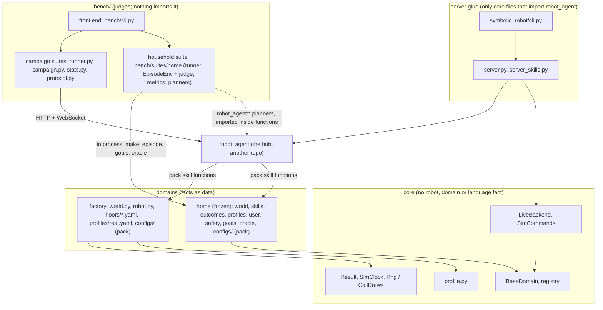

# symbolic_robot docs site: plan (part 1)

Planned at: `a5cc7a4943aaf1ac9603f14fab10bf8889d46278` (main, in sync with origin, commit date 2026-11-18).
Uncommitted at planning time: `docs/home/bench/lora.md` (1 line changed). Nothing on the site may quote it; quote the committed
text with `git show a5cc7a4:<path>`. This file (`website/PLAN.md`) is not committed.

Planned on 2026-11-19. All runs were made on a copy of the pinned commit (`git archive a5cc7a4 | tar -x` into a scratch folder,
the test split file removed from the copy), never in the repository. Every command below was run with
`PYTHONDONTWRITEBYTECODE=1` and `-B`.

How to read this plan:
- `file:line` refers to the pinned commit.
- "RUN" means I ran it and the value is the real output. "READ" means I read it in the code and did not run it.
- "not run" is stated wherever it applies.
- Excerpt ranges were checked against the repository's private-name patterns (`tests/test_layering.py:11-12`) and are clean.
- Part 2 (what is left) is listed in section 7.

Portable Markdown profile for every page (the site engine is chosen later):
- headings, paragraphs, tables, fenced code, ```` ```mermaid ```` blocks;
- admonitions of four kinds only: `note`, `warning`, `abstract` ("In this page"), `code` ("Where in the code");
- tabs rarely; no engine-specific components, no raw HTML, no `# (1)` code annotations (explain lines in the text below the block instead).

---

## 1. Audience and promise

**Who reads it.** Three groups, in this order of priority:

| reader | comes with | wants to leave with |
|---|---|---|
| A researcher who benchmarks task planners | knows LLM planning and statistics; does not know this repo | how to run the household benchmark on their planner, what a number means, how to compare two planners honestly |
| A developer who adds a domain or a suite | knows Python; does not know the protocol | the hooks to implement, the data files to write, the tests that will check them |
| Someone who runs the simulator behind robot_agent | knows robot_agent (the hub) | how `python -m symbolic_robot run` presents a domain to the hub, what it needs, what it does not do |

**Promise (one line for the home page).** "Test a robot task planner against a small symbolic world whose failures come from
declared probabilities, and compare planners with paired tests that the same seed makes exact."

**Two sentences.** `symbolic_robot` is one engine for simulated robots whose skills do not run for real: each call checks
preconditions on a small symbolic world, draws its outcome from probabilities written in YAML, and returns a result plus a hidden
`truth` record. A separate package, `bench/`, runs planners on it, judges them from the truth and never from the planner's own claim,
and compares them on the same tasks and seeds.

**In and out.**
- In: a planner (a Python class, or robot_agent's loops), a task split, a profile (`ideal`, `real` or `stress`) and seeds.
- Out: `episodes.jsonl`, `summary.json` and `report.md`. A paired comparison of two run folders is printed by `compare`.

**What the site must not promise.**
- It does not drive a real robot, has no physics and does not run live demos (`README.md:3-5`).
- A number from it is a simulated result.
- It reproduces no task data; results are quoted as aggregates only (section 8).

**Voice.** Same as the finished embodiplan site: short sentences, "In this page" box at the top, "Where in the code" box with
links pinned to the commit, tables for inputs and outputs, real values only, "not run" said plainly.

**Relation to the framework site.** The robot_agent site already has a satellite page for this repo and a guide "Benchmark a
planner" (both verified at `f55ace24c3b4`). This site goes one layer deeper.
- It reuses their verified facts: the layer table, the move example with seeds 3, 3, 4, the oracle and naive smoke numbers, the
  McNemar output, the "test split refused by the front end only" finding.
- It contradicts none of them.
- It refines two:
  - the core `CallDraws` exists but neither domain uses it (finding F1);
  - the headline interval in `report.md` is a task-clustered Wilson interval, not the plain episode Wilson interval (F9).
- Link to the framework pages for how the hub side works; do not copy them.

---

## 2. System diagram (mermaid draft)



Notes for the writer:
- The household domain uses only `BaseDomain` from the core. It has its own seeded streams, clock, profile loader and result type
  (`SkillResult`). READ: `grep` of its imports shows `symbolic_robot/domains/home/domain.py:10` is the only import from the core.
  Draw it that way.
- The factory domain uses `Rng`, `SimClock`, `Result` and `profile.py` from the core (`domains/factory/robot.py:5-8`, `profiles.py:6`).

**One run end to end (household benchmark, the path most readers take).** RUN with `--planner oracle --split dev --limit 20 --profile real --seeds 2`.

1. `python -m bench run --domain home --suite run ...` enters `bench/cli.py:105-109`. `_own_cli` (`bench/cli.py:88-102`) sees that the
   suite `home/run` has a `delegate`, so every other argument goes to it unchanged.
2. `delegate` (`bench/suites/home/register.py:30-36`) refuses `--split test` (`register.py:20-27`), adds `--out`, prints the command
   and calls `bench.suites.home.cli.main(["run", ...])`.
3. `cmd_run` (`bench/suites/home/cli.py:123`) calls `run_many` (`bench/suites/home/runner.py:237`). It loads the split
   (`tasks.py:109`), takes the first 20 tasks and loops tasks x seeds.
4. `run_episode` (`runner.py:59-101`) builds an `EpisodeEnv` (`env.py:202-273`), which calls the domain's
   `make_episode(house, seed_state, profile, derive_seed(task_id, seed), key=f"{task_id}|{seed}")` (`env.py:211-212`;
   `domains/home/episode.py:120-139`).
5. The planner's `run(env)` calls `env.call(skill, **args)` (`env.py:349-389`), which goes to `Robot.call`
   (`domains/home/skills.py:294-308`). That validates the arguments, draws a 14-slot uniform vector keyed by
   (seed, key, "outcome", skill, arguments, n-th call) (`skills.py:337-345`) and runs the skill handler.
6. The planner ends with `env.finish(status)`. `EpisodeEnv.record` calls `judge` (`env.py:552-594`), which evaluates each subtask's goal
   on the true world with `domains/home/goals.py:evaluate`.
7. `write_run` (`runner.py:322-333`) writes `episodes.jsonl`, `summary.json` (`metrics.summarize`) and `report.md` (`report.render`).

**One run end to end (campaign suite, factory). READ, not run.** It needs robot_agent, the `server` extra and an LLM.
1. `cmd_run` (`bench/cli.py:27-52`) registers the protocol hash.
2. `orchestrate.server` starts `python -m symbolic_robot run` on a free port (`orchestrate.py:62-75`).
3. `run_campaign` (`campaign.py:14-46`) calls `run_episode` (`runner.py:85-107`) for every (task, repeat, arm). That posts
   `/skill/reset_world`, drives `/ws/agent` and answers `listen` events with the suite's scripted person.
4. It reads `/agent/sim_world/get` and judges success as "the object is at its destination" (`runner.py:93`).

---

## 3. Key ideas (in the order a newcomer needs them)

Each idea is 3-4 lines on `how-it-works/key-ideas.md`, linking down.

### K1. A skill does not move anything: it checks, draws, applies and reports
- **Statement.** A skill call checks preconditions on a symbolic world, draws its outcome from declared probabilities, changes the
  world, advances a simulated clock, and returns a result with a hidden `truth`.
- **Why it matters.** Thousands of episodes run in seconds. RUN: 40 oracle episodes took 1.8 s wall.
- **Evidence.** `symbolic_robot/result.py:7-14`; factory `robot.py:53-70`; household `skills.py:1-9` (the seven-step docstring).
- **Background.** B1. **Module.** M1, M10, M16.

### K2. Failure rates are data with a source label, and `ideal` and `stress` are derived from `real`
- **Statement.** Every number is a YAML parameter `{kind, value, source, note}`. `ideal` sets every probability to 0; `stress` scales
  them.
- **Why it matters.** A planner's score can be read against "no faults", "plausible faults" and "twice or three times the faults"
  without editing code. Every number can be traced to a paper or is marked as assumed.
- **Evidence.**
  - Core: `symbolic_robot/profile.py:71-87`, `factory/profiles/real.yaml:4-5` (`stress: {scale: 3.0}`).
  - Household: `profiles/ideal/profile.yaml:1-10`, `profiles/stress/profile.yaml:5-10` (factor 2.0, cap 0.95).
  - RUN: the household `real` profile has 113 parameters, 58 with a source URL and 55 marked `assumed`.
- **Background.** B2. **Module.** M2, M17.

### K3. The same seed gives the same run, call by call (common random numbers)
- **Statement.** A draw depends on (seed, key, n-th use) or (seed, skill, arguments, n-th call), hashed with SHA-256. It does not
  depend on the wall clock, on Python `hash()` or on unrelated calls.
- **Why it matters.** Two planners that make the same call in the same episode get the same outcome. So a paired test compares the
  planners, not their luck.
- **Evidence and RUN results.**
  - `symbolic_robot/rng.py:15-24`; household `rng.py:23-42`, `outcomes.py:1-6`.
  - Household: a `wait` inserted before `move` + `find` leaves both outcomes and durations unchanged.
  - Two identical oracle runs: `diff -r` empty.
  - The household selftest writes byte-identical files for the same arguments.
- **Background.** B3. **Module.** M1, M16.

### K4. One protocol, two engines behind it
- **Statement.** A domain is a `BaseDomain` subclass. Every hook has a safe default that does nothing. The core and the server know
  nothing else.
- **Why it matters.** The factory (about 900 lines) and the frozen household simulator (about 10,000 lines with its own rng,
  clock and profiles) are served by the same backend and `sim_command` handler. A new domain needs no core change: `tests/toy.py`
  is a complete one.
- **Evidence.** `symbolic_robot/domain.py:12-84`, `registry.py:11`, `tests/toy.py:42-64`, `domains/home/domain.py:31-62`.
- **Background.** B1, B4. **Module.** M3, M14.

### K5. The judge reads the truth, and lives where the planner cannot import it
- **Statement.** Success is decided on the true final world (household: goal atoms; factory: the object's final place). The
  planner's claim only adds "false success" when it is wrong. Judging code is only in `bench/`, and a test forbids the core and the
  domains from importing `bench`.
- **Why it matters.** A planner that says "done" too early is caught, not rewarded.
- **Evidence.**
  - `bench/suites/home/env.py:552-594` (the line `success = all(correct) and order_ok and status_ok and not sem`, `env.py:586`);
    `bench/runner.py:93-100`; `tests/test_layering.py:39-41`.
  - RUN: `naive` in `real` has false success 0.025 (1 of 40); `oracle` 0.0.
- **Background.** B5. **Module.** M24, M21.

### K6. Compare planners in pairs, with the task as the unit
- **Statement.** Run both planners on the same tasks and seeds, then test the discordant pairs. The household benchmark uses McNemar
  on (task, seed) plus two task-level tests; the campaign suites use a sign test on tasks plus bootstrap intervals.
- **Why it matters.** Seeds of one task are correlated. The task-level tests are the ones to quote.
- **Evidence and RUN results.**
  - `bench/suites/home/metrics.py:369-437`, `bench/stats.py:27-80`.
  - Oracle vs naive: pair test p = 0.0078; task-majority McNemar p = 0.0625; task sign-flip p = 0.0324.
- **Background.** B6. **Module.** M25, M21.

### K7. A planner is a plug-in with one method, and privileged references are labelled
- **Statement.** A planner is any class with `name`, `privileged` and `run(env)`, named in the registry or as `package.module:Class`.
  Only `oracle` and `naive` may read `env.truth`.
- **Why it matters.** You can benchmark your own planner without touching the repo. The upper references are marked so nobody
  compares a planner's claim with an oracle's.
- **Evidence.** `bench/suites/home/planners/base.py:31-36`, `planners/__init__.py:104-131`, `env.py:276-291`.
- **Background.** B7. **Module.** M26, M27.

### K8. The rules are enforced by tests, not by good will
- **Statement.** Layering, the private-name ban, the size limits and the frozen behaviour of the household simulator are all
  checked by tests.
- **Why it matters.** A contributor sees at once what will break.
- **Evidence and RUN results.**
  - `tests/test_layering.py`, `tests/size_baseline.json`.
  - `tests/test_home_baseline.py`: the oracle and naive runs are byte-identical to the baselines recorded before the merge.
    I called its parametrised test by hand for all 3 cases: OK.
- **Module.** M31, M32.

---

## 4. Background chapters (`learn/*.md`)

Order: from "what is it" to "how to run it for real". Each chapter opens with an `abstract` box and closes with a `code` box.

### B1. Symbolic worlds, skills and the hidden truth (`learn/symbolic-worlds.md`)
- **Must teach.**
  - What a symbolic world is: places with an id `name@zone` or `name@room`, objects with an `at` field, a robot with `at` and
    `holding`, open containers.
  - A skill as precondition, outcome, effect and duration.
  - The `Result` / `SkillResult` fields.
  - Failure codes: the 11 values of `domains/home/types.py:13-26`, the same as robot_agent's `FailureCode` (checked by
    `tests/home/sim/test_types.py` when robot_agent is importable; not run here).
  - "truth" vs "what the robot reports": the household robot keeps a `believed` state that a silent slip makes differ from the truth
    (`skills.py:310-329`).
- **Real values (RUN, factory `small_workshop`, profile `real`, seed 0).**
  - `move(target="main bench")` gives `ok`, 14.078 s, truth
    `{"leg": {"from": "charging_dock@entry", "to": "main_bench@bench_area", "dist": 8.062}}`.
  - `move(target="forklift lane")` gives `blocked`, truth `{"hazard": "entered_forklift_lane", ...}`.
  - `fly()` gives `software` "unknown skill fly".
- **Real values (RUN, household `studio_flat`, `real`, seed 0).**
  - `find(obj="book")` returns `absent`, `injected: true`, truth event `miss`.
  - The next `pick(obj="book_1")` succeeds, because the grasp camera looks again (`skills.py:724-728`).
- **Figure.** A two-column strip, "what the planner sees" (`public()`) vs "what the judge sees" (`to_json()` with `truth`, `injected`)
  for the household `find` above. Use the printed JSON; trim nothing but long lists.

### B2. Declared outcome probabilities and profiles (`learn/declared-outcomes.md`)
- **Must teach.**
  - The parameter record (core: `{kind, value, source, note}`; household: plus `role`, `where`, `assumed`).
  - The kinds `prob`, `prob_map`, `split` (failure-code shares, inverse CDF over sorted labels, `profile.py:45-52`,
    `outcomes.py:325-334`), `range`.
  - How `ideal` and `stress` are derived:
    - core: `x3` capped at 1, only when `real` declares `derive.stress.scale`;
    - household: roles `failure`, `user_noise` and `safety_noise` set to 0 for `ideal`; failure probabilities x2 capped at 0.95 for
      `stress`, recovery probabilities not scaled, sourced overrides.
  - The `ideal: keep` flag (`profile.py:9-11`).
  - "Assumed" parameters are allowed and listed.
- **Real values.**
  - Factory, RUN: `slip` real 0.05 / ideal 0.0 / stress 0.15000000000000002; `speed_mps` 0.8 in all three; the ideal source label
    reads "ideal profile: failure switched off (real: invented, round number)".
  - Household, RUN: `move.p_fail` `{low: 0.0067, medium: 0.02, high: 0.025}` (real) and `{0.0134, 0.04, 0.05}` (stress);
    `open.p_fail` `{door: 0.21, drawer: 0.167}` (real) and `{0.5, 0.5}` (stress override, source arXiv 2401.14403).
  - Profile hashes: real `fe93eed0af9c`, ideal `cfe3574d0bad`, stress `c1f81f714ba9`.
- **Figure (measured, RUN 2026-11-19).** Factory detector miss over 2,000 seeds per profile, `small_workshop`, `move` to the main
  bench then `find(large wrench)`:

  | profile | declared | measured miss among finds | finds |
  |---|---|---|---|
  | ideal | 0 | 0.0 | 2000 |
  | real | 0.10 | 0.0942 | 1954 |
  | stress | 0.30 | 0.3094 | 1884 |

  The remaining episodes failed the move with `hw_fault`: 46 (real), 116 (stress). Draw it as a bar chart, declared vs measured.
  - The household equivalent is the consistency check (`domains/home/consistency.py:1-10`: 20,000 calls per parameter, exact
    binomial test at 0.1 %). Not run here.
- **Link.** For rationale, the repo's `docs/home/sim/calibration.md` and `profiles.md`. Link only; their text uses old package names.

### B3. Determinism by seed (`learn/determinism.md`)
- **Must teach.**
  - SHA-256 of a joined text gives 64 bits (`rng.py:23-24`, `derive_seed` `rng.py:34-35`, household `rng.py:13-15`).
  - The n-th use counter, and why it is per key: another key does not shift this one (`tests/test_core.py:80-87`).
  - Three schemes and who uses which:
    1. core `Rng` (factory and `tests/toy.py`);
    2. core `CallDraws` (16 slots per call; used by no domain at this commit, only by `tests/test_core.py:96-105`, finding F1);
    3. household `Streams.rng_for("outcome", skill, canon_args, nth)` feeding a 14-slot vector named by `outcomes.U`
       (`outcomes.py:252-270`, `skills.py:337-345`).
  - Slots: each rule reads its own slot, so rules do not steal numbers from each other.
  - The episode seed and key in the household runner: `derive_seed(task_id, seed)` and `key = "task_id|seed"` (`env.py:211-212`).
  - The campaign seed `task_number * 100 + repeat` (`bench/runner.py:79-82`).
  - Simulated time only: `SimClock` (`clock.py:5-11`; the household clock refuses a negative dt, `domains/home/clock.py:11-16`).
  - What breaks determinism: an LLM. Use `--llm cache-only` or a shared cache (`llm.py:1-12`, `shared_cache.py`; not run).
- **Real values (RUN).**
  - `Rng(5).uniform("x")` gives 0.10508243923211916 the first time and 0.3446454403780886 the second; a fresh `Rng(5)` gives the
    first value again.
  - `derive_seed(1, "a")` = 15374730731433132414.
  - Factory `stress` move rows: seeds 3, 3, 4 give `['ok','ok','ok']` 16.13 s, the same again, and `['ok','hw_fault','ok']` 11.0 s
    (same as the framework page).
- **Figure.** A small table: household `move` then `find` with and without a `wait` before them; identical outcomes and durations
  (4.384 s, 3.76 s). RUN.

### B4. Packs, manifests and the hub (`learn/packs-and-manifests.md`)
- **Must teach.**
  - A pack is robot_agent's plug-in format, kept in `domains/<name>/configs/`. It holds `manifest.yaml`, `adapter.py`,
    `skills_config.py`, `ra_skills.py`, `tasks.py` (ENV), `backend.py`, `safety/*.yaml`.
  - Skill functions return the legacy dict `{isdone, msg, code?, **data}` (`result.py:16-22`).
  - ENV: one entry per place, with `loc`, `aliases`, `openable`, `surface` and `search: false` for the dock and keep-out lanes
    (`factory/configs/tasks.py:11-32`).
  - Why robot_agent may be imported only here and in the server glue (`tests/test_layering.py:49-63`).
  - `install_pack` hands the live backend to the pack (`domain.py:70-71`, `factory/configs/backend.py:7-17`).
- **Real values (RUN).**
  - `env_for(small_workshop)` has 9 entries for 10 places (the lane is left out).
  - The dock entry has aliases `['charging dock', 'charging dock in the entry', 'charge', 'charging', 'charging station']` and
    `search: False`.
- **Not run.** `check_manifest`, any hub import.
- **Warning box.** Reuse the framework page's verified warning: the ROS-off switch is not on the hub's `main`. Link to it; do not
  restate the hub code.
- **Figure.** The pack's files as a table: file, what robot_agent reads from it, the factory example.

### B5. The benchmark protocol: suites, splits, arms, runner, judge (`learn/benchmark-protocol.md`)
- **Must teach.**
  - What a suite is: `bench/suite.py:9-31`, the two kinds (campaign vs delegate).
  - Splits: train 4,000, dev 1,000, test 5,000 lines (line counts at the pin). Dev is for development; the test split is never read
    outside the benchmark's own protocol (CLAUDE.md rule 4).
  - Arms are run options of one planner (factory, `bench/suites/factory/arms.py:7-17`).
  - Budgets: 60 calls, 1,800 simulated s, 30 LLM calls (`env.py:40-46`).
  - Statuses: `done`, `refuse`, `give_up`, plus `error`, `budget`, `replay_miss` (`env.py:33-34`).
  - The judge rule in plain words (four conditions, `env.py:568-590`).
  - Pre-registration: `PROTOCOL_SHA256` (`bench/protocol.py:15-28`).
  - Infrastructure failure is not a score: `InfraError` stops the run (`runner.py:43-45`, `runner.py:85-86`); more than 5 % planner
    errors gives a non-zero exit (`runner.py:27`).
- **Real values (RUN, aggregates of the dev split, for the label mix only, no task text).**
  - Kinds: feasible 817, clarify 138, refuse 45.
  - Subtasks per task: 1 = 467, 2 = 318, 3 = 215.
  - Every task has `en` and `ko` text.
  - Source: 602 LLM paraphrases, 398 templates.
  - Houses in dev: 6 of the 8 (`korean_apt_59` 271, `couple_flat` 230, `family_house` 173, `senior_flat` 120, `shared_flat` 106,
    `studio_flat` 100).
  - Goal predicates used: `on` 494, `delivered` 490, `in` 293, `docked` 201, `said_to` 149, `unmoved` 91, `open` 41, `closed` 25.
  - Source: `bench/suites/home/data/tasks/dev.jsonl` at the pin, 1,000 records, counted 2026-11-19.
- **Figure.** A flow: task, then `EpisodeEnv`, then the planner loop (`observe`, `call`), then `finish`, then `judge` on the true world,
  then the record. Plus a 2x2 table: claimed / not claimed x goal holds / does not hold, naming success, false success and give-up.

### B6. Paired tests (`learn/paired-tests.md`)
- **Must teach.**
  - Why pairing (same task, same seed, same draws: B3).
  - Discordant pairs b and c.
  - McNemar: exact binomial when b + c < 25, else chi-square with continuity correction (`metrics.py:419-437`).
  - Clustering of seeds within a task, so: majority per task (`metrics.py:393-398`) and the task sign-flip permutation test
    (10,000 permutations, seed 0, `metrics.py:369-390`).
  - The Wilson interval (`metrics.py:27-35`) and its task-clustered form with an effective sample size (`metrics.py:48-74`).
  - The campaign suites' different method: per-task means, exact sign test with ties dropped, the combined
    "success first, then distance with a tie band of max(0.5 m, 5 %)" criterion, 10,000-resample bootstrap with seed 0
    (`bench/stats.py:10-80`). The A/A arm `A2` measures noise.
  - Mark as general knowledge, not verified here: the statistical properties of McNemar and of the bootstrap. Cite a textbook,
    not the repo.
- **Real values (RUN).** The McNemar output of oracle vs naive: 40 pairs, b = 8, c = 0, p 0.0078; per-task majority p 0.0625;
  sign-flip statistic 4.0, p 0.0324. Plus the interval refinement:

  | interval | value | source |
  |---|---|---|
  | `success_ci95` (in the headline) | [0.667847, 0.917035] | task-clustered, n_eff 34.503817, ICC 0.159292, design effect 1.159292 |
  | `success_ci95_episode` | [0.6805, 0.912546] | plain Wilson of 33 of 40 |

- **Figure.** The 2x2 pair table for oracle vs naive (33 and 25 successes; b = 8, c = 0).

### B7. Planners as plug-ins (`learn/planners-as-plugins.md`)
- **Must teach.**
  - The `Planner` protocol, `StepPlanner` (`act(obs)` until `Finish`), `PlanPlanner` (`base.py:31-80`).
  - `Observation` fields (`env.py:101-128`).
  - The registry and `package.module:Class` names (`planners/__init__.py:104-131`).
  - `needs_llm`, `privileged` (`env.truth` is `None` and `env.goal` raises `PermissionError` otherwise, `env.py:276-291`).
  - The three groups: references, baselines in the style of published planners, robot_agent planners. Reuse the framework page's
    table.
- **Real values (RUN).**
  - 58 registered names, 52 of them `robot_agent:*`.
  - Here 6 are available: robot_agent is not importable.
  - The `GiveUp` floor planner of the framework guide is the minimal example; RUN it again before publishing (not rerun here).
- **Figure.** A table of the planner interface: attribute or method, type, required or optional, used by.

---

## 5. Modules (one entry per page; 32 pages)

Front matter for every page:

```yaml
---
sources: [<paths below>]
verified_at: a5cc7a4943aa
---
```

Code links: `https://github.com/mtbui2010/symbolic_robot/blob/a5cc7a4943aa/<path>#L<a>-L<b>`.

Shared notes for all module pages:
- "Tests" lists files; "RUN-stub" means the fixture-free test functions were called by hand through a minimal stand-in for
  `pytest.raises` / `mark` / `importorskip` (no pytest is installed), with the result shown. This is evidence, not a pytest run.
- Excerpts: the range is verbatim at the pin and clean of private names. The writer copies it, then shows the real output of the
  "Run" block under it.

### Core (`symbolic_robot/*.py`)

#### M1. Results, simulated time and seeded draws (`modules/results-time-draws.md`)
- **sources:** `symbolic_robot/result.py`, `symbolic_robot/clock.py`, `symbolic_robot/rng.py`, `symbolic_robot/__init__.py`, `tests/test_core.py`
- **Purpose.** The three primitives every domain may use: the return value of a skill, a clock that moves only by reported
  durations, and keyed deterministic draws.
- **Input.**

  | name | type | unit | meaning | example (RUN) |
  |---|---|---|---|---|
  | `Rng(seed)` | int | | episode seed | `Rng(5)` |
  | `uniform(*key)` | any parts | | draw key | `("hw", "move")` |
  | `chance(p, *key)` | float in [0,1] | probability | | `Rng(4).chance(0.5, "hw", "move")` gives `True` |
  | `CallDraws(seed, n_slots=16).begin(skill, args)` | str, dict | | one call | `("pick", {"o": 1})` |
  | `SimClock.advance(dt)` | float | s | reported duration | `5.0` then `2.5` gives 7.5 |

- **Output.**
  - `uniform` is a float in [0, 1): 0.10508243923211916 for `Rng(5)`, key `x`, first use.
  - `Draw.u` is 16 floats; `n` = 1 on the first call with these arguments. The first four for `CallDraws(7)`, `pick {"o": 1}`:
    `[0.8654, 0.678, 0.317, 0.6405]`.
  - `Result.to_legacy()` gives `{'isdone': False, 'msg': 'no', 'code': 'absent', 'x': 1}`.
  - Failure: none; `pick([])` returns `None`.
- **Used by.** The factory domain, `tests/toy.py`. **Uses.** `hashlib`, `random`.
- **Excerpt.** `symbolic_robot/rng.py:15-31` (`Rng`), and `rng.py:51-70` (`begin`, `Draw`; 20 lines) for the call vector.
- **Failure modes.** `canon_args` drops `node`, `wait` and `log_fn` (`rng.py:38-41`), so callbacks do not change the key; an argument
  given as a different type (`"1"` vs `1`) is a different call.
- **Tests.** `tests/test_core.py` (rng order independence, uniformity, call vectors, clock, legacy shape). RUN-stub: pass.
- **Finding to state.** F1, `CallDraws` is used by no domain at this commit.

#### M2. Profiles (core) (`modules/profiles.md`)
- **sources:** `symbolic_robot/profile.py`, `symbolic_robot/domains/factory/profiles.py`, `symbolic_robot/domains/factory/profiles/real.yaml`, `tests/test_profile.py`
- **Purpose.** Read one YAML file per profile, refuse a parameter without a value and a source, and derive `ideal` / `stress` from `real`.
- **Input.** A profile directory and a name: `PROFILE_DIR`, `"stress"`.
- **Output.**
  - A `Profile` with `get`, `by`, `uniform(key, u)`, `choose(key, u)`, `source`, `with_overrides`.
  - `available(dir)` gives `['ideal', 'real', 'stress']` (RUN).
- **Failure.**
  - `ValueError("unknown profile 'nope'; known: ideal, real, stress")` (RUN).
  - `ValueError("<file>: parameter <k> needs a value and a source label")` (`profile.py:101-103`).
  - `KeyError` for a missing parameter without a default (`profile.py:28-34`).
- **Excerpt.** `symbolic_robot/profile.py:71-87` (`derived`), then `factory/profiles/real.yaml:3-23`. Show the RUN table of
  `slip` / `persistent_fault` / `speed_mps` for the three profiles.
- **Edge case.** `Profile.get(key, default)` treats a default of `None` as "no default" (`profile.py:31-34`). READ; worth one line.
- **Note.** The household domain does NOT use this module (it has its own, M17). Say it in the first paragraph.
- **Tests.** `tests/test_profile.py` (5 tests; 3 fixture-free passed RUN-stub; 2 need `tmp_path`, not run).

#### M3. The domain protocol and the registry (`modules/domain-protocol.md`)
- **sources:** `symbolic_robot/domain.py`, `symbolic_robot/registry.py`, `tests/toy.py`, `tests/test_core.py`, `pyproject.toml`, `docs/domains.md`
- **Purpose.** What a domain gives the core, with defaults that do nothing, and how a name finds its class: built-ins, the entry-point
  group `symbolic_robot.domains`, or `register()`.
- **Input.** A domain name (`"factory"`); hook arguments (`ep`, `oid`, `place` ...).
- **Output.**
  - `registry.names()` gives `['factory', 'home']`; `get(name)` gives a cached instance.
  - Hook outputs as in the hook table of `docs/domains.md` "What each hook buys". Verify each row against `domain.py` before copying.
- **Failure.**
  - `KeyError("unknown domain 'nope'; known: factory, home")` (RUN through the CLI).
  - `make_episode` not overridden raises `NotImplementedError` (`domain.py:36-37`).
  - A broken plug-in does not break `world_labels()` (`registry.py:48-56`).
- **Excerpt.** `tests/toy.py:42-64` (a complete domain, 23 lines), and `symbolic_robot/registry.py:30-45`.
- **Diagram.** Hooks grouped as catalogue, episodes, published, `sim_command` ops.
- **Tests.** `tests/test_core.py::test_registry_lists_builtins_and_takes_a_plugin`, `test_live_backend_and_sim_commands_work_for_a_new_domain`. RUN-stub: pass.

#### M4. Live backend and sim commands (`modules/live-backend-and-sim-commands.md`)
- **sources:** `symbolic_robot/backend.py`, `symbolic_robot/simcommand.py`, `symbolic_robot/domains/factory/__init__.py`, `symbolic_robot/domains/home/domain.py`, `tests/test_core.py`, `tests/test_domain_factory.py`
- **Purpose.**
  - `LiveBackend` wraps a domain episode: it logs each call with its truth, lets the world be replaced, and passes unknown
    attributes to the inner robot.
  - `SimCommands` is the generic `sim_command` handler with the ops `state`, `truth`, `reset`, `load`, `move_object`, `spawn`.
- **Input.** `LiveBackend(domain, world, profile, seed, **opts)`; `handle({"cmd": ..., ...})`.
- **Output (RUN, factory `small_workshop`, `ideal`, seed 0).**
  - `snapshot()` gives `{'at': 'toolbox@bench_area', 'holding': None, 'x': 6.5, 'y': 7.0, 'yaw': 0.0, 'busy': '', 't_sim': 13.29}`.
  - `state` gives keys `ok, symbolic, domain, world, worlds, scenes, objects, catalog, profile, seed, isdone` and 10 objects.
  - `spawn caliper` gives `caliper_1 is now at entry_table@entry`; a second unnamed caliper gives
    `"an object named 'caliper' exists: give a variant"`.
  - `load nowhere` gives `ok: False`; an unknown cmd gives `"unknown cmd 'fly'"`.
- **Failure.** Every op answers a dict; exceptions become `{"ok": False, "msg": "<Type>: <msg>"}` (`simcommand.py:22-27`).
  `isdone` mirrors `ok`.
- **Excerpt.** `symbolic_robot/backend.py:35-53`; `simcommand.py:18-36`.
- **Findings to state.**
  - F5: `reset` validates `what` (`objects | robot | all`) but always makes a whole new episode (`simcommand.py:52-61`).
  - F6: the factory's `view` reports the object's variant under the key `color` (`domains/factory/world.py:143`, RUN:
    `'color': 'large'`).
- **Tests.** `tests/test_core.py`, `tests/test_domain_factory.py` (4 tests, RUN-stub pass).

### Server glue

#### M5. Server glue and the engine command line (`modules/server-and-cli.md`)
- **sources:** `symbolic_robot/server.py`, `symbolic_robot/server_skills.py`, `symbolic_robot/cli.py`, `symbolic_robot/__main__.py`, `Makefile`, `tests/test_server.py`
- **Purpose.** Present any domain to robot_agent's app as the headless benchmark backend: stub node with 3 agents, launcher skills,
  headless `ask` / `say`, ENV publication, LLM connection seeding. `python -m symbolic_robot {list, run}`.
- **Input.** `build(robot, world, profile, seed, run_dir, ask_mode="headless", dialogue, model, ollama_url, opts)` (`server.py:120-123`);
  CLI flags (`cli.py:57-79`); `--<world_label>` aliases such as `--floor`, `--house` (`cli.py:64-65`); `--opt KEY=VALUE` with int,
  float and bool conversion (`cli.py:10-17`).
- **Output.**
  - `(app, live)`; no server is started by `build`.
  - `list` output (RUN): two domains, worlds and profiles. Copy the block, it holds no private name.
- **Failure (RUN).**
  - Unknown domain or profile: `cannot start: ...`, exit 2.
  - F4: without robot_agent, `run` dies with a `ModuleNotFoundError` traceback, exit 1, not the friendly exit 2: the import at
    `server.py:144` is not covered by the `except` at `cli.py:49`.
  - It has already written `<run-dir>/configs/locations/default/connections.json` (`server.py:141-143`).
- **Excerpt.** `server.py:136-153`; `server_skills.py:60-75`.
- **Not run.** Starting the server, `/ws/agent`, `/agent/listen/<id>`. The hub's ROS-off switch: link to the framework warning.
- **Tests.** `tests/test_server.py` (4 tests; skipped here: robot_agent not importable; RUN-stub confirms the module-level skip).

### Factory domain (`symbolic_robot/domains/factory/`)

#### M6. Factory world and floors (`modules/factory-world.md`)
- **sources:** `symbolic_robot/domains/factory/world.py`, `symbolic_robot/domains/factory/floors/`, `symbolic_robot/domains/factory/__init__.py`, `tests/test_factory.py`
- **Purpose.** Load a floor YAML into places, objects and a robot position; resolve names to ids by normalised words (singular,
  articles dropped).
- **Input.** Floor name. RUN: `assembly_hall` has 25 places, 21 objects, 10 zones; `small_workshop` has 10 places, 10 objects.
- **Output.**
  - `World` with `places`, `objects`, `at`, `holding`, `opened`.
  - `resolve_place(name)` returns an id, a list when ambiguous, or `None`. RUN: `"shelf"` gives `None` (no exact name match), so
    `move` says "no place called 'shelf'".
- **Failure.** Asserts on unique labels, a known dock and known start places (`world.py:90-94`); `ValueError` for an unknown floor
  (`world.py:152-156`).
- **Excerpt.** `world.py:110-126`; a 12-line slice of `floors/small_workshop.yaml:2-21` (the places block).
- **Tests.** `tests/test_factory.py::test_floors_load_and_are_consistent`, `test_names_match_singular_and_plural` (RUN-stub pass).

#### M7. Factory skills and faults (`modules/factory-skills.md`)
- **sources:** `symbolic_robot/domains/factory/robot.py`, `symbolic_robot/domains/factory/episode.py`, `symbolic_robot/domains/factory/profiles.py`, `symbolic_robot/domains/factory/profiles/real.yaml`, `symbolic_robot/rng.py`, `symbolic_robot/clock.py`, `tests/test_factory.py`
- **Purpose.** The simulated arm and gripper: 12 skills (`move`, `find`, `pick`, `place`, `put_in`, `open`, `close`, `say`, `ask`,
  `look`, `grasp_check`, `pose`).
  - The fault order, from `robot.py:53-70`: unknown skill, then persistent hardware fault, then transient `hw_fault`, then the skill's
    own checks and draws.
  - The faults: detector miss, slip, drop, a persistent fault from call k of one skill (`_plan_persistent`, `robot.py:43-46`).
  - Hazards are reported in truth (`hot_part_stowed`, forklift lane).
- **Input.** `make_episode(floor, profile, seed, policy=None, target="")`; `robot.call(skill, **args)`.
- **Output (RUN).**
  - The `small_workshop` / `real` / seed 0 call table from B1: `move` ok 14.078 s; `find` ok 3.0 s; `pick` ok 6.0 s.
  - Then `move` to the lane: `blocked` with the hazard truth.
  - Then `move` to `shelf 1`: `hw_fault (persistent)`. Seed 0 has `persistent = {'skill': 'move', 'from_call': 3}`.
  - `total_distance()` 8.062 m; one log line, JSON.
- **Failure.** Never raises for a bad skill; returns `Result(False, ..., "software")`.
- **Excerpt.** `robot.py:53-70` (`call`) and `robot.py:114-127` (`_sk_pick`).
- **Figure.** The detector-miss table of B2 (link there).
- **Tests.** `tests/test_factory.py` (17 tests, frequency tests against the profile; RUN-stub pass).

#### M8. Factory tasks and scripted people (`modules/factory-tasks-and-people.md`)
- **sources:** `symbolic_robot/domains/factory/tasks.py`, `symbolic_robot/domains/factory/tasks_gen.py`, `symbolic_robot/domains/factory/person.py`, `symbolic_robot/domains/factory/user.py`, `symbolic_robot/domains/factory/messy.py`, `tests/test_factory.py`, `tests/test_factory_messy.py`
- **Purpose.**
  - Seeded task generators: the standard set (every 6th task names its source; the others rotate `knows`, `unknown`, `wrong`) and
    the messy set (7 policies).
  - The scripted person outside the server: `person.answer_for`.
  - The same idea inside the simulator: `user.SimUser`, used by `--dialogue sim`.
- **Input.** `factory_tasks(floor, n, seed)`; `answer_for(task, question, n_where)`.
- **Output (RUN, `assembly_hall`, 36 tasks, seed 7).**
  - Counts: `('ask','knows')` 10, `('ask','unknown')` 10, `('ask','wrong')` 10, `('given', None)` 6.
  - Task `t01` (generated, not licensed data; may be shown):
    `{"id": "t01", "object": "circuit board", "dest": "tool_wall@tool_crib", "kind": "ask", "policy": "unknown", "prompt": "Put the circuit board on the tool wall.", ...}`.
  - Answers:
    - "Where is the circuit board?" gives `('I do not know.', 'source', '')`;
    - "Where should I put it?" gives `('On the tool wall.', 'dest', '')`;
    - a `wrong` task's first answer is "I think it is on the weld table.", the second "It is on the toolbox.".
  - Messy set: 42 tasks, 6 per policy. A `partial_name` script:
    `[{"text": "It is on the fixt. table 2.", "grounded": "partial"}, {"text": "It is on the fixture table 2.", "grounded": "place"}]`.
- **Excerpt.** `tasks_gen.py:32-48`; `person.py:24-43`; optionally `messy.py:85-107` on a second tab-free section.
- **Failure.** `script_for` raises `ValueError(policy)` for an unknown policy (`messy.py:107`).
- **Tests.** `tests/test_factory.py::test_tasks_are_generated_and_balanced`, `test_sim_user_policies`; `tests/test_factory_messy.py`
  (3 tests). RUN-stub pass.

#### M9. Factory pack for robot_agent (`modules/factory-pack.md`)
- **sources:** `symbolic_robot/domains/factory/configs/`, `symbolic_robot/domains/factory/__init__.py`, `tests/test_server.py`
- **Purpose.** The robot_agent plug-in of the factory:
  - the manifest (skills, `pre` / `effects` predicates, errors, a `planner` block, a `safety` profile);
  - `Adapter.bind` (plan step to skill and params, names resolved on the world);
  - `observe` / `reconcile`;
  - ENV per floor;
  - legacy skill functions.
- **Input.** A plan step `{"action": "Pick", "object": "large wrench"}`. READ; `bind` needs robot_agent's contract classes.
- **Output.** `(skill_name, params)`, or `Unbindable`.
- **Excerpt.** `configs/adapter.py:44-61` (`bind`), `configs/tasks.py:11-32` (`env_for`), `configs/ra_skills.py:7-31`.
- **Real values (RUN).** The `env_for` dock entry (B4). `SYMBOLIC_FACTORY_KEEP_LANES=1` puts the lane back (`tasks.py:35-36`): READ.
- **Privacy.** Do not show the manifest's first lines (`configs/manifest.yaml:1-2`: they name the robot). Show `manifest.yaml:20-31`
  (the `move` skill) at most. Its safety profile `configs/safety/factory.yaml` is invented data marked `assumed`: it may be shown.
- **Not run.** `check_manifest`, `Adapter` (needs robot_agent).
- **Tests.** `tests/test_server.py::test_factory_manifest_check`, `test_factory_adapter_binds_names` (skipped here).

### Household domain (`symbolic_robot/domains/home/`, frozen except `domain.py`)

Shared note for M10-M18: the simulator is frozen since tag `home-sim-freeze-r19` (CLAUDE.md rule 4). Every page says so in its
"In this page" box, and links `tests/home/sim/test_freeze_r19.py`. Module docstrings and comments name the retired package: never
copy a docstring wholesale; use the clean ranges given.

#### M10. Household domain wrapper and house layouts (`modules/home-domain-and-houses.md`)
- **sources:** `symbolic_robot/domains/home/domain.py`, `symbolic_robot/domains/home/__init__.py`, `symbolic_robot/domains/home/houses/`, `symbolic_robot/domains/home/realism.py`, `tests/test_home_parity.py`
- **Purpose.**
  - `Home(BaseDomain)` is the only non-frozen file. It maps the protocol onto the frozen package and wraps the robot so a failure
    message drops ": no such object" (`realistic_msgs`, a `live_opts` default of the server).
  - The houses are YAML layouts: rooms with rectangles, doors, places with an approach pose, height, clutter, capacity and tags,
    objects, people.
- **Input.** `make_episode(world, profile, seed, seed_state=0, lang="en", key="live", realistic_msgs=False)` (`domain.py:58-62`).
- **Output (RUN).** House table, counted from `load_house` at the pin:

  | house | rooms | places | objects | people |
  |---|---|---|---|---|
  | care_home_suite | 4 | 22 | 23 | 2 |
  | couple_flat | 4 | 24 | 22 | 2 |
  | family_house | 6 | 31 | 25 | 3 |
  | korean_apt_59 | 6 | 29 | 23 | 2 |
  | korean_apt_84 | 7 | 34 | 28 | 3 |
  | senior_flat | 3 | 21 | 23 | 1 |
  | shared_flat | 6 | 28 | 21 | 3 |
  | studio_flat | 2 | 16 | 19 | 1 |

  - `seed_state` 1 moves 10 of the 25 objects of `family_house` to an alternative place (RUN; rule: each object with an `alt` list
    moves with p 0.3 if there is room, `world.py:480-492`).
- **Excerpt.** `domain.py:15-37`; a 10-line slice of `houses/studio_flat.yaml:1-16` (rooms, doors, two places). House data is
  Apache-2.0, not task data.
- **Realism rules** R-a to R-d (`realism.py:1-20`): list them, mark the check as not run.
- **Tests.** `tests/test_home_parity.py` (510 scripted calls through the protocol vs direct calls, per `docs/architecture.md`; 2
  fixture-free tests RUN-stub pass; the parametrised one not run), `tests/home/sim/test_houses.py` (RUN-stub pass).

#### M11. Household world state (`modules/home-world.md`)
- **sources:** `symbolic_robot/domains/home/world.py`, `symbolic_robot/domains/home/types.py`, `symbolic_robot/domains/home/catalog.py`, `tests/home/sim/test_world.py`, `tests/home/sim/test_types.py`
- **Purpose.** The TRUE world: static `House` and dynamic `Obj`, `Person`, `RobotState` (true pose, `perceived`, `phantoms`,
  `partial_open`, `estop`), `faults` that outlive a call, utterances, semantic violations, `people_now` / `people_seen`.
  Plus geometry: room of a point, a path through doors.
- **Input.** `from_house(name, seed_state)`.
- **Output (RUN, `studio_flat`).**
  - Rooms `['main', 'bathroom']`; 16 places; 19 objects; people `['user']`.
  - Robot at `dock@main`, pose `(3.0, 3.0, 90.0)`.
  - The first object `book_1` (cls `book`, at `shelf@main`, `{'color': 'green'}`).
- **Excerpt.** `world.py:460-480` (`from_house`) and `world.py:229-239` (`visible_at`: nothing inside a closed or partly opened container).
- **Types.** Table of `SkillResult` (`types.py:53-79`: `public()` vs `to_json()`), `FaultState`, `UserReply`, `Heard`, `Traverse`.
- **Tests.** `tests/home/sim/test_world.py` (not run), `tests/home/sim/test_types.py` (RUN-stub: 1 failure is the stand-in ignoring `skipif` for robot_agent; not a real failure).

#### M12. Household skill dispatch and motion (`modules/home-skills.md`)
- **sources:** `symbolic_robot/domains/home/skills.py`, `symbolic_robot/domains/home/outcomes.py`, `symbolic_robot/domains/home/world.py`, `symbolic_robot/domains/home/safety.py`, `tests/home/sim/test_skills.py`
- **Purpose.**
  - The 17 skills of `SKILL_SPECS` (`skills.py:96-121`) and the seven-step order of `Robot.call` (`skills.py:1-9`, `skills.py:331-373`):
    argument check (software error, 0 s), e-stop, persistent fault, interruption (cancelled), random e-stop, then the handler.
  - The motion skills `move`, `dock`, `wait`. `move` covers blocked paths that a retry or help can clear, false arrivals and drops in
    transit (`skills.py:548-650`).
- **Input.** `robot.call(skill, **args)`; argument types per spec.
- **Output (RUN, `studio_flat`, `real`, seed 0).**
  - `move(target="shelf@main")` gives ok, 4.384315 s, data `{"at": "shelf@main"}`.
  - `move()` gives `software` "TypeError: move() missing 1 required positional argument: 'target'", 0 s.
  - `fly()` gives `software` "NameError: skill 'fly' is not defined".
  - A trace record has the keys `args, code, data, dur, duration_s, injected, k, msg, ok, skill, t, truth`.
- **Excerpt.** `skills.py:337-357` (key, nth, the uniform vector, e-stop and persistent-fault checks).
- **Failure modes worth a table.** The events `blocked` / `blocked_persists` / `blocked_cleared`, `false_arrival`,
  `drop_in_transit`, `timeout`, `safety_abort`, read from `skills.py:586-650`.
- **Tests.** `tests/home/sim/test_skills.py`, `test_failure_paths.py`, `test_robot_idle.py` (not run here).

#### M13. Household perception (`modules/home-perception.md`)
- **sources:** `symbolic_robot/domains/home/skills.py`, `symbolic_robot/domains/home/catalog.py`, `symbolic_robot/domains/home/world.py`, `tests/home/sim/test_find_ambiguous.py`, `tests/home/sim/test_find_description.py`, `tests/home/sim/test_find_at_person.py`
- **Purpose.** `find`, `look`, `vlm_check`, `grasp_check`, `pose`.
  - Detector misses, wrong instance (by clutter: `few` / `many`), false positives (phantoms that a later `pick` exposes).
  - Camera dropouts cleared by a wait.
  - Name matching for free-text queries (`detector_hits`, `skills.py:34-76`: whole catalogue words, packaging nouns, colour words
    that must not contradict).
- **Input / output (RUN).**
  - `find(obj="book")` at `shelf@main` gives `absent`, `injected: true`, event `miss`, 4.943289 s.
  - `look()` gives `visible` (objects with EN/KO names) and `containers` states.
- **Excerpt.** `skills.py:680-704`, the visible-object branch of `_sk_find`: miss, wrong instance and false positive (25 lines).
  Checked clean. Do not widen it upwards: lines 656 and 672 are comments that carry dev task ids.
- **Not run.** `vlm_check`, `pose` noise. Mark them.
- **Tests.** The three `test_find_*` files (not run).

#### M14. Household manipulation (`modules/home-manipulation.md`)
- **sources:** `symbolic_robot/domains/home/skills.py`, `symbolic_robot/domains/home/outcomes.py`, `symbolic_robot/domains/home/reach.py`, `symbolic_robot/domains/home/catalog.py`, `tests/home/sim/test_skills.py`, `tests/home/sim/test_reach.py`
- **Purpose.** `pick`, `place`, `put_in`, `open`, `close`, `handover`.
  - True-state preconditions (hand full, not found, too heavy for `carry.payload_kg`, high shelf above 1.5 m, partly open, closed,
    no free slot) answer with 1.0 s and `injected: false`.
  - Failure-model outcomes answer with `injected: true`.
  - Sticky faults: a failed grasp or open sets a `FaultState` that a retry clears with `p_retry_success`.
  - Silent failures: `slip` for pick, `fall` for place, `partial_open` for open; the result says ok, the truth says
    `effect: false`.
- **Input / output (RUN).**
  - `pick(obj="book_1")` after a missed find gives ok, 8.44553 s, `{"holding": "book_1"}`.
  - `believed` gives `{'at': 'shelf@main', 'holding': 'book_1', 'opened': []}`.
- **Excerpt.** `skills.py:705-725` (start of `_sk_pick`).
- **Background.** Delivery to a person, `reach` vs `hand` (`reach.py:1-20`, `goals.py:7-8`). One paragraph here; detail in part 2.
- **Tests.** `test_skills.py`, `test_reach.py`, `test_reach_oracle_capacity.py` (not run).

#### M15. Household failure model and seeded streams (`modules/home-outcomes.md`)
- **sources:** `symbolic_robot/domains/home/outcomes.py`, `symbolic_robot/domains/home/rng.py`, `symbolic_robot/domains/home/clock.py`, `symbolic_robot/domains/home/skills.py`, `tests/home/sim/test_outcomes.py`, `tests/home/sim/test_rng.py`, `tests/home/sim/test_determinism.py`
- **Purpose.**
  - How one call's outcome is drawn: 14 named slots (`U`).
  - `p_fail` by clutter, grasp class or container class.
  - The `split` of failure codes.
  - The retry-success branch for sticky faults; silent failure after success.
- **Input.** `profile`, `Ctx(skill, clutter, grasp_class, container_type, attempt, sticky ...)`, `u` (14 floats).
- **Output.** `Outcome(kind, code, event)`, with kind one of `ok | fail | silent_fail | wrong_instance | false_positive`.
- **Excerpt.** `outcomes.py:252-270` (the slots), then `outcomes.py:337-349` (`sample_outcome`).
- **Real values.** B3's "wait inserted" table; `hw-rates` report (RUN):
  `hw.p_per_motion_call 0.01875`; with `p_persistent 0.5`, an 8-call task has any fault 14.05 % and lost after retries 7.32 %.
  Command: `python -m symbolic_robot.domains.home.report hw-rates`.
- **Tests.** `test_outcomes.py`, `test_rng.py`, `test_determinism.py` (RUN-stub: pass).

#### M16. Household profiles and calibration (`modules/home-profiles.md`)
- **sources:** `symbolic_robot/domains/home/profiles/`, `symbolic_robot/domains/home/consistency.py`, `symbolic_robot/domains/home/report.py`, `tests/home/sim/test_profiles.py`, `tests/home/sim/test_consistency.py`
- **Purpose.**
  - `PARAM_REGISTRY` lists every parameter the code reads: 113, with roles failure 28, recovery 7, nominal 61, user_noise 15,
    safety_noise 2.
  - The fragments of `real`: `skills.yaml`, `user.yaml`, `safety.yaml`, `reach.yaml`.
  - Derivation rules for `ideal` and `stress`; the validator; the consistency check; the profile hash written into every run
    (`profile_sha`).
- **Input / output (RUN).**
  - `python -m symbolic_robot.domains.home.profiles validate` prints "0 rule(s) failed, 0 warning(s)" and the list of assumed
    parameters.
  - `list` gives `ideal real stress`.
  - The `find.p_miss` entry (value 0.093, source arXiv 2401.12202, Sec. III-D, with its note) is a good quoted example.
- **Excerpt.** `profiles/ideal/profile.yaml:1-10`; `profiles/stress/profile.yaml:1-20`.
- **Privacy.** Notes in `real/skills.yaml` mention the retired module name (for example the `hw.p_persistent` note). Do not quote
  those notes verbatim.
- **Not run.** `consistency` (20,000 calls per parameter).
- **Tests.** `test_profiles.py` (RUN-stub pass), `test_consistency.py` (not run).

#### M17. Goals and the oracle solver (`modules/home-goals-and-oracle.md`)
- **sources:** `symbolic_robot/domains/home/goals.py`, `symbolic_robot/domains/home/oracle.py`, `symbolic_robot/domains/home/hazards.py`, `symbolic_robot/domains/home/selftest.py`, `tests/home/sim/test_goals.py`, `tests/home/sim/test_oracle.py`, `tests/home/sim/test_selftest.py`
- **Purpose.**
  - The goal-condition language: 12 predicates (`goals.py:23-26`); `not`, `any`, `refuse`, `stop`; a text form.
  - `evaluate(goal, world)` gives `GoalEval(holds, atoms, fraction)`.
  - `oracle.solve(world, goal)` is the call plan from the true state in the `ideal` profile, or `None`.
  - The selftest (random houses, 25 calls per episode, byte-identical traces).
- **Input / output (RUN, `studio_flat`).**
  - `parse("on(mug_1, desk@main) & docked()")` gives the JSON form; `evaluate` gives `holds=True, fraction=1.0`.
  - For `on(mug_1, shelf@main) & docked()`: `fraction=0.5`; `solve` gives
    `move(desk@main), find(mug_1), pick(mug_1), move(shelf@main), place(shelf@main), move(dock@main), dock()`.
  - Executing that plan in `ideal` gives `holds=True` at t = 85.77 s.
  - Selftest `--seed 1 --episodes 2 --profile real`: 52 lines, two runs `cmp` identical.
- **Excerpt.** `goals.py:1-14` (the grammar), `oracle.py:428-441` (`solve`).
- **Note.** Goal evaluation sits in the frozen domain, but the success rule that combines it is in `bench/` (M24). Say this to
  square it with CLAUDE.md rule 7.
- **Tests.** `test_goals.py` (RUN-stub pass), `test_oracle.py`, `test_selftest.py` (not run).

#### M18. Household pack for robot_agent (`modules/home-pack.md`), overview only in part 1
- **sources:** `symbolic_robot/domains/home/configs/`, `symbolic_robot/domains/home/planner/seed_memory.jsonl`
- **Purpose.**
  - The manifest: 17 skills, a `planner` block with `llm_budget: 22`, `translate_budget: 8`, `search_legs`, and `seed_memory`.
  - The adapter, the legacy skill functions, the ENV builder with person entries, the structured-question mapper `ra_dialog.py`,
    the household safety profile with sourced word lists.
- **Real values.** `manifest.yaml:22-30` (the planner block). READ; verify it is clean before quoting: lines 14-21 name the retired
  package and the benchmark.
- **Left for part 2.** `adapter.py` (290 lines), `ra_skills.py`, `ra_dialog.py`, `tasks.py`.
- **Privacy.** The first lines of `manifest.yaml` (robot name) and the docstrings of `adapter.py` / `__init__.py` name the retired
  package: do not quote them.

### Benchmark package, generic (`bench/*.py`, `bench/suites/registry.py`)

#### M19. Suites and the front end (`modules/bench-front-end.md`)
- **sources:** `bench/suite.py`, `bench/suites/registry.py`, `bench/cli.py`, `bench/__main__.py`, `bench/orchestrate.py`, `bench/suites/home/register.py`, `Makefile`, `tests/test_bench.py`
- **Purpose.**
  - `Suite` is data plus hooks; the registry imports `MODULES`.
  - `python -m bench {list, run, analyze, report, verify}`: a delegate suite gets every argument except `--domain`, `--suite`,
    `--out`, `--python`, `--ports` and `--dry-run`.
  - `orchestrate` takes a free port in 8120-8129, never a busy one, and stops only the process it started (SIGTERM, then SIGKILL).
- **Input / output (RUN).**
  - `python -m bench list` prints 7 suites; copy the block, it is clean.
  - `--dry-run` of `factory/protocol` prints the plan line and creates nothing.
  - `verify` on an empty folder prints "DOES NOT match (or is missing)", exit 1.
- **Failure (RUN).**
  - Without `websockets`, `python -m bench list` fails with `ModuleNotFoundError` (`bench/cli.py:12` imports `campaign`, which
    imports `runner`, which imports `websockets`).
  - F8: `--dry-run` accepts an unknown arm (`--arms Z` printed the plan); arms are checked only in `run_campaign`
    (`campaign.py:22-25`).
- **Excerpt.** `bench/cli.py:88-109` (`_own_cli`, `main` head); `bench/suite.py:9-31`.
- **Tests.** `tests/test_bench.py` (10 tests; 6 fixture-free passed RUN-stub; 4 need `tmp_path`, `capsys` or `monkeypatch`, not run).

#### M20. Campaign runner (`modules/campaign-runner.md`)
- **sources:** `bench/runner.py`, `bench/campaign.py`, `bench/suites/factory/__init__.py`, `tests/test_bench.py`
- **Purpose.** Drive a running robot_agent server like any client:
  - `reset_world` with the paired seed;
  - a WebSocket run with the arm's options;
  - answer `listen` events with the suite's person;
  - read the truth; write `episodes.jsonl` (resumable) and `detail/<task>_<arm>_<repeat>.json`. The arm order rotates with the task.
- **Input.** `run_episode(suite, base, task, arm, seed, profile, timeout_s=420)`.
- **Output.** The record keys of `runner.py:98-104` (`success`, `claimed_done`, `wrong_done`, `distance_m`, `questions`, `faults`, ...).
- **Real values (RUN).**
  - `episode_seed({"id": "t07"}, 1)` = 701 (from `runner.py:82`; computed, the import needs websockets).
  - `sim_faults` on four sample truth records gives `['slip', 'miss', 'miss']`: a `not_here` event is not a fault.
    RUN through the logic; verify again with `websockets` present before publishing.
- **Finding.** F10: the WebSocket message always asks for robot_agent's planner `"sage"` with `lang: "en"` (`runner.py:26`): the arms
  compare options of that one planner.
- **Excerpt.** `bench/runner.py:85-104`; `bench/campaign.py:29-43`.
- **Not run.** Any campaign (needs the server, robot_agent and an LLM).
- **Tests.** `tests/test_bench.py::test_campaign_resumes_limits_and_rejects_unknown_arms` (needs fixtures; not run).

#### M21. Campaign statistics and pre-registration (`modules/campaign-statistics.md`)
- **sources:** `bench/stats.py`, `bench/protocol.py`, `bench/suites/factory/analyze_protocol.py`, `bench/suites/factory/report_protocol.py`, `tests/test_bench.py`
- **Purpose.** Per-task means, exact sign test, the combined criterion with a tie band, bootstrap intervals, the protocol suite's
  pre-registered win rule, the protocol hash.
- **Input / output (RUN).**
  - `protocol.register(out, factory/protocol.md)` wrote `5b33867b307b...` and `verify` gave `True`.
  - A changed copy gives `SystemExit: the protocol changed after its hash was recorded (...): 5b33867b307b -> 8d5961f9c06a; restore ... or start a new results folder`.
  - `sign_test` exact values: take them from `tests/test_bench.py:16-22` and RUN them before publishing.
- **Excerpt.** `bench/stats.py:46-70` (`compare`); `bench/protocol.py:15-28`; `analyze_protocol.py:11-21` (`verdict`).
- **Tests.** `test_sign_test_exact_values`, `test_bootstrap_is_deterministic_and_brackets_the_mean`,
  `test_compare_combined_criterion_counts_wins_losses_ties` (RUN-stub pass); `test_protocol_hash_is_pre_registered` (fixture, not run).

#### M22. Factory suites (`modules/factory-suites.md`)
- **sources:** `bench/suites/factory/`, `symbolic_robot/domains/factory/tasks.py`, `symbolic_robot/domains/factory/person.py`
- **Purpose.** Three registered suites with their arms, protocol texts and analyses:

  | suite | arms | episodes |
  |---|---|---|
  | `protocol` | A, B, C, A2 | 288 |
  | `messy` | A, C, D, A2 | 336 |
  | `messy_fix` | A, E, D, on 25 fixed tasks | 150 |

  Post-hoc tools: `grounding.py`, `probe.py`.
- **Input / output.** The arms table from `arms.py:7-17` (verbatim excerpt, 17 lines incl. docstring at `arms.py:1-17`). The server
  environment is arm A (`__init__.py:19`).
- **Privacy.** `protocol.md` names a home directory, a user name, a branch and a model name in "Engine and models"
  (`bench/suites/factory/protocol.md`, that section). Never quote that section. The question, the arms and the measures
  sections are clean.
- **Not run.** Every factory suite run and analysis (no results folder).
- **Tests.** `tests/test_bench.py::test_suites_registered_with_their_protocols` (RUN-stub pass), `tests/test_parity_factory.py`
  (needs recorded results; not run).

### Household benchmark (`bench/suites/home/`)

#### M23. Household runner and task loading (`modules/home-runner.md`)
- **sources:** `bench/suites/home/runner.py`, `bench/suites/home/tasks.py`, `bench/suites/home/data/__init__.py`, `bench/suites/home/register.py`, `bench/suites/home/cli.py`, `tests/home/bench/test_runner_determinism.py`, `tests/test_home_baseline.py`
- **Purpose.** Play tasks x seeds with one planner and write three files. The rules:
  - wall time goes to stderr only;
  - `robot_agent:*` planners force one worker (`runner.py:270-271`);
  - `--limit` gives a "smoke" prefix run with a reweighted success;
  - `--shard K/N` with `merge`;
  - a task file whose records differ from the packaged ones is refused (`StaleTasksError`);
  - `InfraError` aborts the run.
- **Input.** The `run` flags (`cli.py:401-430`): `--planner`, `--split` (default dev), `--limit`, `--profile`, `--seeds`
  (default 1), `--lang`, `--llm`, `--model` (default `qwen3-vl:8b-instruct`, `llm.py:27`), `--workers`, `--tasks`, `--set`,
  `--shard`, `--shared-cache`, `--max-calls`, `--max-sim-time-s`, `--max-llm-calls`, `--replicate`.
- **Output (RUN).**
  - stderr: `[run] oracle 40 episodes in 1.8s wall -> <dir>`.
  - stdout: the one JSON line
    `{"false_success": 0.0, "goal_condition_success": 0.868421, "help_rate": 0.15, "n_episodes": 40, "n_error": 0, "rejection_rate": 1.0, "smoke": true, "success": 0.825, "success_ci95": [0.667847, 0.917035]}`.
  - `config` without `versions`: `budgets`, `data_sha 8d4d45894632e119`, `lang`, `limit`, `llm`, `model`, `model_digest`,
    `n_tasks`, `planner`, `planner_config`, `profile`, `profile_sha`, `seeds`, `split`, `user_classifier: rules`.
- **Excerpt.** `runner.py:59-81` (`run_episode` head).
- **Findings.**
  - F7: `cli.py run` itself does not refuse `--split test`. Only the front end (`register.py:20-27`, RUN: both `--split test` and
    `--split=test` are refused), `understand-eval` (`cli.py:200`) and `tasks-file` (`cli.py:311`) refuse it. Consistent with the
    framework guide.
  - Privacy: `config.versions` keys carry the retired package names (`runner.py:194-196`). Never print `versions` on the site.
- **Tests.** `tests/test_home_baseline.py`: the three parametrised byte-identity cases were run by hand (RUN, OK);
  `tests/home/bench/test_runner_determinism.py` (RUN-stub pass).

#### M24. Episode environment and the judge (`modules/episode-env-and-judge.md`)
- **sources:** `bench/suites/home/env.py`, `bench/suites/home/refusals.py`, `symbolic_robot/domains/home/goals.py`, `symbolic_robot/domains/home/episode.py`, `tests/home/bench/test_env.py`, `tests/home/bench/test_scoring_rules.py`
- **Purpose.** What a planner sees (`Observation`) and does (`call`, `note_refusal`, `finish`); budgets; interruptions (a scripted
  stop or correction); subtasks and order; the judge; the episode record.
- **Input.** `EpisodeEnv(task, profile, seed, lang, budgets, llm, privileged, interrupt_via)`.
- **Output (RUN).**
  - The record keys (55 keys, list printed in this plan's run log; copy from a fresh run).
  - Call keys `args, code, dur, event, injected, k, ok, skill, t`.
  - Statuses in the oracle smoke run: `done`, `give_up`, `refuse`.
  - Failure codes over 40 oracle episodes in `real`: `hw_fault` 6, `unreachable` 5, `cancelled` 4, `grasp_failed` 3, `blocked` 3,
    `absent` 3, `timeout` 1; 21 of them injected.
- **Failure.** After `finish`, `call` returns `software` "episode finished". Past the budget it returns `timeout`
  "episode budget exhausted" (`env.py:352-357`).
- **Excerpt.** `env.py:568-590` (the judge's subtask loop and success rule), `env.py:276-291` (`truth`, `goal`, privilege).
- **Figure.** The 2x2 claim / truth table of B5 with this run's counts: oracle false success 0 of 40; naive 1 of 40.
- **Tests.** `tests/home/bench/test_env.py`, `test_scoring_rules.py` (RUN-stub pass).

#### M25. Metrics, report and compare (`modules/home-metrics-and-report.md`)
- **sources:** `bench/suites/home/metrics.py`, `bench/suites/home/report.py`, `bench/suites/home/failures.py`, `bench/suites/home/cli.py`, `tests/home/bench/test_metrics.py`
- **Purpose.** `summarize` gives 63 keys (RUN). `report.render` gives `report.md`. `compare` gives McNemar plus the task-level tests.
  `failures.py` is a rule-based primary cause per failed episode, "an analysis aid, not a score".
- **Input / output (RUN).** The headline table and the compare block of B6. The `summary.json` key list (63 keys) printed in the
  run log.
- **Excerpt.** `metrics.py:419-437` (`mcnemar`); `metrics.py:27-36` (`wilson`).
- **Privacy.** `report.md` line 1 is a title with the benchmark's old name (`report.py:27`). Show the report from "## Headline" on,
  never the title.
- **Tests.** `tests/home/bench/test_metrics.py` (RUN-stub pass).

#### M26. Planner interface and registry (`modules/planner-interface.md`)
- **sources:** `bench/suites/home/planners/__init__.py`, `bench/suites/home/planners/base.py`, `bench/suites/home/env.py`, `bench/suites/home/runner.py`
- **Purpose.** How a planner is found, built and run:
  - `REGISTRY` with 58 names (RUN);
  - `planner_available` (robot_agent importable or not);
  - `needs_llm`;
  - `StepPlanner`, `PlanPlanner`, `finish_with`, the refusal and give-up texts in EN/KO.
- **Input / output (RUN).**
  - `python -m bench run --domain home --suite planners` prints 58 tab-separated lines after the command line. Here the 52
    `robot_agent:*` names are marked unavailable.
- **Privacy.** Several descriptions in `REGISTRY` contain the retired package name (`planners/__init__.py:26`, `:85`, `:87`). Show
  the listing as a table of names and groups written by the page, not the raw output.
- **Excerpt.** `planners/base.py:39-66` (`StepPlanner`, 28 lines; if too long, `47-66`), `planners/__init__.py:134-150`.
- **Tests.** `tests/home/bench/test_planners_oracle_naive.py`, `test_planners_llm_fake.py` (partly RUN-stub).

#### M27. Reference planners: oracle and naive (`modules/reference-planners.md`)
- **sources:** `bench/suites/home/planners/oracle.py`, `bench/suites/home/planners/naive.py`, `symbolic_robot/domains/home/oracle.py`, `symbolic_robot/domains/home/goals.py`, `tests/home/bench/test_planners_oracle_naive.py`
- **Purpose.**
  - `oracle` is closed loop on the true world. It re-solves after every call, makes at most 3 attempts per call, backs off from a
    blocked move, uses a recovery call (wait or ask for help), asks the gold question once on clarify tasks, refuses refuse parts,
    and claims `done` only when the judge would score success.
  - `naive` is the oracle's start-state plan, open loop. The first failure gives `give_up`; silent failures become false successes.
- **Real values (RUN, 2026-11-19, dev, first 20 tasks, 2 seeds, 40 episodes each; smoke runs, not results).**

  | profile | oracle success | naive success | oracle false success | naive false success | oracle help rate |
  |---|---|---|---|---|---|
  | ideal | 1.0 | 1.0 | 0.0 | 0.0 | 0.15 |
  | real | 0.825 | 0.625 | 0.0 | 0.025 | 0.15 |
  | stress | 0.625 | 0.35 | 0.0 | 0.0 | 0.25 |

  The figure for this page: success by profile for the two references. It shows what the profiles do, not a planner result.
- **Excerpt.** `planners/oracle.py:135-157` (the loop), `planners/naive.py:57-75`.
- **Tests.** `tests/home/bench/test_planners_oracle_naive.py` (4 tests: oracle ideal solves all with no false success; real oracle
  beats naive; ...). RUN-stub pass.

#### M28. LLM baselines and clients (`modules/llm-baselines.md`), part 2
- **sources:** `bench/suites/home/planners/saycan_like.py`, `bench/suites/home/planners/inner_monologue_like.py`, `bench/suites/home/planners/progprompt_like.py`, `bench/suites/home/planners/knowno_like.py`, `bench/suites/home/planners/keyword.py`, `bench/suites/home/planners/prompts.py`, `bench/suites/home/llm.py`, `bench/suites/home/shared_cache.py`
- **Verified so far (READ).**
  - The four descriptions (`planners/__init__.py:17-24`).
  - `llm.py:1-12`: `OllamaHTTP` through urllib; `FakeLLM` rule-based, never reported as a planner's result; `CachedLLM` keyed by
    sha256(model, prompt, format, temperature, seed); `CountingLLM`.
  - The `--llm` forms `URL | fake | cache-only`.
- **Not run.** Any LLM call. Part 2 reads the planners themselves.

#### M29. robot_agent planners and the adapter (`modules/robot-agent-planners.md`), part 2
- **sources:** `bench/suites/home/planners/robot_agent_adapter.py`, `bench/suites/home/planners/robot_agent_fake.py`, `bench/suites/home/planners/d1_options.py`, `bench/suites/home/planners/ablations.py`, `bench/suites/home/retry.py`, `bench/suites/home/gold_goals.py`, `symbolic_robot/domains/home/configs/`
- **Verified so far (READ).**
  - The four-step per-episode procedure (`robot_agent_adapter.py:4-17`): set the backend proxy so calls go through `env.call`;
    replace module-level hooks and restore them; pick the loop by planner; drain `run_blocking`.
  - The 52 registered `robot_agent:*` names.
  - `retry.py:1-20`: retry inside a skill for the `_d1` variants.
- **Privacy.** The adapter's docstring names the retired package and host id (`robot_agent_adapter.py:9-10`): do not quote lines 1-17
  verbatim; paraphrase them.
- **Not run.** Everything; robot_agent is not importable here. Reuse the framework guide's verified paragraph on the hook
  replacement and one-worker rule.

#### M30. Task data and its generation (`modules/task-data.md`), part 2
- **sources:** `bench/suites/home/data/`, `bench/suites/home/gen/`, `bench/suites/home/tasks.py`, `bench/suites/home/LICENSE-DATA`, `bench/suites/home/NOTICE`, `tests/home/bench/test_licence.py`
- **Verified so far.** Split sizes (lines at the pin): train 4,000, dev 1,000, test 5,000; pools `d3dev` and `d5dev` 150 each. The
  `Task` fields (`tasks.py:53-79`). The dev aggregates in B5. The licence statement (README "Licences").
- **Rule for the page.** No task text, no goal of a named task, no paraphrase, no Korean sentence, aggregates only.
- **Not run.** `python -m bench.suites.home.data ...` (generation, paraphrase, validate).
- **Test.** `tests/home/bench/test_licence.py` checks the licence statements against the data. RUN-stub: 1 failure that is my
  artefact: the test counts the test split, which I removed from the copy.

### Quality and rules

#### M31. Layering, names and size limits (`modules/layering-tests.md`)
- **sources:** `tests/test_layering.py`, `tests/size_baseline.json`, `CLAUDE.md`, `docs/architecture.md`
- **Purpose.** The tests that enforce the rules:
  - core and domains never import `bench`;
  - nothing imports the retired packages;
  - robot_agent only in the glue, the packs, and inside functions of the two adapter files;
  - domains do not import each other or the server;
  - no private names;
  - household names only in the household parts;
  - functions at most 80 lines and files at most 600 lines, against a baseline that may only shrink.
- **Input.** The files listed by `git ls-files -co --exclude-standard` (tracked AND untracked, minus ignored), so the site's own
  pages under `website/` are scanned too.
- **Output (RUN-stub on a git snapshot of the copy).** All 6 tests pass.
- **Facts (RUN).** `size_baseline.json` holds 31 exceptions: 16 moved with the household benchmark and 15 with the household simulator.
- **Finding F3.** CLAUDE.md rule 2 says the baseline lists "justified exceptions, now none". The file lists 31; `docs/architecture.md`
  matches the file. Report it to the owner; do not fix it.
- **Excerpt.** `tests/test_layering.py:74-82` and `100-112`. The private patterns at lines 11-12 are built from split strings on
  purpose. Do NOT reproduce them joined.
- **Rule for the site.** Every page must pass these two tests. Run them on a snapshot that includes `website/` before publishing.

#### M32. Parity and frozen behaviour (`modules/parity.md`)
- **sources:** `tests/test_home_baseline.py`, `tests/test_home_parity.py`, `tests/home/parity/`, `tests/parity/factory_replay.py`, `tests/test_parity_factory.py`, `tests/home/sim/test_freeze_r19.py`, `docs/architecture.md`
- **Purpose.** Proof that refactors and the merge did not change behaviour:
  - household scripted calls (62 episodes) and three oracle / naive runs are byte-identical to recordings made before the merge;
  - 510 calls through the protocol equal direct calls;
  - the factory replay of an earlier campaign (774 episodes, 15,690 calls, 0 mismatches, as `docs/architecture.md` states; not
    re-run here: the recorded results are not in the repo);
  - selftest traces pinned to the freeze.
- **Real values (RUN).** The three byte-identity cases, run by hand: OK. The summaries they print: `oracle` / `real` / 20 tasks has
  success 0.8; the same with 2 seeds has 0.825; `naive` / `stress` / 20 has 0.25.
- **Privacy.** The factory parity test reads an environment variable whose name contains the private factory robot name
  (`tests/test_parity_factory.py:1-2`). Write "the environment variable named in that test", never the name.
- **Tests.** As listed.

---

## 6. Structure and nav

Merges and splits decided:
- Results, clock and rng are one page (M1): they are small and always used together.
- Backend and `sim_command` are one page (M4); server and CLI are one page (M5).
- Factory tasks and scripted people are merged (M8).
- The household skills are split by responsibility: dispatch and motion, perception, manipulation, outcomes. `skills.py` is 1,221
  lines.
- Household user model, dialogue, ASR, intent, safety and hazards: one overview page in part 2 (they are 4,300 lines and frozen).

Left out of the site, and why:
- `docs/migration_*` (not linked, see privacy);
- recorded results under `results/` (read-only data of other runs);
- `bench/suites/home/tools/` (LoRA and translation A/B tools, research scaffolding, part 2 at most as one reference row);
- `env.local.mk` (machine values);
- `bench/suites/home/data/quality/*` (reports derived from task data).

```
Home                                   index.md
Get started                            start/getting-started.md
How it works
  Overview and one run end to end      how-it-works/index.md
  Key ideas                            how-it-works/key-ideas.md
  Glossary                             reference/glossary.md
Learn
  1 Symbolic worlds and the truth      learn/symbolic-worlds.md            (B1)
  2 Declared outcomes and profiles     learn/declared-outcomes.md          (B2)
  3 Determinism by seed                learn/determinism.md                (B3)
  4 Packs, manifests and the hub       learn/packs-and-manifests.md        (B4)
  5 The benchmark protocol             learn/benchmark-protocol.md         (B5)
  6 Paired tests                       learn/paired-tests.md               (B6)
  7 Planners as plug-ins               learn/planners-as-plugins.md        (B7)
Guides
  Run a benchmark                      guides/run-a-benchmark.md
  Read a result                        guides/read-a-result.md
  Add a planner                        guides/add-a-planner.md
  Add a domain                         guides/add-a-domain.md
  Add a suite                          guides/add-a-suite.md
Modules
  Code map                             modules/index.md
  Core           M1-M4
  Server glue    M5
  Factory domain M6-M9
  Household domain M10-M18
  Benchmark (generic) M19-M22
  Household benchmark M23-M30
  Rules and parity M31-M32
Reference
  Make targets                         reference/make-targets.md
  Command lines                        reference/cli.md
  sim_command ops and endpoints        reference/sim-command.md
  Result files                         reference/result-files.md
  Known pitfalls                       reference/known-pitfalls.md
  Versions and licences                reference/versions-and-licences.md
```

Page counts:

| group | pages |
|---|---|
| orientation | 4 (index, getting started, how it works, key ideas) + glossary |
| learn | 7 |
| guides | 5 |
| modules | 32 + code map (24 planned in full, 8 marked part 2 or overview: M18, M28, M29, M30, and the part-2 sections of M12-M14) |
| reference | 6 |

### Guides (each ends with the task working)

| guide | steps (all RUN unless marked) | ends with |
|---|---|---|
| Run a benchmark | `python -m symbolic_robot list`, `python -m bench list`, `... --suite planners`, an `oracle` run with `--limit 20 --seeds 2`, a `naive` run, `compare` | the McNemar block of B6. Factory campaign: `--dry-run` only, not run |
| Read a result | open `report.md` from "## Headline", then `summary.json` `config` (no `versions`), then `episodes.jsonl` filtered on `success == false`; `smoke: true` means a prefix | the oracle table with its interval explained (task-clustered, F9) |
| Add a planner | `GiveUp` floor planner on `PYTHONPATH`, `--planner module:GiveUp` (framework guide's example, rerun before publishing), then a `StepPlanner` that reads `obs.places` | a compare against `oracle` |
| Add a domain | copy `tests/toy.py`, `registry.register`, `LiveBackend` + `SimCommands` on it (RUN through `tests/test_core.py`), then the entry point in a package (READ, not run) and data files with `source` labels | `python -m symbolic_robot list` showing it (with an entry point: not run) |
| Add a suite | `Suite(...)` with `delegate=None`, `tasks`, `answer`, `distance`, `analyze`, `protocol`; add the module to `registry.MODULES`; `--dry-run`. A full campaign is not run | `python -m bench list` showing it (to RUN on a scratch copy) |

### Writing order

1. `reference/glossary.md` and `how-it-works/index.md`: they fix the names every other page uses.
2. M1, M3, M4 (core), then B1, B3.
3. M23, M24, M25, M26, M27 and the guide "Run a benchmark", "Read a result": this is the path of the first audience.
4. B5, B6, B7, then "Add a planner".
5. M6-M9 (factory), B2, B4, "Add a domain".
6. M10-M17 (household domain).
7. M19-M22, "Add a suite".
8. M5, M31, M32, reference pages, key ideas, home page last.
9. Part-2 pages after a second planning run.

Glossary terms (define at first use, plain meaning):
- domain, world, floor / house, place id `name@zone`, episode, `seed_state` (arrangement), key;
- skill, `Result` / `SkillResult`, truth, injected, silent failure, failure code;
- profile (`real`, `ideal`, `stress`), parameter kind, role, assumed parameter;
- `Rng`, `CallDraws`, `Streams`, slot, common random numbers, `SimClock`;
- pack, manifest, adapter, ENV, legacy dict, `LiveBackend`, `sim_command`, stub node, headless ask;
- suite, delegate suite, campaign, arm, A/A arm, scripted person, answer policy, messy policy;
- split, smoke run, budget, status, judge, goal atom, goal-condition success, false success, wrong-done, help rate, rejection rate;
- privileged planner, oracle, naive;
- McNemar test, sign test, task sign-flip test, Wilson interval, effective sample size, design effect, bootstrap interval;
- pre-registration, `PROTOCOL_SHA256`, `InfraError`, `replay_miss`;
- freeze tag, parity, size baseline.

---

## 7. What was run and what was not

Interpreters:
- `/usr/bin/python3` (3.12.3, pyyaml 6.0.1, no websockets, no pytest) for the engine.
- A second local interpreter with pyyaml and websockets for `python -m bench` (its path is machine-specific and not recorded here).
- The default `python3` on PATH has no pyyaml and was not used.
- No interpreter has pytest, fastapi or robot_agent.
- Nothing was installed and the network was not used.

| what | how | result |
|---|---|---|
| `python -m symbolic_robot list` | RUN | 2 domains, worlds, profiles (section 5, M5) |
| `python -m symbolic_robot run --robot factory` | RUN | traceback, exit 1 (F4); `--robot nope` and `--profile bogus` exit 2 with "cannot start" |
| core rng, profile, result examples | RUN | values in M1, M2 |
| factory episodes and skill calls; `LiveBackend` and `SimCommands` ops | RUN | M4, M7 |
| factory tasks and scripted person, messy scripts | RUN | M8 |
| factory detector-miss frequency, 3 profiles x 2,000 seeds | RUN | B2 table |
| household episode through the protocol; goals, oracle plan, plan executed in `ideal` | RUN | M11-M17 |
| household common-random-numbers check | RUN | B3 |
| house table, profile hashes and counts, `profiles validate`, `profiles list`, `report hw-rates`, selftest twice + `cmp` | RUN | M10, M15, M16, M17 |
| `python -m bench list`, `--suite planners`, oracle and naive smoke runs (ideal, real, stress; 20 dev tasks x 2 seeds), repeat run + `diff -r`, `compare` | RUN | M23-M27, B6 |
| `--split test` and `--split=test` through the front end | RUN | refused |
| factory `--dry-run` (valid and unknown arm), `verify` on an empty folder, `protocol.register` / change | RUN | M19, M21 |
| tests, fixture-free functions through a stand-in for pytest helpers (core, profile, layering, factory, messy, bench, home baseline, home parity, 8 household sim files, 6 household bench files) | RUN-stub | all passed except 2 artefacts: `skipif` ignored by the stand-in (`test_types`), test split removed (`test_licence`) |
| `tests/test_home_baseline.py` parametrised byte-identity, 3 cases | RUN by hand with a temp folder | OK |
| `make test`, any pytest run, tests with fixtures or parametrisation (except the case above) | not run | no pytest |
| the server, any HTTP or WebSocket endpoint, `make run`, `make bench ROBOT=factory`, any campaign, `analyze` / `report` of factory folders | not run | needs fastapi, uvicorn, robot_agent, an LLM |
| `robot_agent:*` planners, LLM baselines, `--llm cache-only`, `understand-eval`, `live-smoke`, data generation | not run | no robot_agent, no LLM |
| household `consistency` (20,000 calls per parameter) | not run | time; left for the writer of M16 |
| factory parity replay | not run | the recorded results are not in the repo |
| the `GiveUp` planner of the framework guide | not rerun | rerun before publishing "Add a planner" |

### Left for part 2 (read in outline only)

| area | files | lines (approx.) |
|---|---|---|
| household user model, dialogue, intent, ASR | `user.py`, `dialog.py`, `intent.py`, `asr.py`, `_hs_compat.py` | 3,760 |
| household safety, hazards, reach, realism, consistency, catalog | `safety.py`, `hazards.py`, `reach.py`, `realism.py`, `consistency.py`, `catalog.py` | 2,300 |
| household pack | `configs/adapter.py`, `ra_skills.py`, `ra_dialog.py`, `tasks.py`, `manifest.yaml`, `safety/household.yaml` | 1,200 |
| robot_agent planners | `robot_agent_adapter.py`, `robot_agent_fake.py`, `d1_options.py`, `ablations.py`, `retry.py`, `gold_goals.py` | 2,400 |
| LLM baselines and clients | `keyword.py`, `saycan_like.py`, `inner_monologue_like.py`, `progprompt_like.py`, `knowno_like.py`, `progprompt_examples.py`, `prompts.py`, `llm.py`, `shared_cache.py` | 2,500 |
| analysis tools | `understand_eval.py`, `sim_user_audit.py`, `user_intent.py`, `rescore.py`, `failures.py`, `refusals.py` | 1,500 |
| data generation and tools | `bench/suites/home/gen/*`, `data/__main__.py`, `tools/lora/*`, `tools/translate_ab/*` | 7,800 |
| factory suite analyses | `analyze_messy.py`, `analyze_fix.py`, `report_messy.py`, `grounding.py`, `probe.py` | 400 |
| tests | `tests/home/sim/*` (72 files) and `tests/home/bench/*` (98 files) beyond those run | |
| repo docs as rationale | `docs/home/sim/*` (16), `docs/home/bench/*` (38) | |

---

## 8. Open questions for the user

1. **Results on the site.** May the site quote the one pre-registered household result as an aggregate?
   - Source: `docs/home/bench/d5_final_result.md`, measured 2026-11-18, 1,200 episodes per arm.
   - Figures: success 887 vs 897, false success 54 vs 39, paired McNemar p = 0.253.
   - Its table header contains the old environment-variable name; the site would rename the arms.
   - If not, the site shows only the smoke runs, labelled as such.
2. **Model names.** Both domains set a `default_model` whose name begins with an abbreviation of the household project's former
   name. May the site print it? (Proposal: no; write "the domain's default model".)
3. **The factory robot name** in `configs/manifest.yaml:2`: the brief forbids it. Confirm that the site should show no manifest
   header at all.
4. **`CallDraws`** (F1): document it as "available to new domains, used by none today", or leave it out of the newcomer path?
5. **CLAUDE.md rule 2 vs `size_baseline.json`** (F3): report only, or would you like the wording fixed in the repo (not by me)?
6. **The 52 `robot_agent:*` variants.** One table on M29 (name, one-line meaning written by the page), or only the 3 main ones plus
   a link to the registry?
7. **Site location and publishing.** `website/` is not ignored, so `tests/test_layering.py` scans its pages (untracked files
   included). Is the site meant to be committed to this repo, and published from it?
8. **Links to `docs/home/*`.** Their texts use the retired package names. Link to them for rationale (as the framework site does), or
   avoid them?
9. **Framework mode.** Should these pages carry cross-repo `sources:` (for example `robot_agent:` for the ROS-off warning), or link to
   the framework site instead?

---

## 9. Findings (for the owner; the site states those marked "page")

| id | finding | evidence | page |
|---|---|---|---|
| F1 | Core `CallDraws` is used by no domain; the factory uses `Rng`, the household its own `Streams` + 14-slot vector | grep of the pinned tree; `tests/test_core.py:96-105` is the only user | M1, B3 |
| F2 | The household domain imports only `BaseDomain` from the core; it has its own rng, clock, profiles and `SkillResult` | `domains/home/domain.py:10`, grep | K4, M10 |
| F3 | CLAUDE.md rule 2 says the size baseline has no exceptions; it has 31 | `tests/size_baseline.json`, RUN count | M31 |
| F4 | `python -m symbolic_robot run` without robot_agent: traceback and exit 1, after writing `connections.json` into the run dir | RUN; `server.py:141-145`, `cli.py:49` | M5, pitfalls |
| F5 | `sim_command reset` checks `what` but always builds a new episode | `simcommand.py:52-61` | M4 |
| F6 | The factory `view` puts the object's variant under `color` | `factory/world.py:143`, RUN | M4 |
| F7 | The household CLI `run` does not refuse the test split; only the front end, `understand-eval` and `tasks-file` do | RUN + `cli.py:200`, `:311` | M23 |
| F8 | `--dry-run` accepts an unknown arm | RUN; `campaign.py:22-25` | M19 |
| F9 | The headline `success_ci95` is task-clustered (n_eff 34.5 for 40 episodes); the plain Wilson is `success_ci95_episode` | RUN; `metrics.py:48-74` | B6, M25 |
| F10 | Campaign episodes always ask for robot_agent's planner `sage` in English | `bench/runner.py:26` | M20 |
| F11 | The headless `ask` passes `lang="en"` to the listen call whatever the question's language | `server_skills.py:71` | M5 |
| F12 | `make test ROBOT=home` selects tests by keyword (`-k home`), not by folder | `Makefile:95` | reference |
| F13 | The bench front end waits on `/agent/sim_world/get` plus a 10 s settle; `make run` polls `/agent/mobile_pose/get` | `orchestrate.py:37-48`, `Makefile:68` | reference |

---

## 10. Privacy list (what must not appear on the public site)

Names:
- **The private names the repo bans.** The four patterns of `tests/test_layering.py:11` and the household project's former name
  (`:12`). Write "the household domain" / "the household benchmark" and "the factory domain".
  - They appear in many module docstrings, in `report.md`'s title, in `summary.json` `config.versions` keys, in planner descriptions,
    in `docs/home/*`, in profile notes and in `results/` folder content.
  - Never copy those texts; paraphrase.
  - The site pages will be scanned by the repo's own test (untracked files included).
- **The factory robot's name** (`domains/factory/configs/manifest.yaml:2`) and the parity environment variable built from it
  (`pyproject.toml` markers, `tests/test_parity_factory.py:1-2`).
- **The default model name of both domains** (`domain.py`, `factory/__init__.py:17`) until question 2 is answered.

Files and sections:
- **`docs/migration_<sibling simulator>.md`.** Do not link, quote or name it beyond "a later-step plan file".
- **`bench/suites/factory/protocol.md`, section "Engine and models".** A home directory with a user name, a branch name and a local
  LLM address. Quote other sections only.
- **No hostnames, IP addresses, user names or home paths.** That includes `env.local.mk` (not committed; machine values), the
  `LAN_IP` line of the Makefile output, and absolute paths in run output (shorten to `out/...` as the framework guide does).
  `127.0.0.1` defaults in the code may be named as "localhost" if needed.

Data:
- **Task data (research-only in part).** `bench/suites/home/data/tasks/*.jsonl`, `data/llm_cache/*.jsonl`, `data/pools/*`,
  `data/quality/*`.
  - No task text in any language, no paraphrase, no gold goal of a task, no Korean sentence from the data, no task id with its
    content.
  - Aggregates only, with source file, count and date (as in B5).
  - Generated factory tasks and the house YAML files are not this data and may be shown.
- **Recorded results** under `results/live_smoke`, `results/r4a`: read-only data of other runs. Do not reproduce them.
- **Episode records.** `episodes.jsonl` of a run carries `final_say` and the heard instruction (task text). Show keys and aggregates,
  not records.

Repos and remotes:
- The repo has a public remote (`github.com/mtbui2010/symbolic_robot`); CLAUDE.md rule 8 says "no push" for the owner's local commits.
  The site is published only when the owner says so.
- robot_agent's revision used by the household planners is not public on `main` in part (framework page warning). Name it as the
  framework site does, nothing more.
