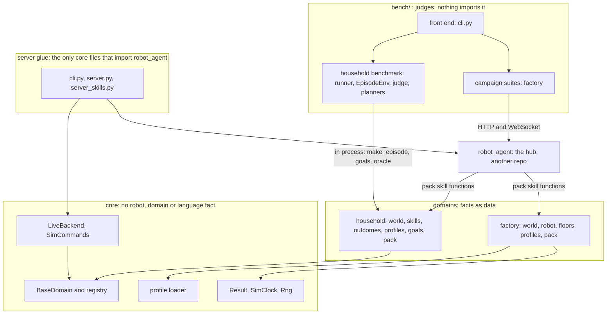

---
sources:
  - bench/cli.py
  - bench/suites/home/register.py
  - bench/suites/home/cli.py
  - bench/suites/home/runner.py
  - bench/suites/home/env.py
  - symbolic_robot/domains/home/episode.py
  - symbolic_robot/domains/home/skills.py
  - bench/campaign.py
  - bench/runner.py
  - bench/orchestrate.py
  - tests/test_layering.py
verified_at: a5cc7a4943aa
---

# How it works

!!! abstract "In this page"
    - One layer diagram: the engine, the domains, the server glue, `bench/` and the hub.
    - One household episode from the command line to the three result files, in seven steps, each naming the file and line.
    - The same path for a factory campaign, read in the code and not run.
    - The rules that the code and its tests enforce. The next page, [Key ideas](key-ideas.md), explains the eight ideas behind them.

Line numbers are at commit `a5cc7a4943aa`. The values in the steps come from a run on a copy of that commit, made offline on 2026-11-19. No language model was called and no server was started.

## The pieces



| layer | what it holds | page |
|---|---|---|
| core (`symbolic_robot/*.py`) | the result type, the simulated clock, seeded draws, the profile loader, the domain protocol, the registry, the live backend | [Results, time and draws](../modules/results-time-draws.md), [Domain protocol](../modules/domain-protocol.md), [Live backend](../modules/live-backend-and-sim-commands.md) |
| domains | the facts of one world: places, skills, fault rates, goals | [Factory world](../modules/factory-world.md), [Household domain](../modules/home-domain-and-houses.md) |
| server glue | two core files that present a domain to the hub, and the engine's command line | [Server and CLI](../modules/server-and-cli.md) |
| `bench/` | planners, episode environment, judge, statistics, reports | [Front end](../modules/bench-front-end.md), [Campaign runner](../modules/campaign-runner.md), [Household runner](../modules/home-runner.md) |
| robot_agent (the hub) | the planner loops and the skill-calling API; another repository | [framework site](https://mtbui2010.github.io/robot_agent/) |

Two facts the diagram shows and the code confirms. The household domain takes one thing from the core, `BaseDomain` (`symbolic_robot/domains/home/domain.py:10`); it has its own seeded streams, clock and profile loader. The factory domain uses the core's `Rng`, `SimClock` and `Result` (`domains/factory/robot.py:5-7`) and the profile loader (`profiles.py:6`). `CallDraws`, a core helper for one fixed vector of draws per call, is used by no domain at this commit ([glossary](../reference/glossary.md#calldraws)).

## One episode end to end

This is the path most readers take: the household benchmark with the reference planner `oracle`, 20 `dev` tasks, 2 seeds, profile `real`.

```text
$ python -m bench run --domain home --suite run --planner oracle --split dev --limit 20 --seeds 2 --profile real --out out/oracle
household benchmark: python -m bench.suites.home.cli run --planner oracle --split dev --limit 20 --seeds 2 --profile real --out out/oracle
[run] oracle 40 episodes in 1.9s wall -> out/oracle
{"false_success": 0.0, "goal_condition_success": 0.868421, "help_rate": 0.15, "n_episodes": 40, "n_error": 0, "rejection_rate": 1.0, "smoke": true, "success": 0.825, "success_ci95": [0.667847, 0.917035]}
```

This is a smoke run ([glossary](../reference/glossary.md#smoke-run)), not a result. The wall time changes from run to run. A second identical run wrote a byte-identical `episodes.jsonl` and the same `summary.json` apart from the timing field.

| # | what happens | file and line | module page |
|---|---|---|---|
| 1 | `python -m bench` calls `main`. `_own_cli` reads `--domain` and `--suite`. The suite `home/run` has a `delegate`, so every other argument is passed on unchanged | `bench/cli.py:88-109` | [Front end](../modules/bench-front-end.md) |
| 2 | `delegate` refuses `--split test`, adds `--out`, prints the command, and calls the household command line | `bench/suites/home/register.py:20-36` | [Front end](../modules/bench-front-end.md) |
| 3 | `cmd_run` calls `run_many`. It loads the split with `load_tasks`, keeps the first 20 tasks, and loops tasks times seeds | `bench/suites/home/cli.py:123-142`, `runner.py:237-252` | [Household runner](../modules/home-runner.md) |
| 4 | `run_episode` makes an `EpisodeEnv` and a planner. The env builds the episode with `make_episode`, seeded by `derive_seed(task_id, seed)` and keyed `task_id\|seed` | `runner.py:59-72`, `env.py:212-213`, `domains/home/episode.py:120-139` | [Episode env and judge](../modules/episode-env-and-judge.md), [Household domain](../modules/home-domain-and-houses.md) |
| 5 | The planner's `run(env)` calls `env.call(skill, **args)`. That calls `Robot.call`, which checks the arguments, draws 14 uniforms keyed by seed, key, skill, arguments and the n-th call with them, applies the skill and advances the clock | `env.py:349-366`, `domains/home/skills.py:294-308`, `skills.py:331-345`, `outcomes.py:37-41` | [Household skills](../modules/home-skills.md), [Household outcomes](../modules/home-outcomes.md) |
| 6 | The planner ends with `env.finish(status)`. `EpisodeEnv.record` calls `judge`, which evaluates each subtask goal on the true final world. Success is `all(correct) and order_ok and status_ok and not sem` | `env.py:480`, `env.py:552-593` (the success line is 586) | [Episode env and judge](../modules/episode-env-and-judge.md), [Goals and the oracle](../modules/home-goals-and-oracle.md) |
| 7 | `write_run` writes `episodes.jsonl`, `summary.json` (from `metrics.summarize`) and `report.md` (from `report.render`) | `runner.py:322-333` | [Metrics and report](../modules/home-metrics-and-report.md) |

```text
$ ls out/oracle
episodes.jsonl  report.md  summary.json
```

Step 5 is where the idea of the engine shows. The same call in two planners' episodes gets the same 14 draws, so the planners are compared on the same luck. This snippet builds a household episode with a synthetic key, runs `move` then `find`, and then runs it again with a `wait` before them (house `studio_flat`, profile `stress`):

```python
def run(with_wait):
    ep = make_episode("studio_flat", 1, "stress", derive_seed("demo", 7), key="demo|7")
    if with_wait:
        ep.robot.call("wait", seconds=5)
    a = ep.robot.call("move", target="counter@main")
    b = ep.robot.call("find", obj="mug")
    return [(r.ok, str(r.code), round(r.duration_s, 3)) for r in (a, b)]
```

```text
[(True, 'None', 9.068), (False, 'FailureCode.ABSENT', 5.347)]
[(True, 'None', 9.068), (False, 'FailureCode.ABSENT', 5.347)]
```

Both runs give the same outcomes and durations, including the same failed `find`. See [Determinism by seed](../learn/determinism.md).

### The same path for a factory campaign

Read in the code, not run: it needs robot_agent, the `server` extra and a language model.

1. `cmd_run` registers the protocol hash (`bench/cli.py:27-52`, line 44), so a changed protocol is refused ([Campaign statistics](../modules/campaign-statistics.md)).
2. `orchestrate.server` starts `python -m symbolic_robot run --robot <domain>` on a free port (`bench/orchestrate.py:62-75`) ([Server and CLI](../modules/server-and-cli.md)).
3. `run_campaign` calls `run_episode` for every task, repeat and arm (`bench/campaign.py:14-46`). Each episode posts `/skill/reset_world`, drives the agent socket, and answers the robot's questions with the suite's scripted person (`bench/runner.py:85-90`) ([Campaign runner](../modules/campaign-runner.md)).
4. It reads the true world back through `/agent/sim_world/get` and judges success as "the object is at its destination" (`bench/runner.py:91-93`).

## Rules the code enforces

Each row is a rule that a test states.

| rule | enforced by | why it matters |
|---|---|---|
| `bench/` judges; the core and the domains never import it | `tests/test_layering.py:39-41` | a planner cannot reach the judge ([Layering tests](../modules/layering-tests.md)) |
| only `server.py`, `server_skills.py` and the domain packs import robot_agent | `tests/test_layering.py:49-56` | the engine and the reference planners run without the hub; `bench/` talks to the server over HTTP, except two planner adapter files that import it inside functions (`test_layering.py:57-63`) |
| a domain never imports another domain or the server | `tests/test_layering.py:66-71` | a new domain needs no change elsewhere ([Domain protocol](../modules/domain-protocol.md)) |
| size limits may not grow: 80 lines per function, 600 per file, with recorded exceptions | `tests/test_layering.py:100-113`, `tests/size_baseline.json` | a contributor sees at once what will break |
| the household simulator keeps its behaviour | `tests/test_home_baseline.py` | its results stay comparable ([Parity](../modules/parity.md)) |
| `--split test` is refused by the front end | `bench/suites/home/register.py:22-23` | the front end guards the split, nothing else does ([Benchmark protocol](../learn/benchmark-protocol.md)) |

Next: [Key ideas](key-ideas.md), then the [code map](../modules/index.md).
