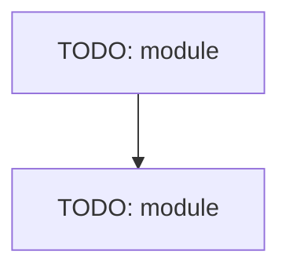

# How it works

<!-- For a developer who wants to change the code. Sections:
     1. The pieces: a mermaid diagram of modules/processes and what talks to what.
     2. One request (or one run), end to end: numbered steps, each naming the file that does it.
     3. Decisions, and why: a table of design choices with the reason (and what was rejected). -->

## The pieces

## One request, end to end

1. TODO

## Decisions, and why

| Decision | Why |
|---|---|
| TODO | TODO |
