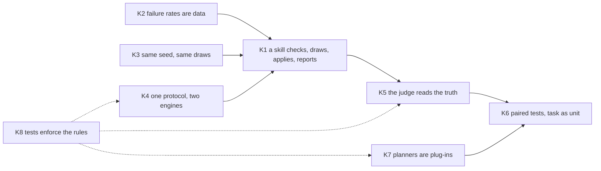

---
sources:
  - symbolic_robot/result.py
  - symbolic_robot/rng.py
  - symbolic_robot/profile.py
  - symbolic_robot/domain.py
  - symbolic_robot/registry.py
  - symbolic_robot/domains/factory/robot.py
  - symbolic_robot/domains/home/skills.py
  - symbolic_robot/domains/home/outcomes.py
  - symbolic_robot/domains/home/rng.py
  - symbolic_robot/domains/home/domain.py
  - symbolic_robot/domains/home/profiles/ideal/profile.yaml
  - symbolic_robot/domains/home/profiles/stress/profile.yaml
  - symbolic_robot/domains/factory/profiles/real.yaml
  - bench/suites/home/env.py
  - bench/suites/home/metrics.py
  - bench/suites/home/planners/base.py
  - bench/suites/home/planners/__init__.py
  - bench/stats.py
  - tests/toy.py
  - tests/test_layering.py
verified_at: a5cc7a4943aa
---

# Key ideas

!!! abstract "In this page"
    - Eight ideas, K1 to K8, in the order a newcomer needs them.
    - Each has a one-line statement, why it matters, evidence at commit `a5cc7a4943aa`, and links to the Learn chapter and the module page.
    - Where a number appears, it comes from a run on an offline copy of the commit and is a smoke value, not a result.

The ideas have one thing in common: a simulated robot is only useful for comparing planners if every difference between two runs comes from the planners and not from luck, from the judge, or from hidden state. The engine is built to make that true.

## K1. A skill does not move anything: it checks, draws, applies and reports

A skill call checks preconditions on a symbolic world, draws its outcome from declared probabilities, changes the world, advances a simulated clock, and returns a result with a hidden `truth`.

Why it matters: nothing is physical, so episodes are fast. Forty oracle episodes took between 0.8 and 1.9 s of wall time in the runs for these pages.

Evidence:

- `Result` holds `ok`, `msg`, `code`, `data`, `duration_s` and `truth` ([`symbolic_robot/result.py:7-14`](https://github.com/mtbui2010/symbolic_robot/blob/a5cc7a4943aa/symbolic_robot/result.py#L7-L14)).
- The factory robot's `call` checks, runs the skill, and advances the clock ([`domains/factory/robot.py:53-70`](https://github.com/mtbui2010/symbolic_robot/blob/a5cc7a4943aa/symbolic_robot/domains/factory/robot.py#L53-L70)).
- The household robot lists its seven steps in the module docstring and has its own result type ([`domains/home/skills.py:1-9`](https://github.com/mtbui2010/symbolic_robot/blob/a5cc7a4943aa/symbolic_robot/domains/home/skills.py#L1-L9)).

Learn: [Symbolic worlds and the truth](../learn/symbolic-worlds.md). Code: [Results, time and draws](../modules/results-time-draws.md), [Factory skills](../modules/factory-skills.md), [Household skills](../modules/home-skills.md).

## K2. Failure rates are data with a source label; `ideal` and `stress` are derived from `real`

Every number is a YAML parameter with a kind, a value, a source and a note. `ideal` sets every probability to 0; `stress` scales them.

Why it matters: a planner's score can be read against no faults, plausible faults and harsher faults without editing code, and every number is either traced to a source or marked as assumed. The household `real` profile has 113 parameters: 58 with a source and 55 marked `assumed`.

Evidence:

- The core derives a profile: `ideal` maps every probability to 0, another name needs `derive.<name>.scale` and caps at 1 ([`profile.py:71-87`](https://github.com/mtbui2010/symbolic_robot/blob/a5cc7a4943aa/symbolic_robot/profile.py#L71-L87)).
- The factory profile declares `stress: {scale: 3.0}` ([`factory/profiles/real.yaml:4-5`](https://github.com/mtbui2010/symbolic_robot/blob/a5cc7a4943aa/symbolic_robot/domains/factory/profiles/real.yaml#L4-L5)).
- The household `ideal` rules zero every failure and noise role ([`home/profiles/ideal/profile.yaml:1-10`](https://github.com/mtbui2010/symbolic_robot/blob/a5cc7a4943aa/symbolic_robot/domains/home/profiles/ideal/profile.yaml#L1-L10)); `stress` uses factor 2.0 and cap 0.95 ([`stress/profile.yaml:5-10`](https://github.com/mtbui2010/symbolic_robot/blob/a5cc7a4943aa/symbolic_robot/domains/home/profiles/stress/profile.yaml#L5-L10)).

Learn: [Declared outcomes and profiles](../learn/declared-outcomes.md). Code: [Profiles (core)](../modules/profiles.md), [Household profiles](../modules/home-profiles.md).

## K3. The same seed gives the same run, call by call

A draw depends on the seed, a key and the n-th use of that key (or, in the household domain, on the skill, its arguments and the n-th call with them), hashed with SHA-256. It does not depend on the wall clock, on Python `hash()` or on unrelated calls.

Why it matters: two planners that make the same call in the same episode get the same outcome, so a paired test compares the planners and not their luck ([glossary](../reference/glossary.md#common-random-numbers)).

Evidence:

- `Rng.uniform` hashes `seed|key|n` ([`symbolic_robot/rng.py:15-24`](https://github.com/mtbui2010/symbolic_robot/blob/a5cc7a4943aa/symbolic_robot/rng.py#L15-L24)).
- The household domain has its own streams and a fresh generator per call key ([`domains/home/rng.py:23-42`](https://github.com/mtbui2010/symbolic_robot/blob/a5cc7a4943aa/symbolic_robot/domains/home/rng.py#L23-L42)) and draws a vector of 14 uniforms per call ([`outcomes.py:37-41`](https://github.com/mtbui2010/symbolic_robot/blob/a5cc7a4943aa/symbolic_robot/domains/home/outcomes.py#L37-L41)). The core helper `CallDraws` does the same job but no domain uses it at this commit.
- Run offline: a `wait` inserted before `move` and `find` left both outcomes and durations unchanged (output on [How it works](index.md)). Two identical oracle runs wrote a byte-identical `episodes.jsonl`.

Learn: [Determinism by seed](../learn/determinism.md). Code: [Results, time and draws](../modules/results-time-draws.md), [Household outcomes](../modules/home-outcomes.md).

## K4. One protocol, two engines behind it

A domain is a `BaseDomain` subclass whose hooks all have safe defaults. The core and the server know nothing else about it.

Why it matters: the factory domain and the household simulator, which has its own streams, clock and profiles, are served by the same backend and the same `sim_command` handler. A new domain needs no core change: `tests/toy.py` is a complete one.

Evidence: [`symbolic_robot/domain.py:12-30`](https://github.com/mtbui2010/symbolic_robot/blob/a5cc7a4943aa/symbolic_robot/domain.py#L12-L30) (the base class and its catalogue hooks), [`registry.py:10-11`](https://github.com/mtbui2010/symbolic_robot/blob/a5cc7a4943aa/symbolic_robot/registry.py#L10-L11) (the two built-in domains), [`tests/toy.py:36-58`](https://github.com/mtbui2010/symbolic_robot/blob/a5cc7a4943aa/tests/toy.py#L36-L58), [`domains/home/domain.py:31-40`](https://github.com/mtbui2010/symbolic_robot/blob/a5cc7a4943aa/symbolic_robot/domains/home/domain.py#L31-L40).

Learn: [Packs, manifests and the hub](../learn/packs-and-manifests.md). Code: [Domain protocol](../modules/domain-protocol.md), [Live backend](../modules/live-backend-and-sim-commands.md).

## K5. The judge reads the truth, and lives where the planner cannot import it

Success is decided on the true final world: goal atoms in the household benchmark, the object's final place in the factory campaigns. The planner's claim only matters when it is wrong. Judging code is in `bench/`, and a test forbids the core and the domains from importing `bench`.

Why it matters: a planner that says "done" too early is caught, not rewarded. In the smoke runs, `naive` under `real` had false success 0.025 (1 of 40) and `oracle` 0.0.

Evidence: the success line `success = all(correct) and order_ok and status_ok and not sem` ([`bench/suites/home/env.py:586`](https://github.com/mtbui2010/symbolic_robot/blob/a5cc7a4943aa/bench/suites/home/env.py#L586), in `judge`, lines 552-593); the factory judge ([`bench/runner.py:91-93`](https://github.com/mtbui2010/symbolic_robot/blob/a5cc7a4943aa/bench/runner.py#L91-L93)); the layering test ([`tests/test_layering.py:39-41`](https://github.com/mtbui2010/symbolic_robot/blob/a5cc7a4943aa/tests/test_layering.py#L39-L41)).

Learn: [Symbolic worlds and the truth](../learn/symbolic-worlds.md), [The benchmark protocol](../learn/benchmark-protocol.md). Code: [Episode env and judge](../modules/episode-env-and-judge.md), [Campaign runner](../modules/campaign-runner.md).

## K6. Compare planners in pairs, with the task as the unit

Run both planners on the same tasks and seeds, then test the discordant pairs. The household benchmark uses McNemar on (task, seed) pairs plus two task-level tests. The campaign suites use a sign test on tasks plus bootstrap intervals. The headline interval of one planner in `report.md` is a Wilson interval at an effective sample size, which is task-clustered. The plain Wilson interval is kept beside it.

Why it matters: the seeds of one task are correlated, so the task-level tests are the ones to quote.

Evidence: [`bench/suites/home/metrics.py:369-437`](https://github.com/mtbui2010/symbolic_robot/blob/a5cc7a4943aa/bench/suites/home/metrics.py#L369-L437), [`bench/stats.py:27-80`](https://github.com/mtbui2010/symbolic_robot/blob/a5cc7a4943aa/bench/stats.py#L27-L80). Run offline, oracle against naive (40 episodes each, a smoke comparison): pair test p = 0.0078, task-majority McNemar p = 0.0625, task sign-flip p = 0.0324. The pair test alone would be too confident.

Learn: [Paired tests](../learn/paired-tests.md). Code: [Household metrics and report](../modules/home-metrics-and-report.md), [Campaign statistics](../modules/campaign-statistics.md).

## K7. A planner is a plug-in with one method, and privileged references are labelled

A planner is any class with `name`, `privileged` and `run(env)`, named in the registry or as `package.module:Class`. A privileged planner may read `env.truth`. At this commit only `oracle`, `naive` and the diagnostic `robot_agent:sage_gold` are privileged.

Why it matters: you can benchmark your own planner without touching the repo, and the upper references are marked so that nobody compares a planner's claim with an oracle's.

Evidence: the protocol ([`planners/base.py:31-36`](https://github.com/mtbui2010/symbolic_robot/blob/a5cc7a4943aa/bench/suites/home/planners/base.py#L31-L36)), the registry and the spec form ([`planners/__init__.py:104-131`](https://github.com/mtbui2010/symbolic_robot/blob/a5cc7a4943aa/bench/suites/home/planners/__init__.py#L104-L131)), and the env that hides the world unless `privileged` ([`env.py:275-277`](https://github.com/mtbui2010/symbolic_robot/blob/a5cc7a4943aa/bench/suites/home/env.py#L275-L277)). The comment in `base.py` says "oracle, naive only"; the class of `sage_gold` also sets the flag ([planners as plug-ins](../learn/planners-as-plugins.md)).

Learn: [Planners as plug-ins](../learn/planners-as-plugins.md). Code: [Planner interface](../modules/planner-interface.md), [Reference planners](../modules/reference-planners.md).

## K8. The rules are enforced by tests, not by good will

Layering, the ban on private names, the size limits and the frozen behaviour of the household simulator are all checked by tests.

Why it matters: a contributor sees at once what will break.

Evidence: the layering tests ([`tests/test_layering.py:39-113`](https://github.com/mtbui2010/symbolic_robot/blob/a5cc7a4943aa/tests/test_layering.py#L39-L113)), the size exceptions in `tests/size_baseline.json`, and `tests/test_home_baseline.py`, which compares the oracle and naive runs byte for byte with baselines recorded before the merge. `pytest` is not installed on the machine used for these pages, so no pytest result is claimed. That test was not run for this page.

Code: [Layering tests](../modules/layering-tests.md), [Parity and frozen behaviour](../modules/parity.md). Next: the [code map](../modules/index.md).
