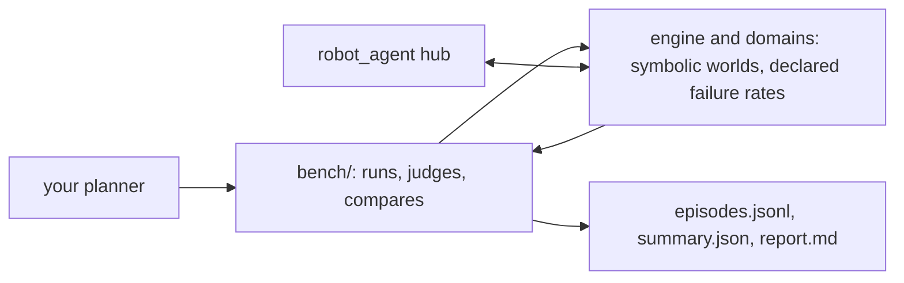

# symbolic_robot

**Test a robot task planner against a small symbolic world whose failures come from declared probabilities, and compare planners with paired tests that the same seed makes exact.**

`symbolic_robot` is one engine for simulated robots whose skills do not run for real. Each call checks preconditions on a small symbolic world, draws its outcome from probabilities written in YAML, and returns a result plus a hidden `truth` record. A separate package, `bench/`, runs planners on it, judges them from the truth and never from the planner's own claim, and compares them on the same tasks and seeds. A number from it is a simulated result: there is no physics and no real robot.

## Start here

| page | what you get |
|---|---|
| [Get started](start/getting-started.md) | a clean copy, the listing commands and a first run in about a second |
| [How it works](how-it-works/index.md) | the layers and one episode end to end, with file and line |
| [Key ideas](how-it-works/key-ideas.md) | the eight ideas behind the engine and the benchmark |

## Where to go

| you are | go to |
|---|---|
| a researcher who benchmarks planners | [Run a benchmark](guides/run-a-benchmark.md), [Read a result](guides/read-a-result.md), [Add a planner](guides/add-a-planner.md); the chapters [The benchmark protocol](learn/benchmark-protocol.md) and [Paired tests](learn/paired-tests.md) |
| a developer who adds a domain or a suite | [Add a domain](guides/add-a-domain.md), [Add a suite](guides/add-a-suite.md), the [code map](modules/index.md) and [Layering tests](modules/layering-tests.md) |
| an integrator who runs the simulator behind robot_agent | [Packs, manifests and the hub](learn/packs-and-manifests.md), [Server and CLI](modules/server-and-cli.md), [Sim command](reference/sim-command.md) |
| anyone looking up a term, command or file | [Glossary](reference/glossary.md), [Command line](reference/cli.md), [Result files](reference/result-files.md), [Known pitfalls](reference/known-pitfalls.md) |

The framework site, [robot_agent](https://mtbui2010.github.io/robot_agent/), describes the hub and the other repositories.

## Verified so far

These pages describe commit `a5cc7a4943aa`. Everything below was run offline on a copy of that commit, in 2026-11.

| what | how it was checked | result |
|---|---|---|
| engine and both domains | listed, built worlds, called skills in a script | works; `python -m symbolic_robot list` shows the factory and household domains |
| household smoke runs | `oracle` and `naive`, 20 dev tasks, 2 seeds, profiles `ideal`, `real`, `stress` | run to the end and write the three files; they are smoke runs, not results |
| determinism | the same arguments run twice; a `wait` inserted before two calls | `episodes.jsonl` byte-identical; outcomes and durations unchanged |
| paired comparison | `compare` on the two smoke folders | prints the pair test and two task-level tests |

## Not yet

- No campaign was run, no language-model planner was run, and no `robot_agent:*` planner was run.
- No `pytest` result is claimed: `pytest` is not installed on the machine used.
- The server, the hub and ROS were not started.
- Smoke runs show the shape of the output. They are not benchmark results.

## The commit and the licences

The code links on this site are pinned to commit `a5cc7a4943aa`.

The repository is not under one licence. The root `LICENSE` is MIT and covers only the engine, the factory domain and the generic benchmark front end. The household simulator and the household benchmark carry their own Apache-2.0 files. The task data of the household benchmark is not under one licence, and part of it is research-only: this site never shows a task. Read [Versions and licences](reference/versions-and-licences.md), then the licence files, before you copy or share anything.
