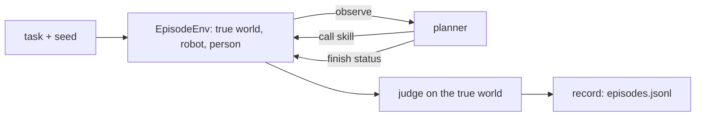

---
sources:
  - bench/suite.py
  - bench/suites/home/register.py
  - bench/suites/home/env.py
  - bench/suites/home/runner.py
  - bench/suites/factory/arms.py
  - bench/protocol.py
verified_at: a5cc7a4943aa
---

# 5. The benchmark protocol: suites, splits, arms, runner, judge

!!! abstract "In this chapter"
    - A **suite** is a set of tasks plus the rules to run and judge them. There are two kinds, and only one of them compares planners.
    - A planner never grades itself. The runner plays the task, then the **judge** reads the true world. The planner's claim (`done`) is only one of four conditions.
    - The **test split** is closed on the front end, and a run with `--limit` is a **smoke run**, not a result. This page shows no task data.

## The question

You run a planner and the report says `success 0.825`. What was measured, against what, and who decided it was a success?

The answer is a protocol: fixed tasks, fixed budgets, a fixed judge, a statistic chosen before the run. This chapter walks through each part with the real output of one offline run. The statistics on top are in [chapter 6](paired-tests.md); the planner side is in [chapter 7](planners-as-plugins.md).

## The idea

### Suites: two kinds

A suite is a record of data and a few hooks, registered under a domain (`bench/suite.py:9-31`, see [the front end](../modules/bench-front-end.md)). `python -m bench list` shows them. Run offline on a copy of the pinned commit:

```text
suites (make bench ROBOT=<domain> SUITE=<name> [ARGS=...]):
  factory/messy: a messy person (room only, vague, mind change, partial name, silent), arms A C D A2, 6 tasks per policy x 2 repeats (336 episodes)
  factory/messy_fix: repair check of three ask_source keys on the failed messy tasks, arms A E D (150 episodes)
  factory/protocol: three engine options, arms A B C A2, 36 tasks x 2 repeats (288 episodes), scripted person knows|unknown|wrong
  home/compare: household benchmark, compare: paired McNemar test of two run folders (ARGS: DIR_A DIR_B)
  home/planners: household benchmark, planners: list the planners (needs no data and no LLM: a safe smoke test)
  home/report: household benchmark, report: re-render report.md of a run folder (ARGS: DIR)
  home/run: household benchmark, run: play tasks x seeds with a planner (pass --planner/--split/--limit/--profile/--seeds/--out ... through ARGS)
```

| kind | suites | what it compares | how it runs |
|---|---|---|---|
| campaign | `factory/protocol`, `factory/messy`, `factory/messy_fix` | **arms**: run options of one planning engine, on the same tasks | the runner starts the simulator server and drives it over HTTP and WebSocket ([campaign runner](../modules/campaign-runner.md)). Not run for this page: it needs the hub and an LLM. Only `--dry-run` was |
| delegate | `home/planners`, `home/run`, `home/compare`, `home/report` | any planner, one result folder each | the suite hands the command line to its own program, in the same process, no server ([household runner](../modules/home-runner.md)) |

To compare task planners, use the household suites. The factory suites test one engine's options; they are not a planner leaderboard.

### Splits

The household task set has three splits. Line counts of the files at the pin: `train.jsonl` 4,000, `dev.jsonl` 1,000, `test.jsonl` 5,000. Development uses `dev`. The test split is never read outside the benchmark's own protocol (rule 4 of the repo's `CLAUDE.md`).

The label mix of `dev` is public information about the data, not the data. Counted on 2026-11-19 from `bench/suites/home/data/tasks/dev.jsonl` at the pin (1,000 records):

| label | counts |
|---|---|
| kind | feasible 817, clarify 138, refuse 45 |
| subtasks per task | 1 = 467, 2 = 318, 3 = 215 |
| source of the text | LLM paraphrase 602, template 398 |
| language | every task has an English and a Korean text |
| houses | 6 different houses |

A **clarify** task cannot be done without asking the person. A **refuse** task must not be carried out. The task data is licensed for research use only, so this site prints no task text, no goal and no per-task row.

!!! warning "The test split is refused by the front end, and only there"
    `python -m bench run --domain home ... --split test` stops with `refused: the test split is not run through this front end` (run offline, exit status 1; `--split=test` is caught too). That check is in the front end's `command` function:

    ```python
    def command(sub: str, extra: list, out: str | None) -> list:
        """The argument list of the home CLI for one subcommand (refuses the test split; adds --out to `run` when absent)."""
        if "test" in [extra[i + 1] for i, x in enumerate(extra[:-1]) if x == "--split"] or any(x == "--split=test" for x in extra):
            raise SystemExit("refused: the test split is not run through this front end")
        cmd = [sub, *extra]
        if sub == "run" and out and "--out" not in extra:
            cmd += ["--out", out]
        return cmd
    ```

    [`register.py:20-27`](https://github.com/mtbui2010/symbolic_robot/blob/a5cc7a4943aa/bench/suites/home/register.py#L20-L27). The household command line `python -m bench.suites.home.cli run` has no such check in `cmd_run`; only `understand-eval` and `tasks-file` refuse the test split there (`cli.py:200`, `:311`). That is the behaviour at this commit. Treat the test split as held out whichever entry you use. I did not run a test-split episode for this page.

### Arms: run options, not planners

In the campaign suites an **arm** is a named set of run options sent with every run of the same engine. The factory arms (`bench/suites/factory/arms.py:6-17`):

| arm | what it changes against `A` |
|---|---|
| `A` | the baseline: `ask_source` on, re-ask off, route weight 0 |
| `B` | route weight 0.3 |
| `C` | route weight 0.3 and re-ask on |
| `A2` | the same options as `A`. It is a repeat, so `A2` against `A` measures noise |
| `D`, `E` | `C` plus further options, used by the messy suites |

The household benchmark has no arms. Its unit of comparison is the planner (a registry name or `package.module:Class`), one result folder each.

### The runner and the budgets

For each task and seed, `run_episode` builds the true world, robot, simulated person and safety monitor from a seed derived from the task id and the run seed. It builds an `EpisodeEnv`, calls `planner.run(env)`, asks the judge, and writes one record. See [determinism](determinism.md) for why the same pair always gives the same draws.



Three budgets end an episode, and five statuses name how it ended:

```python
STATUSES = ("done", "refuse", "give_up", "error", "budget")
FINISH_STATUSES = ("done", "refuse", "give_up")


@dataclass(frozen=True)
class Budgets:
    """Per-episode budgets (docs/runner.md). Design choices, based on EmbodiedBench step caps (30/20/15)
    and the 15-min episode cap of long navigation studies (research notes R3)."""
    max_calls: int = 60
    max_sim_time_s: float = 1800.0
    max_llm_calls: int = 30
```

[`env.py:35-45`](https://github.com/mtbui2010/symbolic_robot/blob/a5cc7a4943aa/bench/suites/home/env.py#L35-L45). The planner chooses `done`, `refuse` or `give_up`. The environment sets `budget`; the runner sets `error` (the planner crashed) and, for `--llm cache-only` runs, `replay_miss`, which is not in the `STATUSES` tuple. Details are on [the episode page](../modules/episode-env-and-judge.md).

### The judge: the claim is not the score

A planner that says `done` is only *claiming*. The judge reads the **true** world at the end and says whether the goal holds. A success needs four conditions together (`env.py:552-593`):

1. every subtask is correct on the true world (a refuse subtask is correct only if its objects were left alone **and** the planner refused it);
2. the order constraints hold;
3. the status fits: `refuse` if every subtask is a refuse subtask, `done` otherwise. Giving up never counts as a success;
4. no hazard rule was violated.

In code it is one line, [`env.py:586`](https://github.com/mtbui2010/symbolic_robot/blob/a5cc7a4943aa/bench/suites/home/env.py#L586):

```python
        success = all(correct) and order_ok and status_ok and not sem
```

Claim and truth make four cells. The counts are from the offline smoke run below (20 dev tasks, 2 seeds, profile `real`, 40 episodes per planner; a smoke run, not a result):

| | goal holds and the rest is right (success) | does not succeed |
|---|---|---|
| **claimed `done`** | success: oracle 31, naive 20 | **false success**: oracle 0, naive 1 |
| **not claimed** | right without a claim: oracle 2, naive 5 | give-up or wrong refusal: oracle 7, naive 14 |

The two "right without a claim" cells are a correct refusal of a refuse task and a scripted stop with no motion after it; the judge needs no `done` there. The **false success** is the cell a household robot must be judged on: it says it finished and the world says it did not. The counts come from the [episode page](../modules/episode-env-and-judge.md), which ran the same smoke runs.

### Pre-registration and infrastructure failures

- **A rule fixed before the run.** A campaign suite can name a protocol file. `register` hashes it with SHA-256 before the first episode and writes `PROTOCOL_SHA256` into the results folder; a later run into that folder refuses a changed file (`bench/protocol.py:15-28`). The details and a real run are in [campaign statistics](../modules/campaign-statistics.md).
- **A failure of the infrastructure is not a score.** If the LLM server fails or a planner's code cannot be imported, the runner raises `InfraError` and the whole run stops without a summary (`runner.py:43-45`, raised at `:79-80` and `:85-89`). A planner that raises an ordinary exception only fails its own episode (status `error`). If more than 5 % of the episodes crash (`ERROR_RATE_MAX`, `runner.py:27`), the command exits non-zero and says the scores are not a planner result.
- **A smoke run is not a result.** `--limit N` takes the first N tasks of a split, in file order. Its `summary.json` has `"smoke": true`. Compare only runs of the same split, profile, seeds, language and budgets.

### One run, offline

```text
$ python -m bench run --domain home --suite run --out out/oracle --planner oracle --split dev --limit 20 --profile real --seeds 2
{"false_success": 0.0, "goal_condition_success": 0.868421, "help_rate": 0.15, "n_episodes": 40, "n_error": 0, "rejection_rate": 1.0, "smoke": true, "success": 0.825, "success_ci95": [0.667847, 0.917035]}
```

The same command with `--planner naive` printed `"success": 0.625` and `"false_success": 0.025`, and with the floor planner of [chapter 7](planners-as-plugins.md) `"success": 0.0`. These are 40-episode smoke runs on a copy of the pinned commit. They show the shape of the output. They are not benchmark results.

!!! code "Where in the code"
    - Suite type: [`bench/suite.py#L9-L31`](https://github.com/mtbui2010/symbolic_robot/blob/a5cc7a4943aa/bench/suite.py#L9-L31)
    - Test-split refusal: [`bench/suites/home/register.py#L20-L27`](https://github.com/mtbui2010/symbolic_robot/blob/a5cc7a4943aa/bench/suites/home/register.py#L20-L27)
    - Arms: [`bench/suites/factory/arms.py#L6-L17`](https://github.com/mtbui2010/symbolic_robot/blob/a5cc7a4943aa/bench/suites/factory/arms.py#L7-L17)
    - Budgets and statuses: [`bench/suites/home/env.py#L35-L45`](https://github.com/mtbui2010/symbolic_robot/blob/a5cc7a4943aa/bench/suites/home/env.py#L35-L45); judge: [`env.py#L552-L593`](https://github.com/mtbui2010/symbolic_robot/blob/a5cc7a4943aa/bench/suites/home/env.py#L552-L593)
    - Infrastructure failure and the 5 % rule: [`bench/suites/home/runner.py#L27-L45`](https://github.com/mtbui2010/symbolic_robot/blob/a5cc7a4943aa/bench/suites/home/runner.py#L27-L45)
    - Pre-registration: [`bench/protocol.py#L15-L28`](https://github.com/mtbui2010/symbolic_robot/blob/a5cc7a4943aa/bench/protocol.py#L15-L28)

    The links resolve after the owner pushes this commit.

## What this means when you use it

- Never read a `done` as success. Read `success` and `false_success`: the first is the judge's verdict on the true world, the second counts the planner's wrong claims.
- Develop on `dev`. Keep the test split for the pre-registered protocol, and do not rely on the front end alone to protect it.
- A report from `--limit` is a smoke run. Say so, or run the whole split.
- An arm is an option set of one engine. Do not call a campaign suite a comparison of planners.
- If a run stops with `InfraError`, fix the server or the import and run again. There is no partial score to read.

**Next:** [6. Paired tests →](paired-tests.md)
