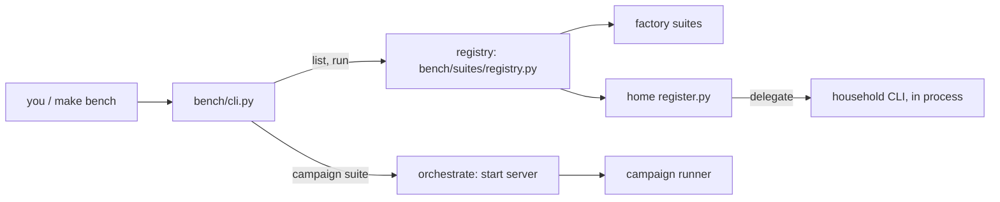

---
sources:
  - bench/suite.py
  - bench/suites/registry.py
  - bench/cli.py
  - bench/__main__.py
  - bench/orchestrate.py
  - bench/suites/home/register.py
  - Makefile
  - tests/test_bench.py
verified_at: a5cc7a4943aa
---

# `bench` front end: suites, registry, `python -m bench`

!!! abstract "In this page"
    You get the one command line that runs every benchmark suite of this repo, and the small
    data class, the registry and the server starter behind it. After reading you can list the
    suites, preview a run without starting anything, and tell which arguments the front end keeps
    and which it hands over to a suite. This is the entry point; the code that plays episodes is
    in [Campaign runner](campaign-runner.md), the numbers in
    [Campaign statistics](campaign-statistics.md).

| | |
|---|---|
| **Input** | `python -m bench {list, run, analyze, report, verify}` and its options |
| **Output** | text on stdout; for a campaign suite a results folder (see [Campaign runner](campaign-runner.md)) |
| **Used by** | `make bench`, `make list` ([Make targets](../reference/make-targets.md)), people |
| **Uses** | the suite registry, `bench/orchestrate.py`, `bench/protocol.py`, `bench/campaign.py` |
| **Source** | [bench/cli.py](https://github.com/mtbui2010/symbolic_robot/blob/a5cc7a4943aa/bench/cli.py), [bench/suite.py](https://github.com/mtbui2010/symbolic_robot/blob/a5cc7a4943aa/bench/suite.py), [bench/orchestrate.py](https://github.com/mtbui2010/symbolic_robot/blob/a5cc7a4943aa/bench/orchestrate.py) |
| **Tests** | `tests/test_bench.py` |

## Background

A **suite** is one benchmark you can run by name. It lives under a domain: the name is
`<domain>/<suite>`, for example `factory/protocol`. There are two kinds.

- A **campaign suite** drives a planner through the running simulator server and compares **arms**
  (named sets of run options) on the same tasks. The three factory suites are of this kind.
- A **delegate suite** is a whole program of its own. The front end only hands the command line to
  it. The four household entries (`home/planners`, `home/run`, `home/compare`, `home/report`) are of
  this kind; see [Household runner](home-runner.md).

Both kinds use the same class, `Suite`. A campaign suite fills the data fields and hooks; a delegate
suite fills one field, `delegate`.

## Where it sits



## `Suite`: data plus hooks

`Suite` is a dataclass. Its fields are grouped in the file as campaign fields and one delegate field.

```python
@dataclass
class Suite:
    domain: str
    name: str
    description: str
    # ---- campaign suites (a planner is driven through the API, arms compared on the same tasks)
    arms: dict = field(default_factory=dict)            # arm -> run options sent with each run
    default_arms: tuple = ()
    tasks: Optional[Callable] = None                    # (world, n, task_seed) -> list of task dicts
    answer: Optional[Callable] = None                   # (task, question, n_where) -> (text, kind, grounded): the simulated person
    distance: Optional[Callable] = None                 # (call log) -> metres travelled
    analyze: Optional[Callable] = None                  # (results dir) -> summary dict (also written to summary.json)
    report: Optional[Callable] = None                   # (list of results dirs) -> prints markdown tables
    protocol: Optional[Path] = None                     # the pre-registered protocol file (its sha256 is recorded with the results)
    defaults: dict = field(default_factory=lambda: {"tasks": 36, "seeds": 2, "task_seed": 7, "profile": "real", "world": ""})
    server_args: tuple = ()                             # extra arguments of `python -m symbolic_robot run`
    server_env: dict = field(default_factory=dict)      # environment of the server (the baseline arm's options)
    # ---- a suite whose commands are its own program (the home suites: run in this process through its own CLI)
    delegate: Optional[Callable] = None                 # (args namespace, extra args list) -> exit status

    @property
    def key(self) -> str:
        return f"{self.domain}/{self.name}"
```

| field | meaning |
|---|---|
| `domain`, `name`, `description` | the key `domain/name` and the line shown by `list` |
| `arms`, `default_arms` | arm name to the run options sent with each run; the arms used when `--arms` is empty |
| `tasks` | `(world, n, task_seed)` gives the task list |
| `answer` | the simulated person: `(task, question, n_where)` gives `(text, kind, grounded)` |
| `distance` | call log to metres travelled |
| `analyze`, `report` | results folder to summary dict; folders to markdown tables |
| `protocol` | the pre-registered protocol file; its hash is recorded with the results (see [Campaign statistics](campaign-statistics.md)) |
| `defaults` | `tasks` 36, `seeds` 2, `task_seed` 7, `profile` "real", `world` "" unless the suite overrides |
| `server_args`, `server_env` | extra arguments and environment of the server the front end starts |
| `delegate` | `(args, extra) -> exit status`: the suite's own command line |

## The registry

`bench/suites/registry.py` holds a dictionary keyed by `(domain, name)`. A suite module calls
`register(Suite(...))` when it is imported. `MODULES` lists the two modules that do this:
`bench.suites.factory` and `bench.suites.home.register`. `load_all()` imports them, and `get` and
`listing` call it first. An unknown key raises `KeyError` that lists the known suites. The household
module registers its four entries in a loop over a small table of subcommands, and imports its heavy
modules only when a command runs, so listing suites needs none of them.

## The commands

| command | what it does |
|---|---|
| `list` | prints `domain/name: description` for every suite, sorted |
| `run --domain D --suite S --out DIR ...` | campaign suite: prints the plan line, writes the protocol hash, starts a server, runs the campaign, stops the server, then analyses. Delegate suite: hands over (see below) |
| `analyze --domain D --suite S DIR` | runs the suite's `analyze` on a results folder and writes `summary.json` and `report.md` |
| `report --domain D --suite S DIR...` | prints the suite's markdown tables |
| `verify --domain D --suite S DIR` | checks the recorded protocol hash; exit 0 when it matches, 1 otherwise |

`make bench ROBOT=<domain> SUITE=<name> ARGS=...` runs `python -m bench run` with `--out
results/<domain>_<suite>`; see [Make targets](../reference/make-targets.md).

### What `list` prints

I ran this offline. It needs the `websockets` package: `bench/cli.py` imports `campaign`, which
imports `runner`, which imports `websockets` (see failure modes).

```text
suites (make bench ROBOT=<domain> SUITE=<name> [ARGS=...]):
  factory/messy: a messy person (room only, vague, mind change, partial name, silent), arms A C D A2, 6 tasks per policy x 2 repeats (336 episodes)
  factory/messy_fix: repair check of three ask_source keys on the failed messy tasks, arms A E D (150 episodes)
  factory/protocol: three engine options, arms A B C A2, 36 tasks x 2 repeats (288 episodes), scripted person knows|unknown|wrong
  home/compare: household benchmark, compare: paired McNemar test of two run folders (ARGS: DIR_A DIR_B)
  home/planners: household benchmark, planners: list the planners (needs no data and no LLM: a safe smoke test)
  home/report: household benchmark, report: re-render report.md of a run folder (ARGS: DIR)
  home/run: household benchmark, run: play tasks x seeds with a planner (pass --planner/--split/--limit/--profile/--seeds/--out ... through ARGS)
```

### `--dry-run`

For a campaign suite, `cmd_run` prints one plan line and returns before it registers the protocol,
starts a server or creates a folder. I ran it and `out/` did not exist afterwards.

```text
$ python -m bench run --domain factory --suite protocol --out out/x --dry-run
suite factory/protocol: world assembly_hall, profile real, tasks 36, repeats 2, arms A,B,C,A2 -> out/x
```

### `verify` on an empty folder

```text
$ python -m bench verify --domain factory --suite protocol empty
protocol hash DOES NOT match (or is missing): empty
```

The exit status is 1.

## Delegate suites: who gets which arguments

A suite with its own command line gets every argument except six: `--domain`, `--suite`, `--out`,
`--python`, `--ports` and `--dry-run`. The generic `run` options such as `--limit`, `--profile`,
`--seeds` and `--tasks` then mean the suite's own. `_own_cli` does this with a small pre-parser,
before the full parser is built.

```python
def _own_cli(argv):
    """(namespace, rest) when `run` names a suite that has its own command line (the home suites), else None. Such a suite gets EVERY other
    argument unchanged: the generic `run` options (--limit, --profile, --seeds, --tasks, ...) mean the suite's own, not ours."""
    if not argv or argv[0] != "run":
        return None
    pre = argparse.ArgumentParser(add_help=False, allow_abbrev=False)
    for name in ("--domain", "--suite", "--out", "--python", "--ports"):
        pre.add_argument(name, default=None)
    pre.add_argument("--dry-run", action="store_true")
    a, rest = pre.parse_known_args(argv[1:])
    try:
        suite = registry.get(a.domain, a.suite)
    except KeyError:
        return None
    return (a, rest) if suite.delegate is not None else None


def main(argv=None) -> int:
    argv = sys.argv[1:] if argv is None else list(argv)
    own = _own_cli(argv)
    if own is not None:
        return registry.get(own[0].domain, own[0].suite).delegate(*own)
```

`bench/suites/home/register.py` turns the rest into the household command line
(`command(sub, extra, out)`), adds `--out` to `run` when you gave none, prints the equivalent
command, and returns before running anything when `--dry-run` is set. It runs the household CLI in
the same process: no subprocess, and `--python` is not used.

## The test split is refused by the front end

`command` refuses the household test split. Both spellings are caught:

```text
$ python -m bench run --domain home --suite run --split test --out out/h
refused: the test split is not run through this front end
$ python -m bench run --domain home --suite run --split=test --out out/h
refused: the test split is not run through this front end
```

Both exit with status 1. The refusal is in the front end, not in the household command line itself.
In `bench/suites/home/cli.py` the test split is checked in `understand-eval` (line 200) and in
`tasks-file` (line 311). I found no such check in the handler of its `run` subcommand, whose
`--split` option takes any value. The docstring of `register.py` says that the benchmark's own CLI
refuses it too; for `run` the code does not show that, so go through `python -m bench` when you want
the refusal. I did not run the household CLI directly (the task data is not in my copy).

## Starting and stopping the server

For a campaign suite, `bench/orchestrate.py` starts `python -m symbolic_robot run --robot <domain>
--port <p> --run-dir <out>/_server/site-<p> ...` as a child process in its own session, with the
server output in `<out>/_server/server-<p>.log`.

| step | function | rule |
|---|---|---|
| choose a port | `free_port(ports)` | the first port of the range (default 8120-8129) where nothing answers on `127.0.0.1` or `0.0.0.0`; a busy port is never taken; `SystemExit` when none is free |
| wait | `wait_up(port, proc)` | polls `/agent/sim_world/get` for up to 120 s, then waits a further 10 s so robot_agent can finish loading its connections; raises `RuntimeError` if the server exits early |
| stop | `stop(proc)` | SIGTERM, wait 10 s, then SIGKILL; does nothing if the process has already ended |

Only the process started here is ever signalled. `port_range("8120-8129")` gives `range(8120, 8130)`
and `port_range("9000")` gives `range(9000, 9001)` (I ran both). `make run` waits differently: it
polls `/agent/mobile_pose/get`. See [Server and CLI](server-and-cli.md).

## Edge cases and failure modes

| symptom | cause | fix |
|---|---|---|
| `ModuleNotFoundError: No module named 'websockets'` on `python -m bench list` (I ran it with an interpreter that lacks the package) | `bench/cli.py:12` imports `campaign`, which imports `runner`, which imports `websockets`; even `list` needs it | install the `websockets` extra |
| `--dry-run` prints a plan for an unknown arm (I ran `--arms Z`: the line ends `arms Z`, exit 0) | arms are checked only in `run_campaign` (`campaign.py:22-25`), after the dry-run return | check the arm names yourself; a real run stops with `unknown arm(s)` before any episode |
| `unknown arguments for <suite>: ...`, exit 2 | an option the generic parser does not know, given to a campaign suite | use the options in the table of commands |
| `no free port in 8120-8129` | all ten ports are busy | pass `--ports` with another range |
| `analysis not computed (...); episodes.jsonl is complete` | a reduced run lacks an arm the analysis compares | rerun `analyze` after adding the arms |

## How it is verified

`tests/test_bench.py` has ten tests. They are not run under pytest here (it is not installed in my
environment); I ran the same calls by hand and the values above are real.

| test | what it proves |
|---|---|
| `test_suites_registered_with_their_protocols` | the three factory suites and two home entries are registered; each factory suite has a protocol file, tasks, answer, distance, analyze and default arms inside its arms |
| `test_home_suite_hands_over_to_its_own_cli_and_refuses_the_test_split` | `command` builds the household argument list and refuses both test spellings |
| `test_port_helpers_and_stop_only_the_started_process` | a busy port is not chosen; `stop` ends a child and is idempotent |
| `test_dry_run_prints_the_plan_and_starts_nothing` | the plan line of `messy_fix` and of a household suite |
| `test_home_suites_run_in_process_without_a_subprocess` | no subprocess is started for a household suite |

!!! code "Where in the code"
    - Suite fields: https://github.com/mtbui2010/symbolic_robot/blob/a5cc7a4943aa/bench/suite.py#L9-L31
    - Own-CLI split and `main` head: https://github.com/mtbui2010/symbolic_robot/blob/a5cc7a4943aa/bench/cli.py#L88-L109
    - Test-split refusal: https://github.com/mtbui2010/symbolic_robot/blob/a5cc7a4943aa/bench/suites/home/register.py#L20-L27
    - Server start and stop: https://github.com/mtbui2010/symbolic_robot/blob/a5cc7a4943aa/bench/orchestrate.py#L30-L76

Next: [Campaign runner](campaign-runner.md), [Run a benchmark](../guides/run-a-benchmark.md),
[Add a suite](../guides/add-a-suite.md).
