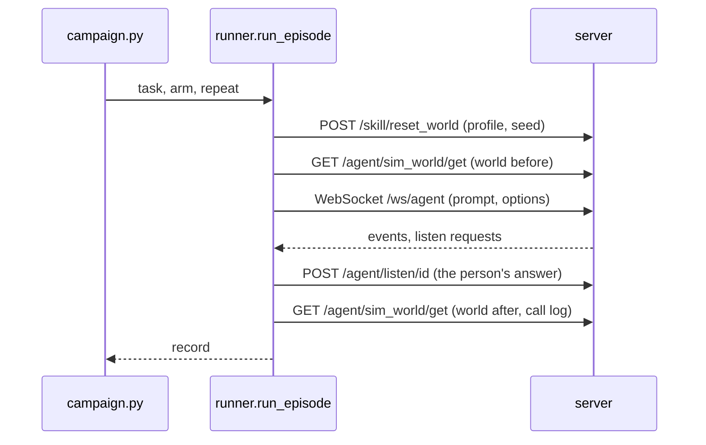

---
sources:
  - bench/runner.py
  - bench/campaign.py
  - bench/suites/factory/__init__.py
  - tests/test_bench.py
verified_at: a5cc7a4943aa
---

# Campaign runner: one episode, then all of them

!!! abstract "In this page"
    You get how a campaign suite plays its episodes against a running server, what one episode
    record contains, how the paired simulator seed is made, how the arm order rotates, and how a
    stopped campaign resumes. The result is measured from the simulator's own truth, never from what
    the robot says. This page does not cover how to start the server (see
    [bench front end](bench-front-end.md)) or the numbers computed afterwards (see
    [Campaign statistics](campaign-statistics.md)).

| | |
|---|---|
| **Input** | a `Suite`, the server address `host:port`, a task dict, an arm name, a repeat number, a profile |
| **Output** | one record per episode in `episodes.jsonl`; the full detail in `detail/<task>_<arm>_<repeat>.json` |
| **Used by** | `bench/cli.py` (`cmd_run`) |
| **Uses** | the server's HTTP and WebSocket interface; `websockets`; the suite's `answer` and `distance` hooks |
| **Source** | [bench/runner.py](https://github.com/mtbui2010/symbolic_robot/blob/a5cc7a4943aa/bench/runner.py), [bench/campaign.py](https://github.com/mtbui2010/symbolic_robot/blob/a5cc7a4943aa/bench/campaign.py) |
| **Tests** | `tests/test_bench.py::test_campaign_resumes_limits_and_rejects_unknown_arms` |

## Background

A **campaign** is every combination of a task, a repeat number and an **arm** for one suite. An arm
is a named set of run options sent with each run (see [Factory suites](factory-suites.md)). The
runner acts like any other client of the robot_agent server: it is not a test double. The planner
under test runs inside that server, and the runner only sends the request, answers its questions and
reads the world afterwards. See [Server and CLI](server-and-cli.md) for the server and
[Benchmark protocol](../learn/benchmark-protocol.md) for why truth is read from the simulator.

## Where it sits



## Input

`run_episode(suite, base, task, arm, seed, profile="real", timeout_s=420.0)`.

| name | meaning | example |
|---|---|---|
| `suite` | supplies `arms[arm]`, `answer`, `distance` and `domain` | `factory/protocol` |
| `base` | server address without scheme | `127.0.0.1:8120` |
| `task` | a dict that needs `id`, `prompt`, `kind`, `obj_id`, `dest`; `policy` is optional | a generated factory task |
| `arm` | key of `suite.arms` | `"B"` |
| `seed` | repeat number (not the simulator seed) | `1` |
| `profile` | the simulator's fault profile | `"real"` |
| `timeout_s` | wall seconds before the run is cancelled and counted as timed out | `420.0` |

A factory task is generated, not hand-written. One from `factory/protocol`, run offline:

```text
{'id': 't07', 'prompt': 'Put the bolt box on the weld table.', 'policy': 'knows', 'kind': 'ask'}
```

## How one episode works

1. `episode_seed(task, seed)` makes the simulator seed (below).
2. `POST /skill/reset_world` with the profile and that seed gives a fresh world and memory. The world
   is read once (`w0`).
3. `_episode` opens `/ws/agent` and sends one message: the prompt, `"lang": "en"`, `"planner":
   "sage"` and the arm's options.
4. It reads events until `done` or `error`, a closed connection, or the timeout. On timeout it posts
   `/agent/cancel` and records a `timeout` event.
5. A line the robot "says" with a `speak_id` is acknowledged, as a browser would.
6. A `listen` event is a question. The suite's `answer(task, question, n_where)` gives the person's
   reply. The reply is posted to `/agent/listen/<id>` after 0.2 s. An answer of kind `source` (a
   where-is-it answer) increments `n_where`, which lets a script give a different second answer.
7. The world is read again (`w1`). Success is `w1["objects"][task["obj_id"]]["at"] == task["dest"]`.
   The record is built and returned. `run_episode` does not raise for a failed run.

### The record

```python
def run_episode(suite, base: str, task: dict, arm: str, seed: int, profile: str = "real", timeout_s: float = 420.0) -> dict:
    """One episode: fresh world and memory (reset_world), one run, then the truth read back. Never raises for a failed run."""
    ep_seed = episode_seed(task, seed)
    http(base, "POST", "/skill/reset_world", {"profile": profile, "seed": ep_seed})
    w0 = http(base, "GET", "/agent/sim_world/get")["value"]
    rec = asyncio.run(_episode(suite, base, task, suite.arms[arm], timeout_s))
    w1 = http(base, "GET", "/agent/sim_world/get")["value"]
    done = next((e for e in reversed(rec["events"]) if e.get("event") == "done"), {})
    truth_ok = w1["objects"].get(task["obj_id"], {}).get("at") == task["dest"]
    status = done.get("status")
    n_q = len(rec["dialog"])
    src = [d for d in rec["dialog"] if d["kind"] == "source"]
    bad = [i for i, d in enumerate(src) if d["grounded"] in ("room", "none")]       # answers that name no place (messy policies only)
    out = {"domain": suite.domain, "task": task["id"], "arm": arm, "seed": seed, "sim_seed": ep_seed, "policy": task.get("policy"), "kind": task["kind"],
           "status": status or "none", "success": bool(truth_ok), "claimed_done": status == "success",
           "wrong_done": status == "success" and not truth_ok, "distance_m": round(suite.distance(w1["log"]), 2),
           "questions": n_q, "q_source": len(src),
           "unusable_answers": len(bad), "clarified": sum(1 for i in bad if i + 1 < len(src)),      # an unusable answer followed by another where-question
           "t_sim": w1["robot"].get("t_sim"), "wall_s": rec["wall_s"], "n_events": len(rec["events"]),
           "faults": sim_faults(w1["log"]), "timeout": any(e.get("event") == "timeout" for e in rec["events"]), "engine_msg": str(done.get("msg", ""))[:200]}
```

| key | meaning |
|---|---|
| `success` | truth: the object is at the destination |
| `claimed_done` | the engine's `done` event has status `success` |
| `wrong_done` | claimed done, truth says no |
| `status` | the engine's own status, or `"none"` when no `done` event came |
| `distance_m` | `suite.distance(call log)`; for the factory, the sum of successful `move` legs |
| `questions`, `q_source` | listen events answered; how many were where-questions |
| `unusable_answers`, `clarified` | answers that name no place (messy policies only); of those, how many were followed by another where-question |
| `faults` | the simulator's injected faults (below) |
| `timeout`, `t_sim`, `wall_s`, `n_events`, `engine_msg` | timeout flag, simulated and wall seconds, event count, the first 200 characters of the engine message |

`sim_seed`, `domain`, `task`, `arm`, `seed`, `policy`, `kind` identify the episode. The `_detail`
key (dialogue, call log, events without `step_log`, world before and after, the task) is split off
by the campaign and written to `detail/`. The detail files can hold the heard instruction and the
robot's last words, so treat them as episode records: this page shows none.

## The paired seed

```text
episode_seed(task, seed) = int(digits of task["id"] or 0) * 100 + int(seed)
```

The seed is the same for every arm and differs between tasks, so each arm meets the same injected
faults on a task, and tasks do not all share one fault. Computed offline:

| task id, repeat | `episode_seed` |
|---|---|
| `t07`, 1 | 701 |
| `t07`, 0 | 700 |
| `t12`, 1 | 1201 |
| `x` (no digits), 1 | 1 |

An id without digits gives 0 for the number part, so two such tasks would share seeds.

## Faults

`sim_faults(log)` reads the truth of each call-log entry and returns the injected faults. A
`truth.fault` is a fault; otherwise a `truth.event` is one unless it is `not_here`; otherwise
`really_here` counts as a `miss` (a detector miss). An object that is simply not at a place is not a
fault. On six sample entries (a `slip` fault, a `not_here` event, a `drop` event, a `really_here`
flag, an empty truth, an empty entry), run offline:

```text
['slip', 'drop', 'miss']
```

## The campaign loop

`run_campaign` (in `bench/campaign.py`) records the protocol hash, writes `tasks.json`, checks the
arms, reads `episodes.jsonl` to learn what is done, and plays what is missing.

```python
    for i, t in enumerate(tasks):
        if only and t["id"] not in set(only):
            continue
        for seed in range(seed0, seed0 + seeds):
            order = arms[i % len(arms):] + arms[:i % len(arms)]
            for arm in order:
                if (t["id"], arm, seed) in done:
                    continue
                if limit and new >= limit:
                    return new
                r = run_episode(suite, base, t, arm, seed, profile)
                (out / "detail" / f"{t['id']}_{arm}_{seed}.json").write_text(json.dumps(r.pop("_detail"), default=str))
                with open(log, "a") as f:
                    f.write(json.dumps(r) + "\n")
                new += 1
```

- **Rotating order.** For task number `i` the arm list starts at `i % len(arms)`, so drift in the
  server or the model touches every arm alike. With arms `[A, B]` the first four (task, arm) pairs of
  repeat 0 were `t00 A, t00 B, t01 B, t01 A`, as the test expects.
- **Resume.** A finished `(task, arm, seed)` is skipped. I ran the loop with a stand-in for
  `run_episode` and `limit=5`: 5 new episodes; run again with no limit: 7 new; again: 0. In all 12
  lines of `episodes.jsonl`, and `detail/t00_A_0.json` and so on.
- **Limit.** `limit` stops after that many new episodes (a pilot).
- **Unknown arm.** `SystemExit: unknown arm(s) ['Z'] for factory/protocol; known: A, B, C, A2`, before
  any episode.
- **Only.** `only` restricts the task ids.
- Each finished episode prints one progress line with the time, task, arm, status, success,
  `wrong_done`, distance, questions and wall seconds.

## What the arms compare (finding F10)

The WebSocket message always asks for robot_agent's planner `sage` with `lang: "en"` (`runner.py:26`).
The arms therefore compare run options of that one planner, not different planners. The server side
of the factory suites sets its baseline environment to arm A (`bench/suites/factory/__init__.py:19`),
and every arm also sends its options with each run. To compare other planners use the household
benchmark ([Household runner](home-runner.md)).

## Edge cases and failure modes

| symptom | cause | fix |
|---|---|---|
| a run of 420 s ends with `timeout: true`, status `none` | no `done` event in time; the run is cancelled | not a crash: counted as a failure; raise `timeout_s` in code if a model is slow |
| HTTP error before the first event | the server is not up or refuses the call | `run_episode` does not catch errors of the reset and world reads; the front end waits for the server before the first episode |
| `wrong_done: true` | the robot said done and the object is not at the destination | a measured result, not a runner bug |
| `ModuleNotFoundError: websockets` | the runner imports it at the top | install the `websockets` extra |
| a rerun appends nothing | every `(task, arm, seed)` is already in `episodes.jsonl` | use a new `--out` folder for a fresh run |

## How it is verified

`test_campaign_resumes_limits_and_rejects_unknown_arms` replaces `run_episode` by a fake, runs 3 tasks
x 2 repeats x 2 arms with `limit=5`, then without it, then again, and checks the counts (5, 7, 0), the
12 lines, `tasks.json`, `PROTOCOL_SHA256`, the detail file, the rotating order and the `SystemExit`
for an unknown arm. It needs the `tmp_path` and `monkeypatch` fixtures, so I did not run it under
pytest; I ran the same calls by hand (above). No campaign was run for this page: it needs the
server, robot_agent and an LLM.

!!! code "Where in the code"
    - Record and `run_episode`: https://github.com/mtbui2010/symbolic_robot/blob/a5cc7a4943aa/bench/runner.py#L85-L104
    - Seed and faults: https://github.com/mtbui2010/symbolic_robot/blob/a5cc7a4943aa/bench/runner.py#L64-L82
    - Campaign loop: https://github.com/mtbui2010/symbolic_robot/blob/a5cc7a4943aa/bench/campaign.py#L14-L46

Next: [Campaign statistics](campaign-statistics.md), [Factory suites](factory-suites.md).
