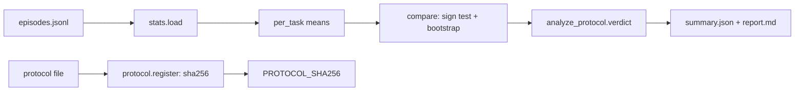

---
sources:
  - bench/stats.py
  - bench/protocol.py
  - bench/suites/factory/analyze_protocol.py
  - bench/suites/factory/report_protocol.py
  - tests/test_bench.py
verified_at: a5cc7a4943aa
---

# Campaign statistics and pre-registration

!!! abstract "In this page"
    You get the statistics that turn `episodes.jsonl` into a verdict: per-task means, an exact sign
    test, a combined success-then-distance criterion with a tie band, a bootstrap interval, the
    pre-registered win rule of the `protocol` suite, and the protocol hash that stops anyone from
    changing the rule after the results are in. Every number below was computed offline from small
    synthetic inputs. This page shows no real campaign result of the factory suites (none was run)
    and one aggregate from the household benchmark, labelled with its source.

| | |
|---|---|
| **Input** | a list of episode records (rows) with `task`, `arm`, `seed` and the measures; a protocol file and a results folder |
| **Output** | dictionaries of counts, p-values and intervals; the file `PROTOCOL_SHA256` |
| **Used by** | the factory suite analyses and reports, `bench/cli.py` (`verify`, `run`), `bench/campaign.py` |
| **Uses** | the standard library only (`math`, `random`, `hashlib`, `json`) |
| **Source** | [bench/stats.py](https://github.com/mtbui2010/symbolic_robot/blob/a5cc7a4943aa/bench/stats.py), [bench/protocol.py](https://github.com/mtbui2010/symbolic_robot/blob/a5cc7a4943aa/bench/protocol.py), [analyze_protocol.py](https://github.com/mtbui2010/symbolic_robot/blob/a5cc7a4943aa/bench/suites/factory/analyze_protocol.py) |
| **Tests** | `tests/test_bench.py` |

## Background

The arms of a campaign are compared on the **same tasks** with the same simulator seeds (see
[Campaign runner](campaign-runner.md)). So the comparison is paired: the unit is the task, not the
episode. Each measure is first averaged over the repeats of a task. Read
[Paired tests](../learn/paired-tests.md) for the idea and
[Benchmark protocol](../learn/benchmark-protocol.md) for pre-registration.

The measures in `MEASURES` are `success`, `wrong_done`, `distance_m`, `questions` and `t_sim`.

## Where it sits



## The functions

| function | what it does |
|---|---|
| `load(path)` | reads `<path>/episodes.jsonl`, one JSON object per line |
| `per_task(rows, arm, measure, tasks)` | `{task: mean over the repeats}`; a `None` value counts as 0.0 |
| `sign_test(wins, losses)` | exact two-sided binomial p; ties are dropped; 1.0 when there are no wins or losses |
| `boot_ci(diffs)` | `(mean, low, high)`: 10,000 resamples of the paired differences with seed 0; zeros for an empty list |
| `compare(rows, arm, base, tasks, measures)` | the paired comparison, below |
| `table(rows, arms, tasks)` | per-arm means: episodes, success, wrong-done, distance, questions, `t_sim`, wall time, timeouts, episodes with no `done` event |

`sign_test` values, computed offline and equal to the ones in the test:

| wins, losses | p |
|---|---|
| 0, 0 | 1.0 |
| 6, 0 | 0.03125 |
| 5, 0 | 0.0625 |
| 3, 3 | 1.0 |
| 9, 1 | 0.021484375 |

`boot_ci([1.0, 2.0, 3.0, 4.0, 5.0])` gave `(3.0, 1.8, 4.2)` and gives the same again, because the
random generator is seeded.

## `compare`: the combined criterion

```python
def compare(rows: list, arm: str, base: str, tasks=None, measures=MEASURES) -> dict:
    """arm vs base on the tasks both have. Combined criterion per task: success first, then distance (with a tie band)."""
    out: dict = {}
    s_a, s_b = per_task(rows, arm, "success", tasks), per_task(rows, base, "success", tasks)
    d_a, d_b = per_task(rows, arm, "distance_m", tasks), per_task(rows, base, "distance_m", tasks)
    common = sorted(set(s_a) & set(s_b))
    win = loss = tie = sw = sl = dw = dl = 0
    for t in common:
        ds = s_a[t] - s_b[t]
        sw, sl = sw + (ds > 0), sl + (ds < 0)
        tol = max(DIST_TOL_ABS, DIST_TOL_REL * d_b[t])
        dd = d_a[t] - d_b[t]
        dw, dl = dw + (dd < -tol), dl + (dd > tol)
        if ds > 0:
            win += 1
        elif ds < 0:
            loss += 1
        elif dd < -tol:
            win += 1
        elif dd > tol:
            loss += 1
        else:
            tie += 1
    out["n_tasks"] = len(common)
    out["combined"] = {"wins": win, "losses": loss, "ties": tie, "p": round(sign_test(win, loss), 4)}
```

For each task that both arms have, the arm **wins** if its success rate is higher, **loses** if it is
lower. When the success rates are equal, a distance shorter by more than the tie band is a win, longer
by more is a loss, anything else is a tie. The band is `max(0.5 m, 5 % of the baseline's distance)`
(`DIST_TOL_ABS`, `DIST_TOL_REL`). The sign test then uses the wins and losses; ties are dropped.

The function also returns the same counts for success alone and distance alone, a bootstrap
interval of the paired difference for every measure (`d_<measure>`), and the distance difference on
the tasks where both arms succeeded in every repeat (`d_distance_both_success`).

A toy run, six tasks, one repeat, distance 10 m everywhere (the data of
`test_compare_combined_criterion_counts_wins_losses_ties`), arm B against A:

```text
n_tasks 6
combined      {'wins': 2, 'losses': 1, 'ties': 3, 'p': 1.0}
success_only  {'wins': 2, 'losses': 1, 'p': 1.0}
distance_only {'wins': 0, 'losses': 0, 'p': 1.0}
d_success     {'mean': 0.1667, 'ci95': [-0.3333, 0.6667]}
d_distance_both_success {'n': 2, 'mean': 0.0, 'ci95': [0.0, 0.0]}
```

## Pre-registration: `PROTOCOL_SHA256`

A suite may name a protocol file (`Suite.protocol`). `register` hashes it with SHA-256 **before** the
first episode and writes `<hash>  <file name>` into the results folder. A later run into the same
folder checks the hash and refuses a changed file.

```python
def register(out: Path, protocol: Path | None, allow_change: bool = False) -> str:
    """Write the hash on the first run; on a later run check it. -> the hash ('' when the suite has no protocol file). Raises on a change."""
    if protocol is None:
        return ""
    h, f = sha256_of(protocol), Path(out) / FILE
    if f.exists():
        old = f.read_text().split()[0]
        if old != h and not allow_change:
            raise SystemExit(f"the protocol changed after its hash was recorded ({f}): {old[:12]} -> {h[:12]}; "
                             f"restore {protocol} or start a new results folder")
        return old
    f.parent.mkdir(parents=True, exist_ok=True)
    f.write_text(f"{h}  {Path(protocol).name}\n")
    return h
```

`cmd_run` calls `register` once before the server starts, and `run_campaign` calls it again. `verify`
(and `python -m bench verify`) returns true when the file exists and its first token equals the hash of
the protocol file now.

I ran it on a throw-away file in a temporary folder (paths shortened):

```text
register  ->  2d27fbdf4e8c   (file PROTOCOL_SHA256 holds the same hash)
verify    ->  True
after editing the file, verify -> False
register  ->  SystemExit: the protocol changed after its hash was recorded (<tmp>/res/PROTOCOL_SHA256): 2d27fbdf4e8c -> 81db67b6a570; restore <tmp>/p.md or start a new results folder
register(allow_change=True) -> 2d27fbdf4e8c
```

With `allow_change` (`--allow-protocol-change`) the old hash is returned and the file is **not**
rewritten, so `verify` stays false for the changed protocol: the change stays visible. The hash is of
the raw bytes, so a changed space or newline also counts. For the committed `factory/protocol`
protocol file, `register` in an empty folder wrote a hash starting `5b33867b307b` and `verify` gave
`True`.

## The pre-registered win rule

The `protocol` suite names its rule in its protocol text, and `verdict` implements it:

```python

def verdict(rows: list) -> dict:
    """The pre-registered win rule: B (or C) beats A on more tasks than it loses on success-or-distance, and wrong-done does not increase."""
    out = {}
    for arm in ("B", "C"):
        c = compare(rows, arm, "A")
        w = c["combined"]
        wd = c["d_wrong_done"]["mean"]
        out[arm] = {"wins": w["wins"], "losses": w["losses"], "p": w["p"], "d_wrong_done": wd,
                    "beats_A": bool(w["wins"] > w["losses"] and wd <= 0)}
    out["rule_met"] = any(out[a]["beats_A"] for a in ("B", "C"))
```

B or C "beats A" when it wins on more tasks than it loses (combined criterion) and the mean paired
difference of wrong-done is not above zero. `rule_met` is true when either does. The rule is a count
rule: the p-value is reported next to it but is not part of it, and the protocol states that no
correction is made for the two comparisons. Arm A2 is a repeat of A, so `A2` against `A` shows how
large a difference noise alone can make.

On synthetic rows (the toy data above for B; C identical to A), `verdict` returned:

```text
{'B': {'wins': 2, 'losses': 1, 'p': 1.0, 'd_wrong_done': 0.0, 'beats_A': True},
 'C': {'wins': 0, 'losses': 0, 'p': 1.0, 'd_wrong_done': 0.0, 'beats_A': False},
 'rule_met': True}
```

This is a smoke input, not a result: with p = 1.0 the rule is "met" on a count of 2 against 1, which is
exactly why the protocol text asks to read the result against the A/A difference. `verdict` of this suite does not compute that comparison; `A2` against `A` is in the `vs_A` table of `summary.json`.

`analyze` adds the per-arm tables, `vs_A` for B, C and A2, C against B, a breakdown by the
person's answer policy, and the number of episodes. `report_protocol.main` prints them as markdown
tables (`+0.167 [-0.333, +0.667]` style intervals, p-values as `<0.0001` or four places). The messy
and messy-fix suites have their own `analyze_*` and `report_messy` modules, built on the same
`compare`; I did not run them (see [Factory suites](factory-suites.md)).

## One quoted aggregate: the household D5 comparison

The household benchmark has a pre-registered comparison of two arms with the same paired logic (a
McNemar test, not these modules). Its aggregate, from the file `docs/home/bench/d5_final_result.md`
in the repo, measured 2026-11-18 on 1,200 episodes per arm: success **887 of 1,200 against 897 of
1,200**, exact two-sided paired p = **0.253**. That is no detectable difference. Feeding the
discordant counts written in that file (36 and 26) to `sign_test` gives 0.2529, the same p. No
per-task data is shown.

## Edge cases and failure modes

| symptom | cause | fix |
|---|---|---|
| `n_tasks` 0, `p` 1.0, intervals `0.0` | the two arms share no task | compare arms that ran on the same tasks |
| a task counted with fewer repeats | `per_task` averages whatever rows exist | finish the campaign; rerun resumes |
| `analysis not computed (...)` | the analysis compares an arm that was not run (a reduced `--arms`) | add the arm or read `episodes.jsonl` directly |
| `SystemExit: the protocol changed ...` | the protocol file differs from the recorded hash | restore the file, or start a new results folder; `--allow-protocol-change` overrides and keeps the old hash |
| `verify` false in an empty folder | no `PROTOCOL_SHA256` | the run never started there |

## How it is verified

| test | status here |
|---|---|
| `test_sign_test_exact_values`, `test_bootstrap_is_deterministic_and_brackets_the_mean`, `test_compare_combined_criterion_counts_wins_losses_ties` | not run under pytest (not installed); I ran the same calls by hand and the values above are from that |
| `test_protocol_hash_is_pre_registered` | needs `tmp_path`; I ran the same calls by hand in a temporary folder |

!!! code "Where in the code"
    - `compare`: https://github.com/mtbui2010/symbolic_robot/blob/a5cc7a4943aa/bench/stats.py#L46-L70
    - Hash register and verify: https://github.com/mtbui2010/symbolic_robot/blob/a5cc7a4943aa/bench/protocol.py#L15-L33
    - `verdict`: https://github.com/mtbui2010/symbolic_robot/blob/a5cc7a4943aa/bench/suites/factory/analyze_protocol.py#L11-L21

Next: [Factory suites](factory-suites.md), [Campaign runner](campaign-runner.md).
