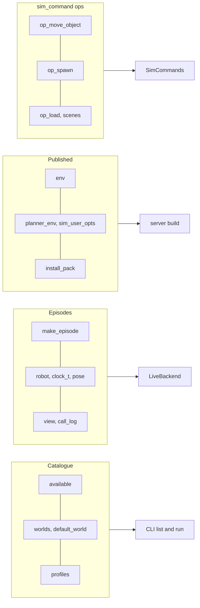

# The domain protocol and the registry

!!! abstract "In this page"
    - A **domain** is one simulated world with its robot: the factory, the household, or one you add. `BaseDomain` lists everything the core may ask of it. Every hook has a default that does nothing, so a domain overrides only what it has.
    - The **registry** finds a domain by name: from a built-in table, from a Python entry point, or from a call to `register()`.
    - A complete toy domain of 23 lines, run through the real core, with its real output.
    - Failure modes: an unknown name, a domain that cannot build episodes, a broken plug-in.

!!! code "Where in the code"
    - [`domain.py`](https://github.com/mtbui2010/symbolic_robot/blob/a5cc7a4943aa/symbolic_robot/domain.py): `BaseDomain`
    - [`registry.py`](https://github.com/mtbui2010/symbolic_robot/blob/a5cc7a4943aa/symbolic_robot/registry.py): `register`, `names`, `get`, `world_labels`
    - [`tests/toy.py`](https://github.com/mtbui2010/symbolic_robot/blob/a5cc7a4943aa/tests/toy.py): a domain written only against the protocol
    - [`docs/domains.md`](https://github.com/mtbui2010/symbolic_robot/blob/a5cc7a4943aa/docs/domains.md): the repo's own "Adding a domain" note
    - [`pyproject.toml`](https://github.com/mtbui2010/symbolic_robot/blob/a5cc7a4943aa/pyproject.toml): package data of the two built-in domains
    - Tests: [`tests/test_core.py`](https://github.com/mtbui2010/symbolic_robot/blob/a5cc7a4943aa/tests/test_core.py)

## What the core asks of a domain

The core is generic. It holds the live backend ([live-backend-and-sim-commands.md](live-backend-and-sim-commands.md)), the `sim_command` handler, the server glue ([server-and-cli.md](server-and-cli.md)) and the command line. None of them knows what a floor, a house or a gripper is. They ask the domain, through a fixed list of methods called **hooks**.

An **episode** is whatever `make_episode` returns. The core touches it only through the hooks and through its robot, which must offer `call(skill, **args)` returning an object with `ok`, `msg`, `code`, `data`, `duration_s` and `truth` (see `Result` in [results-time-draws.md](results-time-draws.md)).

The hooks fall into four groups.



## Class attributes

| attribute | default | meaning |
|---|---|---|
| `name` | `""` | the registry name |
| `description` | `""` | one line, printed by `python -m symbolic_robot list` |
| `pack` | `""` | the importable robot_agent pack: `<pack>.configs.{adapter, skills_config, tasks}` and `manifest.yaml`. It may be dotted: both built-in domains use `symbolic_robot.domains.<name>` |
| `world_label` | `"world"` | what this domain calls a world: `floor`, `house`, `room`. The command line accepts `--<label>` |
| `default_model` | `""` | name of the local LLM served for planner and reader. Empty: no LLM connection is written |
| `live_opts` | `{}` | episode options the server applies unless the caller gives them. `make_episode` itself never reads this dict |

## Hooks and what happens without them

Every row was checked against `domain.py`.

| hook | default (read in `domain.py`, and run) | what the core does with it |
|---|---|---|
| `available()` | `None` (usable); a string is the reason it is not | `list` prints `not available: <reason>`; nothing else breaks |
| `worlds()` | `[]` | the world names `list` shows and `sim_command load` accepts |
| `default_world()` | the first world, or `""` | the world `run` uses when none is given (`server.py` line 130) |
| `profiles()` | `[]` | the profile names `list` shows and `sim_command reset` checks |
| `make_episode(world, profile, seed, **opts)` | raises `NotImplementedError` | builds the episode |
| `robot(ep)` | `ep.robot` | the object the live backend calls |
| `clock_t(ep)` | the robot's attribute `t`, or `0.0` | simulated time in logs and snapshots |
| `pose(ep)` | `(0.0, 0.0, 0.0)` | `(x, y, yaw in radians)` of the robot |
| `view(ep)` | `{"objects": {}, "robot": {}}` | the simulation truth: `{"objects": {id: {cls, at, ...}}, "robot": {...}}` |
| `call_log(ep)` | `None` | the robot's own call log; `None` means the live backend keeps one |
| `env(ep)` | `None` | the planner's ENV for this world; `None` means the pack's own |
| `planner_env()` | `{}` | environment defaults for the planner (names without the `ROBOT_AGENT_` prefix) |
| `sim_user_opts()` | `{}` | `make_episode` options that turn the simulated person on for `--dialogue sim` |
| `install_pack(live)` | does nothing | hands the live backend to the pack's skill functions |
| `op_move_object(ep, oid, place)` | `None` | `None` makes the op answer `ok: false` |
| `op_spawn(ep, cls, place, **kw)` | `None` | the same |
| `op_load(ep, name)` | `None` | the same (after the worlds list is tried first) |
| `scenes(ep)` | `[]` | extra loadable names shown by `state` |

The minimum for a server is `make_episode`, `robot`, `pose` and `view`. Without the others the domain still runs: it has no ENV of its own, no planner options, no LLM connection, and the `sim_command` ops that need a hook answer `ok: false` with a message.

### The defaults, run

```python
from symbolic_robot.domain import BaseDomain
b = BaseDomain()
print(b.available(), b.worlds(), repr(b.default_world()), b.profiles(), b.pose(None), b.view(None))
print(b.call_log(None), b.env(None), b.planner_env(), b.sim_user_opts(), b.op_move_object(None, "a", "b"), b.scenes(None))
try: b.make_episode("w", "p", 0)
except NotImplementedError as e: print("NotImplementedError", e)
```

Output (run):

```text
None [] '' [] (0.0, 0.0, 0.0) {'objects': {}, 'robot': {}}
None None {} {} None []
NotImplementedError domain '' cannot build episodes
```

## A complete domain in 23 lines

`tests/toy.py` is a whole domain written only against this protocol. It shows, and a test checks, that a new domain needs no change in the core. Its robot (a `ToyRobot`, defined above the part shown) draws a failure with `Rng.chance`, and advances a `SimClock` by each call's duration.

```python
class Toy(BaseDomain):
    name = "toy"
    description = "two places and a cup"
    world_label = "room"

    def worlds(self):
        return ["small", "big"]

    def profiles(self):
        return ["ideal", "real"]

    def make_episode(self, world, profile, seed, **opts):
        return ToyEpisode(world, profile, seed)

    def pose(self, ep):
        return ({"a": 0.0, "b": 3.0}[ep.robot.at], 0.0, 0.0)

    def view(self, ep):
        return {"objects": {k: {"cls": k, "at": v} for k, v in ep.robot.items.items()}, "robot": {"at": ep.robot.at}}

    def op_move_object(self, ep, oid, place):
        ep.robot.items[oid] = place
        return {"ok": True, "msg": f"{oid} is now at {place}"}
```

Source: [`tests/toy.py` L36-L58](https://github.com/mtbui2010/symbolic_robot/blob/a5cc7a4943aa/tests/toy.py#L36-L58).

It overrides the catalogue (`worlds`, `profiles`), the episode (`make_episode`, `pose`, `view`) and one op (`op_move_object`). Everything else uses the default.

### Registering it and using it (run)

```python
from symbolic_robot import registry
from symbolic_robot.backend import LiveBackend
from symbolic_robot.simcommand import SimCommands
from toy import Toy                      # tests/toy.py

print(registry.names(), registry.world_labels())
registry.register("toy", Toy)
print(registry.names(), registry.world_labels())
live = LiveBackend(Toy(), "small", "ideal", 0)
print(live.call("go", to="b").ok, live.snapshot())
c = SimCommands(live)
print(c.handle({"cmd": "move_object", "body": "cup", "place": "b"}))
print(c.handle({"cmd": "spawn", "cls": "x", "place": "a"}))
```

Output (run):

```text
['factory', 'home'] ['floor', 'house']
['factory', 'home', 'toy'] ['floor', 'house', 'room']
True {'at': 'b', 'x': 3.0, 'y': 0.0, 'yaw': 0.0, 'busy': '', 't_sim': 2.0}
{'ok': True, 'msg': 'cup is now at b', 'isdone': True}
{'ok': False, 'msg': "spawn is not supported by domain 'toy'", 'isdone': False}
```

The toy has no `op_spawn`, so `spawn` says it is not supported: that is the default of an un-overridden op. The snapshot shows the position `x = 3.0` coming from `pose`, `at` from `view`, and `t_sim` from the robot's clock (2.0 s for one `go`).

## The registry

```python
def names() -> list:
    return sorted({**BUILTIN, **_entry_points(), **_extra})


def get(name: str) -> BaseDomain:
    if name in _cache:
        return _cache[name]
    target = {**BUILTIN, **_entry_points(), **_extra}.get(name)
    if target is None:
        raise KeyError(f"unknown domain {name!r}; known: {', '.join(names())}")
    if isinstance(target, str):
        mod, _, attr = target.partition(":")
        target = getattr(importlib.import_module(mod), attr)
    dom = target() if isinstance(target, type) else target
    _cache[name] = dom
    return dom
```

Source: [`symbolic_robot/registry.py` L30-L45](https://github.com/mtbui2010/symbolic_robot/blob/a5cc7a4943aa/symbolic_robot/registry.py#L30-L45).

There are three sources of names, merged in this order; a later one overrides an earlier one with the same name:

| source | how | when to use |
|---|---|---|
| `BUILTIN` | a dict of `"module:Class"` strings: `factory` and `home` | the two domains of this repo. They are imported lazily, so a missing optional package disables only its own domain |
| entry points | the group `symbolic_robot.domains`, entry name = domain name, value = `"module:attr"`; `attr` is a `BaseDomain` subclass or instance | a domain shipped in another package. Not run here: it needs an installed package |
| `register(name, target)` | a class, an instance or a `"module:attr"` string; clears the cached instance of that name | tests and local scripts |

`get` creates the instance once and caches it: a class is called with no arguments, an instance is used as it is. `world_labels()` returns the sorted `world_label` of every domain that can be loaded; the command line uses it to accept `--floor`, `--house` and so on.

An entry point in a package looks like this (from `docs/domains.md`; not run):

```toml
[project.entry-points."symbolic_robot.domains"]
toy = "my_package.toy:Toy"
```

## Failure modes

| situation | result |
|---|---|
| `registry.get("nope")` | `KeyError: "unknown domain 'nope'; known: factory, home"` (run). The command line turns it into a `cannot start:` message with exit code 2 |
| `make_episode` not overridden | `NotImplementedError: domain '' cannot build episodes` (run above, with an empty name; a domain with a name shows it) |
| a plug-in that cannot be imported | `get` raises its `ModuleNotFoundError` (run with a registered name `"no_such_module:X"`), but `names()` still lists it and `world_labels()` skips it, so the CLI flags keep working (`registry.py` lines 48-56; checked by the run: labels stayed `['floor', 'house', 'room']`) |
| `available()` returns a reason | `list` prints `not available: <reason>`. The household domain does this when pyyaml is missing |
| two registrations of one name | the later source wins (`register` over an entry point over a built-in). `register` also drops the cached instance |

## How it is verified

`tests/test_core.py`, called by hand through a small stand-in for `pytest.raises` (pytest is not installed here; this is not a pytest run), passed:

- `test_registry_lists_builtins_and_takes_a_plugin`: `factory` and `home` are listed; `get("nope")` raises `KeyError`; after `register("toy", Toy)`, `get("toy").worlds()` is `["small", "big"]` and `"room"` is in `world_labels()`.
- `test_live_backend_and_sim_commands_work_for_a_new_domain`: the toy goes through `LiveBackend` and `SimCommands`: a call, the log, the snapshot, `state`, `move_object` with and without a place, `spawn` (not supported), an unknown command.

Next: [live-backend-and-sim-commands.md](live-backend-and-sim-commands.md). To write your own domain end to end, see [../guides/add-a-domain.md](../guides/add-a-domain.md).
