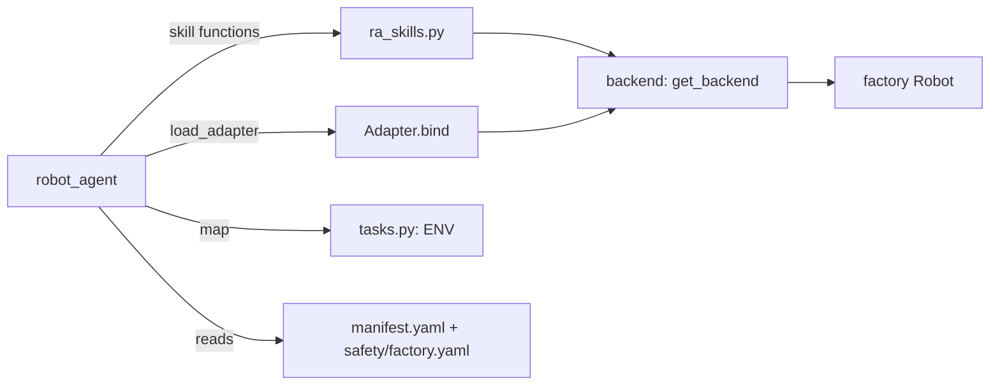

---
sources:
  - symbolic_robot/domains/factory/configs/
  - symbolic_robot/domains/factory/__init__.py
  - tests/test_server.py
verified_at: a5cc7a4943aa
---

# Factory pack: the plug-in that connects the factory to robot_agent

!!! abstract "In this page"
    You get the files that make the factory domain usable by [robot_agent](https://mtbui2010.github.io/robot_agent/): a manifest, an adapter that turns a plan step into a skill call, the legacy skill functions, and the map (ENV) of a floor. Read it when you add a domain and want to know what a pack must hold, or when a plan step fails to bind. The pack is the only place of the factory domain that imports robot_agent.

    | | |
    |---|---|
    | **Input** | a plan step such as `{"action": "Pick", "object": "large wrench"}` |
    | **Output** | `(skill_name, params)`, or `Unbindable` |
    | **Used by** | robot_agent, through `load_adapter('symbolic_robot.domains.factory')`; the [server](server-and-cli.md) |
    | **Uses** | the [world](factory-world.md) for names, the [robot](factory-skills.md) through a backend |
    | **Tests** | `tests/test_server.py` (needs robot_agent; skipped when it is not importable) |

!!! code "Where in the code"
    All files are under `symbolic_robot/domains/factory/configs/`:

    - [`manifest.yaml`](https://github.com/mtbui2010/symbolic_robot/blob/a5cc7a4943aa/symbolic_robot/domains/factory/configs/manifest.yaml): 153 lines; the skills and the planner block.
    - [`adapter.py`](https://github.com/mtbui2010/symbolic_robot/blob/a5cc7a4943aa/symbolic_robot/domains/factory/configs/adapter.py): `Adapter` (112 lines).
    - [`ra_skills.py`](https://github.com/mtbui2010/symbolic_robot/blob/a5cc7a4943aa/symbolic_robot/domains/factory/configs/ra_skills.py): the 12 legacy skill functions.
    - [`skills_config.py`](https://github.com/mtbui2010/symbolic_robot/blob/a5cc7a4943aa/symbolic_robot/domains/factory/configs/skills_config.py): the table skill name -> function.
    - [`tasks.py`](https://github.com/mtbui2010/symbolic_robot/blob/a5cc7a4943aa/symbolic_robot/domains/factory/configs/tasks.py): `env_for` and `ENV`.
    - [`backend.py`](https://github.com/mtbui2010/symbolic_robot/blob/a5cc7a4943aa/symbolic_robot/domains/factory/configs/backend.py): `get_backend` and `set_backend`.
    - `safety/factory.yaml`: the safety profile.

## Background

robot_agent is the planner and executor on the other side. It does not know the factory. A pack tells it what the robot can do (the manifest), how to call it (the legacy skill functions), how a plan step becomes a call (the adapter), and what the map holds (ENV). See [packs and manifests](../learn/packs-and-manifests.md). The rule of the repo is that robot_agent is imported only here and in the server glue; a test enforces it.

## Where it sits



## Input

The pack files and what robot_agent reads from each:

| file | what robot_agent reads | factory example |
|---|---|---|
| `manifest.yaml` | skills with `action`, `pre`, `hold`, `effects`, `verify`, `errors`; geometry; a `planner` block; the safety file | 12 skills; `move` has effect `arrived(?inputs)` |
| `adapter.py` | `Adapter`: `bind`, `observe`, `reconcile`, `pose`, `container_states`, `health` | `make_adapter()` |
| `skills_config.py` | table of skill name to function | `'move': (...ra_skills, 'move')` |
| `ra_skills.py` | the skill functions, each `f(node=None, inputs="", **params)` | `move(inputs="main bench")` |
| `tasks.py` | `ENV`: one entry per place | 9 entries for the 10 places of `small_workshop` |
| `backend.py` | the robot the functions drive | `set_backend(robot)` |
| `safety/factory.yaml` | rules and word classes the engine checks before acting | lane kept clear, hot parts not stowed |

The manifest holds, besides the skills: the language (`en`), `capabilities`, `geometry` (arrival tolerance 0.3 m, reach 0.78 m), `limits.payload_kg` 5.0, and a `planner` block (`llm_budget` 22, `translate_budget` 8, `input_pivot: none`, `search_legs: true`, `detector_miss_rate: 0.1`, and two notes: open a container before `PutIn`; find an object before `Pick`). The value 0.1 repeats the profile's detector miss as a literal; I found no code that ties the two together.

This is the `move` skill of the manifest, which shows every key a skill has:

```yaml
  - name: move
    action: MoveTo
    description: "Drive to a place."
    params: {type: object, properties: {inputs: {type: string, description: "place id or name"}}, required: [inputs]}
    pre: []
    hold: []
    effects: ["arrived(?inputs)"]
    verify: [{kind: symbolic}, {kind: sensor, skill: pose}]
    interruptible: true
    errors: [unreachable, blocked, hw_fault, cancelled, software]
    version: "1.0"
```

[`manifest.yaml` lines 22-32](https://github.com/mtbui2010/symbolic_robot/blob/a5cc7a4943aa/symbolic_robot/domains/factory/configs/manifest.yaml#L22-L32). `pre` and `effects` are predicates over the plan state; `errors` lists the failure codes the skill may return, which are the `code` values of the [`Result`](results-time-draws.md).

The safety profile `safety/factory.yaml` is invented data, and every entry is marked `assumed`: it is not a safety assessment of a real plant. It has three rules: nothing is left in the forklift lane (`lane_clear`), a hot part is not put into a toolbox or a cabinet (`hot_not_stowed`), and a hot part is not handed to a person (`hot_not_handed`). The rules are data, so the same engine refuses other things in the household pack.

## Output

`Adapter.bind(step)` returns `(skill_name, params)` and raises `Unbindable` with a reason when it cannot. These two calls are the expected values that `tests/test_server.py::test_factory_adapter_binds_names` asserts. I did not run them, because robot_agent is not installed here:

| plan step | result |
|---|---|
| `{'action': 'Pick', 'object': 'Small Wrench'}` | `('pick', {'inputs': 'small wrench'})` |
| `{'action': 'MoveTo', 'object': 'tool wall'}` | `('move', {'inputs': 'tool_wall@tool_crib'})` (on `assembly_hall`) |

For the other cases the result follows from the code I read. A plan action with no skill, or an `Observe` or `Verify` skill, gives `Unbindable("no skill for ...")` with the list of actions the robot can do. `Say` and `Ask` need a sentence. `Look` takes no argument. Every other action needs one, and gets it resolved against the world: a place name becomes a place id when it names exactly one place, `dock`, `charger`, `home` or `base` become the dock, and an object name becomes the object's label when exactly one object matches. If the name is not unique it passes through as written, and the skill itself will report the problem.

`env_for(world)` is the map. Run offline on `small_workshop`: 10 places give 9 entries, because the forklift lane is left out (it is a keep-out region, not a place to go to or search). The dock entry, shortened to its main keys:

```text
aliases: ['charging dock', 'charging dock in the entry', 'charge', 'charging', 'charging station']
search: False    surface: False    openable: False
```

Each entry also has `loc` (`x`, `y`, `rz`), `height`, `default_mode`, and `category` when the place has one. The toolbox entry has `openable: True`. `search: False` tells the engine not to search the dock or a lane for objects.

The legacy skill functions return the dict `{isdone, msg, code?, **data}`. Offline, in profile `ideal`, with `set_backend(robot)`:

```text
move(inputs="main bench")  -> {'isdone': True, 'msg': 'arrived at main bench', 'at': 'main_bench@bench_area'}
find(inputs="large wrench") -> {'isdone': True, 'msg': 'found large wrench', 'found': 'large wrench', 'ins': {'large wrench': {'pose_3d': [0.6, 0.0, 0.8]}}}
grasp_check()              -> {'isdone': False, 'msg': 'empty', 'holding': False}
pick(inputs="large wrench") -> {'isdone': True, 'msg': 'picked large wrench'}
grasp_check()              -> {'isdone': True, 'msg': 'holding', 'holding': True}
```

The `pose_3d` in `find` is a fixed made-up value, `[0.6, 0.0, 0.8]`. `grasp_check` sets `isdone` to whether the gripper holds something.

On failure: `ENV` is built when `tasks.py` is imported, for the floor named by the environment variable `SYMBOLIC_FACTORY_FLOOR` (default `assembly_hall`).

## How it works

1. When the live backend starts, `Factory.install_pack(live)` runs and calls `set_backend(live)`. From then on `get_backend()` returns the live robot, and every skill function calls `get_backend().call(skill, **args).to_legacy()`.
2. Without a backend, `get_backend()` builds a default episode of the default floor.
3. A plan step reaches `Adapter.bind`. It finds the skill by its action name, and fills `inputs` (resolved on the world).
4. `observe` reads the robot's own sensed state: where it is and what it holds, never the hidden truth. `reconcile` copies `arrived`, `holding` and the set of open containers back into robot_agent's world model.
5. `Factory.planner_env()` also hands three settings to the planner: `ASK_SOURCE` and `ASK_SOURCE_REASK` (ask the person where an object is) and `SEARCH_ROUTE_WEIGHT` (0.3).

Setting `SYMBOLIC_FACTORY_KEEP_LANES=1` puts the lane back in `ENV`. The code comment says it exists only to reproduce an engine finding. I did not run it.

## Code

```python
    def bind(self, step: dict, world=None):
        action = (step.get("action") or "").strip()
        obj = str(step.get("object") or step.get("target") or step.get("inputs") or "").strip()
        spec = self.manifest.skill_for(action)
        if spec is None or spec.action in ("Observe", "Verify"):
            raise Unbindable(f"no skill for {action!r} on {self.manifest.robot} (it can {', '.join(sorted(self.plannable_actions))})")
        if spec.action in TEXT_ACTIONS:
            if not obj:
                raise Unbindable(f"{action} needs a sentence")
            params = {"inputs": obj}
            if step.get("lang"):
                params["lang"] = step["lang"]
            return spec.name, params
        if spec.action == "Look":
            return spec.name, {}
        if not obj:
            raise Unbindable(f"{action} needs an argument")
        return spec.name, {"inputs": self._resolve(obj, "object" if spec.action in OBJECT_ACTIONS else "place")}
```

[`adapter.py` lines 44-61](https://github.com/mtbui2010/symbolic_robot/blob/a5cc7a4943aa/symbolic_robot/domains/factory/configs/adapter.py#L44-L61)

The map of one place:

```python
def env_for(world: World, keep_lanes: bool = False) -> dict:
    env = {}
    for pid, p in sorted(world.places.items()):
        if p.kind == "lane" and not keep_lanes:        # a keep-out region of the map, not a place the robot goes to or searches (the engine searches every ENV place)
            continue
        zone = p.zone.replace("_", " ")
        aliases = [p.name, f"{p.name} in the {zone}", pid.split("@")[0].replace("_", " ")] + list(p.aliases)
        if pid == world.dock:
            aliases += DOCK_WORDS
        seen, al = set(), []
        for a in aliases:
            if a and a.lower() not in seen:
                seen.add(a.lower())
                al.append(a)
        entry = {"loc": {"x": p.pos[0], "y": p.pos[1], "rz": 0.0}, "height": 0.8, "default_mode": "front", "aliases": al,
                 "openable": p.openable, "surface": p.kind in ("surface", "bin") and p.slots > 0}
        if p.category:
            entry["category"] = p.category
        if p.kind == "lane" or pid == world.dock:       # keep-out region / charger: the engine's search must not pick them (ENV `search: false`)
            entry["search"] = False
        env[pid] = entry
    return env
```

[`tasks.py` lines 11-32](https://github.com/mtbui2010/symbolic_robot/blob/a5cc7a4943aa/symbolic_robot/domains/factory/configs/tasks.py#L11-L32)

The legacy functions are thin: `ra_skills.py` lines 7-23 hold `_run`, `move`, `find` and `pick` ([permalink](https://github.com/mtbui2010/symbolic_robot/blob/a5cc7a4943aa/symbolic_robot/domains/factory/configs/ra_skills.py#L7-L23)).

## Edge cases and failure modes

| symptom | cause | fix |
|---|---|---|
| `Unbindable: no skill for 'X'` | the plan action is not a manifest action, or it is `Observe` or `Verify` | plan with the listed actions |
| `Unbindable: ... needs an argument` | a skill step without `object`, `target` or `inputs` | add the argument |
| a name passes through unresolved | the name matched no place, or several | use the id or a longer name; see [world](factory-world.md) |
| the lane is missing from ENV | by design: it is a keep-out region | `SYMBOLIC_FACTORY_KEEP_LANES=1`, only to reproduce an engine finding |
| `ENV` is for the wrong floor | it is built at import time from `SYMBOLIC_FACTORY_FLOOR` | set the variable before the import; `Factory.env(ep)` builds the map of a given episode instead |
| import error `robot_agent` in `adapter.py` | the adapter imports robot_agent's contract classes; the other pack files do not | install robot_agent; the skill functions and `env_for` run without it |

## How it is verified

`tests/test_server.py` boots the server and the pack, so it needs robot_agent and is skipped here. Its factory tests:

- `test_factory_boots_with_pack_and_launcher_skills`: all 12 skills are registered, and so are the launcher's `reset_world` and `spawn_object`; 21 objects on `assembly_hall`.
- `test_factory_manifest_check`: robot_agent's manifest checker reports 0 errors; the warnings it prints are only the "not inspected" kind, because the checker assumes a top-level pack name and this one is dotted.
- `test_factory_adapter_binds_names`: the two `bind` results in the table above.

I did not run `check_manifest` or the adapter. I ran `env_for` and the skill functions offline on a copy of the pinned commit, and I claim no pytest result because `pytest` is not installed here.
