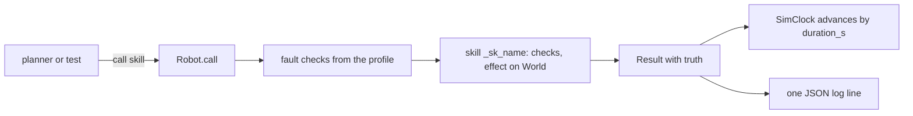

---
sources:
  - symbolic_robot/domains/factory/robot.py
  - symbolic_robot/domains/factory/episode.py
  - symbolic_robot/domains/factory/profiles.py
  - symbolic_robot/domains/factory/profiles/real.yaml
  - symbolic_robot/rng.py
  - symbolic_robot/clock.py
  - tests/test_factory.py
verified_at: a5cc7a4943aa
---

# Factory skills and faults: the simulated arm and gripper

!!! abstract "In this page"
    You get the 12 skills of the factory robot, the order in which a call can fail, the five kinds of fault the `real` profile draws, and a measured check that the faults happen as often as the profile declares. Read it when you want to know why a call failed, or before you add a skill or change a fault rate.

    | | |
    |---|---|
    | **Input** | `make_episode(floor, profile, seed, policy=None, target="")`, then `robot.call(skill, **args)` |
    | **Output** | a `Result`: `ok`, `msg`, `code`, `data`, `duration_s`, and `truth` (what really happened) |
    | **Used by** | the benchmark judge, the [live backend](live-backend-and-sim-commands.md), the [pack](factory-pack.md) |
    | **Uses** | the [world](factory-world.md), the seeded draws and the clock of [results, time and draws](results-time-draws.md), the [profile](profiles.md) |
    | **Tests** | `tests/test_factory.py` (17 tests) |

!!! code "Where in the code"
    - [`robot.py`](https://github.com/mtbui2010/symbolic_robot/blob/a5cc7a4943aa/symbolic_robot/domains/factory/robot.py): the `Robot` class, 214 lines. `call` is at lines 53-70.
    - [`episode.py`](https://github.com/mtbui2010/symbolic_robot/blob/a5cc7a4943aa/symbolic_robot/domains/factory/episode.py): `make_episode` builds an `Episode(world, robot, floor, profile, seed)`.
    - [`profiles.py`](https://github.com/mtbui2010/symbolic_robot/blob/a5cc7a4943aa/symbolic_robot/domains/factory/profiles.py) and `profiles/real.yaml`: the fault rates. `ideal` and `stress` are derived from `real`.
    - [`rng.py`](https://github.com/mtbui2010/symbolic_robot/blob/a5cc7a4943aa/symbolic_robot/rng.py) (`Rng`) and [`clock.py`](https://github.com/mtbui2010/symbolic_robot/blob/a5cc7a4943aa/symbolic_robot/clock.py) (`SimClock`).

## Background

A skill is one action the planner may ask for. In the simulator a skill has a precondition (is the gripper empty?), a possible fault, an effect on the world, and a duration in simulated seconds. Nothing waits in real time: the clock moves only by the duration a call reports. A `truth` record on every result says what really happened; the robot's message may hide it (a detector miss says "not found", the truth says `detector_miss`). See [symbolic worlds](../learn/symbolic-worlds.md), [declared outcomes](../learn/declared-outcomes.md) and [determinism](../learn/determinism.md).

## Where it sits



## Input

`make_episode("small_workshop", "real", 0)` loads the floor and builds the robot with the profile `real` and seed 0. The default floor is `assembly_hall`. Passing `policy` also builds a scripted person for `ask` (see [tasks and people](factory-tasks-and-people.md)).

The 12 skills and their arguments:

| skill | arguments | what it does | fault drawn |
|---|---|---|---|
| `move` | `target` | go to a place; refuses a lane | transient and persistent hardware fault |
| `find` | `obj` | look for an object at the current place | detector miss |
| `pick` | `obj` | take a visible object | slip; hardware faults |
| `place` | `target` | put the held object on a surface or bin | drop; hardware faults |
| `put_in` | `container` | put the held object in an open container | drop; hardware faults |
| `open`, `close` | `container` | open or close a container here | hardware faults |
| `say` | `text`, `lang` | speak; always `ok` | none |
| `ask` | `question`, `lang` | ask the person; fails with code `timeout` if no answer | none |
| `look` | none | list what the camera sees here | none |
| `grasp_check` | none | read the gripper: `holding` or `empty` | none |
| `pose` | none | read `[x, y, 0.0]` of the current place | none |

`move`, `pick`, `place`, `put_in`, `open` and `close` form the set `MOTION`. Only they can have a hardware fault.

The rates of `real`, from `profiles/real.yaml`. Every number is invented and marked so in the file:

| parameter | `real` | meaning |
|---|---|---|
| `detector_miss` | 0.10 | `find`: the object is in view and is not seen |
| `slip` | 0.05 | `pick`: the grip fails, the object stays |
| `drop` | 0.03 | `place` and `put_in`: the object falls to the floor of that zone |
| `hw_fault` | 0.02 | any motion call: a transient fault, nothing happens |
| `persistent_fault` | 0.04 | per episode: from some call on, one skill always fails |
| `speed_mps` | 0.8 | base speed; a move takes `distance / speed` plus 4.0 s overhead |

`ideal` is `real` with every failure set to 0. `stress` multiplies each probability by 3 (capped at 1), because `real` declares `derive: stress: {scale: 3.0}`. For example `slip` is 0.05, 0.0 and 0.15000000000000002 in `real`, `ideal` and `stress`.

## Output

A call table, run offline on `small_workshop`, profile `real`, seed 0. Seed 0 happens to plan a persistent fault: `persistent = {'skill': 'move', 'from_call': 3}`.

| call | ok | code | seconds | message and truth |
|---|---|---|---|---|
| `move(target="main bench")` | yes | | 14.078 | `arrived at main bench`; leg of 8.062 m from the dock |
| `find(obj="large wrench")` | yes | | 3.0 | `found large wrench`; truth `find: seen` |
| `pick(obj="large wrench")` | yes | | 6.0 | `picked large wrench`; truth `hot: False` |
| `move(target="forklift lane")` | no | `blocked` | 1.0 | `forklift lane is a forklift lane: not allowed`; truth `hazard: entered_forklift_lane` |
| `move(target="shelf 1")` | no | `hw_fault` | 1.0 | `move: hardware fault (persistent)`; truth `fault: persistent_hw_fault` |
| `fly()` | no | `software` | 1.0 | `unknown skill fly` |

The third `move` call is the one that hits the persistent fault (`from_call` is 3); the lane call counts as the second. After these six calls `total_distance()` is 8.062 m (only successful legs count) and `robot.log` has 6 entries. The first log entry is one JSON object:

```json
{"skill": "move", "args": {"target": "main bench"}, "ok": true, "code": "", "msg": "arrived at main bench", "t_sim": 14.08, "dur": 14.08, "truth": {"leg": {"from": "charging_dock@entry", "to": "main_bench@bench_area", "dist": 8.062}}}
```

A failed call without its own duration gets the profile's duration for that skill, or 1.0 s when the profile has none (a failed `move` gets 1.0 s, as above).

Hazards are reported in the truth, not in the message: `entered_forklift_lane` (move into a lane), `left_in_forklift_lane` (release in a lane), `hot_part_stowed` (a hot part put into a container). The judge reads them; the robot does not.

On failure: a call never raises for a bad skill name. It returns `Result(False, "unknown skill ...", "software")`.

## How it works

1. `call` counts the call (`n_calls`, and a count per skill name).
2. It looks up the method `_sk_<skill>`. If none exists the result is `software`.
3. If the skill is in `MOTION` and a persistent fault is active for this skill, the result is `hw_fault` with truth `persistent_hw_fault`.
4. Else, if the skill is in `MOTION` and a draw `chance(hw_fault, "hw", skill)` succeeds, the result is a transient `hw_fault`.
5. Else the skill runs its own checks and draws (the `find` miss, the `pick` slip, the `place` drop).
6. The clock advances, and one log entry is appended, with `msg` cut to 160 characters.

The persistent fault is planned once, when the robot is built (`_plan_persistent`, lines 43-46): with probability 0.04 one of `pick`, `place`, `move`, `open` is chosen, and a start call between 1 and 4. From that call on, that skill always fails. Every draw uses `Rng(seed)`, whose value depends on the seed, a key such as `("miss", "wrench_l")`, and how many times that key was asked. The order of other calls does not change a draw, so two plans in the same episode meet the same fault at the same event.

Note: `CallDraws`, the other draw scheme in `rng.py`, is a core helper that no domain uses at this commit. The factory uses `Rng`.

## Code

```python
    # ---- entry point
    def call(self, skill: str, **args) -> Result:
        self.n_calls += 1
        self._count[skill] = self._count.get(skill, 0) + 1
        fn = getattr(self, f"_sk_{skill}", None)
        if fn is None:
            res = Result(False, f"unknown skill {skill}", "software")
        elif skill in MOTION and self.persistent_active(skill):
            res = Result(False, f"{skill}: hardware fault (persistent)", "hw_fault", truth={"fault": "persistent_hw_fault"})
        elif skill in MOTION and self.rng.chance(float(self.prof.get("hw_fault", 0)), "hw", skill):
            res = Result(False, f"{skill}: hardware fault", "hw_fault", truth={"fault": "hw_fault"})
        else:
            res = fn(**args)
        if not res.duration_s:
            res.duration_s = float(self.prof.get("durations_s").get(skill, 1.0))
        self.clock.advance(res.duration_s)
        self.log.append({"skill": skill, "args": {k: str(v) for k, v in args.items()}, "ok": res.ok, "code": res.code or "",
                         "msg": res.msg[:160], "t_sim": round(self.t, 2), "dur": round(res.duration_s, 2), "truth": res.truth})
        return res
```

[`robot.py` lines 52-70](https://github.com/mtbui2010/symbolic_robot/blob/a5cc7a4943aa/symbolic_robot/domains/factory/robot.py#L52-L70)

A skill with its own checks, `pick`:

```python
    def _sk_pick(self, obj=""):
        w = self.world
        if w.holding:
            return Result(False, "the gripper is not empty", "blocked")
        ids = w.resolve_objects(str(obj), among=w.visible_at(w.at))
        if len(ids) != 1:
            return Result(False, f"{obj} is not here", "absent")
        o = w.objects[ids[0]]
        if o.weight_kg > w.payload_kg:
            return Result(False, f"{o.label} is too heavy", "grasp_failed", truth={"fault": "too_heavy", "object": o.id})
        if self.rng.chance(float(self.prof.get("slip", 0)), "slip", o.id):
            return Result(False, "the grip slipped", "grasp_failed", truth={"fault": "slip", "object": o.id})
        o.at, w.holding = "robot", o.id
        return Result(True, f"picked {o.label}", truth={"picked": o.id, "hot": o.hot})
```

[`robot.py` lines 114-127](https://github.com/mtbui2010/symbolic_robot/blob/a5cc7a4943aa/symbolic_robot/domains/factory/robot.py#L114-L127)

## Measured: does the detector miss as often as declared?

This is the check that the declared number is the real number. I ran it offline on a copy of the pinned commit: for each seed from 0 to 1,999 and each profile, build a `small_workshop` episode, `move` to the main bench, then `find("large wrench")`. Episodes whose `move` failed with a hardware fault are counted separately, and a miss is a find whose truth is `detector_miss`.

| profile | declared miss | measured miss among finds | finds | moves lost to `hw_fault` |
|---|---|---|---|---|
| `ideal` | 0 | 0.0 | 2000 | 0 |
| `real` | 0.10 | 0.0942 (184 of 1,954) | 1954 | 46 |
| `stress` | 0.30 | 0.3094 (583 of 1,884) | 1884 | 116 |

Both measured values lie within one standard error of the declared value (0.0942 against 0.10 over 1,954 finds; 0.3094 against 0.30 over 1,884 finds). `stress` declares 0.1 times 3, which is 0.30000000000000004 in floating point; the table rounds it. The household domain has its own, larger check, which was not run for this page.

## Edge cases and failure modes

| symptom | cause | fix |
|---|---|---|
| a skill fails with `hw_fault` every time from some call on | a persistent fault planned from the seed (4 % of `real` episodes) | none in the episode; a planner can only route around it. Use `ideal` to switch it off |
| `find` fails on an object that is really in the room | `find` sees only the current place and nothing inside a closed container; an object that was dropped is at `floor@<zone>`, which no place shows | `move` to the place, `open` the container; a dropped object is not findable |
| `pick` says "is not here" | zero matches, or several: the name must match exactly one visible object | name the object with its variant |
| `place` says "use put_in" | the target is a container; `put_in` is for containers, `place` for surfaces | use the other skill |
| `ask` fails with `timeout` | no scripted person was given | build the episode with a `policy` |

## How it is verified

`tests/test_factory.py` has 17 tests. The ones on this page:

- `test_ideal_run_is_exact_and_deterministic` and `test_real_profile_is_deterministic_by_seed_and_differs_across_seeds`: the same seed repeats, different seeds differ.
- `test_detector_miss_rate_is_near_the_profile` and `test_detector_miss_hw_and_persistent_frequencies_match_the_profile`: the rates lie within 4 standard errors of the profile (0.10, 0.02, 0.04).
- `test_slip_and_drop_frequencies_match_the_profile`, `test_stress_profile_fails_more_and_ideal_never`, `test_all_fault_kinds_occur_and_ideal_has_none`.
- `test_preconditions`, `test_hazards_and_payload`, `test_record_ask_advances_the_clock_and_keeps_the_text`, `test_rng_is_order_independent`.

`pytest` is not installed on this machine, so I claim no pytest result. The call table, the log line, the persistent plan and the detector table above are real output of my offline run.
