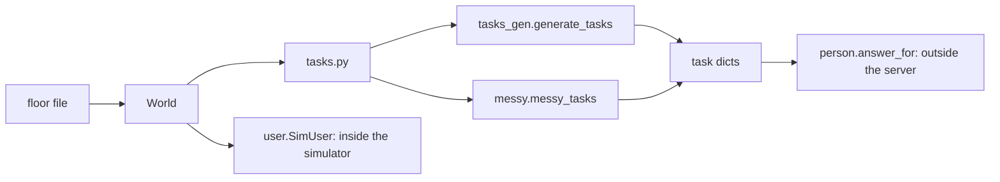

---
sources:
  - symbolic_robot/domains/factory/tasks.py
  - symbolic_robot/domains/factory/tasks_gen.py
  - symbolic_robot/domains/factory/person.py
  - symbolic_robot/domains/factory/user.py
  - symbolic_robot/domains/factory/messy.py
  - tests/test_factory.py
  - tests/test_factory_messy.py
verified_at: a5cc7a4943aa
---

# Factory tasks and scripted people

!!! abstract "In this page"
    You get the two task generators of the factory domain (the standard set and the messy set), the scripted person who answers the robot's questions, and the same idea inside the simulator. Every task is generated from a floor file by a seeded script; nothing is hand-picked and no task here is research data, so examples are shown in full. Read it when you need a task set, or a person that answers in a controlled way.

    | | |
    |---|---|
    | **Input** | `factory_tasks(floor, n, seed)`, `factory_messy_tasks(floor, n_per_policy, seed)`, `answer_for(task, question, n_where)` |
    | **Output** | a list of task dicts; an answer `(text, kind, grounded)` |
    | **Used by** | the factory benchmark suites ([factory suites](factory-suites.md)) |
    | **Uses** | the [world](factory-world.md), Python's seeded `random` |
    | **Tests** | `tests/test_factory.py`, `tests/test_factory_messy.py` |

!!! code "Where in the code"
    - [`tasks.py`](https://github.com/mtbui2010/symbolic_robot/blob/a5cc7a4943aa/symbolic_robot/domains/factory/tasks.py): the two entry points; it reads the floor and hands lists to the generator.
    - [`tasks_gen.py`](https://github.com/mtbui2010/symbolic_robot/blob/a5cc7a4943aa/symbolic_robot/domains/factory/tasks_gen.py): `generate_tasks`, free of any floor fact.
    - [`person.py`](https://github.com/mtbui2010/symbolic_robot/blob/a5cc7a4943aa/symbolic_robot/domains/factory/person.py): the person who answers from outside the server.
    - [`user.py`](https://github.com/mtbui2010/symbolic_robot/blob/a5cc7a4943aa/symbolic_robot/domains/factory/user.py): `SimUser`, the same idea inside the simulator.
    - [`messy.py`](https://github.com/mtbui2010/symbolic_robot/blob/a5cc7a4943aa/symbolic_robot/domains/factory/messy.py): five extra answer policies.

## Background

A benchmark task is a request such as "Put the marker pen on the bolt bin." Some requests do not say where the object is, so the robot must ask. The person who answers is a script with an answer policy, so a planner's way of asking can be tested without a human. The policy says how the person answers the question "Where is the X?":

| policy | what the person says |
|---|---|
| `knows` | the true place |
| `unknown` | "I do not know." |
| `wrong` | a wrong place first; the true place when asked again |
| `room_only` | only a room or zone name |
| `vague` | something like "Over there." |
| `mind_change` | a wrong place, then "No wait, it is on ..." |
| `partial_name` | the place under a changed name (an alias, an abbreviation, a typo, a dropped word), then the full name |
| `silent` | an empty answer or "...", then the place |

The first three are the standard set. All seven names of the messy set are `knows`, `wrong` and the five at the bottom. See also [declared outcomes](../learn/declared-outcomes.md) for how a result is judged against the true world.

## Where it sits



## Input

`factory_tasks(floor, n, seed)` keeps the objects that the gripper can lift and that do not start in a locked container. Destinations are the places that are a `surface` or a `bin` and have free slots. The generator then pairs objects with destinations in a seeded order, never an object with the place it already stands on, and never the same pair twice.

| parameter | meaning |
|---|---|
| `floor` | `assembly_hall` or `small_workshop` |
| `n` | how many tasks (36 below) |
| `seed` | the shuffle seed; the same seed gives the same set |
| `given_every` | every n-th task names its source (default 6) |

For the messy set, `n_per_policy` tasks are made for each of the seven policies, so `n_per_policy=6` gives 42 tasks. The messy tasks never name a source (`given_every` is set so large that none is "given").

## Output

Run on `assembly_hall`, 36 tasks, seed 7 (offline, on a copy of the pinned commit):

| kind and policy | count |
|---|---|
| `ask`, `knows` | 10 |
| `ask`, `unknown` | 10 |
| `ask`, `wrong` | 10 |
| `given` | 6 |

Task ids run from `t00`. The second task, in full:

```json
{"id": "t01", "object": "circuit board", "obj_id": "board", "dest": "tool_wall@tool_crib", "true_place": "test_bench@test_bay", "kind": "ask", "policy": "unknown", "dest_text": "the tool wall", "true_text": "the test bench", "prompt": "Put the circuit board on the tool wall.", "wrong_place": "parts_rack_a@parts_store", "wrong_text": "the parts rack A"}
```

The fields are: `id`, `object` (the label), `obj_id`, `dest` (a place id), `true_place` (where the object really is), `kind`, `policy` (`None` for a `given` task), `dest_text` and `true_text` (spoken forms), `prompt` (the request), and for `ask` tasks `wrong_place` and `wrong_text` (a place that is neither the true place nor the destination).

The scripted person's answers, from the same run:

| task and question | answer `(text, kind, grounded)` |
|---|---|
| the `unknown` task above, "Where is the circuit board?" | `('I do not know.', 'source', '')` |
| a `knows` task, "Where should I put it?" | `('On the bolt bin.', 'dest', '')` (the task's own destination text) |
| a `wrong` task, first "Where is ...?" | `('I think it is on the weld table.', 'source')` |
| the same task, asked again | `('It is on the toolbox.', 'source')` (the true place) |

The messy set of 42 tasks has 6 of each policy. Two scripts that the generator made (a script is a list of answers, the last one repeats):

```json
[{"text": "It is on the fixt. table 2.", "grounded": "partial"}, {"text": "It is on the fixture table 2.", "grounded": "place"}]
[{"text": "It is somewhere in the tool crib.", "grounded": "room"}, {"text": "As I said, somewhere in the tool crib.", "grounded": "room"}]
```

The first is a `partial_name` script (an abbreviation of the longest word), the second a `room_only` script. `grounded` says what the text names: `place` (a real place), `partial` (a place under a changed name), `room`, or `none`.

The simulator's own person, `SimUser(world, policy, seed, target)`, gives the same policies from the sim's truth for `--dialogue sim`. On `assembly_hall` with policy `wrong`, asked twice about the large wrench: `I think it is at the assembly bench 2.` then `It is at the tool wall.`. With policy `unknown` it says `I do not know.`; a question without "where" gets `Yes.`

On failure: `script_for(policy, ...)` raises `ValueError(policy)` for an unknown policy name (I ran it with `bogus` and got `ValueError bogus`).

## How it works

1. `generate_tasks` sorts the objects by id, shuffles them with `random.Random(seed)`, and picks one destination per object with the same generator. It loops up to 10 rounds until it has `n` pairs.
2. Task number `i` (from 0) is `given` when `(i + 1) % given_every == 0`. Its prompt is `Take the X from <true place> to <dest>.`
3. Every other task is an `ask` task; the policies rotate `knows`, `unknown`, `wrong`. The prompt is `Put the X on <dest>.` and does not say where X is.
4. `messy_tasks` calls the same generator with `given_every` huge, then assigns the seven policies in rotation, and for the five new ones calls `script_for` with a second generator seeded from `seed * 7919 + 1`.
5. At run time `answer_for(task, question, n_where)` reads the question. A question that holds "where" and a verb such as put, bring or take is a destination question; any other "where" question is a source question. A task with a `script` answers the n-th source question with the n-th script entry.
6. `person.py` is for a person who answers through the HTTP API from outside the server. `user.py` is the same idea inside the simulator. The experiment runner keeps its own copy of the policy for the API, as the `user.py` docstring says.

## Code

```python
    tasks, n_ask = [], 0
    for i, (o, d) in enumerate(pairs):
        given = (i + 1) % given_every == 0
        t = {"id": f"t{i:02d}", "object": o["label"], "obj_id": o["id"], "dest": d, "true_place": o["at"],
             "kind": "given" if given else "ask", "policy": None,
             "dest_text": spoken[d], "true_text": spoken.get(o["at"], o["at"])}
        if given:
            t["prompt"] = f"Take the {o['label']} from {t['true_text']} to {spoken[d]}."
        else:
            t["policy"] = POLICIES[n_ask % 3]
            n_ask += 1
            t["prompt"] = f"Put the {o['label']} on {spoken[d]}."
            wrong = sorted(p["id"] for p in places if p["id"] not in (o["at"], d))
            w = rnd.choice(wrong)
            t["wrong_place"], t["wrong_text"] = w, spoken[w]
        tasks.append(t)
    return tasks
```

[`tasks_gen.py` lines 32-48](https://github.com/mtbui2010/symbolic_robot/blob/a5cc7a4943aa/symbolic_robot/domains/factory/tasks_gen.py#L32-L48)

The scripted person:

```python
def _answer(task: dict, question: str, n_where: int) -> tuple:
    """(answer text, kind) of the scripted person. kind: source | dest | confirm | which | other.
    A where-question is read first ('Where should I put it?' is a destination question, 'Where is the X?' a source question)."""
    s = question.lower()
    if _CLARIFY.search(s):                                 # asks again where the object is: the person's next scripted answer
        return f"It is on {task['true_text']}.", "source"
    if "where" in s:
        if _DEST_WORDS.search(s) and "where is" not in s:
            return f"On {task['dest_text']}.", "dest"
        pol = task.get("policy") or "knows"
        if pol == "unknown":
            return "I do not know.", "source"
        if pol == "wrong" and n_where == 0:
            return f"I think it is on {task['wrong_text']}.", "source"
        return f"It is on {task['true_text']}.", "source"
    if _CONFIRM.search(s):
        return "Yes.", "confirm"
    if "which" in s:
        return f"The {task['object']}.", "which"
    return "Yes.", "other"
```

[`person.py` lines 24-43](https://github.com/mtbui2010/symbolic_robot/blob/a5cc7a4943aa/symbolic_robot/domains/factory/person.py#L24-L43)

## Edge cases and failure modes

| symptom | cause | fix |
|---|---|---|
| fewer tasks than `n` | the generator stops after 10 rounds when no new object-destination pair is left | ask for fewer tasks, or use a larger floor |
| a `given` task has `policy` `None` | its request already names the source, so no policy applies | expected |
| `ValueError: <policy>` | `script_for` got a policy that is not one of the five new ones | use a name from the table above |
| `answer_for` says "Yes." to a question that is not about a place | no rule matched; the default answer is "Yes." | make the question contain "where", "which", or a confirmation phrase |
| a messy `knows` or `wrong` task | these two are the references: `answer_for` answers them as the standard set does | expected |

## How it is verified

- `tests/test_factory.py::test_tasks_are_generated_and_balanced`: the set is generated, the same seed repeats and another seed differs, the policies are 10 / 10 / 10, 6 tasks are `given`, and a `wrong` place is never the true place or the destination.
- `tests/test_factory.py::test_sim_user_policies`: `SimUser` follows `knows`, `unknown` and `wrong` (the wrong place first, the true place on the second ask), and answers "Yes." to a confirmation.
- `tests/test_factory_messy.py` (3 tests): the suite shape and its determinism, scripts follow their policy, and `answer_for` uses a script while the old policies stay unchanged.
- I ran every call above offline on a copy of the pinned commit; `pytest` is not installed here, so I claim no pytest result.
