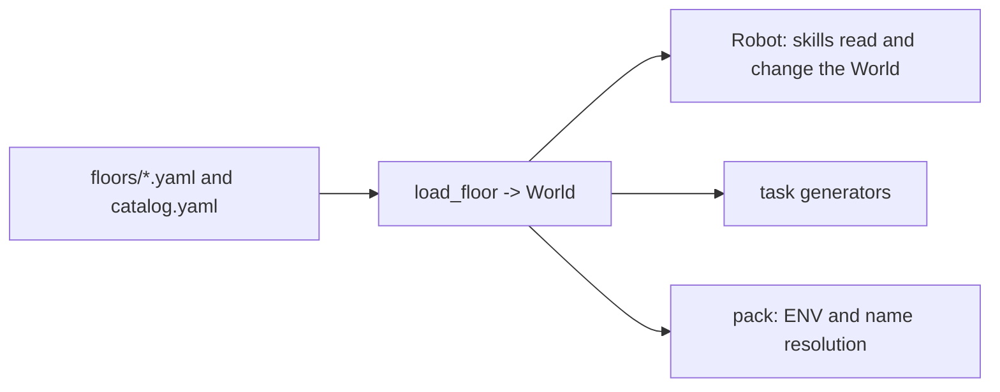

---
sources:
  - symbolic_robot/domains/factory/world.py
  - symbolic_robot/domains/factory/floors/
  - symbolic_robot/domains/factory/__init__.py
  - tests/test_factory.py
verified_at: a5cc7a4943aa
---

# Factory world and floors: places, objects and names

!!! abstract "In this page"
    You get the data model of the factory domain's world: how a floor file becomes places, objects and a robot position, and how a spoken name is turned into a place id. Read it before you write a floor file or a planner that names places.

    | | |
    |---|---|
    | **Input** | a floor name (`assembly_hall` or `small_workshop`) |
    | **Output** | a `World`: `places`, `objects`, `at`, `holding`, `opened` |
    | **Used by** | the factory robot ([skills and faults](factory-skills.md)), the [task generators](factory-tasks-and-people.md), the [pack](factory-pack.md) |
    | **Uses** | PyYAML and the floor files; no random draw |
    | **Tests** | `tests/test_factory.py` |

!!! code "Where in the code"
    - [`symbolic_robot/domains/factory/world.py`](https://github.com/mtbui2010/symbolic_robot/blob/a5cc7a4943aa/symbolic_robot/domains/factory/world.py): 156 lines. The docstring says it: no fact of any floor is in the file.
    - `symbolic_robot/domains/factory/floors/`: `assembly_hall.yaml`, `small_workshop.yaml` and `catalog.yaml` (object classes).
    - [`symbolic_robot/domains/factory/__init__.py`](https://github.com/mtbui2010/symbolic_robot/blob/a5cc7a4943aa/symbolic_robot/domains/factory/__init__.py): the `Factory` class that offers the floors to the registry (`worlds()` and `default_world()`, which is `assembly_hall`).

## Background

A symbolic world has no pixels and no physics. It is a list of named places, a list of objects that each stand at one place, and a robot that stands at one place and holds at most one object. A skill reads and changes this state. See [symbolic worlds](../learn/symbolic-worlds.md) for the idea.

In this page "the factory domain" is the small simulated shop floor that ships with the repo. Every number in a floor file is invented; the file headers say so.

## Where it sits



## Input

A floor name. `list_floors()` returns the file names in `floors/` without `catalog`. The size of each floor, counted by loading it:

| floor | places | objects | zones |
|---|---|---|---|
| `assembly_hall` | 25 | 21 | 10 |
| `small_workshop` | 10 | 10 | 5 |

A place id is `name@zone` (for example `main_bench@bench_area`). The part after `@` must be a zone of the floor, and an object dropped on the floor of that zone is at `floor@<zone>`. A place has a `kind`:

| kind | meaning in the code |
|---|---|
| `surface` | an open table or shelf; things go on it with `place` |
| `bin` | like a surface, used by the assembly hall |
| `container` | a toolbox or cabinet; it must be opened first (`openable`), things go in with `put_in`; it may be `locked` |
| `lane` | a forklift lane: a keep-out region, the robot may not enter it or leave anything there |

Other fields: `slots` (how many objects fit, default 4), `category` (the class name the robot's map knows, such as `hot_zone`), `aliases` (other spoken names). An object has an `id`, a class from `catalog.yaml` (weight in kg, and `hot`), an optional `variant` (such as `large`) and a start place `at`. Its label is `"<variant> <class>"`, for example `large wrench`.

This is the places block of the small floor, in full:

```yaml
places:
  - {id: charging_dock@entry,       name: charging dock,    pos: [1.0, 2.0],  kind: surface, slots: 0}
  - {id: entry_table@entry,         name: entry table,      pos: [2.5, 3.0],  kind: surface, slots: 4}
  - {id: main_bench@bench_area,     name: main bench,       pos: [5.0, 9.0],  kind: surface, slots: 6}
  - {id: vise_bench@bench_area,     name: vise bench,       pos: [8.0, 9.5],  kind: surface, slots: 4}
  - {id: toolbox@bench_area,        name: toolbox,          pos: [6.5, 7.0],  kind: container, slots: 6}
  - {id: shelf_1@storage,           name: storage shelf 1,  pos: [11.0, 2.0], kind: surface, slots: 6, aliases: [shelf 1]}
  - {id: shelf_2@storage,           name: storage shelf 2,  pos: [13.5, 3.5], kind: surface, slots: 6, aliases: [shelf 2]}
  - {id: parts_cabinet@storage,     name: parts cabinet,    pos: [12.0, 5.0], kind: container, slots: 6}
  - {id: drying_rack@paint_booth,   name: drying rack,      pos: [13.0, 10.5], kind: surface, slots: 4, category: hot_zone}
  - {id: forklift_lane@aisle,       name: forklift lane,    pos: [7.0, 5.0],  kind: lane, slots: 0, category: forklift_lane}
```

The permalink for the block is [`floors/small_workshop.yaml` lines 11-21](https://github.com/mtbui2010/symbolic_robot/blob/a5cc7a4943aa/symbolic_robot/domains/factory/floors/small_workshop.yaml#L11-L21). Positions are in metres.

## Output

| name | type | meaning | example (real, `small_workshop`) |
|---|---|---|---|
| `World.places` | dict id -> `Place` | all places | 10 entries |
| `World.objects` | dict id -> `Obj` | all objects; `at` is a place id, `"robot"`, or `"floor@<zone>"` after a drop | `wrench_l` at `main_bench@bench_area` |
| `World.at` | place id | where the robot stands; starts at the dock | `charging_dock@entry` |
| `World.holding` | object id or `None` | what the gripper holds | `None` |
| `World.opened` | set of place ids | containers that are open | empty |
| `World.payload_kg` | float | the heaviest object the gripper lifts | 5.0 |

`resolve_place(name)` returns one of three things: a place id, a list of ids when the name is ambiguous, or `None`. Real calls on `small_workshop`:

```text
resolve_place("shelf")        -> None                       (no place has exactly this name)
resolve_place("shelf 1")      -> shelf_1@storage            (an alias)
resolve_place("the toolbox")  -> toolbox@bench_area         (article dropped)
resolve_place("Main Bench")   -> main_bench@bench_area      (case ignored)
```

So `move(target="shelf")` fails with "no place called 'shelf'" (code `unreachable`), because the match is on whole names, not on a part of one.

On failure: the constructor `assert`s that object labels are unique, that the dock is a place, and that every object starts at a known place. `load_floor` raises `ValueError` for an unknown floor: `unknown floor 'nope'; known: assembly_hall, small_workshop`.

## How it works

1. `norm(s)` makes a name comparable: lower case, `_` and `-` become spaces, each word loses a plural `s` (`ties` becomes `tie`, `glasses` becomes `glass`), and a leading `the `, `a ` or `an ` is dropped. So a detector that names `cable tie` still sees `cable ties`.
2. A `Place` has the set of names `names`: its name, its id, the id before `@`, and the aliases, all normalised.
3. `resolve_place` returns the id at once when the text is already an id. Otherwise it collects the places whose `names` contain `norm(name)`.
4. `resolve_objects(name, among=...)` is looser: it returns the objects whose label holds every word of the name, and the exact label first. `among` limits the search, for example to what the camera sees.
5. `visible_at(pid)` returns nothing for a closed container. That is how an object can be present and still not found.
6. `snapshot()` is the view of the world that the server shows. It puts the object's variant under the key `color`. This is the current behaviour: a variant such as `large` is not a colour.
7. `_read_yaml` is cached, and the `World` copies what it needs, so two worlds never share state.

## Code

```python
    # ---- lookup by words
    def resolve_place(self, name: str):
        """-> a place id, a list of ids when ambiguous, or None."""
        if name in self.places:
            return name
        n = norm(name)
        hit = [p.id for p in self.places.values() if n in p.names]
        return hit[0] if len(hit) == 1 else (hit or None)

    def resolve_objects(self, name: str, among=None) -> list:
        """Object ids whose label contains every word of ``name`` (exact label first)."""
        n = norm(name)
        pool = [o for o in (among if among is not None else self.objects.values())]
        exact = [o.id for o in pool if norm(o.label) == n or o.id == name]
        if exact:
            return exact
        w = set(n.split())
        return [o.id for o in pool if w and w <= set(norm(o.label).split())]
```

[`world.py` lines 109-126](https://github.com/mtbui2010/symbolic_robot/blob/a5cc7a4943aa/symbolic_robot/domains/factory/world.py#L109-L126)

## Edge cases and failure modes

| symptom | cause | fix |
|---|---|---|
| `move` says "no place called 'shelf'" | the name matches no place exactly | name the place in full or use an alias such as `shelf 1` |
| "which place? (...)" | the name matches several places | use the id or a longer name |
| `find` fails on an object that is really there | the place is a closed container | `open` it first |
| `AssertionError` when loading a floor | duplicate object label, unknown dock, or an object that starts at an unknown place | edit the floor file; give the objects of one class different variants |
| `ValueError: unknown floor` | no `<name>.yaml` in `floors/` | use one of the names printed in the message |

## How it is verified

- `tests/test_factory.py::test_floors_load_and_are_consistent`: both floors load, the dock is a place, every place has a known zone, labels are unique, the hall has at least 9 zones, 25 places and 20 objects, the workshop has 5 zones.
- `tests/test_factory.py::test_names_match_singular_and_plural`: `cable tie` and `cable ties` both find the object, and an opened `tool cabinet` shows its content.
- I ran the counts and the four `resolve_place` calls above on a copy of the pinned commit, offline. `pytest` is not installed here, so I claim no pytest result.
