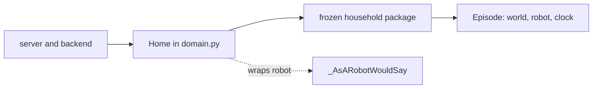

# Household domain wrapper and house layouts

This page shows how the household domain plugs into the generic server and backend through one small class, `Home`, and what the eight house layouts contain. You get the exact arguments of `make_episode`, a table of the houses with real counts, and the one behaviour the wrapper changes: how a failure message is worded.

!!! abstract "In this page"
    - The household domain is a frozen simulator. Everything under `symbolic_robot/domains/home/` is frozen except `domain.py`; the repo's `CLAUDE.md` (rule 4) names the freeze tag `home-sim-freeze-r19`. The test [`tests/home/sim/test_freeze_r19.py`](https://github.com/mtbui2010/symbolic_robot/blob/a5cc7a4943aa/tests/home/sim/test_freeze_r19.py) pins it: it runs the simulator's own self test (seed 7, 30 episodes, profiles `real` and `stress`) and compares a SHA-256 of the trace with a stored value.
    - `Home` (in `domain.py`) is the only file you may change. It maps the domain protocol onto the frozen package.
    - It wraps the episode's robot so a failure text drops the simulator's wording `: no such object`. The server turns this on by default (`live_opts = {"realistic_msgs": True}`).
    - A house is a YAML file: rooms with rectangles, doors, places, objects, people. There are eight.
    - `seed_state` rearranges a house: in `family_house`, `seed_state` 1 moves 10 of the 25 objects.

!!! code "Where in the code"
    - [`_AsARobotWouldSay`](https://github.com/mtbui2010/symbolic_robot/blob/a5cc7a4943aa/symbolic_robot/domains/home/domain.py#L15-L28) and [`Home.make_episode`](https://github.com/mtbui2010/symbolic_robot/blob/a5cc7a4943aa/symbolic_robot/domains/home/domain.py#L58-L62)
    - [`houses/`](https://github.com/mtbui2010/symbolic_robot/tree/a5cc7a4943aa/symbolic_robot/domains/home/houses), the loader in [`houses/__init__.py`](https://github.com/mtbui2010/symbolic_robot/blob/a5cc7a4943aa/symbolic_robot/domains/home/houses/__init__.py)
    - [`realism.py`](https://github.com/mtbui2010/symbolic_robot/blob/a5cc7a4943aa/symbolic_robot/domains/home/realism.py), lazy exports in [`__init__.py`](https://github.com/mtbui2010/symbolic_robot/blob/a5cc7a4943aa/symbolic_robot/domains/home/__init__.py)

## Where it sits



The generic code only knows the domain protocol (see [Domain protocol](domain-protocol.md) and [Live backend and sim commands](live-backend-and-sim-commands.md)). The registry maps the name `home` to `symbolic_robot.domains.home.domain:Home`. The factory domain is the other built-in entry.

The household package imports only `BaseDomain` from the core, in `domain.py`. It has its own random streams, clock, profiles and result type. That is why the same ideas (seeded draws, profiles) show up under other names here; see [Household world state](home-world.md) and [Household failure model and seeded streams](home-outcomes.md).

## What `Home` provides

`Home` fills the protocol with these members. I printed `name`, `world_label`, `default_world()`, `profiles()`, `available()` and `live_opts` by running it; the rest is read from the code.

| member | value or behaviour |
|---|---|
| `name` | `home` |
| `world_label` | `house` (the word the server uses for a world of this domain) |
| `pack` | `symbolic_robot.domains.home` (the robot_agent pack is this package's own `configs/`; see [Household pack for robot_agent](home-pack.md)) |
| `available()` | `None` when `pyyaml` imports, otherwise a message "the household simulator needs pyyaml" |
| `worlds()` | the eight house names; an empty list when `pyyaml` is missing |
| `default_world()` | `senior_flat` |
| `profiles()` | `['ideal', 'real', 'stress']` |
| `live_opts` | `{'realistic_msgs': True}` |
| `clock_t(ep)` | simulated seconds, `ep.clock.t` |
| `pose(ep)` | `(x, y, yaw_in_radians)`; the package keeps yaw in degrees |
| `view(ep)` | objects (class, place, colour), people (x, y), what the robot holds |
| `op_move_object`, `op_spawn` | the two edit operations of `sim_command` (no robot call, no clock time) |

The domain also exposes a default model name and a set of planner environment flags. This page does not print them.

## Input

| name | type | meaning | example (real) |
|---|---|---|---|
| `world` | str | house name | `studio_flat` |
| `profile` | str | `ideal`, `real` or `stress` | `real` |
| `seed` | int | seeds every random draw of the episode | `0` |
| `seed_state` | int | arrangement of the house; 0 is the YAML default | `0` |
| `lang` | str | `en` or `ko`, language of the household | `en` |
| `key` | str | extra string mixed into the streams | `live` |
| `realistic_msgs` | bool | wrap the robot, see below | `False` here; the server passes `True` |

The signature is `make_episode(self, world, profile, seed, seed_state=0, lang="en", key="live", realistic_msgs=False, **opts)`. Extra `opts` are accepted and ignored.

## Output

An `Episode` of the frozen package: `ep.world` (the true world), `ep.robot`, `ep.clock`. The wrapper returns the same object; only `ep.robot` may be replaced by a proxy.

## How it works

1. `Home.make_episode` calls the package's `make_episode(world, int(seed_state), profile, int(seed), lang=lang, key=key)`. Note the order: the package takes the house, then `seed_state`, then the profile, then the seed.
2. If `realistic_msgs` is true, `ep.robot` becomes a `_AsARobotWouldSay`.
3. The proxy forwards `call`, then looks at `res.msg`. If it contains `: no such object`, it returns a copy of the result with that text removed. The code, the data and every other field stay as they were. All other attributes go through `__getattr__` to the real robot.

```python
class _AsARobotWouldSay:
    """Proxy of the episode's robot: a failure text drops the simulator's ': no such object' (a real robot can only say it did not
    find the object). Code, data and everything else are unchanged."""

    def __init__(self, robot):
        self._r = robot

    def call(self, skill, /, **args):
        res = self._r.call(skill, **args)
        msg = str(getattr(res, "msg", "") or "")
        return res if NO_SUCH_OBJECT not in msg else dataclasses.replace(res, msg=msg.replace(NO_SUCH_OBJECT, ""))

    def __getattr__(self, name):
        return getattr(self._r, name)
```

[Source: `domain.py` lines 15-28](https://github.com/mtbui2010/symbolic_robot/blob/a5cc7a4943aa/symbolic_robot/domains/home/domain.py#L15-L28).

I ran the same call with and without the wrapper (profile `real`, seed 0, `studio_flat`):

```text
False Robot absent 'spaceship not found: no such object' 1.0
True _AsARobotWouldSay absent 'spaceship not found' 1.0
```

The columns are `realistic_msgs`, the class of `ep.robot`, the failure code, the message, and the duration in seconds.

The failure code and the time are the same. Only the text changes. The reason: a planner that reads "no such object" learns something a real robot could not know, namely that the object does not exist anywhere. "Not found" only says it was not seen.

## Houses

A house is a YAML file in `houses/`. The simulator reads it with `load_house`, and `validate_house` returns a list of problems. I ran `validate_house` on all eight: each returns an empty list. The counts below come from `from_house(name, 0)` at the pin; "places" includes the generated `floor@<room>` places and the dock.

| house | rooms | places | objects | people |
|---|---|---|---|---|
| `care_home_suite` | 4 | 22 | 23 | 2 |
| `couple_flat` | 4 | 24 | 22 | 2 |
| `family_house` | 6 | 31 | 25 | 3 |
| `korean_apt_59` | 6 | 29 | 23 | 2 |
| `korean_apt_84` | 7 | 34 | 28 | 3 |
| `senior_flat` | 3 | 21 | 23 | 1 |
| `shared_flat` | 6 | 28 | 21 | 3 |
| `studio_flat` | 2 | 16 | 19 | 1 |

Each place has an id `name@room` (for example `shelf@main`), a kind (`surface`, `container`, `seat`, `floor`, `dock`), an approach pose for the robot, a height in metres, a clutter level (`low`, `medium`, `high`), a capacity, and tags. The house files are the repo's own data under the Apache-2.0 licence, so a slice is shown here. The start of `studio_flat.yaml` (rooms, one door, the first place):

```yaml
# A small studio: one main room (sleeping, living, kitchenette) and a bathroom. Short paths, high clutter.
house: studio_flat
version: 1
name: {en: Studio flat, ko: 원룸}
rooms:
  main:     {type: [living, bedroom, kitchen], name: {en: main room, ko: 방}, rect: [0, 0, 6, 5], floor: {pos: [3.4, 2.6], tags: [exit_path]}}
  bathroom: {type: [bathroom], name: {en: bathroom, ko: 화장실}, rect: [6, 2, 8, 5], floor: {pos: [6.8, 3.6]}}
doors:
  - {rooms: [main, bathroom], at: [6.0, 3.5], width_m: 0.7}
places:
  bed@main:
    {room: main, kind: seat, name: {en: bed, ko: 침대}, aliases: {en: [], ko: []},
     pos: [1.8, 3.3], yaw_deg: 180, height_m: 0.5, clutter: high, capacity: 4, tags: [], person_pos: [0.5, 4.5]}
```

[Source: `houses/studio_flat.yaml` lines 1-13](https://github.com/mtbui2010/symbolic_robot/blob/a5cc7a4943aa/symbolic_robot/domains/home/houses/studio_flat.yaml#L1-L13). Rooms are rectangles `[x0, y0, x1, y1]` in metres. Names are given in English and Korean. How the world uses these fields is on [Household world state](home-world.md).

## Arrangements: `seed_state`

`seed_state` 0 is the YAML arrangement exactly. A positive value moves things, deterministically. Each object that has an `alt` list (alternative places) moves with probability 0.3 to one of them, if the target place has room (`world.py` lines 479-493, shown on [Household world state](home-world.md)). People who have `alt_seats` may also take another seat. I ran `family_house` for `seed_state` 0 to 5:

| `seed_state` | objects moved (of 25) | people reseated (of 3) | same twice |
|---|---|---|---|
| 0 | 0 | 0 | yes |
| 1 | 10 | 0 | yes |
| 2 | 6 | 0 | yes |
| 3 | 8 | 1 | yes |
| 4 | 6 | 1 | yes |
| 5 | 9 | 0 | yes |

"Same twice" means two calls with the same arguments gave the same object places.

## Realism rules

`realism.py` checks that the object catalogue and the houses are plausible. It is a data check, not a simulator step. Its rules, in my words:

| rule | what it checks |
|---|---|
| R-a | every object class and receptacle category has its source note and attribute fields |
| R-b | an object's start place and each alternative place is a typical receptacle for its class |
| R-c | an object never goes into a receptacle smaller than itself; liquids come packaged |
| R-d | `graspable` agrees with the payload limit and the grasp class |
| R-h | room types have their required fixtures; every pair of places is 0.5 to 20 m apart by path; the number of objects per house and per receptacle is in range (the range is marked assumed in the report) |

I ran `python -m symbolic_robot.domains.home.realism --strict` offline on a copy of the pinned tree. It checked 56 object classes, 8 houses, 184 objects and 25 receptacle categories, reported `ok: true`, and found 0 violations for each rule. With `--strict` the exit code is 1 if `ok` is false; here it was 0.

## Edge cases and failure modes

| symptom | cause | what to do |
|---|---|---|
| `worlds()` returns an empty list | `pyyaml` is not installed; `available()` explains | install `pyyaml` |
| the message still says "no such object" | the episode was made with `realistic_msgs=False` (the default of `make_episode`) | the server passes `True` through `live_opts`; pass it yourself otherwise |
| a house name raises when loaded | the name is not one of the eight | use `worlds()` |
| `op_spawn` answers `ok: False` | unknown place, full place, or an object id that exists | the answer text lists known places for the first case |
| you want to change the simulator | the package is frozen | change only `domain.py`; a deliberate simulator change needs a new freeze tag and a changelog line, per `CLAUDE.md` rule 4 |

## How it is verified

- `tests/test_home_parity.py` calls a scripted sequence of skills through the domain protocol and directly through the package, for houses and profiles, and compares every result and the final clock and object places. Per `docs/architecture.md` the sequence is 510 calls over 5 houses and 3 profiles. I did not run it (no `pytest`). See [Parity](parity.md).
- `tests/home/sim/test_houses.py` checks that there are at least six houses and that each house is valid. Not run here.
- `tests/home/sim/test_freeze_r19.py` pins the simulator (see the box at the top). Not run here.
