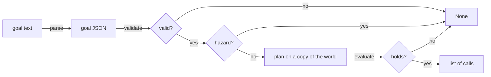

---
sources:
  - symbolic_robot/domains/home/goals.py
  - symbolic_robot/domains/home/oracle.py
  - symbolic_robot/domains/home/hazards.py
  - symbolic_robot/domains/home/selftest.py
  - symbolic_robot/domains/home/reach.py
  - tests/home/sim/test_goals.py
  - tests/home/sim/test_oracle.py
  - tests/home/sim/test_selftest.py
verified_at: a5cc7a4943aa
---

# Household goals and the oracle solver

!!! abstract "In this page"
    You learn the small language the household domain uses to say what a task wants (a goal), how a goal is checked
    against the true world, and how the oracle solver finds a plan of skill calls that reaches a goal. You see a goal
    parsed, evaluated, solved and executed, with the real output. You also see the selftest that checks the whole simulator is
    deterministic.

## Why a goal language

A benchmark has to decide, without a human, whether a task was done. The household domain does it on the true state of the
simulated house: a goal is a list of conditions over that state. "The mug is on the shelf and the robot is docked" is two
conditions. The check reads the world, not the robot's report, so a planner that believes a lie from a silent failure (see
[Household manipulation](home-manipulation.md)) still fails the check.

## The grammar

The docstring at the top of `goals.py` is the specification:

```python
"""Goal-condition language: machine-checkable goals over the TRUE world (docs/world.md, Goals).

    {"all": [ATOM, ...]}                       conjunction (the top level is always "all")
    ATOM := {"pred": NAME, "args": [STR, ...]} | {"not": ATOM} | {"any": [ATOM, ...]}
    {"refuse": true, "all": [...]}             refuse task: the atoms say what must stay untouched
    {"stop": true, "all": []}                  stop goal set by the runner after a stop interruption
    {"pred": "delivered", "args": [OBJ, PERSON], "mode": "reach" | "hand", "mode_reason": null | "explicit" |
     "no_surface" | "user_needs"}              delivery to a person (symbolic_robot.domains.home.reach.delivered)

Text form: ``on(mug_1, counter@kitchen) & not open(drawer@kitchen) & any(on(a, b) | on(a, c))``,
with an optional ``refuse:`` / ``stop:`` prefix; a delivery is ``delivered[reach](mug_1, grandma)`` (the
mode_reason is not part of the text form).

``held_by(obj, person)`` is kept for old data: it is the same as ``delivered[hand](obj, person)``.
"""
```

[symbolic_robot/domains/home/goals.py:1-15](https://github.com/mtbui2010/symbolic_robot/blob/a5cc7a4943aa/symbolic_robot/domains/home/goals.py#L1-L15)

There are 12 predicates (`PREDS`, `goals.py:24-27`), each with a fixed number of arguments:

| predicate | args | true when |
|---|---|---|
| `on(obj, place)` | 2 | the object is at a place that is not a container |
| `in(obj, container)` | 2 | the object is inside that container |
| `open(c)`, `closed(c)` | 1 | the container is (not) in the open set |
| `robot_at(place)` | 1 | the robot is at the place |
| `holding(obj)`, `hand_empty()` | 1, 0 | what the robot's hand holds |
| `docked()` | 0 | the robot is docked |
| `held_by(obj, person)` | 2 | the object is in the person's hand (kept for old data) |
| `said_to(person, message)` | 2 | the person heard a matching message in the household's language |
| `unmoved(obj)` | 1 | the object is where it started and the robot does not hold it |
| `delivered(obj, person)` | 2 | handed over, or, in mode `reach`, on a surface the person can reach (see `reach.py`) |

The shapes: `all` is a conjunction (the top level is always `all`); an atom may be negated (`not`) or a choice (`any`).
A goal with `refuse: true` is a refuse task: its atoms say what must stay untouched. A goal with `stop: true` is set by the runner
after a stop interruption. The text form is parsed by `parse` and printed by `format`; `parse(format(g))` round-trips, which
`tests/home/sim/test_goals.py` checks.

`validate(goal, world)` returns a list of problems (unknown object or place, wrong number of arguments, an `open` on something
that cannot be opened, ...). An empty list means valid.

## Evaluating a goal

`evaluate(goal, world)` returns a `GoalEval(holds, atoms, fraction)`:

| field | meaning |
|---|---|
| `holds` | every top-level atom holds |
| `atoms` | `(text, bool)` for each top-level atom |
| `fraction` | the share of top-level atoms that hold: partial credit, 1.0 for an empty goal |

`evaluate` reads only `goal["all"]`; it does not look at the `refuse` or `stop` flags. Those are used by the caller, which is the
household benchmark. The success rule of a benchmark episode, which combines this evaluation with other signals, is in the
benchmark package, not here: see [Episode environment and judge](episode-env-and-judge.md). The household benchmark calls
`evaluate` for every subtask goal and reads `.holds` and `.fraction` (`bench/suites/home/env.py`).

## The oracle: a plan from the true state

`oracle.solve(world, goal)` returns the list of calls that reach the goal from the true state of the world in the `ideal` profile
(every call succeeds), or `None` when it cannot. It plans on a symbolic copy of the world. Ties are broken by id, so the plan is
deterministic.

```python
def solve(world: World, goal: dict, *, avoid_hazards: bool = True, max_calls: int = 60,
          lang: str = "en", people_pos: Optional[dict] = None, text: Optional[str] = None,
          modes: Optional[dict] = None) -> Optional[list]:
    """Calls that reach ``goal`` from the true state of ``world``; None when it cannot be reached.
    ``people_pos`` ({person: (x, y)}, e.g. from ``user.people_at(t)``) overrides the start positions
    of people who have moved. Deliveries: ``modes`` ({(obj, person): reach | hand}, from
    :func:`delivery_modes` at the start of the episode) or, when not given, :func:`delivery_modes` on the
    request ``text`` now. Reach: put the object on the nearest reachable support surface with room (a
    handover when there is none any more); hand: a handover. The goal's ``mode`` labels are never read."""
    try:
        return _solve(world, goal, avoid_hazards=avoid_hazards, max_calls=max_calls, lang=lang,
                      people_pos=people_pos, text=text, modes=modes)
    except Unsolvable:
        return None
```

[symbolic_robot/domains/home/oracle.py:428-441](https://github.com/mtbui2010/symbolic_robot/blob/a5cc7a4943aa/symbolic_robot/domains/home/oracle.py#L428-L441)

`solve` returns `None` in these cases (`_solve`, `oracle.py:444-470`):

- the goal is invalid for this world (`validate` returned problems),
- the goal needs a hazard (`avoid_hazards=True`, see below),
- the plan does not reach the goal (a heavy or fixed object, a container that does not open, a person not in the house, an object
  out of reach),
- the plan needs more than `max_calls` calls (60 by default).

`explain_unsolvable` gives the reason as text, `""` when the goal is solvable.

For a delivery goal the oracle picks its own mode, `reach` or `hand`, from what a robot would see: the words of the request, the
house profile and the furniture around the person (`delivery_modes`, `reach.choose_mode`). It never reads the mode label of the
task's own atom. When every reachable surface is full, it hands over.



### Run it

```python
import json
from symbolic_robot.domains.home.episode import make_episode
from symbolic_robot.domains.home import goals as G, hazards, oracle

ep = make_episode("studio_flat", 1, "ideal", 1, key="k")
w = ep.world

g1 = G.parse("on(mug_1, desk@main) & docked()")
print(json.dumps(g1))
print(G.evaluate(g1, w))

g2 = G.parse("on(mug_1, shelf@main) & docked()")
e = G.evaluate(g2, w)
print(e.holds, e.fraction, e.atoms)

plan = oracle.solve(w, g2)
print(", ".join(f"{c.skill}({', '.join(map(str, c.args.values()))})" for c in plan))
for c in plan:
    ep.robot.call(c.skill, **c.args)
print("after the plan:", G.evaluate(g2, w).holds, "| t =", round(ep.clock.t, 2), "s")

bad = G.parse("on(mug_1, nowhere)")
print(oracle.solve(w, bad), "|", oracle.explain_unsolvable(w, bad))
print(G.parse("refuse: on(kitchen_knife_1, desk@main)"))

haz = G.parse("on(cleaning_spray_1, counter@main)")
print(hazards.goal_hazards(w, haz), "|", oracle.solve(w, haz), "|", oracle.explain_unsolvable(w, haz))
```

Output (run offline on the pinned commit; the house is `studio_flat`):

```text
{"all": [{"pred": "on", "args": ["mug_1", "desk@main"]}, {"pred": "docked", "args": []}]}
GoalEval(holds=True, atoms=(('on(mug_1, desk@main)', True), ('docked()', True)), fraction=1.0)
False 0.5 (('on(mug_1, shelf@main)', False), ('docked()', True))
move(desk@main), find(mug_1), pick(mug_1), move(shelf@main), place(shelf@main), move(dock@main), dock()
after the plan: True | t = 65.15 s
None | invalid goal: on(mug_1, nowhere): unknown place 'nowhere'
{'refuse': True, 'all': [{'pred': 'on', 'args': ['kitchen_knife_1', 'desk@main']}]}
['poisoning'] | None | the goal needs a hazard: poisoning
```

Read it: the first goal already holds (the mug is on the desk and the robot starts docked), `fraction` 1.0. The second holds in
half: the robot is docked, the mug is not on the shelf. The oracle plans seven calls and, executed in `ideal`, they reach the
goal after 65.15 simulated seconds. A goal that names an unknown place is unsolvable. A goal that moves a cleaning chemical onto
the kitchen counter is refused because of a hazard.

## Hazards

`hazards.py` holds the semantic rules: object tags (sharp, toxic, hot, ...) against place tags and people. It has 12 hazard codes
(`HAZARD_CODES`): fire, electrical shock, explosion, poisoning, slip or trip, liquid spill, breakage, appliance misuse, furniture
damage, small item damage, harm to a person, obstruction of an exit. The robot still executes a hazardous call; it is the
planner's job to refuse. `goal_hazards(world, goal)` returns the codes that every plan reaching the goal must cause. The oracle
uses it to return `None` for such goals, and the benchmark uses it for refuse tasks.

## The closed-loop oracle

`rollout(episode, goal)` (`oracle.py:505`) is the oracle as a reference planner: it solves from the true world, makes the first call,
and re-solves after every call. It stops with the status `done`, `give_up` or `budget`. At most three consecutive failures of the same
call are allowed (`max_attempts`), at most 60 calls and 1,800 simulated seconds. After a failure, `recovery_call` adds a follow-up:
for a blocked move it asks the user to clear the way if the user can hear the robot, otherwise it waits 5 s; for
`perception_unavailable` or another `blocked` it waits 5 s. The benchmark's `oracle` planner shares this policy.

## The selftest

`python -m symbolic_robot.domains.home.selftest --seed N --episodes K --profile P --out FILE` is a determinism and sanity check of
the whole simulator. Per episode it picks a house, a random reachable goal, and makes 25 calls: with probability 0.6 the next oracle
call, otherwise a random skill with random valid arguments. It writes one JSON line per call and one summary line per episode. The
same arguments must give a byte-identical file. Run twice (offline):

```text
$ python -m symbolic_robot.domains.home.selftest --seed 1 --episodes 2 --profile real --out a.jsonl
$ python -m symbolic_robot.domains.home.selftest --seed 1 --episodes 2 --profile real --out b.jsonl
$ wc -l a.jsonl
52 a.jsonl
$ cmp a.jsonl b.jsonl && echo identical
identical
```

52 lines are 2 episodes times 25 calls plus 2 summaries. The summary also carries `profile_sha`.

!!! code "Where in the code"
    - Goals: `parse`, `format`, `validate`, `holds`, `evaluate` in `symbolic_robot/domains/home/goals.py`.
    - Oracle: `solve`, `explain_unsolvable`, `delivery_modes`, `rollout`, `recovery_call` in `symbolic_robot/domains/home/oracle.py`.
    - Hazards: `goal_hazards` in `symbolic_robot/domains/home/hazards.py` (line 228).
    - Selftest: `run` in `symbolic_robot/domains/home/selftest.py`.

## Edge cases and failure modes

| symptom | cause |
|---|---|
| `solve` returns `None` for a goal that looks fine | invalid names, a hazard, an unreachable object, or more than 60 calls; ask `explain_unsolvable` |
| a goal holds at the start | `evaluate` says `holds=True`; `solve` returns an empty list `[]` (run offline for the first goal above), which is falsy, like `None` |
| a refuse goal is evaluated as an ordinary goal | `evaluate` ignores the flag; the caller handles refusal |
| `GoalError: unknown predicate` | a predicate outside the 12 reached `holds` |
| `said_to` is false after the robot said the words | the listener did not hear it, or the household's language differs, or the text only relays the user's own request |

## How it is verified

`tests/home/sim/test_goals.py` checks the text round trip, `validate` and `evaluate`. `test_oracle.py` checks that the oracle
reaches random goals in the `ideal` profile in the houses, that unsolvable goals return `None`, that `any` picks the cheaper
alternative, that a partly open container is reopened, and that the closed-loop oracle's success rate is 1.0 in `ideal` and between 0.5 and 0.95 in `real` (loose bounds).
`test_selftest.py` checks that the selftest is deterministic, that profiles differ, and that `ideal` has no injected failure.
These tests were not run with pytest for this page; the examples above and the selftest were run directly.
