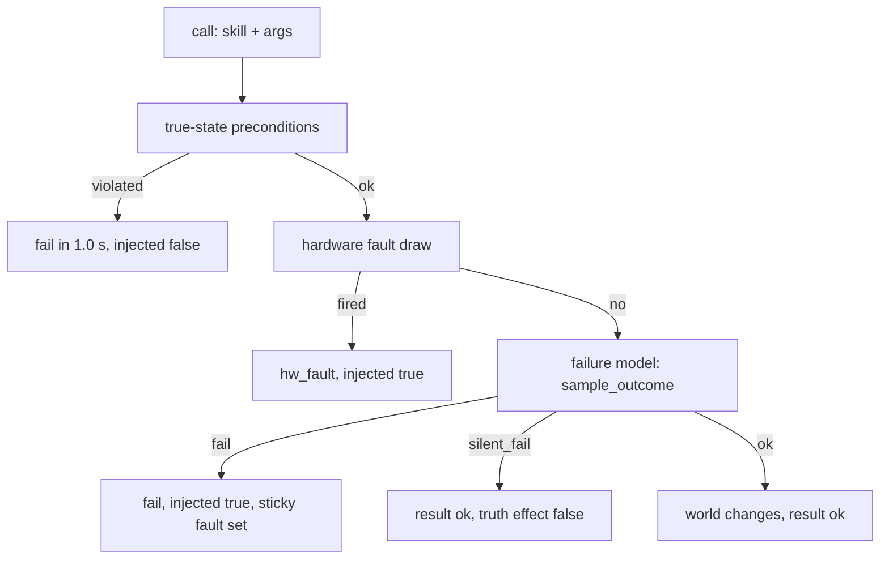

---
sources:
  - symbolic_robot/domains/home/skills.py
  - symbolic_robot/domains/home/outcomes.py
  - symbolic_robot/domains/home/reach.py
  - symbolic_robot/domains/home/catalog.py
  - tests/home/sim/test_skills.py
  - tests/home/sim/test_reach.py
verified_at: a5cc7a4943aa
---

# Household manipulation: pick, place, put_in, open, close, handover

!!! abstract "In this page"
    You get the six skills of the household domain that change the world: what each one checks in the true state, which
    random failures it can draw, and how one call can report success while the truth says nothing happened. Every example
    below was run offline on the pinned commit. This page is about the household domain only; the factory domain has its own skills.

## What the six skills do

The household domain simulates a mobile robot with one arm in a house. The skills `pick`, `place`, `put_in`, `open`, `close` and
`handover` are methods of the `Robot` class in `skills.py` (`_sk_pick`, `_put`, `_sk_open`, `_sk_close`, `_sk_handover`).
`place` and `put_in` share one function, `_put`.

Each call goes through the same steps. The page [Household outcomes](home-outcomes.md) explains the random part in detail.



Two kinds of failure, and the difference matters when you read a trace:

| kind | when | time spent | `injected` | example |
|---|---|---|---|---|
| precondition | the true state forbids the call | `PRECONDITION_S`, 1.0 s (`skills.py:75`) | `false` | `pick` with a full hand |
| failure model | the call was legal, the draw says it fails | a fraction of the nominal time | `true` | a grasp that fails |

A planner can learn from the first kind by thinking harder. The second kind is bad luck; the benchmark counts it separately
(see [Declared outcomes](../learn/declared-outcomes.md)).

## Preconditions (true state, always 1.0 s)

These are read from the code in `skills.py`. All of them answer with `injected: false`.

| skill | condition | code returned |
|---|---|---|
| `pick` | the hand is full | `grasp_failed` |
| `pick` | the name matches nothing, or several objects (the candidates go into `data`) | `absent` |
| `pick` | the object is not visible at the robot's place (event `not_here`) | `absent` |
| `pick` | the object is a phantom: a false positive from an earlier `find` (event `phantom`) | `absent` |
| `pick` | not liftable, or heavier than `carry.payload_kg` (1.0 kg in all three profiles) | `grasp_failed` |
| `pick` | the container is only partly open | `unreachable` |
| `pick` | a `high_shelf` place higher than 1.5 m (`HIGH_SHELF_REACH_M`) | `unreachable` |
| `place`, `put_in` | nothing is held | `absent` |
| `place`, `put_in` | the target is a person (use `handover`), the dock, or not a container for `put_in` | `unreachable` |
| `place`, `put_in` | the container is closed or only partly open | `blocked` |
| `place`, `put_in` | no free slot at the target | `blocked` |
| `open`, `close` | the place is not an openable container, or the hand is full | `blocked` |
| `handover` | nothing is held | `grasp_failed` |
| `handover` | nobody within 3 m (`HANDOVER_RANGE_M`), an unknown or ambiguous person, or a person in another room | `unreachable` |

`open` on an already open container, and `close` on a closed one, return ok at once with no time spent on the failure model.

## Failure-model outcomes

After the preconditions, a call draws from the failure model. `pick`, `open` and `close` have a failure table; `place`, `put_in` and
`handover` have only a drop probability and the silent failure. The numbers below are the `real` profile (the page
[Household profiles](home-profiles.md) lists where they come from).

| skill | failure draw | `real` value | what the world does |
|---|---|---|---|
| `pick` | `pick.p_fail` by clutter, or `pick.p_fail_class` for deformable objects | 0.0534 / 0.0658 / 0.1027 (low / medium / high); deformable 0.16 | nothing changes; sticky fault set |
| `pick` | camera miss, only when the object was not found yet (`find.p_miss`) | 0.093 | event `miss`, `absent`, `injected: true` |
| `open` | `open.p_fail` by container class | door 0.21, drawer 0.167 | nothing changes; sticky fault set |
| `close` | `close.p_fail` | door 0.0, drawer 0.058 | nothing changes; sticky fault set |
| `place`, `put_in` | `place.p_drop` | 0.0196 | the object falls to the floor; `dropped` |
| `handover` | `handover.p_drop` | 0.0196 | the object falls; `dropped` |
| `handover` | the person does not take it | from the user model | `timeout`, event `not_taken` |
| any arm skill | `hw.p_per_motion_call` | 0.01875 | `hw_fault`; persistent with `hw.p_persistent` 0.5 |

The failure code of a failed grasp comes from `pick.split`: absent 0.3, unreachable 0.2, blocked 0.3, grasp_failed 0.2. For
`open` and `close` the split is between `blocked` and `unreachable`.

## Sticky faults and retries

A failed `pick` stores a `FaultState` under the key `grasp:<object>`. A failed `open` stores one under `container:<id>`; a failed
`close` under `container:<id>:close`. The fault says `clears_on="retry"`. The next call with the same skill and target is
drawn as "attempt 2": it fails again when its draw `u[FAIL]` is at least the retry probability (`pick.p_retry_success` 0.376; `open`
and `close` 0.714 for doors, 0.64 for drawers), and it clears the fault when it succeeds. A second failure keeps the same fault;
it does not create a new one.

Here is a run on the `stress` profile that shows both outcomes, a legal call that fails by chance and then succeeds on retry:

```python
from symbolic_robot.domains.home.episode import make_episode

ep = make_episode("studio_flat", 1, "stress", 11, key="k")
r = ep.robot
for skill, args in [("move", {"target": "desk@main"}), ("find", {"obj": "mug_1"}),
                    ("pick", {"obj": "mug_1"}), ("pick", {"obj": "mug_1"}),
                    ("pick", {"obj": "mug_2"}), ("place", {"target": "shelf@main"})]:
    x = r.call(skill, **args)
    rec = r.trace[-1]
    print(skill, args["target" if "target" in args else "obj"], "|", x.ok, x.code and x.code.value, x.injected, rec["dur"], rec["truth"])
print("faults:", ep.world.faults)
```

Output (run offline, columns: ok, code, injected, duration in simulated seconds, truth):

```text
move desk@main | True None False 7.315045 {'effect': True}
find mug_1 | True None False 3.681507 {'effect': False, 'event': 'wrong_instance', 'true_found': 'mug_2'}
pick mug_1 | False grasp_failed True 2.716689 {'effect': False, 'event': 'pick_fail'}
pick mug_1 | True None False 11.475593 {'effect': True}
pick mug_2 | False grasp_failed False 1.0 {'effect': False}
place shelf@main | False unreachable False 1.0 {'effect': False}
faults: {}
```

Read it line by line:

- `find mug_1` returned ok but found the other mug (`wrong_instance`); `pick mug_1` was asked for by id and was not affected.
- The first `pick` failed by chance: `injected: true`, 2.7 s (a fraction of the nominal time). The retry succeeded in 11.5 s, and
  `faults` is empty again.
- `pick mug_2` with a full hand: `injected: false`, exactly 1.0 s. A precondition.
- `place shelf@main` failed because the robot is still at the desk. Also a precondition, also 1.0 s.

## Silent failures

The failure model can also say "ok" and not change the world. `verify.p_false_success` is 0.048 in `real`. It applies to `pick`,
`place`, `put_in` and `open`. The result reports success; only `truth` knows better.

| skill | event in `truth` | what is true after the call |
|---|---|---|
| `pick` | `slip` | the hand is empty, the object did not move; `data` still says `holding` |
| `place`, `put_in` | `fall` | the object is on the floor, not at the target |
| `open` | `partial_open` | the container is in `opened`, but also in the robot's `partial_open` set |

A partly open container blocks `pick`, `place` and `put_in` (see the preconditions) until a `close` and a new `open`.
Here is the `slip` case, run on `stress` with seed 6:

```python
from symbolic_robot.domains.home.episode import make_episode

ep = make_episode("studio_flat", 1, "stress", 6, key="k")
r = ep.robot
r.call("move", target="desk@main")
r.call("find", obj="mug_1")
x = r.call("pick", obj="mug_1")
print("result ok:", x.ok, "| truth:", r.trace[-1]["truth"])
print("believed:", r.believed)
print("true holding:", ep.world.robot.holding, "| mug_1 is at:", ep.world.objects["mug_1"].at)
```

```text
result ok: True | truth: {'effect': False, 'event': 'slip'}
believed: {'at': 'desk@main', 'holding': 'mug_1', 'opened': []}
true holding: None | mug_1 is at: desk@main
```

`believed` is what the robot would conclude from its own reports. It holds the mug. The world does not. A planner that never
checks (`grasp_check`, `vlm_check`, `look`) walks away from the mug with an empty hand. The benchmark judges the true state, so
this planner fails.

## The code

The core of `_sk_pick` after the preconditions: the sticky-fault bookkeeping, then the commit or the silent failure.

```python
        gkey = f"grasp:{oid}"
        sticky = gkey in w.faults
        out = sample_outcome(self.profile, Ctx(skill="pick", clutter=pl.clutter, grasp_class=c.grasp_class,
                                               attempt=2 if sticky else 1, sticky=sticky), u)
        if out.kind == "fail":
            if not sticky:
                w.faults[gkey] = FaultState(device=gkey, code=out.code, since_t=t0, clears_on="retry",
                                            p_clear=float(self._p("pick.p_retry_success")))
            msg = {F.ABSENT: f"{oid} not detected at grasp time: not found",
                   F.UNREACHABLE: f"cannot reach {oid}: no valid grasp pose",
                   F.BLOCKED: f"collision while grasping {oid}: blocked",
                   F.GRASP_FAILED: f"could not grasp {oid}"}[out.code]
            return res.fail(out.code, msg, injected=True, dur=nominal * frac, event="pick_fail")
        w.faults.pop(gkey, None)
```

[symbolic_robot/domains/home/skills.py:748-761](https://github.com/mtbui2010/symbolic_robot/blob/a5cc7a4943aa/symbolic_robot/domains/home/skills.py#L748-L761)

Lines 762-764 (not shown) set the duration and run the arm-safety check. Then the silent failure or the commit:

```python
        if out.kind == "silent_fail":
            res.truth.update({"event": "slip", "effect": False})
            res.data["holding"] = oid
            return res
        r.holding = oid
        o.at = "robot"
        o.inside = False
        r.perceived.discard(oid)
        res.data["holding"] = oid
        return res
```

[symbolic_robot/domains/home/skills.py:765-774](https://github.com/mtbui2010/symbolic_robot/blob/a5cc7a4943aa/symbolic_robot/domains/home/skills.py#L765-L774)

!!! code "Where in the code"
    - `Robot._sk_pick`, `_put`, `_sk_open`, `_sk_close`, `_sk_handover` in `symbolic_robot/domains/home/skills.py` (lines 705-987).
    - The failure draw is `sample_outcome` in `outcomes.py`; the constants `PRECONDITION_S`, `HIGH_SHELF_REACH_M` and
      `HANDOVER_RANGE_M` are at the top of `skills.py` (lines 75-77).
    - Object classes, weights and grasp classes: `catalog.py` (`CLASSES`, `PAYLOAD_KG = 1.0`).

## Delivery to a person: reach or hand

A "bring me X" goal is not always a handover. The goal atom `delivered(obj, person)` has a mode: `hand` means the object is in
the person's hand; `reach` means it is in their hand or rests on a support surface they can reach from where they are at the end
(`reach.py:218-231`). Support surfaces are places of kind `surface` whose type is a table, desk, counter, nightstand or shelf. The
reach radius and height bands come from the profile parameters `reach.*` (for example `reach.grip_reach_m` 0.58 m); they are
geometry, so `ideal`, `real` and `stress` share them. The robot chooses the mode from what it sees, with `reach.choose_mode`; it
never reads a task label. [Goals and the oracle](home-goals-and-oracle.md) shows where this enters the planner of reference. The
details of posture and reach belong to part 2 of this site.

## Edge cases

| symptom | cause |
|---|---|
| `pick` fails with `grasp_failed` and 1.0 s, nothing random | a true-state rule: hand full, object too heavy (over 1.0 kg) |
| `pick` fails with `absent` after a good `find` | the object was a phantom (false positive); the call discards it from the perceived set |
| `open` returns ok, later `put_in` says `blocked: only partly open` | a silent `partial_open`; close and open again |
| `place` returns ok, the goal does not hold | a silent `fall`; the object is on the floor |
| a manipulation call returns `hw_fault` with `injected: true` | the hardware draw fired; if persistent, every later arm call answers `hw_fault` after 1.0 s |
| the pack manifest says a payload of 1.5 kg, the profile says 1.0 kg | two different assumptions at this commit; the simulator uses the profile and the catalog |

## How it is verified

`tests/home/sim/test_skills.py` has tests for the pick and place flow, containers, `put_in` rules, heavy and ambiguous objects,
handover, silent failures and drops, and persistent hardware faults. `tests/home/sim/test_reach.py` covers the delivery
predicate and the reach geometry. These tests were not run with pytest for this page (pytest is not installed in the documentation
environment); the examples above were run directly.
