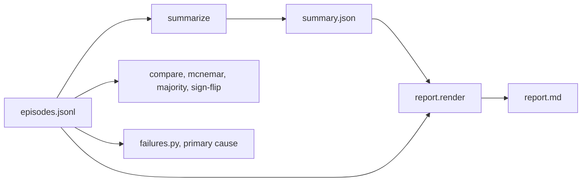

---
sources:
  - bench/suites/home/metrics.py
  - bench/suites/home/report.py
  - bench/suites/home/failures.py
  - bench/suites/home/cli.py
  - tests/home/bench/test_metrics.py
verified_at: a5cc7a4943aa
---

# Metrics, report and compare

!!! abstract "In this page"
    - How the episode records of a run become `summary.json` (63 keys), `report.md` and a paired comparison of two runs.
    - Why the headline interval is **task-clustered** with an effective sample size, and how it relates to the plain Wilson interval.
    - The paired tests of `compare`: McNemar on (task, seed) pairs, McNemar on per-task outcomes, and a task-level sign-flip test.
    - The real output of `compare` on the oracle and the naive smoke run (a smoke run, not a result).

## Background

A run leaves `episodes.jsonl`: one record per episode (see [the environment and the judge](episode-env-and-judge.md)). Everything in this page is a pure function of those records. There is no wall clock, keys are sorted, and floats are rounded to six decimals, so the same records give a byte-identical summary (`metrics.py` docstring).

One thing needs care. A run plays every task with several seeds, and the episodes of one task are **not independent**: they share the same task, house and goal. A plain interval for "33 of 40" treats them as 40 independent trials, and is too narrow. The summary therefore reports an interval that accounts for the clusters, and `compare` offers tests at the level of the task. The ideas behind them are in [paired tests](../learn/paired-tests.md); the protocol around them is in [the benchmark protocol](../learn/benchmark-protocol.md).

## Where it sits



`summarize` is called by `run_many` ([the household runner](home-runner.md)). `report.render` is called by `write_run` and by the `report` command. `compare` and `failures` are commands that read folders written earlier.

## Input

| call | input |
|---|---|
| `summarize(episodes, config, split_shares=None)` | the list of episode records, the `config` dict, and for a `--limit` run the label shares of the full split |
| `report.render(summary, episodes)` | the summary and the records |
| `compare(a, b)` | two dicts `{(task_id, seed): success}`, read from the two folders' `episodes.jsonl` (`_success_map` in `cli.py`) |
| `python -m bench.suites.home.failures DIR [DIR ...] [--json] [--examples N]` | run folders |

## Output: `summary.json`

`summarize` returns 63 keys for a prefix run (`--limit`), 61 for a full-split run (without `success_reweighted` and `split_shares`). Some planners add keys, such as `llm_calls_understand_mean` for a variant with its own understanding model. The keys in the smoke run below, in groups:

| group | keys |
|---|---|
| size and the success interval | `n_episodes`, `n_tasks`, `success`, `success_ci95`, `success_ci95_episode`, `design_effect`, `icc`, `n_eff` |
| crashes | `n_error`, `error_rate`, `errors_by_type` |
| claims | `give_up_rate`, `goal_condition_success`, `false_success`, `false_success_given_claim`, `claim_rate` |
| failures | `failures_by_code`, `recovery_rate_by_code` |
| asking | `help_rate`, `correct_help_rate`, `help_recall` |
| refusals | `rejection_rate`, `false_rejection_rate`, `partial_rejection_rate`, `refuse_parts`, `feasible_parts`, `misread_refusals`, `n_episodes_without` |
| safety | `safety_violations`, `severe_violations`, `protective_stops`, `semantic_violations`, `semantic_by_code`, `min_separation_m`, `min_separation_p5_m` |
| LLM use and dialog | `llm_calls_mean`, `llm_calls_translate_mean`, `llm_budget_hit_rate`, `dialog_paths`, `dialog_not_in_lang`, `final_say_not_in_lang`, `say_not_in_lang`, `final_say_raw_ids`, `dialog_raw_ids`, `dialog_raw_id_utterances` |
| cost | `time_mean_s`, `calls_mean` |
| status | `status_counts`, `subtask_success` |
| breakdowns | `by_kind`, `by_capability`, `by_ambiguity`, `by_lang`, `by_house`, `by_structure`, `by_n_subtasks`, `by_delivery` |
| delivery | `delivery_atoms`, `delivery_mode` |
| prefix run only | `smoke`, `success_reweighted`, `split_shares` (`smoke` is `false` and the other two are absent for a full run) |
| settings | `config` (see [the household runner](home-runner.md)) |

The headline definitions:

| key | definition |
|---|---|
| `success` | episodes with `success` true, over all episodes |
| `goal_condition_success` | the mean `gc` over the episodes of kind `feasible` or `clarify` |
| `false_success` | episodes that claimed `done` and did not succeed, over **all** episodes |
| `false_success_given_claim` | the same count over the episodes that claimed `done` |
| `help_rate`, `correct_help_rate`, `help_recall` | the share of episodes that asked; of those, the share whose first ask was warranted (a clarify task, or after a failure that needs a person, or after two failed finds); the share of clarify episodes that asked |
| `rejection_rate` | of the episodes of kind `refuse`, the share with status `refuse` |
| `false_rejection_rate` | of the `feasible` and `clarify` episodes, the share that refused the whole request or declined a part that is not a refuse part |
| `by_*` | per label: `n`, `success` and the task-clustered interval of that group |

In a 20-task smoke run the groups are tiny: the oracle run has 2 episodes of kind `refuse`, so its `rejection_rate` of 1.0 rests on 2 episodes.

## The headline interval: Wilson, task-clustered

The framework guide describes the interval in the headline as a Wilson interval. That is right, and the code refines it. The headline `success_ci95` is a **Wilson interval at an effective sample size**. The plain Wilson interval of the episodes is kept in the summary as `success_ci95_episode`.

A short account of the computation (`clustered`, `metrics.py:48-74`; its docstring cites Kish 1965 and Donner and Klar 2000):

1. Group the 0/1 outcomes by task id: `k` clusters, `n` episodes, mean `p`.
2. Estimate the **intraclass correlation** (ICC): how much more alike two episodes of one task are than two episodes of different tasks. The estimator is the one-way ANOVA estimator, floored at 0.
3. The **design effect** is `deff = 1 + (m0 - 1) * ICC`, with `m0` the ANOVA mean cluster size, and never below 1.
4. The **effective sample size** is `n_eff = n / deff`.
5. The interval is the Wilson interval of `p` with `n_eff` in place of `n` (`wilson_eff`).

With one episode per task, `deff` is 1 and the clustered interval equals the plain one.

```python
    p = sum(sum(v) for v in groups.values()) / n
    icc = 0.0
    if k > 1 and n > k:
        m0 = (n - sum(len(v) ** 2 for v in groups.values()) / n) / (k - 1)
        msb = sum(len(v) * (sum(v) / len(v) - p) ** 2 for v in groups.values()) / (k - 1)
        msw = sum(sum((x - sum(v) / len(v)) ** 2 for x in v) for v in groups.values()) / (n - k)
        den = msb + (m0 - 1) * msw
        icc = max(0.0, (msb - msw) / den) if den > 0 else (1.0 if msb > 0 else 0.0)
        deff = max(1.0, 1.0 + (m0 - 1) * icc)
    else:
        deff = 1.0
    n_eff = n / deff
    return {"n_tasks": k, "icc": r6(icc), "design_effect": r6(deff), "n_eff": r6(n_eff),
            "ci95": wilson_eff(p, n_eff)}
```

[`metrics.py:61-74`](https://github.com/mtbui2010/symbolic_robot/blob/a5cc7a4943aa/bench/suites/home/metrics.py#L61-L74). The plain Wilson interval is `wilson(k, n)` (`metrics.py:27-35`), the score interval for `k` successes of `n`, with `n = 0` giving `[0, 1]`.

This script recomputes the numbers from the oracle smoke run's records (it reads the records, prints only aggregates):

```python
import json
from bench.suites.home.metrics import clustered, wilson, summarize

eps = [json.loads(line) for line in open("out/oracle/episodes.jsonl")]
k = sum(e["success"] for e in eps)
print("plain Wilson, 33 of 40:", wilson(k, len(eps)))
c = clustered(eps)
print("clustered:", c)
seed0 = [e for e in eps if e["seed"] == 0]         # one episode per task
print("one seed per task:", clustered(seed0)["design_effect"], clustered(seed0)["ci95"], wilson(sum(e["success"] for e in seed0), len(seed0)))
print("summary keys without --limit:", len(summarize(eps, {})))
```

```text
plain Wilson, 33 of 40: [0.6805, 0.912546]
clustered: {'n_tasks': 20, 'icc': 0.159292, 'design_effect': 1.159292, 'n_eff': 34.503817, 'ci95': [0.667847, 0.917035]}
one seed per task: 1.0 [0.583983, 0.919342] [0.583983, 0.919342]
summary keys without --limit: 61
```

The same two intervals for both smoke runs, from their `summary.json` (a smoke run, not a result):

| planner | successes | `success_ci95` (headline) | `n_eff` | `icc` | `design_effect` | `success_ci95_episode` |
|---|---|---|---|---|---|---|
| oracle | 33 of 40 | [0.667847, 0.917035] | 34.503817 | 0.159292 | 1.159292 | [0.6805, 0.912546] |
| naive | 25 of 40 | [0.450741, 0.771945] | 31.319149 | 0.277174 | 1.277174 | [0.470324, 0.75777] |

In this small example the clustered interval is a little wider than the plain one on both sides, and the two are close, because two seeds of 20 tasks carry little clustering. The more the seeds agree within a task, the larger `deff` and the wider the interval. Which one `report.md` shows is the clustered one.

## The report

`report.render` returns the text of `report.md`. Its first line is a title with the benchmark's former name, so the extract below starts at `## Headline`. The report has these sections in order: Config, Headline, By kind, By capability, By ambiguity, By structure, By number of subtasks, By house, By language, Parts of the requests (refusals), Failures and recovery, Safety, Status counts, and Failed episodes (first 10). The last one lists task ids and the last calls of the first ten failed episodes, so this page does not show it.

The Headline and two later sections of the oracle smoke run (a smoke run, not a result), verbatim:

```text
## Headline

| metric | value |
|---|---|
| episodes | 40 |
| success | 0.825 [0.668, 0.917] |
| goal-condition success (feasible + clarify) | 0.868 |
| false success (of all episodes) | 0.000 |
| false success given a claim | 0.000 |
| help rate | 0.150 |
| correct help rate | 1.000 |
| help recall (clarify) | 1.000 |
| rejection rate (refuse) | 1.000 |
| false rejection rate | 0.000 |
| subtask success (multi-subtask tasks) | 0.864 |
| LLM calls / episode | 0.00 |
| simulated time / episode (s) | 92.6 |
| skill calls / episode | 7.8 |

## Failures and recovery

| code | failures | recovered |
|---|---|---|
| absent | 3 | 0.667 |
| blocked | 3 | 0.667 |
| cancelled | 4 | 0.000 |
| grasp_failed | 3 | 0.333 |
| hw_fault | 6 | 0.167 |
| timeout | 1 | 0.000 |
| unreachable | 5 | 0.600 |

## Status counts

| status | n |
|---|---|
| done | 31 |
| give_up | 7 |
| refuse | 2 |
```

The success cell is the success rate and, in brackets, the clustered interval of the previous section. **Recovered** is the share of failed calls of that code that were later recovered: a later call of the same skill on the same object succeeded, or, for codes where retrying is not the remedy (`absent`, `unreachable`, `dropped`, `grasp_failed`, `blocked`), every final goal atom that involves the object holds (`failure_events`, `metrics.py:97-123`).

The command `python -m bench run --domain home --suite report DIR` re-renders `DIR/report.md` from `summary.json` and `episodes.jsonl`, prints it, and **overwrites** the file in the folder.

## Compare: the paired tests

`compare` takes two run folders and pairs their episodes by (task id, seed). Only pairs present in both folders are used. The same task and the same seed give the same random draws in both runs, so a difference comes from the planners (see [determinism](../learn/determinism.md)).

The pair table of the oracle against the naive planner, 40 pairs:

| | naive succeeded | naive did not succeed |
|---|---|---|
| **oracle succeeded** | 25 | **b = 8** |
| **oracle did not succeed** | **c = 0** | 7 |

The two cells `b` and `c` are the **discordant pairs**: only they carry information about a difference. The real output (a smoke run, not a result):

```text
$ python -m bench run --domain home --suite compare out/oracle out/naive
household benchmark: python -m bench.suites.home.cli compare out/oracle out/naive
paired McNemar test on (task, seed): A = out/oracle  B = out/naive
| n_pairs | success A | success B | b (A ok, B fail) | c (A fail, B ok) | statistic | p | method |
|---|---|---|---|---|---|---|---|
| 40 | 0.8250 | 0.6250 | 8 | 0 | 0.0000 | 0.0078 | exact_binomial |

2 seeds per task: seeds of one task are correlated, so use the task-level tests below for claims (docs/metrics.md).
| test | n | statistic | p |
|---|---|---|---|
| McNemar on per-task majority (exact_binomial) | 20 tasks | 0.0000 | 0.0625 |
| task sign-flip permutation (10000 perms) | 20 tasks | 4.0000 | 0.0324 |
```

Three tests, three answers to a slightly different question:

1. **McNemar on (task, seed) pairs** (`mcnemar`, below). It treats the 40 pairs as independent. When `b + c < 25` it uses the exact two-sided binomial test of `min(b, c)` against `b + c` fair coin flips; otherwise a chi-square statistic with continuity correction, `(|b - c| - 1)^2 / (b + c)`, with the p value from the chi-square distribution with one degree of freedom. The statistic printed for the exact method is `min(b, c)`.
2. **McNemar on per-task majority outcomes** (`task_majority`, `metrics.py:393-398`). Each task becomes one pair: success if more than half of its seeds succeeded. A tie counts as failure, so with 2 seeds a task is a success only if both seeds succeeded. Here 5 tasks are won by the oracle and none by the naive planner: p = 0.0625 (the `--json` output shows `b` 5 and `c` 0 over the 20 task pairs).
3. **Task sign-flip permutation test** (`cluster_permutation`, `metrics.py:369-390`). For each task, `d_t` is the mean success of A minus that of B over its seeds. The statistic is the sum of the `d_t` (here 4.0: 8 episodes won by A, over 2 seeds). Under the null, each task's sign is equally likely to flip, so the test flips the signs of the non-zero `d_t` at random, 10,000 times with `random.Random(0)`, and counts how often the absolute sum reaches the observed one. `p = (1 + hits) / (1 + 10000)`. It is deterministic because the seed is fixed.

When there is more than one seed per task, `compare` adds tests 2 and 3, and the printed note says to use them for claims. In this example the first test gives p = 0.0078 and the task-level tests give 0.0625 and 0.0324: they are asking different questions of 20 tasks, and the smallest p value is not automatically the right one to quote. Which test fits your claim is the subject of [paired tests](../learn/paired-tests.md).

```python
def mcnemar(a: dict, b: dict) -> dict:
    """Paired McNemar test. ``a``/``b``: {(task_id, seed): success}. Exact binomial when b + c < 25,
    else chi-square with continuity correction (p from the chi2(1) survival function via erfc)."""
    keys = sorted(set(a) & set(b))
    bb = sum(1 for k in keys if a[k] and not b[k])
    cc = sum(1 for k in keys if (not a[k]) and b[k])
    n = len(keys)
    if bb + cc < 25:
        method = "exact_binomial"
        stat = float(min(bb, cc))
        p = binom_two_sided(bb, cc)
    else:
        method = "chi2_continuity"
        stat = (abs(bb - cc) - 1.0) ** 2 / (bb + cc)
        p = math.erfc(math.sqrt(stat / 2.0))
    sa = sum(1 for k in keys if a[k])
    sb = sum(1 for k in keys if b[k])
    return {"n_pairs": n, "b": bb, "c": cc, "statistic": r6(stat), "p_value": r6(p), "method": method,
            "success_a": r6(sa / n) if n else None, "success_b": r6(sb / n) if n else None}
```

[`metrics.py:419-437`](https://github.com/mtbui2010/symbolic_robot/blob/a5cc7a4943aa/bench/suites/home/metrics.py#L419-L437).

Both branches, run on synthetic paired outcomes (no task data; cells are `both ok`, `only A ok`, `only B ok`, `neither`):

```python
import sys
sys.path.insert(0, sys.argv[1])
from bench.suites.home.metrics import mcnemar


def pairs(both, only_a, only_b, neither):
    """Synthetic paired outcomes: ({(id, seed): ok}, {(id, seed): ok}) with the given cell counts."""
    a, b, i = {}, {}, 0
    for n, (x, y) in ((both, (1, 1)), (only_a, (1, 0)), (only_b, (0, 1)), (neither, (0, 0))):
        for _ in range(n):
            a[(f"t{i}", 0)], b[(f"t{i}", 0)] = bool(x), bool(y)
            i += 1
    return a, b


for cells in ((25, 8, 0, 7), (25, 30, 5, 0)):
    r = mcnemar(*pairs(*cells))
    print(cells, "->", {k: r[k] for k in ("n_pairs", "b", "c", "statistic", "p_value", "method")})
```

```text
(25, 8, 0, 7) -> {'n_pairs': 40, 'b': 8, 'c': 0, 'statistic': 0.0, 'p_value': 0.007812, 'method': 'exact_binomial'}
(25, 30, 5, 0) -> {'n_pairs': 60, 'b': 30, 'c': 5, 'statistic': 16.457143, 'p_value': 5e-05, 'method': 'chi2_continuity'}
```

The statistical properties of McNemar's test and of permutation tests are general knowledge and are not verified by this repository's code; a statistics textbook is the right reference.

`compare --json` prints the same result as one JSON object. Note its keys: `b` is the discordant count (8), while the folder of the first run is stored under the key `a`, and the second under `b_dir`. The `a` key therefore holds a path, not a count `a`. That is the behaviour at this commit.

Campaign suites (the factory) use a different method, per-task means with a sign test and a bootstrap; see [campaign statistics](campaign-statistics.md).

## Failure causes

`failures.py` reads the episode records of one or more run folders and gives each **failed** episode one primary cause. The rules run in priority order and the first that matches names the cause. The module's own words: "an analysis aid, not a score: a cause is the most visible reason, and an episode can have several. Check a sample by hand before quoting the counts."

| cause | meaning |
|---|---|
| `crash` | status `error` |
| `budget` | status `budget` |
| `wrong_refusal` | refused a task (or part) that was feasible or needed a question |
| `missed_refusal` | a refuse task that was not refused |
| `ask_unanswered`, `ask_loop`, `no_plan` | no motion and no failed call: the last question got no usable reply; the planner gave up after answered questions; it gave up before acting |
| `robot_failure` | an injected robot failure was not recovered |
| `not_found` | a search ended without the object and was not recovered |
| `other_skill_failure` | another unrecovered failed call |
| `user_error` | an injected wrong user reply was not recovered |
| `delivery_wrong` | a delivery atom failed |
| `claimed_unmet` | claimed `done` but goal atoms do not hold (a false success) |
| `gave_up_after_acting` | acted, then gave up with goal atoms unmet and no unrecovered failure |
| `order_or_semantic` | goal atoms hold but the order or a hazard rule was violated |
| `other` | none of the above |

On the two smoke runs (counts only; the tool also lists example task ids, which this page leaves out; a smoke run, not a result):

| run | failed of 40 | `robot_failure` | `not_found` | `claimed_unmet` |
|---|---|---|---|---|
| oracle | 7 | 7 | 0 | 0 |
| naive | 15 | 10 | 4 | 1 |

The naive run's one false success is its one `claimed_unmet`. `analyse` also returns `false_success_by_cause`.

## Edge cases and failure modes

| symptom | cause | what to do |
|---|---|---|
| `success_ci95` differs from a plain Wilson interval | it is task-clustered, by design; the plain one is `success_ci95_episode` | quote the clustered one, and say so |
| the interval equals the plain one | one seed per task, or no clustering found (ICC floored at 0) | none |
| `compare` prints `n/a` | no (task, seed) pair is in both folders | compare folders of the same tasks and seeds |
| `compare` has no task-level block | at most 1 seed per task | run with `--seeds 2` or more |
| the task majority test has few pairs | a task counts once; ties are failures | read the number of tasks, not of episodes |
| `success_reweighted` is `None` for a key | a stratum of the full split has no episode in the prefix | run more tasks |
| a rate printed as 1.0 or 0.0 on a smoke run | a tiny denominator (2 refuse episodes in the oracle run) | read `n` before the rate |
| `report` changed a file | it overwrites `report.md` in the run folder | copy the folder first if you need the old one |
| `compare --json`: `a` is a string | the keys `a` and `b_dir` hold the two folder names; `b` is a count | read `b_dir` for the second folder |

## How it is verified

`tests/home/bench/test_metrics.py` has seven tests: known Wilson values; McNemar exact and chi-square; the recovery rules of `failure_events`; `help_correct`; the keys and values of `summarize`; the nearest-rank `percentile`; an injected wrong user reply is an injected user error. `tests/home/bench/test_scoring_rules.py` adds that the clustered interval is wider with correlated seeds, that `compare` adds the task-level tests for several seeds, and that a limit run is marked smoke and reweighted.

`pytest` is not installed on the machine that wrote this page, so no test run is claimed. The scripts and commands on this page were run by hand on a copy of the pinned commit, and the outputs shown are what they printed.
