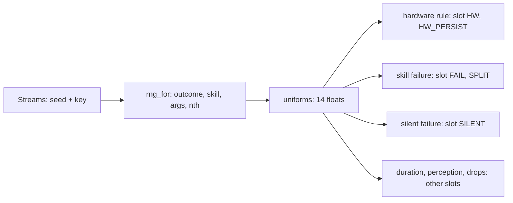

---
sources:
  - symbolic_robot/domains/home/outcomes.py
  - symbolic_robot/domains/home/rng.py
  - symbolic_robot/domains/home/clock.py
  - symbolic_robot/domains/home/skills.py
  - symbolic_robot/rng.py
  - tests/home/sim/test_outcomes.py
  - tests/home/sim/test_rng.py
  - tests/home/sim/test_determinism.py
verified_at: a5cc7a4943aa
---

# Household failure model and seeded streams

!!! abstract "In this page"
    You learn how the household domain turns "a call happens" into "this call succeeds, fails or lies": a fixed vector of 14
    random numbers per call, each rule reading its own slot. You see the failure tables, the retry rule, the silent failure, and why
    two planners that make different calls still meet the same bad luck on the same call. You also learn that the core engine has a
    similar helper, `CallDraws`, that no domain uses at this commit.

## The idea: one vector of numbers per call

A simulator that rolls a die inside each rule has a problem when you compare two planners. If planner A makes one extra call,
every later die roll shifts, and the two planners no longer face the same luck. The household domain avoids this. Before a call runs,
it draws a fixed vector of 14 uniform numbers in [0, 1) from a seed that depends only on names:

- the episode seed and the episode key,
- the skill name,
- the canonical text of its arguments,
- the call's repeat count `nth` (0 for the first call with these arguments, 1 for the second, and so on).

Each rule of the failure model reads one named slot of that vector. So "does the first `pick` of `mug_1` fail?" has the same
answer in every episode with the same seed and key, whatever else the planner did before. This is called common random numbers.
The page [Determinism](../learn/determinism.md) explains why the benchmark needs it for paired tests.



## The 14 slots

The class `U` in `outcomes.py` names them. The right column lists where the code reads each slot (from `skills.py`; the page
[Household manipulation](home-manipulation.md) and [Household skills](home-skills.md) show the skills).

| slot | index | meaning in the code comment | read by |
|---|---|---|---|
| `HW` | 0 | hardware fault on this call | `_hw`, every arm, base, camera and speaker call |
| `HW_PERSIST` | 1 | the fault persists for the episode | `_hw` |
| `FAIL` | 2 | skill failure, retry success, flip, clear | `sample_outcome`; `find` miss; camera clearing; `vlm_check` and `grasp_check` errors |
| `SPLIT` | 3 | failure code from the split | `split_code` |
| `SILENT` | 4 | silent failure (reports ok) | `sample_outcome` |
| `PERC` | 5 | false positive (find), camera dropout ratio | `find` false positive |
| `WRONG` | 6 | wrong instance | `find` wrong instance; the camera miss inside `pick` |
| `EXTRA` | 7 | false arrival, drop while placing or handing over | `move`, `_put`, `_sk_handover` |
| `DUR` | 8 | duration draw | every skill with a duration range |
| `AUX` | 9 | direction of a false arrival, which instance | `move`, `find` |
| `UNAVAIL` | 10 | perception unavailable, move timeout | camera check, `move` |
| `CARRY` | 11 | drop in transit | `move` while holding |
| `ESTOP` | 12 | random e-stop during a motion call | motion calls |
| `FAILTIME` | 13 | fraction of the nominal time a failed call spends | all skills that fail after starting |

The slots are the same for every skill; a rule that does not apply to a skill simply does not read its slot. Because a slot is
read only by its own rule, a change in one rule (say, a new `p_miss`) does not shift the numbers another rule sees.

```python
class U:
    """Slots of the per-call uniform vector."""
    HW = 0              # hardware fault on this call
    HW_PERSIST = 1      # ... and it persists for the episode
    FAIL = 2            # skill failure / retry success / flip / clear
    SPLIT = 3           # failure code from the split
    SILENT = 4          # silent failure (reports ok)
    PERC = 5            # false positive (find) / camera dropout ratio
    WRONG = 6           # wrong instance
    EXTRA = 7           # false arrival / drop while placing or handing over
    DUR = 8             # duration draw
    AUX = 9             # direction of a false arrival / which instance
    UNAVAIL = 10        # perception unavailable / move timeout
    CARRY = 11          # drop in transit
    ESTOP = 12          # random e-stop during a motion call
    FAILTIME = 13       # fraction of nominal time a failed call spends


N_UNIFORMS = 14
```

[symbolic_robot/domains/home/outcomes.py:19-37](https://github.com/mtbui2010/symbolic_robot/blob/a5cc7a4943aa/symbolic_robot/domains/home/outcomes.py#L19-L37)

## How the vector is drawn

The dispatcher `Robot._call` builds the key, counts the call, and draws the vector:

```python
        key = (skill, canon_args({k: v for k, v in full.items() if k not in _NOT_IN_KEY}))
        nth = self._nth.get(key, 0)
        self._nth[key] = nth + 1
        u = uniforms(self.streams.rng_for("outcome", skill, key[1], nth))
        self._u = u
```

[symbolic_robot/domains/home/skills.py:342-346](https://github.com/mtbui2010/symbolic_robot/blob/a5cc7a4943aa/symbolic_robot/domains/home/skills.py#L342-L346)

Two details matter:

- The key leaves out `meaning`, the structured meaning of an `ask`. The same question gets the same draws whatever meaning
  the caller attached (`_NOT_IN_KEY`, `skills.py:124`).
- `nth` counts calls with the same skill and the same arguments. A retry of `pick(obj="mug_1")` is `nth` 1 and has a new vector.

Seeds come from `rng.py` in the household package. `derive_seed(*parts)` hashes its parts, joined with `|`, with SHA-256 and takes
64 bits. It does not use Python's salted `hash()` and never the wall clock. `Streams(seed, key)` gives named long-lived streams
(`stream(name)`) and fresh keyed ones (`rng_for(*parts)`), which is what the outcome draw uses. The clock is `SimClock` (19 lines):
skills advance it by their simulated duration, and `advance` refuses a negative step. Nothing in the household package reads the real time.

## From numbers to an outcome

`sample_outcome(profile, ctx, u)` implements rules 2 to 4 of the failure model for skills that have a failure table. Its inputs:

| input | type | meaning |
|---|---|---|
| `profile` | `Profile` | `ideal`, `real` or `stress`; see [Household profiles](home-profiles.md) |
| `ctx` | `Ctx` | skill, clutter of the place, grasp class, container type, `attempt`, `sticky` |
| `u` | list of 14 floats | the vector of this call |

It returns an `Outcome(kind, code, event)`. `kind` is one of `ok`, `fail`, `silent_fail`, `wrong_instance`, `false_positive`;
the comment on the type lists all five. `sample_outcome` itself returns only `ok`, `fail` and `silent_fail`; no code builds the other two. The `find`
skill writes the events `wrong_instance` and `false_positive` straight into `truth` (`skills.py:687-701`).

```python
def sample_outcome(profile, ctx: Ctx, u: list) -> Outcome:
    """Rules 2-4 of the failure model for a skill with a failure table (move, pick, open, close):
    failure (or retry success after a sticky failure), its code, then a silent failure."""
    if ctx.sticky and ctx.attempt >= 2:
        failed = u[U.FAIL] >= p_retry_success(profile, ctx)
    else:
        failed = u[U.FAIL] < p_fail(profile, ctx)
    if failed:
        return Outcome("fail", split_code(profile, ctx.skill, u[U.SPLIT]), "skill_fail")
    if ctx.skill in ("pick", "place", "put_in", "open") and u[U.SILENT] < float(profile.get("verify.p_false_success")):
        return Outcome("silent_fail", None, {"pick": "slip", "place": "fall", "put_in": "fall",
                                              "open": "partial_open"}[ctx.skill])
    return Outcome("ok")
```

[symbolic_robot/domains/home/outcomes.py:104-116](https://github.com/mtbui2010/symbolic_robot/blob/a5cc7a4943aa/symbolic_robot/domains/home/outcomes.py#L104-L116)

The steps:

1. If the previous attempt left a sticky fault (`ctx.sticky`, `attempt >= 2`), the call fails when `u[FAIL] >= p_retry_success`.
   Otherwise it fails when `u[FAIL] < p_fail`.
2. A failure takes its code from the `split` table of the skill by inverse CDF over the sorted keys, using `u[SPLIT]`.
3. If the call did not fail and the skill is `pick`, `place`, `put_in` or `open`, the call is a silent failure when
   `u[SILENT] < verify.p_false_success`. The event is `slip`, `fall` or `partial_open`.

`p_fail` is chosen by context: `move.p_fail[clutter]`; `pick.p_fail_class[grasp_class]` when the object's class is listed
(`deformable`, `light_deformable`), else `pick.p_fail[clutter]`; `open.p_fail` and `close.p_fail` by container class, where
`drawer` is a drawer and every other container type counts as `door`. Other skills return 0.0 (they have their own rules).

### A real run

```python
from symbolic_robot.domains.home.outcomes import U, Ctx, N_UNIFORMS, uniforms, sample_outcome
from symbolic_robot.domains.home.profiles import load_profile
from symbolic_robot.domains.home.rng import Streams
from symbolic_robot.domains.home.skills import canon_args

args = canon_args({'obj': 'mug_1'})
u = uniforms(Streams(11, "k").rng_for("outcome", "pick", args, 0))
print(args, N_UNIFORMS, [round(x, 4) for x in u])
print("same draws again:", u == uniforms(Streams(11, "k").rng_for("outcome", "pick", args, 0)))
print("nth=1 differs:", uniforms(Streams(11, "k").rng_for("outcome", "pick", args, 1)) != u)
ctx = Ctx(skill="pick", clutter="medium", grasp_class="rigid")
for name in ("ideal", "real", "stress"):
    print(name, sample_outcome(load_profile(name), ctx, u))
v = [0.999] * N_UNIFORMS
v[U.FAIL] = 0.05
v[U.SPLIT] = 0.5
print(sample_outcome(load_profile("real"), Ctx(skill="pick", clutter="high"), v))
```

Output (run offline):

```text
{"obj":"mug_1"} 14 [0.8025, 0.1944, 0.1868, 0.7587, 0.1811, 0.6983, 0.8115, 0.8358, 0.4463, 0.3597, 0.8068, 0.9368, 0.9127, 0.0219]
same draws again: True
nth=1 differs: True
ideal Outcome(kind='ok', code=None, event=None)
real Outcome(kind='ok', code=None, event=None)
stress Outcome(kind='ok', code=None, event=None)
Outcome(kind='fail', code=<FailureCode.BLOCKED: 'blocked'>, event='skill_fail')
```

With `u[FAIL] = 0.1868` the call passes in all three profiles: it needs `u[FAIL] < 0.0658` (real) or `< 0.1316` (stress) to fail. The last
line sets the slots by hand: `FAIL` 0.05 is below the `high` clutter rate 0.1027, and `SPLIT` 0.5 falls in `blocked` (the sorted
keys `absent` 0.3, `blocked` 0.3 reach 0.6).

## Common random numbers, checked

The same test as `test_common_random_numbers`, run by hand: two episodes with the same seed and key, one of them makes two
extra calls (`say`, `look`) first.

```python
from symbolic_robot.domains.home.episode import make_episode

a = make_episode("studio_flat", 1, "real", 9, key="crn")
b = make_episode("studio_flat", 1, "real", 9, key="crn")
b.robot.call("say", text="hello")
b.robot.call("look")
ra = a.robot.call("move", target="desk@main")
rb = b.robot.call("move", target="desk@main")
print("same ok/code/truth:", (ra.ok, ra.code, ra.truth) == (rb.ok, rb.code, rb.truth))
print("clock a, b:", round(a.clock.t, 3), round(b.clock.t, 3))
```

```text
same ok/code/truth: True
clock a, b: 7.315 10.78
```

The outcome is the same. The clocks differ because `b` spent time on the extra calls: the luck is shared, the time is not.

## The hardware-fault table

The `hw-rates` report turns the per-call hardware rate into a rate per task. Command and output (run offline):

```text
$ python -m symbolic_robot.domains.home.report hw-rates
profile real: hw.p_per_motion_call 0.01875, hw.p_persistent 0.5; OK-Robot 7.5% per 4-primitive trial
p_persistent  calls  any_fault(no retry)  lost(retry transients)
         0.2      4                7.29%                   1.51%
         0.2      8               14.05%                   3.01%
         0.2     12               20.32%                   4.47%
         0.5      4                7.29%                   3.73%
         0.5      8               14.05%                   7.32%
         0.5     12               20.32%                  10.78%
        0.94      4                7.29%                   6.87%
        0.94      8               14.05%                  13.27%
        0.94     12               20.32%                  19.24%
```

Read the row `0.5, 8`: with the `real` value of `hw.p_persistent`, an 8-call task meets any hardware fault 14.05 % of the time.
If transient faults are retried, 7.32 % of tasks are lost. `hw.p_persistent` is an assumed value (see the next page).

## The core helper that no domain uses: `CallDraws`

The core engine, `symbolic_robot/rng.py`, offers two schemes. `Rng` is a keyed uniform: the draw depends on the seed, a key, and how
many times that key was asked. `CallDraws(seed, n_slots=16)` is a per-call vector like the one above: `begin(skill, args)` returns a
`Draw` with `.u` (a vector of `n_slots` uniforms) and `.attempt(k)` (the vector of the k-th internal attempt).

At this commit no domain uses `CallDraws`. The factory domain uses `Rng`. The household domain uses its own `Streams` and the
14-slot vector described on this page, and it imports only `BaseDomain` from the core (`domain.py:10`). The only user of `CallDraws`
is `tests/test_core.py`. A new domain may use it, or copy the household design; neither is wired in for you.

Differences you will see if you compare them (run offline):

```python
from symbolic_robot.rng import CallDraws

d = CallDraws(7)
a = d.begin("pick", {"obj": "mug_1"})
b = d.begin("pick", {"obj": "mug_1"})
print(len(a.u), a.n, b.n, a.u == b.u, a.u == a.attempt(0), a.u == a.attempt(1))
```

```text
16 1 2 False True False
```

It has 16 slots by default (the household vector has 14), and the repeat count starts at 1 (the household `nth` starts at 0).

!!! note "Two engines, one idea"
    The household domain was merged into this repository from a standalone simulator, and it kept its own seeding, clock,
    profile loader and result type. The factory domain uses the core ones. See
    [Layering and tests](layering-tests.md) for the import rules this implies.

## Edge cases and failure modes

| symptom | cause |
|---|---|
| two runs of one planner differ | the seed, the key or the profile differs; the profile hash (`profile_sha`) in the result tells you the last one |
| one planner is "unlucky" and the other is not on the same call | they did not make the same call: the draw is keyed by skill, arguments and `nth` |
| a retry fails with the same code | a retry is a new draw (`nth` + 1), with the retry-success probability, not a replay |
| `SimClock.advance` raises `ValueError` | a negative step; durations are never negative |
| a rule you changed shifts nothing else | by design: each rule reads its own slot |

## How it is verified

`tests/home/sim/test_outcomes.py` checks the failure tables (for example `p_fail` for `pick` at low clutter is 0.0534), the
branches of `sample_outcome` (retry success, silent failure), that the split shares match the profile within 0.02 over 20,000 draws, and that
the empirical failure rate of `move` at medium clutter is within 0.004 of 0.02. `test_rng.py` checks that `derive_seed` is stable and that streams
are repeatable. `test_determinism.py` checks that the same seed gives the same trace and the common-random-numbers case above.
These tests were not run with pytest for this page; the examples above were run directly.
