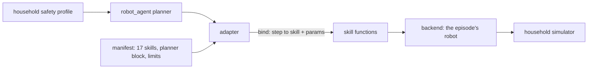

---
sources:
  - symbolic_robot/domains/home/configs/
  - symbolic_robot/domains/home/planner/seed_memory.jsonl
verified_at: a5cc7a4943aa
---

# Household pack for robot_agent (overview)

!!! abstract "In this page"
    A short map of the household robot pack: the files that let robot_agent's planner drive the simulated household robot,
    and the numbers in its manifest. This is an overview only. Part 2 of this site will go deeper into the adapter, the skill
    functions, the dialog mapper and the environment builder.

## What a pack is

robot_agent is the planner framework that this repository serves; see the
[framework site](https://mtbui2010.github.io/robot_agent/) for it. A pack is the part of a robot that robot_agent needs to
plan for it: a manifest (what the robot can do), skill functions (how a call reaches the robot), and an adapter (how the planner's
abstract steps become calls). The page [Packs and manifests](../learn/packs-and-manifests.md) explains the idea. In this
repository the household pack lives inside the household domain, in `symbolic_robot/domains/home/configs/`, and the domain
points to it with `pack = "symbolic_robot.domains.home"`.



## The files

| file | lines | what it is |
|---|---|---|
| `configs/manifest.yaml` | 289 | the robot's description: 17 skills, geometry, limits, a `planner` block, the safety profile path |
| `configs/skills_config.py` | 26 | the table `skill name -> (module, function)` that robot_agent's skill registry loads |
| `configs/ra_skills.py` | 227 | one plain function per skill; each calls the backend and returns a legacy dictionary |
| `configs/backend.py` | 32 | `get_backend()` / `set_backend(robot)`: the robot the skill functions drive |
| `configs/adapter.py` | 290 | the adapter: binds plan steps to skills, observes, reconciles, reports health and pose |
| `configs/tasks.py` | 257 | builds the environment dictionary (`ENV`) of a house, with entries for the people |
| `configs/ra_dialog.py` | 151 | maps the planner's English questions to a template id, a question type and slots |
| `configs/safety/household.yaml` | 147 | what is hazardous for a home robot, as data; word lists marked sourced or assumed |
| `planner/seed_memory.jsonl` | 12 lines | solved example plans the planner can retrieve before it has a memory of its own |

Two things worth knowing now:

- robot_agent is imported only inside the `configs/` folder: by the adapter when it is imported, and lazily inside one function of
  `ra_skills.py` (line 57). The rest of the household domain runs without it. This is one of the layering rules; see [Layering and tests](layering-tests.md).
- The server connects the pack to a live episode through the domain's `install_pack`, which calls `set_backend(live)`. The
  [Domain protocol](domain-protocol.md) page shows the hooks.

## The manifest

I loaded the manifest with PyYAML. It lists 17 skills, in this order: `move`, `find`, `pick`, `place`, `put_in`, `open`, `close`,
`handover`, `say`, `announce`, `ask`, `look`, `vlm_check`, `wait`, `dock`, `grasp_check`, `pose`. Each has a description, parameters,
preconditions (`pre`), effects, verification hooks and the error codes it may return. For example `pick` requires
`found(?inputs)` and `hand_empty()`, and its effects are `holding(?inputs)`, `not found(?inputs)` and `not hand_empty()`.

The `planner` block gives robot_agent its run settings. These lines (the block starts at `planner:` on line 16) are verbatim:

```yaml
  llm_budget: 22
  translate_budget: 8
  input_pivot: none
  translate_model: qwen3-vl:30b-a3b-instruct
  search_legs: true
  notes:
    - "Open a container before PutIn; close it after."
    - "Find an object at its place before Pick; move to a person before Handover."
```

[symbolic_robot/domains/home/configs/manifest.yaml:21-28](https://github.com/mtbui2010/symbolic_robot/blob/a5cc7a4943aa/symbolic_robot/domains/home/configs/manifest.yaml#L21-L28)

What they mean: `llm_budget: 22` planning calls and `translate_budget: 8` translation calls per episode (a comment in the manifest says the two caps sum to the benchmark's 30-call episode budget); `search_legs: true` turns on search legs without a replan; `translate_model` is the model used to
translate what the robot says. The model name belongs to the planner setting, not to the simulator.

The manifest also has a `limits` entry, `payload_kg: 1.5`. The simulator's own payload is `carry.payload_kg` 1.0 in all
three profiles (`catalog.PAYLOAD_KG = 1.0`). The two numbers differ at this commit; the simulator decides what can be lifted.

## What is left for part 2

The adapter (`adapter.py`), the skill functions (`ra_skills.py`), the dialog mapper (`ra_dialog.py`), the environment builder
(`tasks.py`) and the safety profile are only named here. Part 2 will cover them: how a step is bound, how a person's name
becomes an environment key, how a question is mapped, and how the safety word lists are used. Until then, read the files; their
docstrings say what they do. The robot_agent planner variants of the household benchmark are on the page
[robot_agent planners](robot-agent-planners.md), also at overview depth.

!!! code "Where in the code"
    - Domain hook: `Home.pack` and `Home.install_pack` in `symbolic_robot/domains/home/domain.py`.
    - Pack: `symbolic_robot/domains/home/configs/` (nine files) and `symbolic_robot/domains/home/planner/seed_memory.jsonl`.

## Edge cases and failure modes

| symptom | cause |
|---|---|
| importing `configs.adapter` fails | robot_agent is not installed; only the adapter needs it |
| skill functions run on a default robot | no backend was installed; `get_backend()` then builds one on the `senior_flat` house in the `ideal` profile |
| the planner and the simulator disagree on payload | the manifest says 1.5 kg, the profile 1.0 kg |

## How it is verified

Several tests import the pack: for example `tests/home/bench/test_seed_pool_leak.py` and `tests/home/sim/test_people_tracking_env.py`
(neither was run for this page, because pytest and robot_agent are not installed in the documentation environment). The manifest
and the skill list were checked by loading the YAML.
