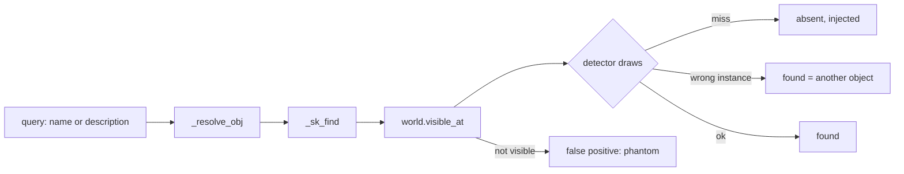

# Household perception

This page covers the five household skills that read the world through sensors: `find`, `look`, `vlm_check`, `grasp_check` and `pose`. You get what each one returns, how the simulator makes the camera wrong (misses, the wrong instance, false positives, dropouts), and how a free-text name such as "blue snack bag" is matched to an object.

!!! abstract "In this page"
    - The household domain is frozen except `domain.py` (tag `home-sim-freeze-r19`, pinned by [`tests/home/sim/test_freeze_r19.py`](https://github.com/mtbui2010/symbolic_robot/blob/a5cc7a4943aa/tests/home/sim/test_freeze_r19.py)). This page describes current behaviour.
    - `find` looks at the place where the robot stands. What it can see is set by the world: objects on a surface, or inside an opened container.
    - Detector errors: a miss, the wrong instance (more likely at a cluttered place), and a false positive (a phantom that a later `pick` exposes).
    - A camera dropout is a fault that a `wait` of at least 5 s may clear.
    - `detector_hits` matches a free-text query to object names: whole catalogue words, packaging nouns, and colour words that must not contradict.
    - `vlm_check`, `grasp_check` and `pose` have their own error rates. I ran `vlm_check` and `pose`; the rate of a wrong `vlm_check` answer was not run.

!!! code "Where in the code"
    - [`detector_hits`](https://github.com/mtbui2010/symbolic_robot/blob/a5cc7a4943aa/symbolic_robot/domains/home/skills.py#L34-L72) and the packaging nouns at [lines 28-31](https://github.com/mtbui2010/symbolic_robot/blob/a5cc7a4943aa/symbolic_robot/domains/home/skills.py#L28-L31)
    - [`_camera_down`](https://github.com/mtbui2010/symbolic_robot/blob/a5cc7a4943aa/symbolic_robot/domains/home/skills.py#L457-L473), [`_resolve_obj`](https://github.com/mtbui2010/symbolic_robot/blob/a5cc7a4943aa/symbolic_robot/domains/home/skills.py#L475-L483)
    - [`_sk_find`](https://github.com/mtbui2010/symbolic_robot/blob/a5cc7a4943aa/symbolic_robot/domains/home/skills.py#L652-L703), [`_sk_look`](https://github.com/mtbui2010/symbolic_robot/blob/a5cc7a4943aa/symbolic_robot/domains/home/skills.py#L1085-L1117), [`_sk_vlm_check`](https://github.com/mtbui2010/symbolic_robot/blob/a5cc7a4943aa/symbolic_robot/domains/home/skills.py#L1139-L1159), [`_sk_grasp_check`](https://github.com/mtbui2010/symbolic_robot/blob/a5cc7a4943aa/symbolic_robot/domains/home/skills.py#L1196-L1205), [`_sk_pose`](https://github.com/mtbui2010/symbolic_robot/blob/a5cc7a4943aa/symbolic_robot/domains/home/skills.py#L1207-L1221)
    - [`visible_at`](https://github.com/mtbui2010/symbolic_robot/blob/a5cc7a4943aa/symbolic_robot/domains/home/world.py#L229-L238) in `world.py`; object classes in `catalog.py`

## Background

An **injected** failure is one drawn by the failure model; a failure from a true-state rule (the object is not here) is not injected. A **phantom** is an object id that `find` reported although the object is not there. The robot keeps two sets for this: `perceived` (what the camera reported) and `phantoms` (the part of it that is false). A **confusable** class is an object class that the catalogue says can be mistaken for another one.

The skills share the dispatch described on [Household skill dispatch and motion](home-skills.md). Every call there draws 14 numbers; the slots used here are `FAIL` (a miss, a wrong answer), `WRONG` (wrong instance), `PERC` (false positive, dropout), `UNAVAIL` (camera unavailable), `AUX` (which instance) and `DUR` (the duration).

## Where it sits



## Input and output

| skill | input | output `data` on success | other outcomes |
|---|---|---|---|
| `find` | `obj`: id, catalogue name, or a description | `{"place": ..., "found": <object id>}`; maybe `candidates` | `absent`, `perception_unavailable`, `hw_fault` |
| `look` | none | `visible` (list of objects with `id`, `cls`, `name` in `en` and `ko`, `attrs`, `inside`), `containers` (`open` or `closed` for each container in the room), `people`, `place` | `perception_unavailable`, `hw_fault` |
| `vlm_check` | `query`: a goal atom such as `on(mug_1, counter@kitchen)` | `{"answer": ...}` with the answer `yes`, `no` or `unknown` | `perception_unavailable` |
| `grasp_check` | none | `{"holding": bool}` as the sensor reads it | `hw_fault` (gripper) |
| `pose` | none | `{"pose": [x, y, yaw_deg], "at": <place id>}` (`at` only if within 0.3 m of an approach pose) | `hw_fault` (base, sensor rate) |

`find`, `look` and `vlm_check` use the camera, so they can fail with a dropout. `grasp_check` and `pose` do not.

## How `find` works

1. It draws the duration (`find.duration_s`).
2. It resolves the name (`_resolve_obj`): first an exact catalogue name or alias; if that fails, `detector_hits` on the query. One hit gives an id; several give a list; none gives `absent` ("not found: no such object", 1.0 s; the wrapper on [Household domain wrapper and house layouts](home-domain-and-houses.md) drops the ": no such object" for a server run).
3. `_camera_down` may fail the call (see below).
4. If the robot is at no place and reports none (for example right after a move to a person), the answer is `absent` with the event `not_at_place`.
5. If the name fits several objects: only those in view count. None in view is `absent`, event `not_here`. One is that one. Several: the detector's hit is drawn among them (slot `AUX`) and the list of those in view goes into `data["candidates"]`.
6. Then the detector draws below.

```python
        if oid in visible:
            if u[U.FAIL] < float(self._p("find.p_miss")):
                return res.fail(F.ABSENT, f"{oid} not found", injected=True, event="miss")
            o = w.objects[oid]
            conf = set(CLASSES[o.cls].confusable)
            others = [x for x in visible if x != oid and (w.objects[x].cls == o.cls or w.objects[x].cls in conf)]
            pl = w.place(here)
            pw = self._p("find.p_wrong_instance")["many" if pl.clutter == "high" else "few"]
            if others and u[U.WRONG] < float(pw):
                found = others[int(u[U.AUX] * len(others)) % len(others)]
                r.perceived.add(found)
                res.data["found"] = found
                res.truth.update({"event": "wrong_instance", "effect": False, "true_found": found})
                return res
            r.perceived.add(oid)
            res.data["found"] = oid
            return res
        if visible and u[U.PERC] < float(self._p("find.p_false_positive")):
            r.perceived.add(oid)
            r.phantoms.add(oid)
            res.data["found"] = oid
            res.truth.update({"event": "false_positive", "effect": False})
            return res
        return res.fail(F.ABSENT, f"{oid} not found", event="not_here")
```

[Source: `skills.py` lines 680-703](https://github.com/mtbui2010/symbolic_robot/blob/a5cc7a4943aa/symbolic_robot/domains/home/skills.py#L680-L703).

Read it in three parts.

- **The object is in view.** With probability `find.p_miss` the call fails `absent`, `injected: true`, event `miss`. Otherwise, if another object in view has the same class or a confusable class, the detector may report that one instead, with probability `find.p_wrong_instance["few"]` (`["many"]` at a place with `clutter: high`). The answer is ok, but the truth says `effect: false`: a silent failure. Otherwise it is found.
- **The object is not in view but something else is.** With probability `find.p_false_positive` the detector reports the object anyway. It is added to `perceived` and `phantoms`. The truth says `false_positive`.
- **Otherwise** the answer is `absent`, event `not_here`, not injected.

A phantom is exposed by a later `pick`: it fails `absent` ("nothing there to grasp", 1.0 s, event `phantom`), and the id leaves both sets (`skills.py` lines 731-735). See [Household manipulation](home-manipulation.md).

### Rates

Values from `load_profile(name).get(...)` at the pin. `p_wrong_instance` is given as few / many.

| parameter | `ideal` | `real` | `stress` |
|---|---|---|---|
| `find.p_miss` | 0.0 | 0.093 | 0.186 |
| `find.p_false_positive` | 0.0 | 0.045 | 0.09 |
| `find.p_wrong_instance` | 0.0 / 0.0 | 0.1 / 0.389 | 0.2 / 0.778 |
| `perception.p_unavailable` | 0.0 | 0.01 | 0.02 |
| `perception.p_clear_on_wait` | 0.5 | 0.5 | 0.5 |
| `vlm.p_false_yes` | 0.0 | 0.5 | 0.95 |
| `vlm.p_false_no` | 0.0 | 0.05 | 0.1 |
| `grasp_check.p_wrong` | 0.0 | 0.02 | 0.04 |
| `pose.sigma_m` | 0.0 | 0.05 | 0.05 |

How the profiles are built and what is assumed is on [Household profiles](home-profiles.md).

## Camera dropouts

`_camera_down` runs at the start of `find`, `look` and `vlm_check`.

1. If a camera fault that clears on waiting is already active, the call fails `perception_unavailable` ("camera unavailable (no fresh frame)", 1.0 s, event `camera_down`). It is injected.
2. Otherwise a hardware fault of the camera may fire.
3. Otherwise, with probability `perception.p_unavailable`, a new camera fault is stored (`clears_on` is `wait`) and the call fails the same way.

A `wait` of at least 5 s, or an idle period of that length, clears it with probability `perception.p_clear_on_wait` (0.5). I ran this on profile `stress`, seed 25, `studio_flat`:

```text
move(shelf@main)  -> ok, 4.384315 s
find(book)        -> perception_unavailable, 'camera unavailable (no fresh frame)', 1.0 s, injected True, event camera_down
wait(6)           -> ok, 6.0 s, event camera_back
```

## Real results

Profile `stress`, seed 0, `studio_flat`, after `move(shelf@main)`. The first `find(book)` is ok; the second call of the same `find` is a new draw and misses:

```text
find(obj="book") -> ok, {'place': 'shelf@main', 'found': 'book_1'}, 3.727388 s, injected False
find(obj="book") -> absent, 'book_1 not found', {'place': 'shelf@main'}, 5.781303 s, injected True, event miss
```

`look()` in profile `real`, seed 0, at `shelf@main` returned two objects (`book_1`, colour green, and `snack_2`, colour blue), each with a name in English and Korean (for example `{'en': 'book', 'ko': '책'}`), the containers of the room (`closet@main`, `drawer@main`, `fridge@main`, `microwave@main`, all `closed`), `people: ['user']` and `place: 'shelf@main'`. It took 3.493304 s.

In `ideal`, `senior_flat`: `find(obj="mug")` at the dock is `absent` (event `not_here`, 4.989 s). After `move(counter@kitchen)`, `find(obj="mug")` gives `found: mug_1` although the house has two mugs: only the red one is on that counter, so only it is in view. A `vlm_check` of `on(mug_1, counter@kitchen)` answers `yes` (2.114 s, truth `yes`); a query that does not parse (`gibberish`) answers `unknown` (2.205 s). `grasp_check` with an empty hand answers `holding: False`. `pose` at the counter gave `[6.4, 0.8, 270.0]` and `at: counter@kitchen`.

`pose` noise, profile `real`, seed 0, three calls at the dock (`studio_flat`, true pose `(3.0, 3.0, 90.0)`, values rounded to six decimals as the result is):

```text
[2.976658, 2.997684, 90.0]   at dock@main
[2.929729, 2.986621, 90.0]   at dock@main
[3.021928, 3.049929, 90.0]   at dock@main
```

Only x and y have noise (sigma 0.05 m); the yaw is exact. Not run: `vlm_check` with a wrong answer (`real` says yes to a false statement half of the time, by the profile value above), a wrong `grasp_check`, a wrong instance, and a false positive. I scanned 400 stress seeds for a false positive on `find(mug)` at `shelf@main` of `studio_flat` and found none, so I show no sample.

## Name matching

`detector_hits(world, query)` returns the sorted ids that a free-text query names. It normalises the query (`norm`: NFKC, lower case, no punctuation; Korean drops spaces). An object matches when:

1. A catalogue name or alias of its class is in the query. English: all its words must be in the query as whole words, and a regular plural counts (`stem_en`). Korean: the name is a substring.
2. The query ends with that name, or with a packaging noun (`pack`, `packet`, `carton`, `bottle`, `box`, `bag`, `jar`, `can`, `tin`, `tub`, `container`, `case`; Korean has its own list).
3. No colour word in the query contradicts the object's colour.

The idea is an open-vocabulary detector: the user (or a planner) says "white milk pack" and the camera finds the milk carton, but "milk glass" is not the milk carton. I ran it on `studio_flat`:

| query | result |
|---|---|
| `book` | `['book_1']` |
| `the green book` | `['book_1']` (the colour agrees) |
| `a red book` | `[]` (the colour contradicts) |
| `books` | `['book_1']` (regular plural) |
| `book on the shelf` | `[]` (the query does not end with the name) |
| `snack bag` | `['snack_1', 'snack_2']` |
| `blue snack bag` | `['snack_2']` |
| `snack` | `[]` (the catalogue name has two words and both must be present) |

## Edge cases and failure modes

| symptom | cause | what to do |
|---|---|---|
| `absent` right after `move` to a person | the robot is at no place: event `not_at_place` | move to a place, then `find` |
| `absent`, event `not_here`, not injected | the object is not in view: wrong place, a closed or partly open container | open the container, or look elsewhere |
| `absent`, injected, event `miss` | a detector miss | repeat the call; it draws again |
| `find` says ok and `pick` says "nothing there to grasp" | a phantom (false positive) | find again |
| `find` says ok, but the next steps act on another object | a wrong instance; the truth says `effect: false` | check with `grasp_check` or `look` |
| `perception_unavailable` | camera dropout | `wait` at least 5 s, then retry |
| a description finds nothing | it must end with the object's name or a packaging noun, and its colour must not contradict | shorten the query |

## How it is verified

- `tests/home/sim/test_find_ambiguous.py`: one fitting object in view is found and picked; several are found with a candidate list; none in view is plain "not found"; picking an ambiguous name without a `find` stays unresolved.
- `tests/home/sim/test_find_description.py`: descriptions with a colour, a packaging noun, a synonym, English plurals; the matching rules above.
- `tests/home/sim/test_find_at_person.py`: `find` beside a person is `absent`.
- Not run here (no `pytest`); the values above come from my own runs on a copy of the pinned tree.
