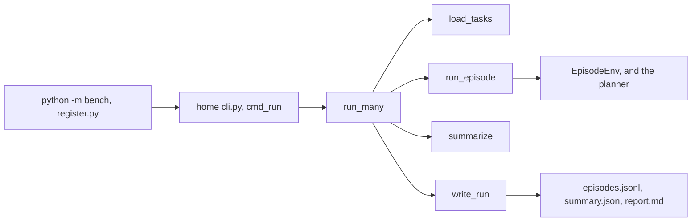

---
sources:
  - bench/suites/home/runner.py
  - bench/suites/home/tasks.py
  - bench/suites/home/data/__init__.py
  - bench/suites/home/register.py
  - bench/suites/home/cli.py
  - tests/home/bench/test_runner_determinism.py
  - tests/test_home_baseline.py
verified_at: a5cc7a4943aa
---

# Household runner and task loading

!!! abstract "In this page"
    - How the household benchmark plays tasks times seeds with one planner and writes three files.
    - Every flag of `run`, the exit codes, and the files a run leaves behind.
    - How tasks are loaded, and why a task file that differs from the packaged data is refused.
    - A real smoke run (the oracle and the naive planner on 20 dev tasks), shown as a smoke run and not as a result.

## Background

The household benchmark scores a **planner**: a program that reads a spoken request and drives a simulated robot in a simulated house. One **episode** is one task played once with one seed. A **task** is a record of the packaged data: a request, a house, a start state, a goal and labels. A **seed** is a small integer that fixes every random draw of the episode (see [determinism](../learn/determinism.md)). A **profile** (`ideal`, `real` or `stress`) sets how often the simulated robot, the perception and the speech recognition fail; see [household profiles](home-profiles.md).

The runner is the loop around that: for every task, for every seed, build an episode, let the planner play it, and collect the record. Then it summarises the records and writes them to a folder. Same arguments give the same files, byte for byte. The learn pages explain the protocol that the runner enforces: [the benchmark protocol](../learn/benchmark-protocol.md).

The packaged task files are in three splits: `train`, `dev` and `test`. The dev split has 1,000 records (counted in `bench/suites/home/data/tasks/dev.jsonl` at the pinned commit, on 2026-11-19). The task data is licensed for research use only. This site shows file names, counts and field names, never a task's text, goal or record. See [task data](task-data.md) and [versions and licences](../reference/versions-and-licences.md).

## Where it sits



The generic front end (`python -m bench run --domain home --suite run ...`) does not run anything itself. `register.py` rewrites the arguments and calls the household command line in the same process. `python -m bench.suites.home.cli run ...` is the same thing without the front end. See [the bench front end](bench-front-end.md).

!!! note "The front end refuses the test split"
    `register.py` stops with `refused: the test split is not run through this front end` when the arguments contain `--split test` or `--split=test`. Both spellings were run and both are refused. The household command line itself does not do this check for `run`: see the failure table.

## Input

`run` is the command that plays tasks. `aa-check` takes the same flags. The table lists them in the order of `build_parser` (`cli.py:400-432`).

| flag | default | meaning |
|---|---|---|
| `--planner` | required | a registered name, or a `package.module:Class` spec. Unknown names exit with 2 |
| `--split` | `dev` | `train`, `dev` or `test` |
| `--limit` | all | the first N tasks of the split, in file order. A prefix run is marked as a smoke run (see below) |
| `--profile` | `real` | `ideal`, `real` or `stress` |
| `--seeds` | `1` | seeds `0` to `N-1` for every task |
| `--lang` | `en` | the language of the instruction: `en` or `ko` |
| `--llm` | none | an LLM server URL, `fake` (tests only) or `cache-only` (replay from caches; a miss marks the episode `replay_miss`) |
| `--model` | `qwen3-vl:8b-instruct` | the model name sent to an LLM server (`llm.py:27`) |
| `--out` | required | the run folder |
| `--workers` | `1` | processes. Planners whose name starts with `robot_agent:` always run with one |
| `--tasks` | none | a task file (JSONL) instead of the packaged split |
| `--allow-stale` | off | accept a task file that differs from the packaged data (see below) |
| `--set` | none | `KEY=V[,KEY=V]` overrides of scalar profile parameters; the summary records them in `config.profile` and `profile_sha` |
| `--shard` | none | `K/N`: only the tasks at index `i % N == K`; written to `OUT/shard<K>/` |
| `--shared-cache`, `--cache-lock`, `--replicate` | none | a prompt cache shared by paired LLM runs; only meaningful with an LLM server |
| `--max-calls`, `--max-sim-time-s`, `--max-llm-calls` | 60, 1800, 30 | the episode budgets; see [the environment and the judge](episode-env-and-judge.md) |

Other commands of the same parser: `planners`, `compare`, `merge`, `prompt`, `understand-eval`, `report`, `show`, `tasks-file`, `rescore`, `rescore-diff`, `calibrate-knowno`, `live-smoke`. Through the generic front end only four are reachable: `planners`, `run`, `compare` and `report` (`SUBCOMMANDS` in `register.py`). `merge` needs the household command line.

## Output

A run writes three files into `--out`, and prints to two streams.

| file | content |
|---|---|
| `episodes.jsonl` | one JSON line per episode, in task order and then seed order. Keys are described in [the environment and the judge](episode-env-and-judge.md) |
| `summary.json` | the metrics and a `config` block; see [metrics, report and compare](home-metrics-and-report.md) |
| `report.md` | a readable report made from the two files above |

All three are written with sorted keys, compact separators and floats rounded to six decimals (`dumps` and `write_run` in `runner.py`). No wall-clock value is written. The elapsed time goes to stderr only.

Streams of a real run, with the generic front end (the `-> out/oracle` path is the folder given to `--out`):

```text
household benchmark: python -m bench.suites.home.cli run --planner oracle --split dev --limit 20 --seeds 2 --profile real --out out/oracle
[run] oracle 40 episodes in 0.9s wall -> out/oracle
{"false_success": 0.0, "goal_condition_success": 0.868421, "help_rate": 0.15, "n_episodes": 40, "n_error": 0, "rejection_rate": 1.0, "smoke": true, "success": 0.825, "success_ci95": [0.667847, 0.917035]}
```

The first and the last line are stdout (the first is printed by the front end only); the middle line is stderr. The JSON line has nine keys chosen in `cmd_run`.

The `config` block of `summary.json` for this run (the `versions` entry is left out: its key names are those of the earlier standalone packages, and the site does not print them):

```text
{"budgets": {"max_calls": 60, "max_llm_calls": 30, "max_sim_time_s": 1800.0}, "data_sha": "8d4d45894632e119", "lang": "en", "limit": 20, "llm": null, "model": null, "model_digest": null, "n_tasks": 20, "planner": "oracle", "planner_config": null, "profile": "real", "profile_sha": "fe93eed0af9c981b12c4eef3eb18b3fab3df7dc776de60d16d8d3cb68c362ede", "seeds": 2, "split": "dev", "user_classifier": "rules"}
```

`data_sha` is the first 16 hex digits of a SHA-256 over the 20 task records the run used. `profile_sha` identifies the profile values. Two runs with the same `data_sha`, `profile_sha`, planner and seeds play the same episodes.

`config.versions` holds version strings and `git describe --always --dirty` of the benchmark and the household simulator, and, for `robot_agent:*` planners, of `robot_agent` and `embodiplan` (`_versions`, `runner.py:188-205`). It is part of `summary.json`, so a dirty checkout changes the file.

### Exit codes

| code | when |
|---|---|
| 0 | the run finished and at most 5 % of the episodes crashed |
| 2 | unknown planner; a bad `--shard`; a planner that is unavailable (for example `robot_agent:*` without `robot_agent` importable); a refused shared cache; a task file that is stale |
| 3 | `InfraError`: the LLM server failed or the planner's code could not be imported. The run is aborted and no summary is written |
| 4 | more than `ERROR_RATE_MAX = 0.05` of the episodes ended with status `error`. The summary exists, but the scores are not a planner result |

An infrastructure failure never turns into a score of 0 %: the run stops instead.

```python
def error_rc(s: dict) -> int:
    """Non-zero when more than ERROR_RATE_MAX of the episodes crashed (status "error")."""
    from .runner import ERROR_RATE_MAX
    if s.get("n_episodes") and (s.get("error_rate") or 0.0) > ERROR_RATE_MAX:
        print(f"{s['n_error']} of {s['n_episodes']} episodes crashed (status error, {s.get('errors_by_type')}); "
              f"the scores are not a planner result", file=sys.stderr)
        return 4
    return 0
```

[`cli.py:240-247`](https://github.com/mtbui2010/symbolic_robot/blob/a5cc7a4943aa/bench/suites/home/cli.py#L240-L247). The exit code 4 is returned after the summary and the files are written.

## How it works

1. `cmd_run` (`cli.py:123-158`) checks the planner name, turns `--profile` and `--set` into one profile string, parses `--shard`, registers a shared cache if asked, and calls `run_many`.
2. `run_many` (`runner.py:237-319`) checks that the planner needs no LLM it did not get (`check_llm`) and is available (`check_planner`), then loads the tasks with `load_tasks`.
3. If `--limit` is smaller than the split, it computes the label shares of the full list (`split_shares`: share per `kind` and per number of subtasks). The summary later uses them to reweight the success rate of a prefix.
4. With `--shard K/N` it keeps the tasks at index `i % N == K`. Planners named `robot_agent:*` set `workers = 1` (`runner.py:268-269`, because `robot_agent` keeps module-level state).
5. With one worker it loops over tasks and then seeds and calls `run_episode`. With more workers it splits the tasks into interleaved chunks, runs them in spawned processes, and sorts the results by (task index, seed). Each worker builds its own LLM client.
6. `config` is built, `summarize` makes the summary, `write_run` writes the three files, and the wall time is printed to stderr.
7. `run_episode` builds an `EpisodeEnv`, makes the planner, runs it, and turns whatever happens into a status. Its head is the excerpt below.

```python
    if llm is None and llm_spec:
        llm = make_llm(llm_spec, model)
    cls = planner_class(planner_name)
    tally0 = CachedLLM.tally_snapshot()
    env = EpisodeEnv(task, profile, seed, lang, budgets, llm=llm, privileged=bool(getattr(cls, "privileged", False)),
                     interrupt_via=getattr(cls, "interrupt_via", "robot"))
    env.planner_name = planner_name
    planner = make_planner(planner_name, llm=env.llm())
    try:
        planner.run(env)
        if env.status is None:
            env.finish("give_up", give_up_text(env.lang), reason="planner returned without finishing")
    except BudgetExceeded:
        env.set_budget()
    except CacheMiss:
        env.set_replay_miss()
    except (LLMError, ImportError) as e:
        raise InfraError(f"task {env.task_id} seed {seed}: {type(e).__name__}: {e}") from e
    except Exception as e:  # noqa: BLE001 - any other planner crash is a failed episode (status "error")
        env.set_error(e)
        if getattr(planner, "raise_errors", False):
            raise
```

[`runner.py:63-84`](https://github.com/mtbui2010/symbolic_robot/blob/a5cc7a4943aa/bench/suites/home/runner.py#L63-L84). A planner that is privileged (the oracle and the naive planner, which may read the true world) is told so by a class attribute. A budget or a cache miss ends the episode with its own status. An LLM error or an `ImportError` is an infrastructure failure and aborts the run. Any other exception is a failed episode with status `error`, unless the planner asks for it to be raised.

## Task loading

`load_tasks(split, limit, tasks_file, allow_stale)` (`runner.py:141-165`) has two sources.

- **A split.** `tasks.load_split(split)` reads `data/tasks/<split>.jsonl` and returns `Task` objects in file order. `SPLITS` is `("train", "dev", "test")` (`data/__init__.py:26`). A missing file gives an empty list. `Task` is a frozen dataclass (`tasks.py:14-39`) with the fields `id`, `split`, `house`, `seed_state`, `text`, `goal`, `kind`, `capability`, `ambiguity`, `source`, `template_id`, `refuse_reason`, `hazards`, `user`, `expected`, `meta`, `subtasks`, `n_subtasks`, `structure`, `order`, `mixed_kind`, `length_words`, `activity_source`, `source_by_lang` and `paraphrase_model`. [Task data](task-data.md) explains them.
- **A task file.** `--tasks FILE` reads JSONL records. When `--split` is also given, only records whose `split` is missing or equal to it are kept. Then the first `--limit` are taken.

`data/__init__.py` also defines the other data folders: the LLM cache, the label policy and a folder for generated quality reports. When the package is installed without the source checkout, the quality reports go to a folder named by an environment variable, or to a local default folder.

### The stale-file check

A task file written before a data fix would silently measure the old text. So `check_fresh_tasks` compares every record of a `--tasks` file with the packaged record of the same id, and refuses the run with `StaleTasksError` when any differs. `stale_records` only reads the `train` and `dev` splits; it never reads `test` (`runner.py:104-123`). A record whose id is not packaged is never stale, so fixtures and custom tasks pass. `--allow-stale` switches the check off.

Real run, on 3 packaged dev records written by `tasks-file`, then one record changed in one field (the seed of its start state), then the same file with `--allow-stale`:

| step | exit code |
|---|---|
| `tasks-file --split dev --limit 3 --out t3.jsonl` | 0 |
| `run --tasks t3.jsonl` with the unchanged file | 0 |
| `run --tasks t3b.jsonl` with the changed record | 2 (the message names the file, how many records differ and how to regenerate it) |
| the same with `--allow-stale` | 0 |

`tasks-file` refuses `--split test`, as does `understand-eval`.

## A smoke run, not a result

This is a **smoke run, not a result**: 20 tasks of the dev split, 2 seeds, profile `real`, 40 episodes per planner, run offline on a copy of the pinned commit. 20 tasks and 2 seeds say little about a planner. The `smoke: true` key in the output marks it. The two planners are privileged references, not baselines to beat: the oracle reads the true world and the hidden goal and plans again from the true state after every call; the naive planner runs the oracle's plan from the start state, open loop, with no recovery and no questions, and ends with `give_up` at its first failed call. They are described in [reference planners](reference-planners.md).

```text
$ python -m bench run --domain home --suite run --planner oracle --split dev --limit 20 --seeds 2 --profile real --out out/oracle
household benchmark: python -m bench.suites.home.cli run --planner oracle --split dev --limit 20 --seeds 2 --profile real --out out/oracle
[run] oracle 40 episodes in 0.9s wall -> out/oracle
{"false_success": 0.0, "goal_condition_success": 0.868421, "help_rate": 0.15, "n_episodes": 40, "n_error": 0, "rejection_rate": 1.0, "smoke": true, "success": 0.825, "success_ci95": [0.667847, 0.917035]}
$ python -m bench run --domain home --suite run --planner naive --split dev --limit 20 --seeds 2 --profile real --out out/naive
household benchmark: python -m bench.suites.home.cli run --planner naive --split dev --limit 20 --seeds 2 --profile real --out out/naive
[run] naive 40 episodes in 0.7s wall -> out/naive
{"false_success": 0.025, "goal_condition_success": 0.710526, "help_rate": 0.0, "n_episodes": 40, "n_error": 0, "rejection_rate": 1.0, "smoke": true, "success": 0.625, "success_ci95": [0.450741, 0.771945]}
```

The wall times (0.9 s, 0.7 s) vary from run to run. Everything else is identical on every run. [Metrics, report and compare](home-metrics-and-report.md) continues with the paired test of these two folders.

Because 20 is less than the 1,000 dev tasks, the summary is a prefix summary. It carries `smoke: true` and a second success figure, `success_reweighted`, which weights the prefix to the label shares of the full split. For the oracle run it is 0.823812 by task kind and 0.826218 by number of subtasks, against the plain `success` of 0.825. The headline `success` is not reweighted.

## Checks that the same arguments give the same files

These were run by hand on the same copy (the test files need `pytest`, which is not installed here; see the last section).

| check | result |
|---|---|
| the oracle smoke run twice into two folders, then `diff -r` | no difference in the three files |
| the same run with `--workers 3` | `episodes.jsonl` identical to the one-worker run |
| the same run as two shards (`--shard 0/2`, `--shard 1/2`), then `python -m bench.suites.home.cli merge` | `episodes.jsonl` identical to the unsharded run. `summary.json` equals it except `config.merged_shards: 2`; `report.md` differs only by that config row |
| the oracle run with `--llm fake` against the packaged baseline `tests/home/parity/oracle_real_dev20_seeds2.episodes.jsonl.gz` | byte-identical (97,514 bytes) |

`merge` refuses to run when a shard is missing or incomplete, or when the shards were run with other settings (`MergeError`, exit 2). It also merges the shards' LLM caches.

## Edge cases and failure modes

| symptom | cause | what to do |
|---|---|---|
| `run --split test` through `python -m bench` prints `refused: ...` and does nothing | the front end refuses both `--split test` and `--split=test` | by design. The test split is for the pre-registered protocol only |
| `python -m bench.suites.home.cli run --split test` runs and writes files | **current behaviour:** `cmd_run` has no check on the split. Only the front end (`register.py`), `understand-eval` (`cli.py:200`) and `tasks-file` (`cli.py:311`) refuse it. This was run: one test episode played and the three files written | use the front end. This agrees with the framework guide, which names the front end as the guard |
| a run exits 2 with `planner ... is unavailable` | the name is a `robot_agent:*` planner and `robot_agent` is not importable | add `robot_agent` to `PYTHONPATH`; see [robot_agent planners](robot-agent-planners.md) |
| a run exits 2 with `unknown planner` | the name is not in the registry and is not a `package.module:Class` spec | `python -m bench run --domain home --suite planners` lists the names |
| a run exits 3, no `summary.json` | `InfraError` | fix the server or the import, run again |
| a run exits 4 | more than 5 % of the episodes ended with status `error` | read `errors_by_type` in the summary; do not quote the scores |
| `summary.json` differs between two checkouts of the same code | `config.versions` holds `git describe --dirty` | compare `episodes.jsonl`, or pass over `versions` |
| `success` differs from what a full dev run would give | a `--limit` run is a prefix of the file order, not a sample | use `success_reweighted`, or run the whole split |
| `--workers 4` has no effect | the planner is `robot_agent:*` (forced to one), or there is one task | none needed |

## How it is verified

- `tests/home/bench/test_runner_determinism.py` has four tests. The same arguments give identical `summary.json`, `episodes.jsonl` and `report.md`, with episodes in (task, seed) order. `ideal` and `real` give different `profile_sha`, and a Korean run works. One and two workers give the same episodes. The summary contains none of the words `wall`, `elapsed`, `timestamp` or `date`.
- `tests/test_home_baseline.py` has two tests. The first replays scripted skill calls against a recorded baseline (62 recorded entries). The second runs the oracle and the naive planner on the dev split with the fake LLM in three configurations and requires `episodes.jsonl` to be byte-identical to a recorded baseline; for the first it also compares the summary after removing the two git keys of `versions`.
- `pytest` is not installed on the machine that wrote this page, so no test run is claimed. The checks in the table above were run by hand and cover the same properties; the second case of the baseline test (oracle, `real`, 20 tasks, 2 seeds) was run by hand and matched.
