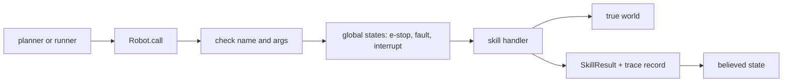

# Household skill dispatch and motion

This page explains the one entry point of the household robot, `Robot.call(skill, **args)`: what it checks, in what order, and how the motion skills `move`, `dock` and `wait` fail. You get the list of the 17 skills, the order of the checks, real results for good and bad calls, and a table of the failure events of `move`.

!!! abstract "In this page"
    - The household domain is frozen except `domain.py` (tag `home-sim-freeze-r19`, pinned by [`tests/home/sim/test_freeze_r19.py`](https://github.com/mtbui2010/symbolic_robot/blob/a5cc7a4943aa/tests/home/sim/test_freeze_r19.py)). This page describes current behaviour.
    - There are 17 skills in `SKILL_SPECS`. Eight are motion skills.
    - `call` checks a skill name and its arguments first (a `software` error, 0 s), then the e-stop, then a persistent hardware fault, then a user interruption, then a random e-stop, then runs the skill's handler.
    - Every call draws a fixed vector of 14 random numbers. The key is the skill, its arguments and how many times the same call was made before.
    - A call that fails a true-state rule answers `injected: false`. A call that fails by chance answers `injected: true`.
    - `move` can fail blocked (a retry or a request for help may clear it), arrive at the wrong spot while reporting success, or drop what the robot carries.

!!! code "Where in the code"
    - [`SKILL_SPECS`](https://github.com/mtbui2010/symbolic_robot/blob/a5cc7a4943aa/symbolic_robot/domains/home/skills.py#L97-L122) and the module note at [lines 1-9](https://github.com/mtbui2010/symbolic_robot/blob/a5cc7a4943aa/symbolic_robot/domains/home/skills.py#L1-L9)
    - [`Robot.call`](https://github.com/mtbui2010/symbolic_robot/blob/a5cc7a4943aa/symbolic_robot/domains/home/skills.py#L294-L308) and [`_call`](https://github.com/mtbui2010/symbolic_robot/blob/a5cc7a4943aa/symbolic_robot/domains/home/skills.py#L331-L373)
    - [`_sk_move`](https://github.com/mtbui2010/symbolic_robot/blob/a5cc7a4943aa/symbolic_robot/domains/home/skills.py#L548-L650), [`_sk_wait`](https://github.com/mtbui2010/symbolic_robot/blob/a5cc7a4943aa/symbolic_robot/domains/home/skills.py#L1161-L1173), [`_sk_dock`](https://github.com/mtbui2010/symbolic_robot/blob/a5cc7a4943aa/symbolic_robot/domains/home/skills.py#L1175-L1194)
    - Draw slots in [`outcomes.py`](https://github.com/mtbui2010/symbolic_robot/blob/a5cc7a4943aa/symbolic_robot/domains/home/outcomes.py#L19-L41)

## Background

A **skill** is one action the robot can be asked to do. A skill returns a `SkillResult`: `ok`, a failure `code`, a message, some `data`, the time it took, and two hidden fields, `injected` and `truth` (see [Household world state](home-world.md)). The **truth** is what really happened in the world. A **silent failure** is a call that answers `ok` while the truth says the effect did not happen.

The "mock robot" is checked against the true world, so a skill never trusts the planner. It looks at the real state first.

## Where it sits



## The 17 skills

| skill | device | motion | arguments |
|---|---|---|---|
| `move` | base | yes | `target` (place id or name, or a person) |
| `find` | camera | no | `obj` |
| `pick` | arm | yes | `obj` |
| `place` | arm | yes | `target` |
| `put_in` | arm | yes | `container` |
| `open`, `close` | arm | yes | `container` |
| `handover` | arm | yes | `person` (default `""`, the nearest person) |
| `say`, `announce` | speaker | no | `text`, `lang` (default `en`) |
| `ask` | speaker | no | `question`, `lang`, `meaning` (optional structured form) |
| `look` | camera | no | none |
| `vlm_check` | camera | no | `query` |
| `wait` | none | no | `seconds`, `0 < seconds <= 120` |
| `dock` | base | yes | none |
| `grasp_check` | gripper | no | none |
| `pose` | base | no | none |

Perception skills (`find`, `look`, `vlm_check`, `grasp_check`, `pose`) are on [Household perception](home-perception.md). The arm skills are on [Household manipulation](home-manipulation.md). `say`, `announce` and `ask` talk to the user model and are not covered in part 1. The module note says the numbered steps are: (1) validate args, (2) e-stop and persistent fault, (3) interruption, (4) true-state preconditions, (5) the failure model, (6) effects on the world, (7) the simulated duration. Steps 1 to 3 happen in `_call`; steps 4 to 7 happen in each handler.

## Input

`robot.call(skill, **args)`. The skill name is positional-only, so an argument can be called `skill`. Types come from the spec: `string`, `number` (anything `float()` accepts), `object` (a dict or `None`).

## Output

A `SkillResult`. Every call also appends a record to `robot.trace` with the keys `args, code, data, dur, duration_s, injected, k, msg, ok, skill, t, truth` (I printed the sorted keys). `k` is the call index, `t` the simulated start time, `dur` the duration. The robot also keeps a belief, `robot.believed`, built only from its own reports: `{"at": ..., "holding": ..., "opened": [...]}`.

## How it works

1. `_call` counts the call (`n_calls`). An unknown skill gives `software`: `NameError: skill 'fly' is not defined`. `_check_args` gives `software` with a `TypeError` text for an unknown argument, a missing one, or a wrong type. These cost 0 s and are `injected: false`.
2. It fills defaults and builds the **key** `(skill, canonical args)`. The structured `meaning` of an `ask` is left out, so the same question gets the same draws. `nth` is how many times that key was called before.
3. It draws the vector of 14 uniform numbers from the stream `("outcome", skill, args, nth)`. Each rule reads its own slot (`U.HW`, `U.FAIL`, `U.DUR` ...). Because the slots are fixed, a rule that is not reached does not shift the draws of the others. This is the common-random-numbers idea; see [Determinism by seed](../learn/determinism.md).
4. A motion skill with the e-stop pressed fails `estop` (the robot must be reset first).
5. If the skill's device has a `hw_fault` that never clears, the call fails `hw_fault` after 1.0 s.
6. A motion call checks for an interruption (a scripted one, or a user "stop" or "correction"). If there is one, the call returns `cancelled` after 0.5 s and the event is stored. A non-motion call only polls the user events.
7. A motion call may hit a random e-stop: the chance is `1 - exp(-rate * nominal_s / 3600)` from the profile's `estop.rate_per_h`. If it fires, the e-stop state is set and the call fails `estop`, `injected: true`.
8. The handler `_sk_<skill>` runs the true-state rules, then the failure model, then the effects.
9. `call` adds the duration to the clock, writes the trace record, updates the belief, and refreshes where people are.

```python
        err = self._check_args(spec, args)
        if err:
            return res.fail(F.SOFTWARE, err)
        full = {k: args.get(k, v.get("default")) for k, v in spec.params.items()}
        # the outcome draws do not depend on an ask's structured meaning (the same question gets the same draws)
        key = (skill, canon_args({k: v for k, v in full.items() if k not in _NOT_IN_KEY}))
        nth = self._nth.get(key, 0)
        self._nth[key] = nth + 1
        u = uniforms(self.streams.rng_for("outcome", skill, key[1], nth))
        self._u = u
        w = self.world
        # (2) global states
        if spec.motion and w.robot.estop:
            return res.fail(F.ESTOP, "e-stop pressed: the robot cannot move until it is reset")
        f = w.faults.get(spec.device)
        if f is not None and f.code == F.HW_FAULT and f.clears_on == "never":
            return res.fail(F.HW_FAULT, f"hardware fault: {spec.device} motor" if spec.device in ("base", "arm")
                            else f"hardware fault: {spec.device}", dur=PRECONDITION_S)
```

[Source: `skills.py` lines 337-354](https://github.com/mtbui2010/symbolic_robot/blob/a5cc7a4943aa/symbolic_robot/domains/home/skills.py#L337-L354).

Only a fault that never clears is checked in `_call`. A camera dropout, a blocked path or a failed grasp is checked inside the handler that owns it.

## Real results

I ran these on a copy of the pinned tree. House `studio_flat`, profile `real`, seed 0, a fresh episode:

```text
move {'target': 'shelf@main'} -> ok, data {'at': 'shelf@main'}, 4.384315 s, injected False
move {}                       -> software, "TypeError: move() missing 1 required positional argument: 'target'", 0.0 s
fly {}                        -> software, "NameError: skill 'fly' is not defined", 0.0 s
```

More checks, profile `ideal`, seed 0 (these are all true-state rules, so `injected` is `False`):

| call | result |
|---|---|
| `dock()` at the start (the robot starts docked at `dock@main`) | ok, `{'docked': True}`, 38.969 s |
| `wait(seconds=0)` and `wait(seconds=200)` | `software`, "ValueError: wait() seconds must be in (0, 120], got 0.0" (and `200.0`), 0 s |
| `wait(seconds="x")` | `software`, "TypeError: wait() argument 'seconds' must be a number, got 'x'", 0 s |
| `move(target="kitchen@main")` (no such place) | `unreachable`, "cannot reach kitchen@main: unknown place", 1.0 s |
| `move(target=3)` | `software`, "TypeError: move() argument 'target' must be a string, got int", 0 s |
| `dock()` after a move to `shelf@main` | `unreachable`, "cannot reach the dock: not at the dock", 1.0 s |
| `move(target="user")` (a person) | ok, `{'at': 'person:user'}`, 9.342 s; `robot.believed["at"]` is then `None` |

A move to the place where the robot already is returns ok in 0.0 s. Time to travel is path length divided by `move.speed_mps` (0.3 m/s in all three profiles). `1.0 s` is `PRECONDITION_S`, the time a call that fails a true-state rule takes.

## Failure events of `move`

The handler calls the base fault check first, then (if a path fault exists) the retry rule, else the profile's failure model, then the timeout, then the safety monitor, and last the arrival and the carry. The `event` goes into `truth`; a planner does not see it. Probabilities are `real` profile values read with `load_profile("real").get(...)`.

| event | what happens | injected | clearing |
|---|---|---|---|
| `blocked` | fails `blocked` ("path blocked", or "stuck on the carpet" at a carpet place). A fault `path:<target>` is stored | yes | on retry with `p_retry_clears_blocked` = 0.416 (carpet: `p_stuck_retry_success` = 0.061); an `ask` for help clears it with `p_help_clears_blocked` = 0.545 |
| `blocked_persists` | a retry while the fault is active and the draw does not clear it | yes | as above |
| `blocked_cleared` | a retry that cleared the fault; the move then goes on and may succeed | no (the move is ok) | |
| `unreachable` | fails `unreachable`: "localization lost" | yes | none |
| `timeout` | fails `timeout` after `move.timeout_s` (300 s); chance 0.005 | yes | none |
| `safety_abort` | the safety monitor aborts a protective stop; fails `blocked` | yes | none |
| `false_arrival` | the call answers ok and the robot reports the target, but the true pose is offset (`move.false_arrival_offset_m`) and `robot.at` is `None`; chance 0.01 (0.038 at a hard-to-navigate place) | no (ok) | the truth says `effect: false` |
| `drop_in_transit` | the robot held an object, which falls to the floor of the room; chance `carry.p_drop` = 0.0175. The truth records the object and the place | no (ok) | the belief is not changed by a successful move, so it still says "holding" |
| `hw_fault`, `hw_fault_persistent` | a hardware fault of the base; chance `hw.p_per_motion_call` = 0.01875, and 0.5 of those persist | yes | persistent ones never clear |

A successful move also clears older `path:` faults (the robot went another way) and empties the sets `perceived` and `phantoms`. The old camera view is gone after a move.

I ran four of these. Profile `stress` and the seeds are the ones I found by scanning; they are examples, not rates.

```text
stress seed 85  move(shelf@main) -> blocked 'path blocked', 3.985149 s, injected True, event blocked
                move(shelf@main) -> ok, 4.384315 s, injected False, event blocked_cleared   (the retry cleared it)
                move(shelf@main) -> ok, 0.0 s                                               (already there)
stress seed 70  move(shelf@main) -> ok, truth {'effect': False, 'event': 'false_arrival'}
                afterwards robot.at is None, reported_at is 'shelf@main'
```

Over 300 stress seeds, with the five calls `move`, `find`, `find`, `wait(6)`, `look`, I counted `move` events: `hw_fault_persistent` 16, `blocked` 4, `timeout` 3, `unreachable` 3, `false_arrival` 2. These counts are a smoke test, not a measurement of the profile. `drop_in_transit` and `safety_abort` were not run (they need a held object and a person near the path).

## `wait` and `dock`

- `wait(seconds)` takes exactly that time. If the camera is down with a fault that clears on waiting and the wait is at least 5 s (`WAIT_CLEARS_S`), the fault clears with the camera's `p_clear` (0.5). The event is `camera_back`. See [Household perception](home-perception.md).
- `idle(seconds)` is not a skill. A runner calls it to let time pass between sensor reads. A run of at least 5 idle seconds acts like `wait` on the camera fault.
- `dock()` needs the robot at the dock, else `unreachable`. It reverses 0.5 m (`DOCK_TRAVEL_M`) under a muted safety field. It can fail with a base hardware fault or a protective stop.

## Edge cases and failure modes

| symptom | cause | what to do |
|---|---|---|
| `software` error with a Python-style message | the call is malformed; the message copies Python's wording | fix the call; it costs 0 s |
| the same call gives different results the second time | the key includes `nth`, so a repeat draws new numbers | expected; a retry is a new draw |
| `estop` on every motion call | the e-stop state is set, and a search of the household package finds nothing that sets it back to false | check `robot.health()` |
| `believed["at"]` is `None` after a move to a person | a person is not a place; the reported place is `None` | use the result's `data["at"]` |
| a move "succeeds" but the next skill says `unreachable` | a `false_arrival`: the true place is `None` | look again with `pose` and move again |

## How it is verified

- `tests/home/sim/test_skills.py` (16 tests), `test_failure_paths.py` (drops while placing or handing over, e-stop by rate, move timeout, stale path faults, arm and dock monitoring, handover, asking through the app, pose sensor rate) and `test_robot_idle.py` (idle advances the clock and clears a camera fault only for a long wait). Not run here: no `pytest`.
- `tests/home/sim/test_freeze_r19.py` pins the whole simulator by trace hash. Not run here.
