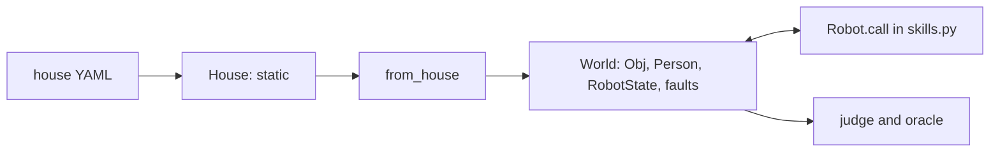

# Household world state

This page describes the TRUE state of a household episode: the house layout that never changes, the objects, people and robot that do, and the small types that skills return. Planners never see this state. Skills read and change it, and the benchmark's privileged oracle reads it.

!!! abstract "In this page"
    - The household domain is frozen except `domain.py` (tag `home-sim-freeze-r19`, pinned by [`tests/home/sim/test_freeze_r19.py`](https://github.com/mtbui2010/symbolic_robot/blob/a5cc7a4943aa/tests/home/sim/test_freeze_r19.py)). Nothing here changes unless the owner makes a new freeze tag.
    - `House` is static. `Obj`, `Person` and `RobotState` are dynamic. `World` holds both, plus `faults`, `utterances`, `semantic_violations`, `people_now` and `people_seen`.
    - The robot's true pose is separate from what it believes (`perceived`, `phantoms`, `partial_open`).
    - `from_house(name, seed_state)` builds the world. It is deterministic, and `seed_state` 0 is the YAML default.
    - `visible_at` shows nothing inside a closed or partly opened container.
    - `SkillResult.public()` is what a planner may see. `to_json()` adds the hidden `injected` and `truth`.

!!! code "Where in the code"
    - [`World`, `Obj`, `Person`, `RobotState`](https://github.com/mtbui2010/symbolic_robot/blob/a5cc7a4943aa/symbolic_robot/domains/home/world.py#L24-L213) (static layout from line 24, dynamic state from line 113)
    - [`visible_at`](https://github.com/mtbui2010/symbolic_robot/blob/a5cc7a4943aa/symbolic_robot/domains/home/world.py#L229-L238) and [`from_house`](https://github.com/mtbui2010/symbolic_robot/blob/a5cc7a4943aa/symbolic_robot/domains/home/world.py#L460-L500)
    - [`SkillResult`, `FaultState`, `Traverse` and friends](https://github.com/mtbui2010/symbolic_robot/blob/a5cc7a4943aa/symbolic_robot/domains/home/types.py#L13-L233)

## Background

The world is symbolic. A place has an id like `shelf@main`; an object is at one place, in the robot's hand (`robot`), with a person (`person:<id>`), or on a floor (`floor@<room>`). There are no physics. Geometry is only used for distances: each room is a rectangle, doors join rooms, and a path goes through door centres.

Two ideas matter on this page.

- **The truth and the belief are different.** The world holds what is really there. The robot's own report can be wrong (a silent failure, a false arrival). The benchmark judges against the truth. See [Symbolic worlds](../learn/symbolic-worlds.md) for the general idea.
- **A seed fixes everything.** The same house, `seed_state`, profile and seed give the same episode. See [Determinism by seed](../learn/determinism.md).

## Where it sits



## Static layout

`load_house` parses a YAML file into a `House` and caches it. The layout is shared by every world of that house and is never changed (`World.copy` deep-copies the state but keeps the same `House`).

| type | fields that matter |
|---|---|
| `Room` | `rect` `(x0, y0, x1, y1)` in metres, `floor_pos` (where dropped objects are picked up), room `types` (kitchen, bedroom ...) |
| `Door` | the two rooms, the point `at`, `width_m` |
| `Place` | `id` (`<place>@<room>`), `kind` (`surface`, `container`, `seat`, `floor`, `dock`), approach pose `pos` and `yaw_deg`, `height_m`, `clutter` (`low`, `medium`, `high`), `capacity`, `tags`, `hard_nav`, an optional `Container` (type, openable, opened), `person_pos` |
| `ObjSpec` | `id`, `cls`, `attrs` (for example colour), `at`, `alt` (alternative places) |
| `PersonSpec` | role (`user` or `other`), names, age group, `seat`, `alt_seats`, `frail`, `prefers_handover`, `walks_to` |
| `House` | the above, plus `robot_start` and `dock` |

## Dynamic state

| type | fields | meaning |
|---|---|---|
| `Obj` | `id`, `cls`, `attrs`, `at`, `inside`, `alt` | where one object is now |
| `Person` | as `PersonSpec` | the start state of one person (movement over time is in the user model) |
| `RobotState` | `at`, `pose`, `holding`, `perceived`, `docked`, `estop`, `partial_open`, `phantoms` | `pose` is the TRUE pose `(x, y, yaw_deg)`; `perceived` is the set of object ids the camera reported; `phantoms` are ids that `find` reported although they are not there; `partial_open` is the set of containers that are only partly open; `estop` is the stop state |
| `World` | `house`, `seed_state`, `objects`, `opened`, `people`, `robot`, `faults`, `utterances`, `semantic_violations`, `initial_at`, `people_now`, `people_seen`, `lang` | the whole episode state |

Four members of `World` need a sentence each.

- `faults` maps a device or target to a `FaultState` that outlives one call. Keys seen in the code are a device name (`camera`, `base`, `arm`, `gripper`), `path:<target>` (a blocked move), and `grasp:<object>` (a failed grasp that a retry may clear). The three fault kinds are used by [Household skill dispatch and motion](home-skills.md), [Household perception](home-perception.md) and [Household manipulation](home-manipulation.md).
- `people_now` is where people are at the current clock time (`{person: {"pos": (x, y), "moving": bool}}`). The robot copies it from the user model after every call. Empty means everyone is at the start position.
- `people_seen` is where the ROBOT last saw each person. It is updated only while the person is in the robot's room, so it can be stale. This is the robot's perception, not the truth.
- `semantic_violations` collects the hazard events that skills record while they run; `utterances` records every `say`, `announce` and `ask` with the time, the language and who heard it.

## Input

`from_house(name, seed_state=0)`. `name` is a house name or a `House`.

## Output (real, `studio_flat`, `seed_state` 0)

| what | value |
|---|---|
| rooms | `['main', 'bathroom']` |
| places | 16 |
| objects | 19 |
| people | `['user']` |
| robot `at`, `pose`, `docked` | `dock@main`, `(3.0, 3.0, 90.0)`, `True` |
| first object | `Obj(id='mug_1', cls='mug', attrs={'color': 'white'}, at='desk@main', inside=False, alt=['counter@main'])` |
| `visible_at('shelf@main')` | `['book_1', 'snack_2']` |
| `room_of((3, 3))` | `main` |
| `path((3, 3), (7, 4))` | `[(3.0, 3.0), (6.0, 3.5), (7.0, 4.0)]`, through the door at `(6.0, 3.5)` |
| `resolve_object('book')`, `resolve_place('shelf')`, `resolve_person('user')` | `book_1`, `shelf@main`, `user` |
| `people_now` after the first call | `{'user': {'pos': (0.5, 0.5), 'moving': False}}` |

A resolver takes an id or a name in either language and returns one id, a list of ids if the name is ambiguous, or `None`. Names go through `norm` (Unicode NFKC, lower case, punctuation dropped; Korean text also drops spaces). English words go through `stem_en`, a rule for regular plurals only; irregular plurals are not handled.

## How it works

1. `from_house` builds `Obj` records from the house's object list, and `Person` records from its people.
2. With `seed_state` 0 it stops there: the YAML arrangement. With a positive `seed_state` it makes a stream named `layout` from `Streams(seed_state, "from_house")`, lets people with `alt_seats` pick a seat, and moves objects (the second excerpt below).
3. It builds the `RobotState` at `house.robot_start` (docked if that is the dock) and records `initial_at`, the start place of every object.

```python
    if rng is not None:
        count = {pid: 0 for pid in house.places}
        for o in objs.values():
            count[o.at] += 1
        for oid in sorted(objs):
            o = objs[oid]
            if not o.alt or rng.random() >= 0.3:
                continue
            dest = rng.choice(sorted(o.alt))
            if count[dest] >= house.places[dest].capacity:
                continue
            count[o.at] -= 1
            count[dest] += 1
            o.at = dest
            o.inside = house.places[dest].kind == "container"
```

[Source: `world.py` lines 479-493](https://github.com/mtbui2010/symbolic_robot/blob/a5cc7a4943aa/symbolic_robot/domains/home/world.py#L479-L493). Objects are visited in sorted id order, so the draws are stable. A move needs free capacity at the target. For `family_house` with `seed_state` 1, 10 of the 25 objects move; I ran this (the full table is on [Household domain wrapper and house layouts](home-domain-and-houses.md)).

What the camera can see is a rule of the world, not of the skill:

```python
    def visible_at(self, place_id: str) -> list:
        """Objects the camera can see at a place: on a surface, or inside an opened (not partly
        opened) container."""
        p = self.house.places.get(place_id)
        if p is None:
            return []
        if p.kind == "container":
            if place_id not in self.opened or place_id in self.robot.partial_open:
                return []
        return self.objects_at(place_id)
```

[Source: `world.py` lines 229-238](https://github.com/mtbui2010/symbolic_robot/blob/a5cc7a4943aa/symbolic_robot/domains/home/world.py#L229-L238). A closed drawer hides its objects, and so does a drawer that is only partly open (the result of a silent failure of `open`). An unknown place gives an empty list.

## Result and fault types

`types.py` is pure standard library. It holds the shared types.

| type | what it is |
|---|---|
| `FailureCode` | an enum of 11 values: `absent`, `perception_unavailable`, `unreachable`, `blocked`, `grasp_failed`, `dropped`, `hw_fault`, `estop`, `timeout`, `cancelled`, `software`. A comment says the values equal robot_agent's own `FailureCode`; a test checks it when robot_agent is importable. |
| `SkillResult` | frozen: `ok`, `code` (None iff ok), `msg`, `data`, `duration_s`, `injected`, `truth` |
| `FaultState` | `device`, `code`, `since_t`, `clears_on` (`wait`, `retry`, `help` or `never`), `p_clear`, `p_help` |
| `Utterance` | one spoken or asked sentence: time, skill, text, language, who heard |
| `UserReply` | what a person answers: text, `kind` (`correct`, `wrong`, `not_sure`, `no_answer`, `yes`, `no`), latency, whether they heard |
| `Heard` | what the robot's speech recogniser hears: text and `event` (`ok`, `not_heard`, `partial`, `corrupted`) |
| `Traverse` | the result of one monitored motion: duration, slow-down time, stopped time, `aborted`, minimum separation, violations |

`SkillResult` has three views. All floats are rounded to six decimals. I ran `move(target="shelf@main")` in `studio_flat`, profile `real`, seed 0:

```text
public()    {'ok': True, 'code': None, 'msg': 'ok', 'data': {'at': 'shelf@main'}, 'duration_s': 4.384315}
to_legacy() {'at': 'shelf@main', 'isdone': True, 'msg': 'ok'}
to_json()   {'ok': True, 'code': None, 'msg': 'ok', 'data': {'at': 'shelf@main'}, 'duration_s': 4.384315, 'injected': False, 'truth': {'effect': True}}
```

| view | for whom | extra |
|---|---|---|
| `public()` | the planner | none |
| `to_legacy()` | the robot_agent legacy dict (see [Household pack for robot_agent](home-pack.md)) | `isdone`, `msg`, `code` |
| `to_json()` | trace and judge | `injected` (the failure model caused it, not a true-state rule) and `truth` (hidden: `effect` and an `event`) |

`FaultState` is described again with the failure model on [Household failure model and seeded streams](home-outcomes.md).

## Edge cases and failure modes

| symptom | cause | note |
|---|---|---|
| `resolve_*` returns a list | the name fits several ids | a skill says "ambiguous" in its message and puts the ids in `data["candidates"]` |
| `visible_at` returns `[]` for a drawer you just opened | the open was a silent partial open, or the drawer is still closed | the true `opened` set says which |
| a person is at an old position in `people_seen` | they left the robot's room | by design: it is the robot's perception |
| `path` returns `[a, b]` for two points | the house is disconnected | `validate_house` rejects such houses; the eight shipped houses are valid |
| a copy of the world changes the original | it does not: `copy` deep-copies state; only the `House` is shared | do not mutate the `House` |
| Korean names with spaces do not match | `norm` removes spaces for Korean text on both sides | compare after `norm` |

## How it is verified

- `tests/home/sim/test_world.py` has tests for seed 0 equal to the YAML default, determinism of `from_house` and variation by `seed_state`, the resolvers, paths through doors, and a deep copy. Not run here.
- `tests/home/sim/test_types.py` has `test_result_shapes` and `test_codes_match_robot_agent`. Not run here; the second needs robot_agent.
- I ran the values in the output table by hand with `/usr/bin/python3` on a copy of the pinned tree. No `pytest` result is claimed.
