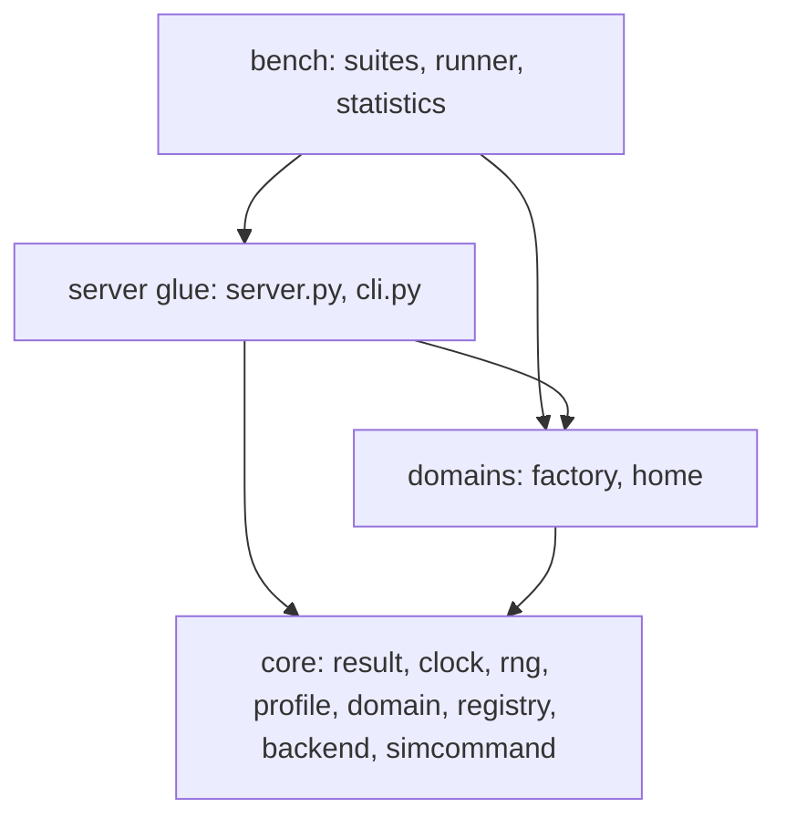

# Code map

!!! abstract "In this page"
    - One row per module page: what the module is for, its main files, its entry points, and the page that explains it.
    - The top-level folders of the repo and what each one is for.
    - A check that every tracked Python file under `symbolic_robot/` and `bench/` appears in some module page's `sources:`, with the files that do not.

All paths are relative to the repo root and refer to commit `a5cc7a4943aa`. Words in `code font` are names in the repo; terms are in the [glossary](../reference/glossary.md).

## The layers



Dependencies point one way. The core never imports a domain or `bench`; a domain never imports `bench`; `bench` talks to a running server over HTTP, except the household benchmark, which runs in process. robot_agent is imported only by the server glue, by a domain's `configs/` pack and by two household planner files, always inside functions. These rules are tests: see [Layering, names and size limits](layering-tests.md).

## Top-level folders

At the pinned commit `git ls-tree` shows these tracked folders and files.

| folder or file | tracked files | what it is for |
|---|---|---|
| `symbolic_robot/` | 89 | the engine: the core (`*.py` at the top), the server glue (`server.py`, `server_skills.py`, `cli.py`) and the two domains (`domains/factory/`, `domains/home/`) |
| `bench/` | 140 | the benchmark package: the generic front end and runner at the top, `suites/factory/` and `suites/home/` (the household benchmark with its planners, task data and tools) |
| `tests/` | 192 | tests: `tests/*.py` for the core, the factory and the rules; `tests/home/sim/` and `tests/home/bench/` for the household parts; `tests/home/parity/`, `tests/parity/` and `size_baseline.json` |
| `docs/` | 61 | the repo's own design notes (`architecture.md`, `bench.md`, `domains.md`, a changelog) and the household notes under `docs/home/`. They are older than this site and use the earlier standalone package names, so this site paraphrases them instead of linking |
| `results/` | 81 | `.gitkeep` and two recorded household runs (`live_smoke`, `r4a`) that came with the merge. They are read-only data of other runs; new runs are not committed |
| `Makefile` | 1 | the shell entry points: [Make targets](../reference/make-targets.md) |
| `pyproject.toml` | 1 | package metadata, extras, the console script, package data: [Versions and licences](../reference/versions-and-licences.md) |
| `README.md`, `LICENSE`, `CLAUDE.md`, `.gitignore` | 4 | the overview, the MIT licence text of the root, the repo's rules for contributors, ignore rules |

`website/`, the source of this site, is not part of the pinned commit.

## Core

| module page | purpose | main files | entry points |
|---|---|---|---|
| [Results, time and draws](results-time-draws.md) | what a skill call returns, simulated time, seeded draws | `symbolic_robot/result.py`, `clock.py`, `rng.py` | `Result`, `SimClock`, `Rng`, `CallDraws`, `derive_seed` |
| [Profiles](profiles.md) | fault rates and durations from one YAML file per profile, with a source label for every number | `symbolic_robot/profile.py`, `domains/factory/profiles.py`, `domains/factory/profiles/real.yaml` | `profile.load`, `Profile.get`, `with_overrides`, `available` |
| [The domain protocol](domain-protocol.md) | what a domain must provide, and how domains are found | `symbolic_robot/domain.py`, `registry.py`, `tests/toy.py` | `BaseDomain`, `registry.get`, `registry.register`, the entry point group `symbolic_robot.domains` |
| [Live backend and sim commands](live-backend-and-sim-commands.md) | the one running episode, its call log, and the `sim_command` ops | `symbolic_robot/backend.py`, `simcommand.py` | `LiveBackend`, `SimCommands.handle` |

## Server glue

| module page | purpose | main files | entry points |
|---|---|---|---|
| [Server glue and the engine command line](server-and-cli.md) | serves a domain through robot_agent's API as the headless benchmark backend | `symbolic_robot/server.py`, `server_skills.py`, `cli.py`, `__main__.py`, `Makefile` | `python -m symbolic_robot {list, run}`, `server.build`, `make run` |

## Factory domain

| module page | purpose | main files | entry points |
|---|---|---|---|
| [Factory world and floors](factory-world.md) | the data model of a floor: places, objects, name resolution | `symbolic_robot/domains/factory/world.py`, `floors/*.yaml`, `__init__.py` | `load_floor`, `list_floors`, `World`, `Factory` |
| [Factory skills and faults](factory-skills.md) | the 12 skills of the arm-and-gripper robot and how a call can fail | `symbolic_robot/domains/factory/robot.py`, `episode.py`, `profiles.py`, `profiles/real.yaml` | `Robot.call`, `make_episode`, `load_profile` |
| [Factory tasks and scripted people](factory-tasks-and-people.md) | generated tasks and the scripted person who answers | `symbolic_robot/domains/factory/tasks.py`, `tasks_gen.py`, `person.py`, `user.py`, `messy.py` | `factory_tasks`, `factory_messy_tasks`, `answer_for`, `SimUser` |
| [Factory pack](factory-pack.md) | the plug-in that makes the factory usable by robot_agent | `symbolic_robot/domains/factory/configs/` (`manifest.yaml`, `adapter.py`, `ra_skills.py`, `skills_config.py`, `tasks.py`, `backend.py`) | `load_adapter('symbolic_robot.domains.factory')`, `env_for` |

## Household domain

The household simulator is frozen since the tag `home-sim-freeze-r19`, except `domain.py` ([Parity and frozen behaviour](parity.md)).

| module page | purpose | main files | entry points |
|---|---|---|---|
| [Household domain and houses](home-domain-and-houses.md) | the wrapper that plugs the simulator into the core, and the eight houses | `symbolic_robot/domains/home/domain.py`, `__init__.py`, `houses/`, `realism.py` | `Home`, `load_house`, `list_houses` |
| [Household world state](home-world.md) | rooms, places, objects, people, the robot, and the result type | `symbolic_robot/domains/home/world.py`, `types.py`, `catalog.py` | `World`, `from_house`, `SkillResult`, `FailureCode` |
| [Household skill dispatch and motion](home-skills.md) | the one entry point `Robot.call`, its checks, the 17 skills, and the motion skills `move`, `dock`, `wait` | `symbolic_robot/domains/home/skills.py`, `outcomes.py`, `world.py`, `safety.py` | `Robot.call` |
| [Household perception](home-perception.md) | the five sensing skills `find`, `look`, `vlm_check`, `grasp_check`, `pose`; detector misses and wrong instances | `symbolic_robot/domains/home/skills.py`, `catalog.py`, `world.py` | `detector_hits`, the perception skills |
| [Household manipulation](home-manipulation.md) | `pick`, `place`, `put_in`, `open`, `close`, `handover` | `symbolic_robot/domains/home/skills.py`, `outcomes.py`, `reach.py`, `catalog.py` | the manipulation skills |
| [Household failure model and seeded streams](home-outcomes.md) | how a call draws its outcome from a 14-slot vector | `symbolic_robot/domains/home/outcomes.py`, `rng.py`, `clock.py` | `uniforms`, `sample_outcome`, `Streams` |
| [Household profiles and calibration](home-profiles.md) | the three profiles built from one calibrated set of numbers, and the validator | `symbolic_robot/domains/home/profiles/` (`__init__.py`, `validate.py`, `__main__.py`, YAML) | `load_profile`, `python -m symbolic_robot.domains.home.profiles` |
| [Goals and the oracle solver](home-goals-and-oracle.md) | the goal language, the check against the true world, and the solver | `symbolic_robot/domains/home/goals.py`, `oracle.py`, `hazards.py`, `selftest.py`, `reach.py` | `goals.parse`, `goals.evaluate`, `oracle.solve`, `python -m symbolic_robot.domains.home.selftest` |
| [Household pack](home-pack.md) | overview of the robot_agent plug-in of the household robot | `symbolic_robot/domains/home/configs/`, `planner/seed_memory.jsonl` | `configs.adapter`, `configs.backend.set_backend` |

## Benchmark (generic)

| module page | purpose | main files | entry points |
|---|---|---|---|
| [Suites and the front end](bench-front-end.md) | the `Suite` data type, the registry, the one command line, the server start and stop | `bench/suite.py`, `suites/registry.py`, `cli.py`, `orchestrate.py`, `suites/home/register.py` | `python -m bench {list, run, analyze, report, verify}`, `Suite`, `registry.register` |
| [Campaign runner](campaign-runner.md) | plays every (task, repeat, arm) of a suite against a running server | `bench/runner.py`, `campaign.py` | `run_episode`, `run_campaign` |
| [Campaign statistics and pre-registration](campaign-statistics.md) | per-task paired statistics, the win rule, the protocol hash | `bench/stats.py`, `protocol.py`, `suites/factory/analyze_protocol.py`, `report_protocol.py` | `compare`, `sign_test`, `boot_ci`, `protocol.register`, `protocol.verify` |
| [Factory suites](factory-suites.md) | three registered factory campaigns, their arms, analyses and reports | `bench/suites/factory/` (`__init__.py`, `arms.py`, `analyze_*.py`, `report_*.py`, `protocol.md`) | `factory/protocol`, `factory/messy`, `factory/messy_fix` |

## Household benchmark

| module page | purpose | main files | entry points |
|---|---|---|---|
| [Household runner and task loading](home-runner.md) | plays tasks times seeds with one planner and writes three files | `bench/suites/home/runner.py`, `tasks.py`, `data/__init__.py`, `register.py`, `cli.py` | `python -m bench.suites.home.cli run`, `run_many`, `load_tasks`, `write_run` |
| [Episode environment and the judge](episode-env-and-judge.md) | what a planner sees and can do in one episode, the budgets, and the judge | `bench/suites/home/env.py`, `refusals.py`, `symbolic_robot/domains/home/goals.py`, `episode.py` | `EpisodeEnv`, `EpisodeEnv.judge`, `make_episode` |
| [Metrics, report and compare](home-metrics-and-report.md) | `summary.json`, `report.md`, the paired tests, the failure causes | `bench/suites/home/metrics.py`, `report.py`, `failures.py` | `summarize`, `clustered`, `compare`, `mcnemar`, `report.render`, `python -m bench.suites.home.failures` |
| [Planner interface and registry](planner-interface.md) | how a planner is found, built and run | `bench/suites/home/planners/__init__.py`, `base.py` | `REGISTRY`, `make_planner`, `Planner`, `StepPlanner`, `PlanPlanner` |
| [Reference planners](reference-planners.md) | `oracle` and `naive`, the two privileged planners | `bench/suites/home/planners/oracle.py`, `naive.py` | `OraclePlanner`, `NaivePlanner` |
| [LLM baselines and clients](llm-baselines.md) | the four LLM baselines, the keyword baseline, the LLM clients and the shared cache | `bench/suites/home/planners/saycan_like.py`, `inner_monologue_like.py`, `progprompt_like.py`, `knowno_like.py`, `keyword.py`, `prompts.py`, `llm.py`, `shared_cache.py` | `make_llm`, `OllamaHTTP`, `CachedLLM`, `FakeLLM` |
| [robot_agent planners and the adapter](robot-agent-planners.md) | overview of the `robot_agent:*` planners and the adapter that runs them | `bench/suites/home/planners/robot_agent_adapter.py`, `robot_agent_fake.py`, `d1_options.py`, `ablations.py`, `retry.py`, `gold_goals.py` | the `robot_agent:*` names in `REGISTRY` |
| [Task data and its generation](task-data.md) | what a task is, where the data lives, how it is generated (in outline); research-only in part | `bench/suites/home/data/`, `gen/`, `tasks.py`, `LICENSE-DATA`, `NOTICE` | `load_split`, `task_by_id`, `python -m bench.suites.home.data` |

## Rules and parity

| module page | purpose | main files | entry points |
|---|---|---|---|
| [Layering, names and size limits](layering-tests.md) | the repo's rules as tests | `tests/test_layering.py`, `tests/size_baseline.json`, `CLAUDE.md` | the seven tests of `test_layering.py` |
| [Parity and frozen behaviour](parity.md) | tests that a refactor, or the merge, changed no behaviour | `tests/test_home_baseline.py`, `tests/test_home_parity.py`, `tests/home/parity/`, `tests/parity/factory_replay.py`, `tests/test_parity_factory.py`, `tests/home/sim/test_freeze_r19.py` | the replay and byte-identity tests |

## Coverage check

The module pages list the repo files they depend on in a `sources:` line of their front matter. This script reads those lists, takes every tracked Python file under `symbolic_robot/` and `bench/` at the pin, and prints the files that no page lists (a directory entry such as `symbolic_robot/domains/factory/configs/` covers the files under it). Run from the repo root.

```python
import glob, re, subprocess
PIN = "a5cc7a4943aa"
tracked = subprocess.run(["git", "ls-tree", "-r", "--name-only", PIN], capture_output=True, text=True, check=True).stdout.split()
py = [f for f in tracked if f.endswith(".py") and f.startswith(("symbolic_robot/", "bench/"))]
sources = set()
for page in glob.glob("website/docs/modules/*.md"):
    text = open(page).read()
    if not text.startswith("---"):                                # index.md has no front matter
        continue
    head = text.split("---")[1]                                   # the front matter
    sources |= set(re.findall(r"[\w./-]+(?:\.\w+|/)(?=[\s,\]]|$)", head.split("verified_at")[0]))
def covered(f):
    return any(f == s or (s.endswith("/") and f.startswith(s)) for s in sources)
gaps = [f for f in py if not covered(f)]
print(len(py), "tracked .py files under symbolic_robot/ and bench/;", len(gaps), "are not a sources: entry of any module page")
print(*gaps, sep="\n")
```

Real output, run on the pinned file list and the module pages of this site:

```text
157 tracked .py files under symbolic_robot/ and bench/; 23 are not a sources: entry of any module page
bench/__init__.py
bench/suites/__init__.py
bench/suites/home/__init__.py
bench/suites/home/planners/progprompt_examples.py
bench/suites/home/rescore.py
bench/suites/home/sim_user_audit.py
bench/suites/home/tools/exp_tables.py
bench/suites/home/tools/lora/build_understand_data.py
bench/suites/home/tools/lora/build_understand_gold.py
bench/suites/home/tools/lora/text_noise.py
bench/suites/home/tools/lora/understand_labels.py
bench/suites/home/tools/translate_ab/agg.py
bench/suites/home/tools/translate_ab/match.py
bench/suites/home/tools/translate_ab/mismatch.py
bench/suites/home/tools/translate_ab/relat.py
bench/suites/home/understand_eval.py
bench/suites/home/user_intent.py
symbolic_robot/domains/__init__.py
symbolic_robot/domains/home/_hs_compat.py
symbolic_robot/domains/home/asr.py
symbolic_robot/domains/home/dialog.py
symbolic_robot/domains/home/intent.py
symbolic_robot/domains/home/user.py
```

134 of the 157 files are covered. The 23 gaps fall into four groups:

| group | files | why they have no page yet |
|---|---|---|
| package markers | `bench/__init__.py`, `bench/suites/__init__.py`, `bench/suites/home/__init__.py`, `symbolic_robot/domains/__init__.py` | a version string and empty or one-line files |
| the household user model | `symbolic_robot/domains/home/user.py`, `dialog.py`, `asr.py`, `intent.py`, `_hs_compat.py` | the simulated person's speech, dialogue and intent code: a large frozen area that this site covers only in passing (for example in [Household world state](home-world.md) and [Household skill dispatch and motion](home-skills.md)) |
| analysis and evaluation tools of the household benchmark | `understand_eval.py`, `rescore.py`, `sim_user_audit.py`, `user_intent.py`, `tools/exp_tables.py` | research scaffolding; their commands are in [Command lines](../reference/cli.md) |
| data and model tools | `tools/lora/*`, `tools/translate_ab/*`, `planners/progprompt_examples.py` | research scaffolding and prompt examples; [Task data](task-data.md) and [LLM baselines](llm-baselines.md) mention the area |

Reading the map: start from the entry point of what you want to change (the last column), open its page, and follow the "Where in the code" block to the file and line.
