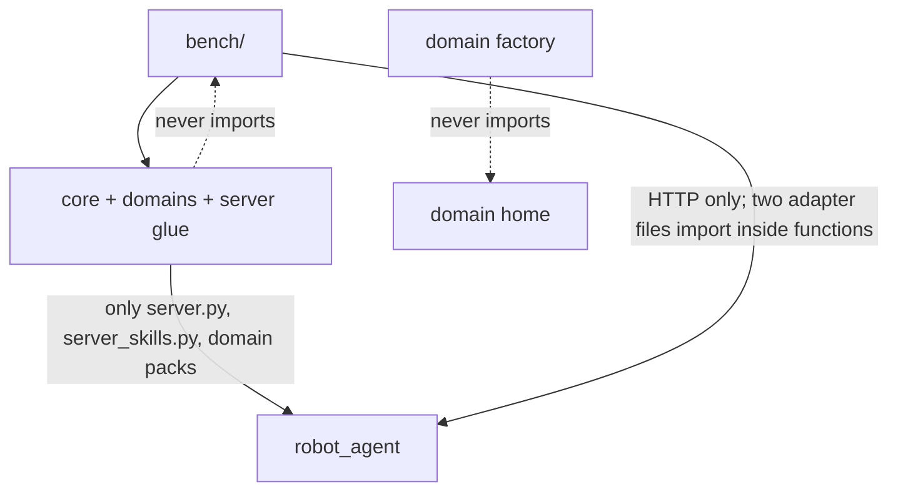

# Layering, private names and size limits

!!! abstract "In this page"
    - The seven tests in `tests/test_layering.py` that turn the repo's rules into failing builds.
    - What each test scans, and what it lets through.
    - The size baseline: it lists 31 exceptions today, although `CLAUDE.md` says none (finding F3).

## Why these tests exist

`CLAUDE.md` states rules for the repo: the engine knows no fact about a robot, the layers only point one way, robot_agent is imported in few places, no private names, small functions and files. Rules kept by good will erode. These tests keep them by failing. They are plain Python: they parse files with `ast` and read text; they import nothing of the engine.

## Where it sits



## What gets scanned

`files()` asks git: `git ls-files -co --exclude-standard`, which means tracked files plus untracked files, minus ignored ones ([test_layering.py:26-28](https://github.com/mtbui2010/symbolic_robot/blob/a5cc7a4943aa/tests/test_layering.py#L26-L28)). The file `env.local.mk` is skipped. Because untracked files count, **the documentation site under `website/` is scanned too**: every page of this site must pass the name tests below before it is published.

## The seven tests

| test | rule | what it checks |
|---|---|---|
| `test_core_and_domains_never_import_bench` | the judge lives outside the engine | no file under `symbolic_robot/` imports `bench` |
| `test_nothing_imports_the_retired_standalone_packages` | the earlier packages are gone | no scanned `.py` file imports either retired package |
| `test_robot_agent_only_in_server_glue_and_domain_packs` | one door to the framework | in the core only `server.py`, `server_skills.py` and a domain's `configs/` pack may import robot_agent; in `bench/` nobody does, except the two household planner adapter files, and only inside functions |
| `test_domains_do_not_import_each_other_or_the_server` | domains are independent | no domain imports another domain or any `symbolic_robot.server*` module |
| `test_no_private_names_anywhere` | the repo is publishable | no scanned text file, and no file path, matches the private-name pattern |
| `test_household_names_appear_only_in_the_home_parts_and_the_docs_about_them` | the earlier household project's name stays in its own parts | the former project name may appear only under an allow-list of paths |
| `test_size_limits_do_not_grow` | small units | functions at most 80 lines, files at most 600, against a baseline that may only shrink |


### Names

The two name patterns are built from split strings on purpose, so that the test file does not match itself in a casual search ([test_layering.py:11-12](https://github.com/mtbui2010/symbolic_robot/blob/a5cc7a4943aa/tests/test_layering.py#L11-L12)). This page does not reproduce them, and never writes the banned names. It describes them: four private names of projects and companies outside this repo, and the former name of the household project. Pages here say "the household domain", "the factory domain" and "the earlier standalone packages" instead.

The private-name test has one allow-list entry: the later-step plan for a sibling simulator and the test file itself. The household-name test allows the household parts (`symbolic_robot/domains/home/`, `bench/suites/home/`, `tests/home/`, recorded results), a few listed docs, `README.md`, `CLAUDE.md`, the `Makefile` and `pyproject.toml`. Everything else, including `website/`, must not contain it.

!!! code "Where in the code"
    [test_layering.py:74-82](https://github.com/mtbui2010/symbolic_robot/blob/a5cc7a4943aa/tests/test_layering.py#L74-L82) and [test_layering.py:100-112](https://github.com/mtbui2010/symbolic_robot/blob/a5cc7a4943aa/tests/test_layering.py#L100-L112).

```python
def test_no_private_names_anywhere():
    bad = []
    for p in files(".py", ".md", ".yaml", ".yml", ".toml", ".mk", ".txt", ".json", ".cfg", "Makefile"):
        rel = str(p.relative_to(ROOT))
        if rel in PRIVATE_OK:
            continue
        if PRIVATE.search(p.read_text(errors="ignore")) or PRIVATE.search(rel):
            bad.append(rel)
    assert not bad, bad
```

```python
def test_size_limits_do_not_grow():
    base = json.loads((ROOT / "tests" / "size_baseline.json").read_text())
    over = {}
    for p in files(".py"):
        n = len(p.read_text().splitlines())
        if n > MAX_FILE:
            over[str(p.relative_to(ROOT))] = n
        for name, size in function_sizes(p):
            if size > MAX_FUNC:
                over[name] = size
    for k, v in over.items():
        assert k in base["allowed"] and v <= base["allowed"][k]["max"], f"{k} is {v} lines (limit {MAX_FUNC}/{MAX_FILE}); justify it in tests/size_baseline.json"
    stale = [k for k in base["allowed"] if k not in over]
```

## The size baseline

A function or file over the limit must be listed in `tests/size_baseline.json` with a `max`. The test fails in two directions:

- a unit is over the limit and not listed, or has grown past its `max`;
- a listed entry is no longer over the limit (a stale entry): remove it. That is how the baseline shrinks.

Real contents at the pinned commit:

| fact | value |
|---|---|
| limits recorded | function 80, file 600 |
| entries | 31 (21 functions, 10 files) |
| from the household benchmark (`bench/`) | 16, each with the source note "moved with the household benchmark" |
| from the household simulator (`symbolic_robot/`) | 15, each with "moved with the household simulator" |
| entries outside those two | 0 |
| largest `max` | 1,696 lines |

!!! warning "Finding F3: CLAUDE.md says none, the file lists 31"
    Rule 2 of `CLAUDE.md` says the baseline lists "justified exceptions, now none". The file lists 31. `docs/architecture.md` matches the file: it says the moved household code is listed there, each entry with its source. The sentence in `CLAUDE.md` is out of date. Current behaviour is documented here as found; the engine, the factory domain and the generic bench modules carry no exceptions, the 31 are all moved household code.

## Failure modes

| symptom | cause | what to do |
|---|---|---|
| name test lists a path | a page, docstring or file contains a banned name, or its path does | reword generically; the test prints the offending relative paths |
| "entries no longer needed" | you shrank a function below the limit | delete its baseline entry |
| "is N lines (limit 80/600)" | a new or grown unit | split it; do not raise the baseline |
| name test passes on a fresh clone but fails with your files | untracked files count | the scan uses tracked plus untracked files |

## Tests

`tests/test_layering.py` (seven functions). pytest is not installed in the documentation environment, so no pytest result is claimed. The seven functions were called directly, without pytest, on a copy of the pinned commit plus this site, as a git snapshot; all seven passed, with these three pages included in the scan.
