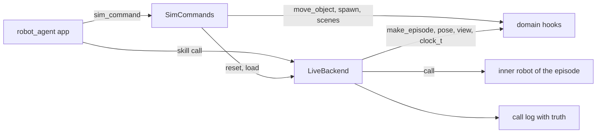

# Live backend and sim commands

!!! abstract "In this page"
    - `LiveBackend` wraps one episode of any domain: it runs skill calls, logs each call with its truth, lets the world be replaced, and passes every other attribute to the inner robot.
    - `SimCommands` is the generic `sim_command` handler. Its six ops are `state`, `truth`, `reset`, `load`, `move_object`, `spawn`. It never raises: every answer is a dict.
    - Real outputs of both on the factory domain (`small_workshop`, profile `ideal`, seed 0) and on a toy domain.
    - Two current behaviours to know: `reset` always makes a whole new episode (F5), and the factory reports an object's variant under the key `color` (F6).

!!! code "Where in the code"
    - [`backend.py`](https://github.com/mtbui2010/symbolic_robot/blob/a5cc7a4943aa/symbolic_robot/backend.py): `LiveBackend`
    - [`simcommand.py`](https://github.com/mtbui2010/symbolic_robot/blob/a5cc7a4943aa/symbolic_robot/simcommand.py): `SimCommands`
    - [`domains/factory/__init__.py`](https://github.com/mtbui2010/symbolic_robot/blob/a5cc7a4943aa/symbolic_robot/domains/factory/__init__.py): the factory's hooks and ops
    - [`domains/home/domain.py`](https://github.com/mtbui2010/symbolic_robot/blob/a5cc7a4943aa/symbolic_robot/domains/home/domain.py): the household's hooks and ops
    - Tests: [`tests/test_core.py`](https://github.com/mtbui2010/symbolic_robot/blob/a5cc7a4943aa/tests/test_core.py), [`tests/test_domain_factory.py`](https://github.com/mtbui2010/symbolic_robot/blob/a5cc7a4943aa/tests/test_domain_factory.py)

## Why a backend between the server and the domain

The benchmark needs the simulated robot to be reachable from outside: robot_agent's app calls skills, reads the world and sends commands. Two things must hold for that to be safe and fair. Every call must be logged with what really happened (the **truth**, which the planner never sees). And a test must be able to put the world back, or load another one, without restarting the process.

`LiveBackend` does both for any domain that follows the [domain protocol](domain-protocol.md). `SimCommands` turns a small JSON-like command into a call on the backend or on a domain hook. The server glue ([server-and-cli.md](server-and-cli.md)) wires the two to the HTTP endpoints; the full op reference is in [../reference/sim-command.md](../reference/sim-command.md). The words used here are in the [glossary](../reference/glossary.md).



## LiveBackend

### Input and output

| call | input | output |
|---|---|---|
| `LiveBackend(domain, world, profile, seed=0, **opts)` | a domain, a world name, a profile name, a seed, more `make_episode` options | a backend with a fresh episode, an empty log and `busy == ""` |
| `call(skill, **args)` | a skill name and its arguments | the inner robot's `Result`, unchanged |
| `reset(**kw)` | any of `profile`, `seed`, `world`, or a domain option | nothing; a new episode is made, the log is cleared |
| `record_ask(question, answer)` | text | nothing; the answer is logged as if the person had given it |
| `snapshot()` | | the robot's state: the domain's `view(...)["robot"]` plus `x`, `y`, `yaw`, `busy`, `t_sim` |
| `world_view()` | | the domain's `view` plus `robot`, `log`, `profile`, `seed`, `world` |
| any other attribute | | the inner robot's attribute (`observe`, `health`, `t` ...) |

### Code

```python
    def __getattr__(self, name):
        if name in ("inner", "episode", "domain"):
            raise AttributeError(name)
        return getattr(self.inner, name)

    # ---- skill calls
    def call(self, skill: str, **args):
        d, ep = self.domain, self.episode
        self.busy = skill
        try:
            with self.lock:
                res = self.inner.call(skill, **args)
            dur = float(getattr(res, "duration_s", 0.0) or 0.0)
        finally:
            self.busy = ""
        self.log.append({"t_wall": time.time(), "skill": skill, "args": {k: str(v) for k, v in args.items()}, "ok": bool(res.ok),
                         "code": str(getattr(res, "code", None) or ""), "msg": str(res.msg)[:160], "t_sim": d.clock_t(ep), "dur": dur,
                         "truth": getattr(res, "truth", None) or {}})
        return res
```

Source: [`symbolic_robot/backend.py` L35-L53](https://github.com/mtbui2010/symbolic_robot/blob/a5cc7a4943aa/symbolic_robot/backend.py#L35-L53).

How it works:

1. `__getattr__` runs only when normal lookup fails. The three names `inner`, `episode` and `domain` are refused, so a half-built object cannot loop forever; everything else goes to the inner robot. This is why a pack's skill functions can use the backend as if it were the robot.
2. `call` sets `busy` to the skill name, takes the lock, calls the robot, and clears `busy` in a `finally`.
3. It then appends one log entry. Arguments are turned into strings, `msg` is cut at 160 characters, and the entry keeps `truth`.
4. `reset` takes the lock, merges the non-`None` options into the stored ones, and calls `make_episode` again through the domain. If the `world` changed and `on_new_world` is set, it calls that (the server uses it to refresh the ENV it publishes).

The lock is an `RLock`, so a skill that calls back into the backend does not block. `busy` is set outside the lock; it is a flag for the UI, not a guard.

### What the log holds

A log entry has the keys `t_wall`, `skill`, `args`, `ok`, `code`, `msg`, `t_sim`, `dur`, `truth`. Only `t_wall` is real wall-clock time: it differs from run to run. Everything else is deterministic for a seed. When a domain returns its own log from `call_log(ep)`, `world_view()["log"]` shows that one instead. The factory does (`call_log` returns the robot's log, whose entries have no `t_wall`); a domain that returns `None` gets the backend's list.

### Example (run): the factory, `small_workshop`, `ideal`, seed 0

```python
from symbolic_robot import registry
from symbolic_robot.backend import LiveBackend
live = LiveBackend(registry.get("factory"), "small_workshop", "ideal", 0)
print(live.snapshot())
r = live.call("move", target="toolbox@bench_area")
print(r.ok, r.msg, r.duration_s, repr(r.code))
print(live.snapshot())
e = live.log[-1]
print({k: e[k] for k in e if k not in ("t_wall", "truth")}, sorted(e["truth"]))
```

Output (run):

```text
{'at': 'charging_dock@entry', 'holding': None, 'x': 1.0, 'y': 2.0, 'yaw': 0.0, 'busy': '', 't_sim': 0.0}
True arrived at toolbox 13.291292967074066 None
{'at': 'toolbox@bench_area', 'holding': None, 'x': 6.5, 'y': 7.0, 'yaw': 0.0, 'busy': '', 't_sim': 13.29}
{'skill': 'move', 'args': {'target': 'toolbox@bench_area'}, 'ok': True, 'code': '', 'msg': 'arrived at toolbox', 't_sim': 13.291292967074066, 'dur': 13.291292967074066} ['leg']
```

The move took 13.29 simulated seconds (distance over speed plus the overhead of the `ideal` profile, see [profiles.md](profiles.md)); no real time passed. `at`, `holding` come from the factory's `view`; `x`, `y`, `yaw`, `busy`, `t_sim` are added by `snapshot`. The truth of a move has the key `leg`. The same seed gives the same numbers; see [results-time-draws.md](results-time-draws.md) for a run with random faults.

## SimCommands

A command is a dict `{"cmd": "<op>", ...}`. `handle` finds the method `op_<cmd>`, runs it under the backend's lock, and sets `isdone` to the same value as `ok`. The domain-specific ops call a hook of the domain; if the hook is not overridden, the answer is `ok: false`, not an exception.

```python
    def handle(self, cmd: dict) -> dict:
        fn = getattr(self, f"op_{cmd.get('cmd')}", None)
        if fn is None:
            return {"ok": False, "isdone": False, "msg": f"unknown cmd {cmd.get('cmd')!r}"}
        with self.live.lock:
            try:
                out = fn(cmd)
            except Exception as e:                # noqa: BLE001 - never kill the agent thread
                out = {"ok": False, "msg": f"{type(e).__name__}: {e}"}
        out["isdone"] = bool(out.get("ok"))
        return out
```

Source: [`symbolic_robot/simcommand.py` L18-L28](https://github.com/mtbui2010/symbolic_robot/blob/a5cc7a4943aa/symbolic_robot/simcommand.py#L18-L28).

`SimCommands(live, on_new_world=None)` takes an optional callback. The server passes one that erases the robot's memory files; `reset` and `load` call it unless the command has `forget` set to `0`, `false`, `no` or `off`. It returns the list of erased files, which is added to the message.

### The six ops

| op | fields | what it does | answers `ok: false` when |
|---|---|---|---|
| `state` | none | objects (`body`, `name`, `cls`, `at` ...), the class catalog, the worlds, the scenes, the profile, the seed, the domain, the world | only if the domain raises |
| `truth` | `last` (default 50) | the domain's view, the robot snapshot, profile, seed, world, `busy`, and the last `last` log entries | only if the domain raises |
| `reset` | `what`, `profile`, `seed`, `forget` | a new episode, optionally with another profile or seed | `what` is not `objects`, `robot` or `all`; the profile is not in the domain's list |
| `load` | `name`, `forget` | makes a new episode of another world, or asks the domain's `op_load` for a scene | the name is neither a world nor a scene the domain loads |
| `move_object` | `body` or `name`, `place` | the domain's `op_move_object` | `body` or `place` is missing; the domain has no such op; the domain says so |
| `spawn` | `cls` or `name`, `place` or `surface`, any extra keys | the domain's `op_spawn` with the extra keys | `cls` or `place` is missing; the domain has no such op; the domain says so |

Anything else answers `unknown cmd '<name>'`. A domain exception inside an op becomes `{"ok": False, "msg": "<ExceptionType>: <text>"}`.

### `state` and `truth` (run, factory)

```python
st = SimCommands(live).handle({"cmd": "state"})
print(sorted(st), len(st["objects"]), st["worlds"], st["scenes"])
print(st["objects"][0])
print(st["catalog"])
```

Output (run):

```text
['catalog', 'domain', 'isdone', 'objects', 'ok', 'profile', 'scenes', 'seed', 'symbolic', 'world', 'worlds'] 10 ['assembly_hall', 'small_workshop'] ['assembly_hall', 'small_workshop']
{'body': 'wrench_l', 'name': 'wrench_l', 'cls': 'wrench', 'at': 'main_bench@bench_area', 'label': 'large wrench', 'color': 'large'}
{'objects': ['bearing', 'bolt box', 'caliper', 'gasket', 'marker pen', 'painted bracket', 'tape roll', 'work gloves', 'wrench']}
```

`small_workshop` has 10 objects; `assembly_hall` has 21 (`tests/test_domain_factory.py`). The catalog lists classes, not objects: the two wrenches are one class.

!!! warning "Current behaviour (F6): the factory reports the variant as `color`"
    The object above is a large wrench, and its entry says `'color': 'large'`. The factory's `snapshot` fills the key `color` from the object's `variant` (`domains/factory/world.py` line 143). A variant is a size here, not a color. A script that reads `color` from a factory object gets the variant. The household's `view` really does report a color (`(o.attrs or {}).get("color")`).

### `spawn`, `load`, `move_object` and unknown commands (run, factory)

```python
c = SimCommands(live)
print(c.handle({"cmd": "spawn", "cls": "caliper", "place": "entry_table@entry"}))
print(c.handle({"cmd": "spawn", "cls": "caliper", "place": "entry_table@entry", "variant": "small"}))
print(c.handle({"cmd": "load", "name": "nowhere"}))
print(c.handle({"cmd": "fly"}))
print(c.handle({"cmd": "move_object", "body": "wrench_l", "place": "entry_table@entry"}))
```

Output (run):

```text
{'ok': False, 'msg': "an object named 'caliper' exists: give a variant", 'isdone': False}
{'ok': True, 'msg': 'caliper_1 is now at entry_table@entry', 'id': 'caliper_1', 'at': 'entry_table@entry', 'isdone': True}
{'ok': False, 'msg': "no world or scene 'nowhere' (worlds: assembly_hall, small_workshop)", 'isdone': False}
{'ok': False, 'isdone': False, 'msg': "unknown cmd 'fly'"}
{'ok': True, 'msg': 'wrench_l is now at entry_table@entry', 'isdone': True}
```

The first `spawn` is refused because this floor already has a caliper and the factory wants every label to be unique: a second one needs a `variant`, which becomes part of its label. The factory's `op_spawn` takes `variant`; the household's takes `color` and `obj_id`. Both receive the extra keys of the command as keyword arguments.

The factory's `move_object` accepts a place id or a name (`resolve_place`); the household's accepts only an exact place id. Neither is checked against capacity when moving.

### `reset` and `load`

`reset` takes `what`, `profile` and `seed`. `load` takes a world name. Both end in `LiveBackend.reset`, which builds a completely new episode.

```python
    def op_reset(self, cmd):
        what = cmd.get("what", "all")
        if what not in ("objects", "robot", "all"):
            return {"ok": False, "msg": f"reset what={what!r}: use objects, robot or all"}
        prof = cmd.get("profile")
        if prof and prof not in self.domain.profiles():
            return {"ok": False, "msg": f"unknown profile {prof!r} (have: {', '.join(self.domain.profiles())})"}
        self.live.reset(profile=prof, seed=None if cmd.get("seed") is None else int(cmd["seed"]))
        forgot = self._forget(cmd)
        return {"ok": True, "msg": f"reset (a new episode)" + (f"; memory erased: {', '.join(forgot)}" if forgot else "")}
```

Source: [`symbolic_robot/simcommand.py` L52-L61](https://github.com/mtbui2010/symbolic_robot/blob/a5cc7a4943aa/symbolic_robot/simcommand.py#L52-L61).

!!! warning "Current behaviour (F5): `reset` checks `what` and then ignores it"
    The value of `what` is validated, but it is never used afterwards. `reset` with `what: "objects"` also puts the robot back, and by the code `what: "robot"` also puts the objects back, because the whole episode is rebuilt. Run on the factory: the robot was at `vise_bench@bench_area` and the caliper had been moved to `entry_table@entry`; after `{"cmd": "reset", "what": "objects"}` the answer was `{'ok': True, 'msg': 'reset (a new episode)', 'isdone': True}`, the robot was at `charging_dock@entry`, the caliper was back at `vise_bench@bench_area` and `t_sim` was `0.0`.

The rest of `reset` is useful: a new `seed` or `profile` is stored and used for this and every later episode. Because draws depend only on the seed (see [results-time-draws.md](results-time-draws.md)), `reset` with the same seed gives the same episode again. Run: with the `stress` profile and seed 1, a `move` and 12 `find` calls gave `SSmmSmSSSSmm` (S seen, m missed); after `{"cmd": "reset", "seed": 1}` the same calls gave `SSmmSmSSSSmm` again. A `reset` without a seed keeps the stored seed. A reset that keeps the world does not call `on_new_world` of the backend, because the world did not change; `load` of another world does.

### The same ops on a domain written against the protocol (run)

The toy domain of [domain-protocol.md](domain-protocol.md) has no `op_spawn` and no `op_load`. Its answers (run):

```text
{'cmd': 'spawn', 'cls': 'x', 'place': 'a'} -> {'ok': False, 'msg': "spawn is not supported by domain 'toy'", 'isdone': False}
{'cmd': 'reset', 'what': 'x'} -> {'ok': False, 'msg': "reset what='x': use objects, robot or all", 'isdone': False}
{'cmd': 'load', 'name': 'nowhere'} -> {'ok': False, 'msg': "no world or scene 'nowhere' (worlds: small, big)", 'isdone': False}
{'cmd': 'load', 'name': 'big'} -> {'ok': True, 'msg': 'world big', 'isdone': True}
```

A domain whose op raises also answers with a dict. For a toy subclass whose `op_move_object` raises `RuntimeError("boom")` the answer was `{'ok': False, 'msg': 'RuntimeError: boom', 'isdone': False}` (run).

## Failure modes

| symptom | cause | what to do |
|---|---|---|
| `ok: false`, `"<op> is not supported by domain '<name>'"` | the domain does not override the hook | add the hook to the domain, or do not send the op |
| `ok: false`, `"unknown cmd 'x'"` | there is no method `op_x` | use one of the six ops |
| `ok: false`, `"<Type>: <text>"` | an exception inside the op | read the type and text; the agent thread is not stopped |
| `reset` ignores `what` | F5 above | send `reset` only when you want a whole new episode |
| `color` shows a size on the factory | F6 above | read `label` or the variant, not `color`, as a size |
| a skill call raises | the inner robot raised; no log entry is written, `busy` is cleared by the `finally` (read from the code, not run) | handle it in the caller |
| `t_wall` differs between two runs | it is wall-clock time | compare `t_sim`, `ok`, `code`, `truth`, not `t_wall` |
| the household `snapshot` has no `at` | its `view` reports only `holding` under `robot` (run: `{'holding': None, 'x': 2.2, 'y': 3.3, 'yaw': 1.5708, 'busy': '', 't_sim': 0.0}`) | use `pose` values |

## How it is verified

Called by hand through a small stand-in for `pytest.raises` (pytest is not installed here; this is not a pytest run), these passed:

- `tests/test_core.py`: `test_live_backend_and_sim_commands_work_for_a_new_domain` (a call, the log, `world_view`, the attribute pass-through `live.t`, `state`, `move_object` with and without a place, `spawn` not supported, an unknown cmd) and `test_live_backend_reset_and_world_change_callback` (`reset(seed=4)` clears the log and the pose and does not fire the callback; `reset(world="big")` fires it with `"big"`).
- `tests/test_domain_factory.py`: `test_domain_catalogue`, `test_live_backend_matches_the_robot_and_publishes_truth`, `test_sim_command_ops` (21 objects on `assembly_hall`, `move_object` by id or place name, `spawn` with a variant, `reset` with a seed and a profile, the memory callback, `load`, `truth`) and `test_env_for_the_server`.

Not run: the HTTP endpoints that call these (`/agent/sim_world/get` and the `sim_command` route): they need the server, which needs robot_agent. See [server-and-cli.md](server-and-cli.md).
