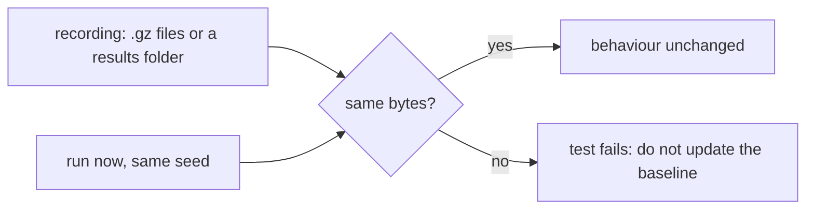

# Parity and frozen behaviour

!!! abstract "In this page"
    - The tests that prove a refactor, or the merge of the household code, changed no behaviour.
    - The three byte-identity cases of the household benchmark, the 62 recorded call sets, the 510 protocol calls, the factory replay and the pinned selftest traces.
    - Which of them ran for this page, and which could not.

## Why parity

The engine is deterministic by seed ([../learn/determinism.md](../learn/determinism.md)): the same seed gives the same run, call by call. That makes a strong test possible. Record a run once. After any refactor, run it again and compare the bytes. A difference means behaviour moved. Rule 4 of `CLAUDE.md` freezes the household simulator for this reason: a deliberate change needs a new freeze tag, a changelog line and a new baseline file. Never edit a baseline to make a test pass.

## The five checks

| check | test | compared with | size |
|---|---|---|---|
| household scripted calls | `tests/test_home_baseline.py` | recording made by the earlier standalone package, before the merge | 62 call sets |
| household benchmark runs | same file, 3 parametrised cases | recorded `episodes.jsonl`, byte for byte | 20, 40 and 20 episodes |
| protocol versus direct calls | `tests/test_home_parity.py` | direct `make_episode` calls | 510 calls: 5 houses x 3 profiles x 34 calls |
| factory replay | `tests/parity/factory_replay.py`, `tests/test_parity_factory.py` | calls recorded in an earlier campaign | 774 episodes, 15,690 calls, 0 mismatches (as `docs/architecture.md` states) |
| selftest traces | `tests/home/sim/test_freeze_r19.py` | SHA-256 pins of the selftest output | 2 profiles |



## Household baselines

The files are in `tests/home/parity/`: `calls.py` (the script), `home_calls.json.gz`, and three episode recordings (`oracle_real_dev20`, `oracle_real_dev20_seeds2`, `naive_stress_dev20`), plus one summary. The 62 call sets are 5 houses x 3 profiles x 2 seeds x 2 languages, as `docs/architecture.md` counts them. The benchmark cases use the dev split, the fake LLM (no model is called) and the `oracle` and `naive` reference planners ([reference-planners.md](reference-planners.md)); the first case is exactly `--planner oracle --split dev --limit 20 --llm fake`. For the first case the summary is also compared, after dropping the two keys that record the source checkout, because the checkout is not behaviour.

!!! code "Where in the code"
    [test_home_baseline.py:31-39](https://github.com/mtbui2010/symbolic_robot/blob/a5cc7a4943aa/tests/test_home_baseline.py#L31-L39).

```python
@pytest.mark.parametrize("name,args", [
    ("oracle_real_dev20", ["--planner", "oracle", "--limit", "20"]),
    ("oracle_real_dev20_seeds2", ["--planner", "oracle", "--profile", "real", "--limit", "20", "--seeds", "2"]),
    ("naive_stress_dev20", ["--planner", "naive", "--profile", "stress", "--limit", "20"]),
])
def test_oracle_and_naive_episodes_are_byte_identical(name, args, tmp_path):
    from bench.suites.home.cli import main
    assert main(["run", "--split", "dev", "--llm", "fake", *args, "--out", str(tmp_path)]) == 0
    assert (tmp_path / "episodes.jsonl").read_bytes() == _gz(name + ".episodes.jsonl")
```

### What was run

pytest is not installed here, so no pytest result is claimed. The three byte-identity cases and the 62 call sets were run by hand, with the same arguments and the same comparison as the test, on a copy of the pinned commit, offline:

| case | exit code | `episodes.jsonl` equals the recording | summary line printed by the run |
|---|---|---|---|
| `oracle_real_dev20` | 0 | yes | 20 episodes, success 0.8 |
| `oracle_real_dev20_seeds2` | 0 | yes | 40 episodes, success 0.825 |
| `naive_stress_dev20` | 0 | yes | 20 episodes, success 0.25 |

The 62 recorded call sets: all equal. The summaries are smoke runs of the dev split with the fake LLM. They show that the code is unchanged; they are not benchmark results.

## Protocol versus direct calls

`test_home_parity.py` runs a script built from the world itself (look, say, pose, then for three objects move, find, open, pick, check the grasp, move, place, close, look; then ask, wait, dock and one call to a skill that does not exist). It runs the script once on a direct `make_episode` robot and once through the domain protocol ([domain-protocol.md](domain-protocol.md)), for each of 5 houses and 3 profiles at seed 11. Every result's `to_json()` must be equal, the clock must be equal and every object must be at the same place. Two more tests check that `LiveBackend` is the same robot, and that the household domain's wrapper operations (move an object, spawn one, refuse a bad place) work. These tests were not run here.

## Factory replay

`tests/parity/factory_replay.py <results dir>` replays the skill-call sequences recorded in an earlier campaign (read only, never copied) in the factory domain and compares, per call: `ok`, `code`, the first 160 characters of `msg`, the duration to 2 decimals, the simulated time and the whole truth dict. Exit status 1 when any call differs. `docs/architecture.md` reports 774 episodes, 15,690 calls and 0 mismatches over three campaigns; one older campaign differs on purpose (a bug fixed before the next version).

The recorded campaigns are not in this repo. The pytest wrapper reads the results folder from an environment variable named in `tests/test_parity_factory.py`, and the tests skip when the folder is absent. The replay was **not run** for this page, and the figures above are quoted from `docs/architecture.md`, not re-measured.

## Pinned selftest traces

`test_freeze_r19.py` runs the household selftest as a subprocess (seed 7, 30 episodes) for `real` and for `stress`, and compares the SHA-256 of the trace file with a pin. The pins guard the freeze: round 19 changed no simulator behaviour. Both pins matched when the two commands were run by hand: the digests started with `4a071034` for `real` and `05800b6f` for `stress`, the same prefixes as the pins in the test.

## Failure modes

| symptom | meaning |
|---|---|
| `scripted calls` test lists keys | a household skill result changed; read the listed keys |
| byte-identity assertion fails | an episode record changed: planner, judge, simulator or serialisation |
| factory parity skipped | the recorded campaigns are absent: expected in a fresh clone |
| selftest digest differs | the household simulator moved; it needs a new freeze tag and note |

## Tests

The files named above are the tests. Not run here: any pytest run, the 510-call protocol test, the factory replay.
