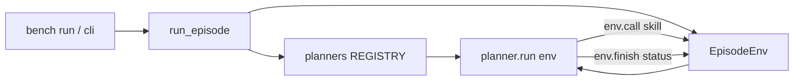

# Planner interface and registry

!!! abstract "In this page"
    How the household benchmark finds, builds and runs a planner. You get the registry (58 names and what
    each group needs), the three checks that run before an episode (`needs_llm`, `planner_available`,
    `is_spec`), the `Planner` contract with its `privileged` flag, the two helper base classes
    (`StepPlanner`, `PlanPlanner`), and the texts a planner says when it gives up or refuses. Every output
    below was produced offline on a copy of commit `a5cc7a4943aa`. To write your own planner, read this page
    first, then [Add a planner](../guides/add-a-planner.md) and
    [Planners as plugins](../learn/planners-as-plugins.md).

## At a glance

| | |
|---|---|
| **Input** | a planner name (a registry key such as `oracle`, or `package.module:ClassName`) and an `EpisodeEnv` |
| **Output** | a planner object whose `run(env)` ends the episode with `env.finish(status, say)` |
| **Used by** | `run_episode` in the household runner ([runner page](home-runner.md)) |
| **Uses** | `importlib`; the planner modules in the same folder |
| **Source** | [`planners/__init__.py`](https://github.com/mtbui2010/symbolic_robot/blob/a5cc7a4943aa/bench/suites/home/planners/__init__.py), [`planners/base.py`](https://github.com/mtbui2010/symbolic_robot/blob/a5cc7a4943aa/bench/suites/home/planners/base.py) |
| **Tests** | `tests/home/bench/test_planners_oracle_naive.py`, `tests/home/bench/test_planners_llm_fake.py` |

## Background

A **planner** here is the thing under test. It reads what the simulated robot can see, picks skill calls
(`move`, `find`, `pick`, `ask`, ...), and decides when the episode is over. The benchmark owns everything
else: the world, the skills, the person, the budgets and the judge. See
[Benchmark protocol](../learn/benchmark-protocol.md) for the whole picture and
[Episode env and judge](episode-env-and-judge.md) for the object a planner talks to.

A planner ends an episode with one of three statuses: `done`, `refuse` or `give_up`.

## Where it sits



`run_episode` reads the class first (to learn `privileged` and `interrupt_via`), builds the `EpisodeEnv`
with those values, then builds the planner and calls `run(env)`
([`runner.py:65-72`](https://github.com/mtbui2010/symbolic_robot/blob/a5cc7a4943aa/bench/suites/home/runner.py#L65-L72)).

## The registry

`REGISTRY` maps a name to `(module, class, one-line description, needs_llm)`. At this commit it holds 58
names ([`planners/__init__.py:12`](https://github.com/mtbui2010/symbolic_robot/blob/a5cc7a4943aa/bench/suites/home/planners/__init__.py#L12)).
The page below groups them; the descriptions in the file are longer.

| Group | Names | Count | Needs an LLM | Details |
|---|---|---|---|---|
| Reference, privileged | `oracle`, `naive` | 2 | no | [Reference planners](reference-planners.md) |
| Baselines in the style of published planners | `saycan_like`, `inner_monologue_like`, `progprompt_like`, `knowno_like` | 4 | yes | [LLM baselines](llm-baselines.md) |
| robot_agent planners | `robot_agent:sage`, `robot_agent:grace`, `robot_agent:llm_direct`, and 49 variants of `sage` | 52 | yes | [robot_agent planners](robot-agent-planners.md) |

Listing is cheap and safe. `python -m bench run --domain home --suite planners` prints one tab-separated
line per name. Here the 52 `robot_agent:` names show `[unavailable: robot_agent not importable]`, because
the hub is not installed on the machine that produced this page. The first six names show no mark.

Two helpers decide whether a name can run:

| Function | Answer | Real value |
|---|---|---|
| `needs_llm(name)` | the fourth registry field; for a `package.module:ClassName` spec, the class attribute `needs_llm` | 56 of 58 names need an LLM; only `oracle` and `naive` do not |
| `planner_available(name)` | `(ok, reason)` | `oracle` gives `(True, '')`; `robot_agent:sage` gives `(False, 'robot_agent not importable (add it to PYTHONPATH)')` |
| `is_spec(name)` | true for `package.module:ClassName` that is not a registry key | `pkg.mod:Cls` is true; `robot_agent:sage` and `oracle` are false |

The run refuses to start when a planner needs an LLM and `--llm` is missing, or when the planner is
unavailable (`check_llm`, `check_planner` in `runner.py`).

!!! code "Where in the code"
    The excerpt is `planners/__init__.py` lines 134-150 at the pinned commit. The permalink resolves after
    the owner pushes the commit.
    [`planners/__init__.py#L134-L150`](https://github.com/mtbui2010/symbolic_robot/blob/a5cc7a4943aa/bench/suites/home/planners/__init__.py#L134-L150)

```python
def planner_available(name: str) -> tuple:
    """(ok, reason): the planner can run here (robot_agent importable, a third-party class importable)."""
    if name.startswith("robot_agent:") and name in REGISTRY:
        return (True, "") if robot_agent_available() else (False, "robot_agent not importable (add it to PYTHONPATH)")
    try:
        planner_class(name)
    except KeyError as e:
        return False, str(e.args[0] if e.args else e)
    except (ImportError, AttributeError) as e:
        return False, f"{type(e).__name__}: {e}"
    return True, ""


def make_planner(name: str, llm=None, **kw):
    p = planner_class(name)(llm=llm, **kw)
    p.name = name
    return p
```

Two details matter. `robot_agent_available()` only asks `importlib.util.find_spec`, so listing never
imports the hub. And `make_planner` overwrites `p.name` with the name you asked for, so a variant class
reports its registry key in the records.

An unknown name raises `KeyError` with the full list of known names and the hint
`or package.module:ClassName`. `planner_available` turns that into a `(False, reason)` pair instead.

## The contract

Every planner needs three things: a `name`, a `privileged` flag and a `run(env)` method.

!!! code "Where in the code"
    [`planners/base.py#L31-L36`](https://github.com/mtbui2010/symbolic_robot/blob/a5cc7a4943aa/bench/suites/home/planners/base.py#L31-L36)

```python
@runtime_checkable
class Planner(Protocol):
    name: str
    privileged: bool                     # True: may read env.truth (oracle, naive only)

    def run(self, env) -> None: ...
```

`privileged` is not an honour system alone. `EpisodeEnv` receives it from the planner class and enforces it:

- `env.truth` returns the true world only when `privileged` is true, otherwise `None`.
- `env.goal` raises `PermissionError("the goal is hidden from non-privileged planners")` otherwise.

Run offline on a synthetic task from the test fixtures (the script is the one below; its output is real):

```python
import sys
sys.path[:0] = [REPO, REPO + "/tests/home/bench"]
from bench.suites.home.planners import REGISTRY, needs_llm, planner_available, is_spec
from bench.suites.home.env import EpisodeEnv
from fixtures import fixture_tasks          # synthetic tasks of the test suite

ra = [n for n in REGISTRY if n.startswith("robot_agent:")]
print(len(REGISTRY), len(ra), [n for n in REGISTRY if not needs_llm(n)])
print(planner_available("oracle"))
print(planner_available("robot_agent:sage"))
print(is_spec("pkg.mod:Cls"), is_spec("robot_agent:sage"), is_spec("oracle"))

task = fixture_tasks()[0]
for privileged in (False, True):
    env = EpisodeEnv(task, "ideal", 0, privileged=privileged)
    print(privileged, type(env.truth).__name__)
    try:
        env.goal
        print("  goal readable")
    except PermissionError as e:
        print("  PermissionError:", e)
```

(`REPO` stands for the root of the checkout.)

```text
58 52 ['oracle', 'naive']
(True, '')
(False, 'robot_agent not importable (add it to PYTHONPATH)')
True False False
False NoneType
  PermissionError: the goal is hidden from non-privileged planners
True World
  goal readable
```

!!! note "The flag is per class"
    The comment says "oracle, naive only", and that holds for the reference planners. The registry also holds
    one diagnostic variant, `robot_agent:sage_gold`, whose class sets `privileged = True`: it starts from the
    task's gold goals. Any table that lists it must mark it privileged. See
    [robot_agent planners](robot-agent-planners.md).

## The two helper classes

Most planners do not implement `run` from scratch. `base.py` gives two shapes.

| Class | You write | `run` does | Stops when |
|---|---|---|---|
| `StepPlanner` | `act(obs)`, returns one `ToolCall` or a `Finish` | loops: observe, `act`, `env.call` | `act` returns `Finish`, or the budget is used up |
| `PlanPlanner` | `plan(obs)`, returns a list of `ToolCall` (optionally ending in a `Finish`); optionally `on_failure(call, result, obs)` | runs the list in order | first failed call, unless `on_failure` returns more calls; the list is empty |

A `ToolCall` is `(skill, args)`. A `Finish` is `(status, say, reason)`: `say` is what the robot tells the
user, `reason` is a status note that is never said.

!!! code "Where in the code"
    [`planners/base.py#L42-L66`](https://github.com/mtbui2010/symbolic_robot/blob/a5cc7a4943aa/bench/suites/home/planners/base.py#L42-L66)

```python
    name = "step"
    privileged = False
    needs_llm = False
    description = ""

    def __init__(self, llm=None):
        self.llm = llm

    def reset(self, env) -> None:
        self.env = env

    def act(self, obs) -> "ToolCall | Finish":
        raise NotImplementedError

    def run(self, env) -> None:
        self.reset(env)
        while env.status is None:
            if env.over:
                env.finish("give_up", give_up_text(env.lang), reason="budget exhausted")
                return
            a = self.act(env.observe())
            if isinstance(a, Finish):
                finish_with(env, a)
                return
            env.call(a.skill, **dict(a.args))
```

The excerpt starts inside `class StepPlanner:`.

The default budgets are 60 calls, 1,800 simulated seconds and 30 LLM calls per episode (`Budgets` in
[`env.py:39-46`](https://github.com/mtbui2010/symbolic_robot/blob/a5cc7a4943aa/bench/suites/home/env.py#L39-L46)).
When the call or time budget is used up, `env.call` returns a `timeout` result and sets `env.over`; an episode
that then ends with `give_up` is recorded with status `budget` (`EpisodeEnv.finish`).

## Give-up and refusal texts

A planner that stops without a good sentence still must say something in the user's language, because the
judge checks the language of what the robot said. Two small tables hold those sentences, each with an `en`
and a `ko` entry:

| Text | Where | Used by |
|---|---|---|
| give-up sentence | `give_up_text(lang)` in `env.py` (`GIVE_UP_TEXT`) | `finish_with` when a `give_up` carries only a `reason`; the helpers in `base.py`; `oracle`, `naive` |
| stop sentence | `STOP_TEXT` in `env.py` | the oracle when the user says stop |
| whole-task refusal | `refusal_text(lang)` in `base.py` (`REFUSAL_TEXT`) | `oracle`, `naive`, `knowno_like` |

An unknown language falls back to English. The file comments say why they exist: earlier baselines said
the English refusal to Korean users, which counted as a dialogue in the wrong language.

`ask_json` and `step_check` in `base.py` are for LLM planners: one call, parse JSON, at most two repair
prompts, and every attempt counts as one LLM call. They are covered on the
[LLM baselines](llm-baselines.md) page.

## Your own planner

A name of the form `package.module:ClassName` is loaded with `importlib` at run time. The class needs a
`name`, a `privileged` flag (normally `False`) and `run(env)`. The finished walk-through is in
[Add a planner](../guides/add-a-planner.md).

## Edge cases and failure modes

| Symptom | Cause | What happens |
|---|---|---|
| `KeyError: unknown planner ...` | name is neither a registry key nor a spec | `needs_llm` and `planner_class` raise; `planner_available` returns `(False, text)` |
| `robot_agent not importable` | the hub is not on `PYTHONPATH` | the run refuses to start; listing still works |
| planner needs an LLM, no `--llm` | `check_llm` | run refused before any episode |
| planner returns without finishing | a bug in the planner | the runner finishes the episode `give_up` with reason `planner returned without finishing` |
| planner raises | any exception except the LLM and import errors | episode recorded with status `error`; the run goes on. A planner with `raise_errors = True` re-raises |
| LLM server fails, or the planner's code is not importable | `LLMError`, `ImportError` | `InfraError`: the whole run aborts and writes no summary, so an infrastructure failure never looks like a 0 % score |
| a planner reads `env._world` | the true world is private by name only | the record is not comparable with others; do not do it |

## How it is verified

- `tests/home/bench/test_planners_oracle_naive.py` runs the reference planners on synthetic tasks. I called its four test functions directly on the copy (no pytest here, so this is not a pytest run): all four passed.
- `tests/home/bench/test_planners_llm_fake.py` drives the LLM baselines with the rule-based fake LLM. Not run for this page.
- The listing and the checks above were run as shown.
