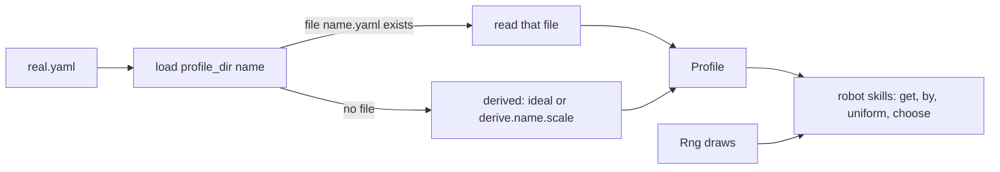

# Profiles (core)

!!! abstract "In this page"
    - A **profile** is the set of fault rates and durations of the simulated robot. This module reads one YAML file per profile and refuses any number that has no value and no source label.
    - `ideal` (no failures) and `stress` (failures three times as likely) are computed from `real`: you write one file, you get three profiles.
    - The factory domain uses this module. The household domain does not: it has its own profile code ([home-profiles.md](home-profiles.md)).
    - A real run shows the three profiles side by side, the error messages, and one edge case of `Profile.get`.

!!! code "Where in the code"
    - [`profile.py`](https://github.com/mtbui2010/symbolic_robot/blob/a5cc7a4943aa/symbolic_robot/profile.py): `Profile`, `derived`, `available`, `load`
    - [`domains/factory/profiles.py`](https://github.com/mtbui2010/symbolic_robot/blob/a5cc7a4943aa/symbolic_robot/domains/factory/profiles.py): `PROFILE_DIR`, `load_profile`, `list_profiles`
    - [`domains/factory/profiles/real.yaml`](https://github.com/mtbui2010/symbolic_robot/blob/a5cc7a4943aa/symbolic_robot/domains/factory/profiles/real.yaml): the one file of the factory
    - Tests: [`tests/test_profile.py`](https://github.com/mtbui2010/symbolic_robot/blob/a5cc7a4943aa/tests/test_profile.py)

## What a profile is, and why one file is enough

A simulated skill fails with some probability: the grip slips, the detector misses an object, a motor has a transient fault. Those probabilities, and how long each skill takes, are the **profile**. A benchmark usually runs the same planner under three of them:

| profile | meaning |
|---|---|
| `real` | the declared fault rates (in the factory: invented round numbers, none measured) |
| `ideal` | every probability is 0: a planner that fails here is wrong, not unlucky |
| `stress` | the probabilities of `real` times a scale, capped at 1 |

The factory has one file, `real.yaml`. `ideal` is computed from it (no `ideal.yaml` exists), and `stress` is computed because `real.yaml` has a `derive` entry that says `stress: {scale: 3.0}`. A profile that has a file of its own is read from that file instead; the derivation is the fallback.

This works because every parameter says what kind it is. The core never needs to know what a "slip" is. See [../learn/declared-outcomes.md](../learn/declared-outcomes.md) for why the numbers are declared and not hidden in code, and the [glossary](../reference/glossary.md) for terms.

## The file format

```yaml
# Fault model of the `real` profile: probabilities per skill call, drawn from the seed (symbolic_robot.rng). Every number is
# invented (round numbers for a simulated factory robot); none is measured. `ideal` (no failures) is derived from this file.
profile: real
derive:
  stress: {scale: 3.0}
params:
  speed_mps:
    {kind: number, value: 0.8, source: "invented", note: "base speed in m/s"}
  detector_miss:
    {kind: prob, value: 0.10, source: "invented, round number", note: "find: the object is in view and is not seen"}
  slip:
    {kind: prob, value: 0.05, source: "invented, round number", note: "pick: the grip fails, the object stays"}
  drop:
    {kind: prob, value: 0.03, source: "invented, round number", note: "place / put_in: the object falls to the floor beside the place"}
  hw_fault:
    {kind: prob, value: 0.02, source: "invented, round number", note: "any motion or manipulation call: a transient hardware fault, nothing happens"}
  persistent_fault:
    {kind: prob, value: 0.04, source: "invented, round number", note: "per episode: from some call on, one skill always fails with hw_fault"}
  durations_s:
    kind: map
    value: {find: 3.0, pick: 6.0, place: 5.0, put_in: 6.0, open: 5.0, close: 4.0, say: 2.0, ask: 4.0, grasp_check: 0.5, pose: 0.2, move_overhead: 4.0}
    source: "invented"
    note: "simulated seconds per skill; a move also takes distance / speed_mps"
```

Source: [`real.yaml` L1-L23](https://github.com/mtbui2010/symbolic_robot/blob/a5cc7a4943aa/symbolic_robot/domains/factory/profiles/real.yaml#L1-L23).

Each parameter has a `kind`, a `value`, a `source` and an optional `note`. The kinds (from the module docstring):

| kind | what the value is | `ideal` | `stress` |
|---|---|---|---|
| `prob` | one probability | 0 | times scale, capped at 1 |
| `prob_map` | a probability per label (per clutter level, per class ...) | every entry 0 | every entry times scale, capped at 1 |
| `split` | shares of failure codes, for example 25% blocked, 75% unreachable | kept | kept |
| `range` | `[low, high]`, drawn uniformly | kept | kept |
| `number`, `map` | a plain number or map (speed, durations) | kept | kept |

A `prob` or `prob_map` that is the chance of *recovering* after a failure, not of failing, sets `ideal: keep`. Then `ideal` and `stress` leave it alone.

The `source` label is mandatory. In the factory it says `invented, round number`: honest about where the number comes from. A published number would give its reference there.

## Where it sits



The numbers come from the profile; the random draws come from [results-time-draws.md](results-time-draws.md). A skill compares one with the other.

## Input and output

| call | input | output |
|---|---|---|
| `load(profile_dir, name="real")` | a folder and a profile name | a `Profile` |
| `available(profile_dir)` | a folder | sorted list of names: the file stems, plus `ideal` and every `derive` key when `real.yaml` exists |
| `Profile.get(key, default=None)` | parameter name | its `value` |
| `Profile.by(key, label)` | a map parameter and a label | `get(key)[label]` |
| `Profile.uniform(key, u)` | a `range` parameter and `u` in [0, 1) | `low + (high - low) * u` |
| `Profile.choose(key, u)` | a `split` parameter and `u` in [0, 1) | a label, by inverse CDF over the labels sorted by name |
| `Profile.source(key)` | parameter name | its source label (`""` if it has none) |
| `Profile.keys()` | | list of parameter names |
| `Profile.with_overrides(**kv)` | new values by name | a copy with those values; the original is unchanged |

The factory wraps `load` and `available` in two lines: `load_profile(name)` and `list_profiles()` over `PROFILE_DIR`, the `profiles` folder next to the module.

### The three profiles side by side (run)

```python
from symbolic_robot import profile as P
from symbolic_robot.domains.factory.profiles import PROFILE_DIR, load_profile
print(P.available(PROFILE_DIR))
for n in ("real", "ideal", "stress"):
    p = load_profile(n)
    print(n, [p.get(k) for k in ("slip", "persistent_fault", "speed_mps")])
print(load_profile("stress").source("slip"))
```

Output (run):

```text
['ideal', 'real', 'stress']
real [0.05, 0.04, 0.8]
ideal [0.0, 0.0, 0.8]
stress [0.15000000000000002, 0.12, 0.8]
stress profile: probabilities of real x3, capped at 1 (real: invented, round number)
```

| profile | `slip` | `persistent_fault` | `speed_mps` |
|---|---|---|---|
| `real` | 0.05 | 0.04 | 0.8 |
| `ideal` | 0.0 | 0.0 | 0.8 |
| `stress` | 0.15 (printed as 0.15000000000000002: 0.05 x 3.0 in floating point) | 0.12 | 0.8 |

The speed is a `number`, so all three keep it. The derived profile also rewrites the `source` label so you can see where its number came from. The durations are a `map`, so `ideal` keeps them too: `load_profile("ideal").get("durations_s")["pick"]` is `6.0` (run).

## How the derivation works

```python
def derived(real: "Profile", name: str) -> "Profile":
    """`ideal`: every probability 0. Other names: only when real declares `derive.<name>.scale`."""
    params = copy.deepcopy(real.params)
    if name == "ideal":
        fn = lambda v: 0.0                                           # noqa: E731
        note = "ideal profile: failure switched off"
    else:
        scale = float((real.derive.get(name) or {}).get("scale", 0))
        if scale <= 0:
            raise KeyError(name)
        fn = lambda v: min(1.0, float(v) * scale)                    # noqa: E731
        note = f"{name} profile: probabilities of real x{scale:g}, capped at 1"
    for p in params.values():
        if p.get("kind") in PROB_KINDS and p.get("ideal") != "keep":
            p["value"] = _map(p["value"], fn)
            p["source"] = f"{note} (real: {p.get('source', '')})"
    return Profile(name, params, real.derive)
```

Source: [`symbolic_robot/profile.py` L71-L87](https://github.com/mtbui2010/symbolic_robot/blob/a5cc7a4943aa/symbolic_robot/profile.py#L71-L87).

1. `load` looks for `<name>.yaml`. If it exists, `_read` parses it and checks every parameter.
2. If it does not, `load` reads `real.yaml` and calls `derived(real, name)`.
3. `derived` copies the parameters (the original is never changed), then rewrites `prob` and `prob_map` values unless they say `ideal: keep`. `_map` applies the function to each entry of a map, or to the single value.
4. A name that is not `ideal` and has no `derive.<name>.scale` above zero raises `KeyError` inside `derived`; `load` catches it and raises the `ValueError` below.

Edge case in how `derive` is read: `scale` must be above 0. `scale: 0` or a missing scale means "this profile is not declared".

## Failure modes

| call | result (run unless marked) |
|---|---|
| `load_profile("nope")` | `ValueError: unknown profile 'nope'; known: ideal, real, stress` |
| `real.get("zzz")` | `KeyError: "profile 'real' has no parameter 'zzz'"` |
| `real.get("zzz", 5)` | returns `5` |
| `real.get("zzz", None)` | `KeyError`, the same as without a default (see below) |
| a file with a parameter that has no `value`, or no `source`, or an empty `source` | `ValueError: bad.yaml: parameter a needs a value and a source label` (run on a scratch file whose parameter has a value and no source) |
| `with_overrides` for a name that is not a parameter | `KeyError: 'zzz'` (run) |
| a folder with no `real.yaml` and no file of that name | `ValueError: unknown profile 'real'; known: ` with an empty list (run: `available` gives `[]`) |

!!! note "A default of None means no default"
    `Profile.get(key, default)` falls back only `if default is not None` (`profile.py` lines 31-34). So `get("x", None)` raises like `get("x")`, and a default of `0`, `0.0` or `False` works. If a parameter may be absent and `None` is the value you want, test with `key in profile.keys()` first.

`with_overrides` changes `value` only. It leaves `source` as it was, so an overridden number still carries the source label of the original. Use it for experiments, for example `real.with_overrides(slip=1.0).get("slip")` is `1.0` while `real.get("slip")` is still `0.05` (run).

## Parameters of other kinds (run on a scratch file)

The factory file only has `prob`, `number` and `map`. The other kinds are covered by a test that writes its own file. This run writes such a file with `derive: {stress: {scale: 2}}` and the four kinds:

```text
fail   ideal {'high': 0.0, 'low': 0.0} stress {'high': 0.4, 'low': 0.2}
retry  real 0.4 ideal 0.4 stress 0.4
dur    uniform(0.25) = 2.5
split  choose: ['blocked', 'blocked', 'unreachable', 'unreachable']
```

- `fail` is a `prob_map` of low 0.1 and high 0.2: `ideal` zeroes both entries, `stress` doubles them.
- `retry` says `ideal: keep`, so it is 0.4 in all three profiles.
- `uniform("dur", 0.25)` on the range `[2.0, 4.0]` is 2.0 + 2.0 x 0.25 = 2.5.
- `choose("split", u)` for u = 0.0, 0.24, 0.26, 1.0 gives blocked, blocked, unreachable, unreachable. The labels are sorted by name and the shares are added up; a `u` of 1.0 or more falls to the last label.

## How it is verified

`tests/test_profile.py` has five tests. Three need no fixture and were called by hand through a small stand-in for `pytest.raises` and `pytest.approx` (pytest is not installed here; this is not a pytest run), and passed:

- `test_real_values_and_sources`: the factory values (0.8, 0.10, 0.05, 0.03, 0.02, 0.04 and the durations) and a source label on every parameter.
- `test_ideal_is_derived_from_real_and_has_no_failures`: no `ideal.yaml` exists; the derived one has zero probabilities and the same durations.
- `test_stress_is_derived_only_when_real_declares_it`: slip 0.15, detector miss 0.30, speed 0.8, `with_overrides`, `available` gives `['ideal', 'real', 'stress']`, an unknown name raises `ValueError`.

The two others write files into a temporary folder (`tmp_path`): `test_probability_maps_and_missing_source` and `test_helpers_and_the_keep_flag`. They were not run as tests; their bodies were repeated by hand on a scratch folder and gave the values in the previous section and the `ValueError` above (run).

Next: [domain-protocol.md](domain-protocol.md).
