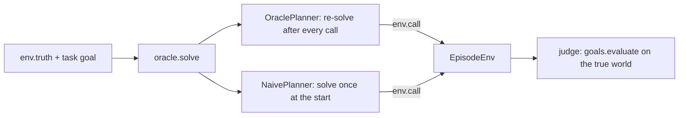

# Reference planners: oracle and naive

!!! abstract "In this page"
    The two planners that may read the true world. `oracle` is the closed-loop upper reference: it
    re-plans from the truth after every call. `naive` is its ablation: the same plan from the start state,
    run open loop. You get how each one works, what the profiles do to them (real numbers from a small
    smoke run), a verbatim excerpt of each loop, and the ways they stop. They are references, not
    planners to compare claims with.

## At a glance

| | |
|---|---|
| **Input** | an `EpisodeEnv` whose planner class has `privileged = True` |
| **Output** | skill calls through `env.call`, then `env.finish("done" / "refuse" / "give_up")` |
| **Used by** | `run_episode`; the calibration report that shares the oracle's recovery policy |
| **Uses** | the household oracle `solve` and `recovery_call`, the goal checker `evaluate` |
| **Source** | [`planners/oracle.py`](https://github.com/mtbui2010/symbolic_robot/blob/a5cc7a4943aa/bench/suites/home/planners/oracle.py), [`planners/naive.py`](https://github.com/mtbui2010/symbolic_robot/blob/a5cc7a4943aa/bench/suites/home/planners/naive.py) |
| **Tests** | `tests/home/bench/test_planners_oracle_naive.py` |

## Background

A **privileged** planner is allowed to read the true world (`env.truth`) and the hidden goal (`env.goal`).
Ordinary planners get `None` for the first and a `PermissionError` for the second; the rule is on the
[planner interface page](planner-interface.md#the-contract). `oracle` and `naive` are the two registry
planners built on it. They answer two questions that a real planner score cannot:

- What is the best any planner could do on this task under this profile (the oracle)?
- How much of that comes from recovering and replanning, and how much from the plan alone (naive)?

A **profile** is a named set of failure rates for the simulator: `ideal`, `real` or `stress`
(see [Home profiles](home-profiles.md)). In `ideal` nothing fails.

The plan itself comes from the household oracle in `symbolic_robot/domains/home/oracle.py`
(`solve(world, goal, ...)`, line 428): it reads exact locations and returns the skill calls that reach the
goal in the `ideal` profile, or `None` when the goal cannot be reached. It is described on
[Goals and oracle](home-goals-and-oracle.md).

## Where it sits



## How the oracle works

`OraclePlanner.run` is a loop. It ends with `done`, a give-up or a stop; otherwise it takes the first
call of a fresh plan.

1. If every subtask is a refuse task, finish `refuse` with the refusal text in the user's language.
2. Otherwise decline each refuse part by index and object (`note_refusals`), so the judge can tie the
   refusal to its subtask.
3. On a clarify task, ask the gold question once (`ask`, with a structured `meaning`) so the help metrics
   see it, then go on with the true intent.
4. Loop: finish `done` when `env.judge("done")["success"]` already holds; else take the targets whose
   `order` predecessors hold, call `solve` from the true world, and run the first call.
5. If the call fails, count the failure per `(skill, args)`. At the third failure of the same call, give up.

Recovery after a failed call:

| Failure | What the oracle does |
|---|---|
| `blocked` move, last try (second failure of 3) | back off to the robot room's floor spot or the start place, then come another way (`retreat_place`) |
| `blocked` move, and the user can hear the robot | an `ask` for help (`recovery_call`) |
| `blocked` or `perception_unavailable` otherwise | `wait` 5 s (`recovery_call`) |
| `cancelled` | do nothing; the user event (stop or correction) is handled at the top of the loop |
| e-stop, or a hardware fault that never clears | give up at once |
| anything else | re-plan from the new true state |

`recovery_call` lives in the domain's `oracle.py` (line 486) and is shared with `rollout`, the domain's own
closed-loop oracle, so the calibration report and the benchmark use one policy.

Deliveries (bring an object to a person) are decided once, from what a robot would observe at the start
(the instruction as the user said it, the house, the furniture near the person), never from the task's
label for the delivery mode. Privileged planners read the words the user said, not what the speech
recogniser made of them, so a recogniser that drops "in my hand" does not make the reference park the object
on a desk.

The oracle claims `done` only when the judge would score success, so its false-success rate is 0 by
construction.

!!! code "Where in the code"
    [`planners/oracle.py#L134-L157`](https://github.com/mtbui2010/symbolic_robot/blob/a5cc7a4943aa/bench/suites/home/planners/oracle.py#L134-L157).
    The excerpt starts inside the `while env.status is None:` loop of `OraclePlanner.run`. The permalink
    resolves after the owner pushes the commit.

```python
            if env.judge("done")["success"]:
                env.finish("done")
                return
            target = solve_target(env)
            people = {pid: st.pos for pid, st in env.user.people_at(env.ep.clock.t).items()}
            key = (len(env._events), env.goal_changed)
            if modes is None or key != modes_key:
                # once at the start, and again after a user event (a correction brings new words and goals);
                # from the scene the robot saw when it got the request (the start), choices already made are kept
                modes = {**observed_modes(env, env.world0, env.current_goal(), true_words=True), **(modes or {})}
                modes_key = key
            plan = _oracle.solve(w, target, lang=env.lang, people_pos=people, modes=modes) if target["all"] else []
            if not plan:
                env.finish("give_up", give_up_text(env.lang), reason="no plan from the current state")
                return
            c = plan[0]
            key = (c.skill, tuple(sorted(c.args.items())))
            if fails.get(key, 0) >= MAX_ATTEMPTS:
                env.finish("give_up", give_up_text(env.lang), reason=f"{c} failed {MAX_ATTEMPTS} times")
                return
            r = env.call(c.skill, **c.args)
            if r["ok"]:
                fails.pop(key, None)
                continue
```

`w` is `env.truth`, read at the top of `run`. `MAX_ATTEMPTS` is 3.

## How naive works

`NaivePlanner` computes the oracle's plan once from the start world (`start_plan`) and runs it call by
call. It never re-plans, never recovers and never asks. The first call that reports a failure ends the episode with
`give_up`. If every call reports ok, it finishes `done`, even if a silent failure meant the goal was not
reached: that is a **false success**, and it is the point of the ablation. Refuse tasks are refused as the
oracle does it. When the task has ordered subtasks, the plan is built layer by layer on an `ideal` copy of
the start state.

!!! code "Where in the code"
    [`planners/naive.py#L57-L75`](https://github.com/mtbui2010/symbolic_robot/blob/a5cc7a4943aa/bench/suites/home/planners/naive.py#L57-L75)

```python
    def run(self, env) -> None:
        kinds = task_kinds(env)
        if kinds and all(k == "refuse" for k in kinds):
            env.finish("refuse", refusal_text(env.lang))
            return
        note_refusals(env)
        plan = start_plan(env)
        if plan is None:
            env.finish("give_up", give_up_text(env.lang), reason="no plan")
            return
        for c in plan:
            if env.over:
                env.finish("give_up", give_up_text(env.lang), reason="budget exhausted")
                return
            r = env.call(c.skill, **c.args)
            if not r["ok"]:
                env.finish("give_up", give_up_text(env.lang), reason=r.get("msg", ""))
                return
        env.finish("done")
```

## What the profiles do to them

I ran both planners on a copy of the pinned commit: the first 20 tasks of the dev split, 2 seeds,
40 episodes each, three profiles, English. Each `summary.json` carries `"smoke": true`. These are **smoke
runs, not results**: 40 episodes are too few to rank anything. They show what the profiles do to a planner that
cannot misread the task.

| profile | oracle success | naive success | oracle false success | naive false success | oracle help rate | naive help rate |
|---|---|---|---|---|---|---|
| ideal | 1.0 | 1.0 | 0.0 | 0.0 | 0.15 | 0.0 |
| real | 0.825 | 0.625 | 0.0 | 0.025 | 0.15 | 0.0 |
| stress | 0.625 | 0.35 | 0.0 | 0.0 | 0.25 | 0.0 |

Date of the run: 2026-11-19. Command (the household CLI, one run per planner and profile):
`python -m bench.suites.home.cli run --planner oracle --split dev --limit 20 --profile real --seeds 2 --out OUT`.
Success is the judge's verdict; false success is a claimed `done` that the judge scored as a failure;
help rate is the share of episodes in which the planner called `ask`. In my episode records the oracle's `ask` calls
fall on clarify tasks in `ideal` and `real` (6 of 40 episodes, the gold question once), and under `stress`
4 more episodes ask for help with a blocked path (10 of 40, 0.25); `naive` never asks.

How to read it:

- In `ideal` both reach 1.0: the start-state plan is enough when nothing fails.
- Under `real` and `stress` the gap grows (0.2 and 0.275). Recovery, waiting and asking carry the oracle;
  naive stops at the first failure.
- The oracle's false success is 0 in all three. Naive's single false success of 40 (0.025) is a silent failure
  under `real`.
- The oracle also loses episodes: 7 of 40 under `real` and 15 of 40 under `stress`. In my records 5 of the 7
  and 9 of the 15 end with a give-up on a hardware fault (arm or base motor). Knowing the truth does not
  repair a motor, so these profiles cap what any planner can reach.

## Edge cases and failure modes

| Symptom | Cause | Where |
|---|---|---|
| `give_up`, reason `no plan from the current state` | `solve` returns `None` (heavy or fixed object, a container that does not open, a person not in the house, a semantic hazard, an object out of reach, or more than 60 calls) | `oracle.py:146-148` |
| `give_up`, reason `<call> failed 3 times` | the same call failed `MAX_ATTEMPTS` times | `oracle.py:151-153` |
| `give_up` after an e-stop | a stuck e-stop, or a fault that never clears | `oracle.py:160-162` |
| `give_up`, reason `budget exhausted` | `env.over` | recorded with status `budget` |
| naive `done` but not a success | a silent failure: a call reported ok but the world did not change as planned | by design; counted as false success |
| naive fails a correction task | its plan is fixed at the start, so it does not follow a changed goal | `test_naive_ideal_fails_only_the_correction` pins this in `ideal` |

## How it is verified

`tests/home/bench/test_planners_oracle_naive.py` has four tests, run on synthetic fixture tasks:

| Test | What it pins |
|---|---|
| `test_oracle_ideal_solves_everything_without_false_success` | in `ideal`, the oracle solves every fixture task and never falsely claims |
| `test_oracle_asks_on_clarify_and_refuses_refuse` | one `ask` on a clarify task with a correct help; refusals on refuse tasks; the correction is seen |
| `test_real_profile_oracle_beats_naive_and_never_claims_falsely` | in `real`, naive success is below oracle success, which is below 1.0; the oracle has no false success; injected failures happen |
| `test_naive_ideal_fails_only_the_correction` | in `ideal`, naive fails only the correction task |

There is no pytest on the machine that produced this page, so I imported the module and called the four
functions directly: all four passed. That is a manual run, not a pytest run.
