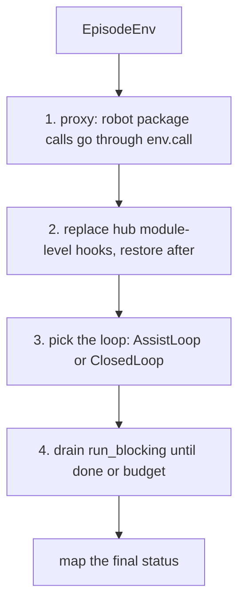

# robot_agent planners and the adapter

!!! abstract "In this page"
    An overview of the 52 `robot_agent:*` planners in the household registry and of the adapter that runs
    them. You get the three planners that matter, the 49 variants grouped by what they change, an outline of
    what the adapter does per episode, and the facts a reader must know before trusting a number. This is an
    overview page: a later part of this site goes deeper. **None of these planners was run for this page.**
    The hub (robot_agent) is not installed on the machine that produced it, so the registry lists all 52 as
    unavailable.

## At a glance

| | |
|---|---|
| **Input** | an `EpisodeEnv` and an LLM client |
| **Output** | skill calls through the robot package, mapped back to a final status |
| **Used by** | `run_episode`, through the [planner registry](planner-interface.md) |
| **Uses** | robot_agent (imported inside functions only), the household robot package in `symbolic_robot/domains/home/configs/` |
| **Source** | [`robot_agent_adapter.py`](https://github.com/mtbui2010/symbolic_robot/blob/a5cc7a4943aa/bench/suites/home/planners/robot_agent_adapter.py) (1,386 lines), [`d1_options.py`](https://github.com/mtbui2010/symbolic_robot/blob/a5cc7a4943aa/bench/suites/home/planners/d1_options.py), [`retry.py`](https://github.com/mtbui2010/symbolic_robot/blob/a5cc7a4943aa/bench/suites/home/retry.py) |
| **Tests** | `tests/home/bench/` (planner tests with the fake LLM need robot_agent; not run for this page) |

## Background

robot_agent is the separate planning hub that this repository exists to test. It offers two loops: the
*AssistLoop*, which runs a planner called SAGE, and the *ClosedLoop*, which runs a named planner such as
`grace` or `llm_direct`. Read the framework site for both: [the symbolic_robot repo page](https://mtbui2010.github.io/robot_agent/repos/symbolic-robot/)
and [Benchmark a planner](https://mtbui2010.github.io/robot_agent/guides/benchmark-a-planner/).

The household simulator ships its own *robot package* (a manifest, an adapter and skill functions) in
`symbolic_robot/domains/home/configs/`. robot_agent drives the simulated robot through those skill functions.
The benchmark's job is to make that work inside a normal episode: budgets, the call log and user interruptions
must all apply.

## The three planners that matter

| Name | Loop | What it is |
|---|---|---|
| `robot_agent:sage` | AssistLoop (SAGE, generator `grace`) | the hub's main planner, with its seed-pool retrieval |
| `robot_agent:grace` | ClosedLoop, planner `grace` | the closed loop with the `grace` planner |
| `robot_agent:llm_direct` | ClosedLoop, planner `llm_direct` | the closed loop with the `llm_direct` planner |

Every other name is a subclass of `SagePlanner` that changes a few options. A variant is a small class: a
`name`, a `loop_options` dict, sometimes a `manifest_overlay` (data the variant adds to the robot pack's
manifest for the run, recorded in the run config; the D1 variants mark it `assumed: true`).

## The 49 variants, by what they change

I grouped these by reading the registry descriptions. The group names and the one-line meanings are mine; the
registry text is longer and uses the benchmark's own development vocabulary. Each variant is a configuration of
the same planner, so the groups are about what is switched.

| Group | Names | What changes |
|---|---|---|
| Single switches (11) | `sage_norag`, `sage_ask`, `sage_nohazard`, `sage_pivot_none`, `sage_pivot_translate`, `sage_complete`, `sage_lab`, `sage_reask`, `sage_unstick`, `sage_exec`, `sage_inv` | one option each. No seed pool (zero-shot); people tracking off, so the robot must ask where people are; the hub's hazard rules off; how Korean input is handed to the reader (as is, or through an English translation); the gate's *complete* operator; person goals; a directed re-read after an uncertain reading; dialogue unsticking; execution integrity; an inventory question |
| Grounding chain (4) | `sage_ground2`, `sage_g2_go`, `sage_g2_kind`, `sage_g2_name` | the second grounding chain, and its three parts alone |
| Execution-integrity parts (4) | `sage_ei_gate`, `sage_ei_end`, `sage_ei_reset`, `sage_ei_wait` | ablations of `sage_exec`, one part each |
| Combinations (6) | `sage_r3`, `sage_r3u`, `sage_u1`, `sage_u2`, `sage_u3`, `sage_u` | named bundles of the options above, added one at a time |
| Reader checks (5) | `sage_v1`, `sage_v2`, `sage_v3`, `sage_vg`, `sage_vs` | `sage_ground2` plus stricter checks on what the understand step returns |
| Separate reader model (7) | `sage_um`, `sage_um_ko`, `sage_um_strict`, `sage_um_give`, `sage_um_verdict`, `sage_m1`, `sage_m2` | a larger model reads the request while a smaller one plans, with a guard that falls back to the planner when the reader runs away; one variant chooses the model by language |
| Step bundles (7) | `sage_s5`, `sage_s6`, `sage_s7`, `sage_s8`, `sage_s8n`, `sage_s9`, `sage_s6d` | cumulative bundles. Each adds dialogue and delivery options to the one before; `sage_s8n` is `sage_s8` without one option; `sage_s9` adds a hazard rule for who receives a product; `sage_s6d` isolates one option |
| Fine-tuned reader and the D arm (4) | `sage_s8n_ft`, `sage_s8n_d1`, `sage_s8n_ft_d1`, `sage_s8n_ft_d1_norag` | a reader fine-tuned on the train split; a new search setup with retry inside a skill; and the zero-shot (empty seed pool) ablation of that arm |
| Diagnostic, privileged (1) | `sage_gold` | starts from the task's gold goals and skips the understand step: the ceiling for execution alone |

Together with `sage`, `grace` and `llm_direct`: 1 + 49 + 2 = 52.

!!! warning "`sage_gold` is privileged"
    Its class sets `privileged = True`. It reads the gold goals, so it is a diagnostic, never a headline
    planner. Mark it in every table. The gold goals are the evaluation side's data
    (`gold_goals.py`); nothing there is given to a planner that is not marked privileged.

## What the adapter does per episode

In outline (the docstring has the same four steps; this page paraphrases it):

1. **Proxy.** The household robot package gets a backend object whose `call` goes through `env.call`. So the
   budgets, the call log and user interruptions apply, and the package's own skill functions are what the hub
   executes.
2. **Hooks.** The hub keeps module-level state that its own tests replace: the current state object, the
   current loop, the robot-package and host identity, the skill environment and the LLM client factory. The
   adapter replaces them for one episode (with a fake state and the episode's world) and **restores them
   afterwards**. It starts a fresh run manager and run-control state.
3. **Loop.** `sage` uses the AssistLoop; `grace` and `llm_direct` use the ClosedLoop with their planner key.
   The loop's LLM client is the benchmark's counted client. Some variants add separate counted clients for
   roles (translator, understand, repair, dialogue) so that the calls are counted apart.
4. **Drain.** `run_blocking` is drained until the `done` event or the episode budget. The final status maps
   success to `done`, refused to `refuse`, and anything else to `give_up`.

A correction from the user reaches these planners as an utterance injected into the run (`interrupt_via =
"inject"`), because the hub stops a run on a cancelled step; a stop still cancels the call.

Two rules follow from the module-level state. The runner forces **one worker** for every `robot_agent:*`
planner (`workers = 1`, [`runner.py:268-269`](https://github.com/mtbui2010/symbolic_robot/blob/a5cc7a4943aa/bench/suites/home/runner.py#L268-L269)),
and the run records the git revisions of the hub and its planning library, which you should state next to any result.

!!! warning "Which hub revision"
    The household pack declares some planner keys that the hub's published `main` does not define. The framework
    guide says so in its own words and marks it not verified. A result from these planners belongs to a hub
    revision; name it. The framework guide covers it:
    [Benchmark a planner](https://mtbui2010.github.io/robot_agent/guides/benchmark-a-planner/).

### Retry inside a skill (the D1 variants)

`sage_s8n_d1` and `sage_s8n_ft_d1` retry inside a skill (`retry.py`). The planner issues **one** call and sees
**one** result, the last attempt's.

| Question | Answer in `retry.py` |
|---|---|
| Which skills | only those that read, look or move: `move`, `find`, `look`, `open`, `close`, `vlm_check`, `dock`, `grasp_check`, `pose`. Never `pick`, `place`, `put_in`, `handover`, `say`, `announce`, `ask`, `wait` |
| Which codes | every failure except `estop` and `cancelled` |
| Counted in the call budget | no; the planner's call budget and the call log see one call |
| Counted in simulated time | yes: the clock moves for every attempt, and no attempt starts when the time budget is used up |
| Recorded | `attempts` and, after a repeat, `attempt_codes` on the call |

A variant with one attempt (the default) is not wrapped at all. `d1_options.py` holds what these variants turn
on in the hub (all default off there) and the data that the options read, declared as a manifest overlay.
Some remedies in it match the simulator's own condition; its docstring says to read them as ablations.

## Test doubles: the fake LLM runs

`robot_agent_fake.py` lets the real loops run with `--llm fake`, with no model. It holds an understand stand-in that answers
with the task's gold goals, and a plug-in planner that plans the gold goals with the oracle from the true
world. These read the gold task and the true world, so **their scores are never reported as a planner's.**

## Edge cases and failure modes

| Symptom | Cause | Result |
|---|---|---|
| name listed as `[unavailable: robot_agent not importable]` | the hub is not on `PYTHONPATH` | the run is refused; add it |
| results differ between machines | a different hub revision | state the revision; the run records git revisions of the hub and its planning library |
| a second worker was asked for | the hub holds module-level state | the runner sets `workers = 1` for these names |
| a `--llm fake` run looks good | the stand-ins read the gold task | not a result |

## What this page leaves out

The full adapter (about 1,400 lines: the role clients, seed-pool handling, the declared-refusal mapping, the
run config) and the per-variant options are for part 2. Not run: everything on this page, because robot_agent
is not importable here. The facts above come from reading the code at the pinned commit and from the
framework site.
