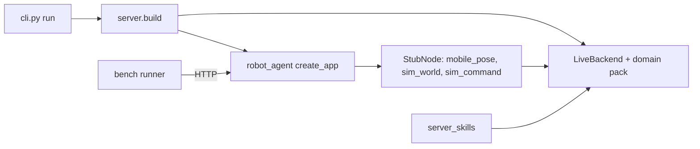

# Server glue and the engine command line

!!! abstract "In this page"
    - How `python -m symbolic_robot` turns a registered domain into the headless benchmark backend of [robot_agent](https://mtbui2010.github.io/robot_agent/).
    - What `build()` does, step by step, and what it writes to disk.
    - The two commands (`list`, `run`), their flags, and what fails when robot_agent is missing (current behaviour, finding F4).

## What it is

The engine is a plain Python package. robot_agent is a separate framework with a planner and an HTTP and WebSocket API. The **server glue** is the small bridge between them: it makes any domain look like a robot to robot_agent's app. It is simulation only: no ROS, no sensors, no real robot. This repo runs benchmarks; the server is the benchmark's backend, not a live demo launcher.

Two modules are the glue, and they are the only core modules that import robot_agent, always inside functions (a test enforces it: [layering-tests.md](layering-tests.md)):

| file | role |
|---|---|
| `symbolic_robot/server.py` | `build()`, the stub node, the three agents, environment defaults, connection seeding |
| `symbolic_robot/server_skills.py` | the launcher skills `reset_world`, `spawn_object`, and the headless `ask` and `say` |
| `symbolic_robot/cli.py`, `__main__.py` | `python -m symbolic_robot {list, run}` |

## Where it sits



The benchmark runner never imports the engine's server: it starts `run` as a process and talks to it over HTTP (see [bench-front-end.md](bench-front-end.md)).

## The command line

`python -m symbolic_robot list` needs no robot_agent. Real output at the pinned commit:

```text
domains:
  factory    simulated factory floor: zones, benches, bins, a lockable cabinet, a forklift lane; floors/*.yaml
             floors: assembly_hall, small_workshop   (default assembly_hall)
             profiles: ideal, real, stress
  home       simulated household (the frozen household simulator): houses, rooms, furniture, a person; profiles ideal | real | stress
             houses: care_home_suite, couple_flat, family_house, korean_apt_59, korean_apt_84, senior_flat, shared_flat, studio_flat   (default senior_flat)
             profiles: ideal, real, stress
```

The word before the colon in "floors:" and "houses:" is the domain's world label. A domain that is not importable prints "not loadable", one that is unavailable prints `not available: <reason>`.

`python -m symbolic_robot run --robot <domain>` serves a domain. Flags ([cli.py:57-79](https://github.com/mtbui2010/symbolic_robot/blob/a5cc7a4943aa/symbolic_robot/cli.py#L57-L79)):

| flag | default | meaning |
|---|---|---|
| `--robot` | required | domain name |
| `--world` | the domain's default | floor or house |
| `--<world_label>` | none | one alias per domain label, for example `--floor`, `--house`; the first one given is used when `--world` is absent |
| `--profile` | `real` | failure profile: `ideal`, `real`, `stress` |
| `--seed` | `0` | episode seed |
| `--dialogue` | `human` | `human` or `sim`: who answers the robot's questions (the benchmark's scripted person, or the simulated user) |
| `--ask-mode` | `headless` | the only mode; `build()` raises for any other value |
| `--model` | the domain's default | local LLM served for planner and reader |
| `--opt KEY=VALUE` | none | a domain option for `make_episode`; repeatable |
| `--run-dir` | `run_dir` | folder for robot_agent's config and the seeded `connections.json` |
| `--ollama-url` | `http://127.0.0.1:11434` | where the local LLM answers |
| `--host`, `--port` | `127.0.0.1`, `8091` | where uvicorn listens |

`--opt` converts the value in this order: int, float, then `true` or `false` (any case), otherwise the text stays a string ([cli.py:10-17](https://github.com/mtbui2010/symbolic_robot/blob/a5cc7a4943aa/symbolic_robot/cli.py#L10-L17)). Real result of the converter:

```text
[('a', 3), ('b', 0.5), ('c', True), ('d', False), ('e', 'hello'), ('f', '')]
```

for `a=3 b=0.5 c=true d=False e=hello f=`. The `make run` target of the Makefile starts this command in the background and polls `/agent/mobile_pose/get` until it answers ([Makefile:61-70](https://github.com/mtbui2010/symbolic_robot/blob/a5cc7a4943aa/Makefile#L61-L70)); the targets are described in [../reference/make-targets.md](../reference/make-targets.md).

## What build() does

`build(robot, world, profile, seed, run_dir, ask_mode, dialogue, model, ollama_url, opts)` returns `(app, live)` and starts no server ([server.py:120-153](https://github.com/mtbui2010/symbolic_robot/blob/a5cc7a4943aa/symbolic_robot/server.py#L120-L153)). In order:

1. Refuse any `ask_mode` except `headless`. Look the domain up and refuse an unavailable one (`RuntimeError`).
2. Pick the world and the model. The environment variable `SYMBOLIC_ROBOT_MODEL` overrides the model.
3. `planner_env`: set defaults, never overriding a variable already set. `ROBOT_AGENT_ROS=off`, `OLLAMA_NUM_CTX=8192`, the understand and translate models, and any variable the domain asks for.
4. Merge options: the domain's `live_opts`, with `--opt` on top; with `--dialogue sim` the domain's simulated-user options go underneath.
5. Create the `LiveBackend` (the single running episode) and let the domain install its pack.
6. Write `connections.json` (below), then import robot_agent and create its app.
7. Replace the node's ROS handle with a `StubNode` holding three agents, load the skill table, publish the world.

The three agents are robot_agent's device-agent interface (`get`, `send`, `cancel`):

| agent | `get` returns | `send` does |
|---|---|---|
| `mobile_pose` | the robot's snapshot | nothing: `{"isdone": true, "msg": "read-only agent"}` |
| `sim_world` | the full world view | nothing (read-only) |
| `sim_command` | `state` | runs a sim command (see [live-backend-and-sim-commands.md](live-backend-and-sim-commands.md), [../reference/sim-command.md](../reference/sim-command.md)) |

`publish_world` sets the planner's `ENV` as an attribute of the pack's `configs.tasks` module, because robot_agent's config manager falls back to it. It runs again whenever the world is rebuilt.

## Skills the launcher adds

`skill_table` always adds `reset_world` and `spawn_object`. With `--dialogue human` it also routes `ask` to `ask_typed` and `say` to `say_quiet`, and `announce` to `say_quiet` when the pack declares one.

| skill | input | output |
|---|---|---|
| `reset_world` | optional `profile`, `seed`, `world`, domain options, `forget` (default true) | `{"isdone": true, "msg": "world reset ...", "erased": [...]}`; with `forget` it deletes robot_agent's memory files (object memory, grace memory, world state) |
| `spawn_object` | `cls`, `place` | `isdone` false with a message when either is missing or the domain has no spawn |
| `say` (headless) | text | recorded in the call log only |
| `ask` (headless) | question | waits for the answer posted to `/agent/listen/<id>`; `isdone` false with "no answer heard" if empty |

!!! code "Where in the code"
    [server.py:136-153](https://github.com/mtbui2010/symbolic_robot/blob/a5cc7a4943aa/symbolic_robot/server.py#L136-L153) and [server_skills.py:60-75](https://github.com/mtbui2010/symbolic_robot/blob/a5cc7a4943aa/symbolic_robot/server_skills.py#L60-L75).

```python
    live = LiveBackend(dom, world, profile, seed, **opts)
    dom.install_pack(live)
    from . import server_skills as S
    S.set_live(live)

    cfg_dir = Path(run_dir) / "configs"
    site = cfg_dir / "locations" / "default"
    seed_connections(site, ollama_url, os.environ.get("SYMBOLIC_ROBOT_MODEL", model))
    from robot_agent.app_factory import create_app
    from robot_agent.state import current
    app = create_app(dom.pack, config_dir=cfg_dir)
    state = current()
    cmds = SimCommands(live, on_new_world=S.forget_memory)
    state.dm._ros_node = StubNode({"mobile_pose": PoseAgent(live), "sim_world": WorldAgent(live), "sim_command": CommandAgent(live, cmds)})
    state.sr.load_from_skill_configs(skill_table(dom, dialogue))
    publish_world(live)
    live.on_new_world = publish_world
    return app, live
```

```python
def say_quiet(node=None, inputs: str = "", lang: str = "en", **params) -> dict:
    """Say, headless: recorded in the call log only (nobody is listening)."""
    return live().call("say", text=str(inputs), lang=lang).to_legacy()


def ask_typed(node=None, inputs: str = "", lang: str = "en", retries: int = 0, timeout: float = 120.0, **params) -> dict:
    """Ask, headless: emits a `listen` event (text mode, the question in `prompt`) and waits for the answer posted to /agent/listen/<id>
    (an experiment script plays the person)."""
    from robot_agent.utils import listen_dashboard
    q = str(inputs or "").strip()
    try:
        text = listen_dashboard(prompt=q, lang="en", max_sec=10.0, timeout=float(timeout), mode="text", capture="browser")
    except RuntimeError as e:
        return {"isdone": False, "text": "", "answer": "", "msg": str(e)}
    live().record_ask(q, text or "")
    return {"isdone": bool(text), "text": text or "", "answer": text or "", "msg": "ok" if text else "no answer heard"}
```

## The files it writes

`seed_connections` writes `<run-dir>/configs/locations/default/connections.json` before the app boots, because robot_agent loads it in the background. It holds one `llm` entry (a local Ollama connection: URL, model, context 8192) when a model is set. Existing entries are kept; an entry of the same name is replaced; a file that is not valid JSON is replaced by ours. Nothing else is written by `build`.

## Failure modes (current behaviour)

| situation | what happens | exit |
|---|---|---|
| unknown domain | `cannot start: "unknown domain 'nope'; known: factory, home"` | 2 |
| unknown profile | `cannot start: unknown profile 'bogus'; known: ideal, real, stress` | 2 |
| domain reports it is not available | `cannot start: ...` | 2 |
| robot_agent not installed | `ModuleNotFoundError: No module named 'robot_agent'` with a full traceback | 1 |

!!! warning "Finding F4: no friendly message without robot_agent"
    `cmd_run` catches `ImportError` only around `from . import server`, which succeeds because `server.py` imports robot_agent inside `build()`. The import at [server.py:144](https://github.com/mtbui2010/symbolic_robot/blob/a5cc7a4943aa/symbolic_robot/server.py#L144) happens later, inside the `try` of [cli.py:46-51](https://github.com/mtbui2010/symbolic_robot/blob/a5cc7a4943aa/symbolic_robot/cli.py#L46-L51), whose `except` lists `RuntimeError`, `KeyError` and `ValueError`, not `ImportError`. So `python -m symbolic_robot run --robot factory` ends in a traceback and exit code 1, not the exit 2 above. By then `build` has already written `connections.json` into the run folder. Run on this commit without robot_agent installed: confirmed. Install the `server` extra and robot_agent first.

!!! note "Finding F11: the headless ask is always English"
    `ask_typed` accepts a `lang` argument, but passes the literal `"en"` to `listen_dashboard` ([server_skills.py:71](https://github.com/mtbui2010/symbolic_robot/blob/a5cc7a4943aa/symbolic_robot/server_skills.py#L71)). The question's language does not reach the listen call.

The server also needs robot_agent's switch that turns ROS off (`ROBOT_AGENT_ROS=off`, set by default here). See the framework site for what the hub does with it: [robot_agent docs](https://mtbui2010.github.io/robot_agent/).

## Not run

Starting the server, `/ws/agent`, `/agent/listen/<id>` and anything that needs robot_agent, fastapi or uvicorn were not run for this page: they are not installed in the documentation environment. The `list` output, the two exit-2 messages, the F4 traceback and the `--opt` converter above were run offline on a copy of the pinned commit.

## Tests

`tests/test_server.py` has four tests ([source](https://github.com/mtbui2010/symbolic_robot/blob/a5cc7a4943aa/tests/test_server.py)). The module skips itself when robot_agent or fastapi is not importable, so none ran here.

| test | checks |
|---|---|
| `test_factory_boots_with_pack_and_launcher_skills` | the factory boots in its own process with its pack and launcher skills, 21 objects, `reset_world` sets the seed, a bad `spawn_object` returns `isdone` false, `connections.json` holds only `llm` entries |
| `test_home_boots_with_its_own_pack` | the household domain boots and exposes the movement and launcher skills |
| `test_factory_manifest_check` | robot_agent's manifest checker finds 0 errors; only "not inspected" warnings remain |
| `test_factory_adapter_binds_names` | the factory adapter maps a plan step to a skill call |

Each domain boots in its own process because robot_agent binds one pack per process.
